# Dual-Graph System of Action lab

This repository contains the reference design, infrastructure configuration, and
web applications for the **Dual-Graph System of Action** Qwiklabs hands-on lab.
The lab demonstrates how to build a deterministic, auditable enterprise AI
system on Google Cloud using **Google Agent Development Kit 2.0 (ADK 2.0)**
([https://adk.dev/2.0/](https://adk.dev/2.0/)), **Cloud Spanner Graph**,
**BigQuery Graph**, **Knowledge Catalog**, and **Vertex AI Gemini**.

## Overview

### Plain-English objective

This project builds an automated e-commerce customer support system and training
lab that checks company return rules in a database before approving or denying a
customer refund, and records every step of that decision for auditing.

### Limits of current practice

Enterprise AI teams are moving from read-only conversational assistants
(Systems of Intelligence) to agents that update operational databases and
execute financial transactions (Systems of Action). Most agent designs rely on
vector retrieval-augmented generation (RAG), autonomous large language model
(LLM) tool-calling loops, or natural language-to-SQL generation. In production,
those approaches fail in three ways:

1.  **Non-deterministic policy arithmetic:** LLMs miscalculate date comparisons
    and rolling return counts across multi-item orders.
1.  **Unverified database mutations:** Autonomous tool-calling loops allow
    prompt injection or unvalidated parameters to mutate database rows without
    enforcing transactional preconditions.
1.  **Disconnected audit logs:** Free-text chat logs do not link the customer
    session, the evaluated policy rule, the observed operational metrics, and
    the resulting database mutation in a queryable graph.

### Architectural approach

This lab implements a Dual-Graph Architecture over Google Cloud's public
`thelook_ecommerce` (`thelook`) dataset to enforce deterministic refund policy
evaluation and end-to-end decision lineage:

- **ADK 2.0 graph-based workflow runtime:** Uses
  [Google ADK 2.0](https://adk.dev/2.0/) (`google.adk` `Workflow`, `Agent`,
  `Context`, `FunctionNode`, and `InMemoryRunner` primitives) to compile the
  5-step DAG (`refund_system_of_action.adk_workflow`). Gemini `Agent` nodes
  (`before_agent_callback`, configured with `ThinkingLevel.MINIMAL` and a
  single-attempt 4-second HTTP timeout) handle natural language intent
  extraction and response synthesis, while `FunctionNode` steps execute catalog
  lookups, cached ISO Graph Query Language (GQL) policy evaluations, and
  transactional Cloud Spanner mutations through
  `InMemoryRunner.run_async(...)`.
- **Operational Context Graph in Cloud Spanner Graph (Acting):** Combines the
  six Relational-to-Graph (R2G) operational order and fulfillment tables of
  `thelook_ecommerce` (`users`, `orders`, `order_items`, `inventory_items`,
  `products`, and `distribution_centers`) with Unstructured-to-Graph (U2G)
  refund policy nodes (`policies`, tier-qualified `policy_conditions`, and
  `policy_restrictions` extracted from corporate return policy documents) to
  evaluate refund eligibility in a single parameterized ISO GQL traversal before
  mutating database state.
- **Action Lineage Graph in BigQuery Graph (Remembering):** Buffers each ADK 2.0
  node transition, policy evaluation, and action decision during workflow
  execution and flushes the verified session trace into BigQuery
  (`soa_action_lineage.ActionLineageGraph`), paired with Spanner Data Boost for
  federated analytical queries across isolated serverless compute.
- **Active semantic governance in Knowledge Catalog:** Stores governed semantic
  metric contracts (`Rolling 100-Day Refund Count`, `Order Age in Days`, and
  `Customer Loyalty Tier`) that map business definitions to verified
  `thelook_ecommerce` status and tier values (`'Returned'`, `'Complete'`,
  `'STANDARD'`, and `'VIP'`).

For goals and non-goals, design alternatives considered, risk mitigations, cost
and timeline budgets, and verification gates, see
[docs/architecture.md](docs/architecture.md).

## System architecture

The diagram below illustrates the four layers of the Dual-Graph System of
Action:

<!-- markdownlint-disable MD013 -->
<!-- MERMAID-DIAGRAM-START
%%{init: {"flowchart": {"nodeSpacing": 45, "rankSpacing": 55}}}%%
flowchart TD
    User["<div style='display:flex;align-items:center;gap:12px;text-align:left;padding:6px 14px 6px 8px;'><div style='width:40px;max-width:40px;flex-shrink:0;'></div><div style='line-height:1.35;white-space:nowrap;'><b style='font-size:14px;color:#202124;'>User (Shopper &amp; Data Engineer)</b><br/><span style='font-size:11px;color:#5F6368;'>Requests Refunds &amp; Audits Decision Lineage</span></div></div>"]

    subgraph CloudRun ["Cloud Run Service (soa-refund-agent-app)"]
        ShopUI["<div style='display:flex;align-items:center;gap:12px;text-align:left;padding:6px 14px 6px 8px;'><div style='width:40px;max-width:40px;flex-shrink:0;'></div><div style='line-height:1.35;white-space:nowrap;'><b style='font-size:14px;color:#202124;'>Shopping Mall &amp; Chat (/shop)</b><br/><span style='font-size:11px;color:#5F6368;'>Order History &amp; 2-Turn Refund Chat</span></div></div>"]
        ConsoleUI["<div style='display:flex;align-items:center;gap:12px;text-align:left;padding:6px 14px 6px 8px;'><div style='width:40px;max-width:40px;flex-shrink:0;'></div><div style='line-height:1.35;white-space:nowrap;'><b style='font-size:14px;color:#202124;'>Data Engineer Console (/console)</b><br/><span style='font-size:11px;color:#5F6368;'>Trace Visualizer &amp; ISO GQL Workbench</span></div></div>"]
        Agent["<div style='display:flex;align-items:center;gap:12px;text-align:left;padding:6px 14px 6px 8px;'><div style='width:40px;max-width:40px;flex-shrink:0;'></div><div style='line-height:1.35;white-space:nowrap;'><b style='font-size:14px;color:#202124;'>ADK 2.0 Refund Agent &amp; FastAPI Runtime</b><br/><span style='font-size:11px;color:#5F6368;'>Vertex AI Gemini + Deterministic Policy Workflow</span></div></div>"]
    end

    KC["<div style='display:flex;align-items:center;gap:12px;text-align:left;padding:6px 14px 6px 8px;'><div style='width:40px;max-width:40px;flex-shrink:0;'></div><div style='line-height:1.35;white-space:nowrap;'><b style='font-size:14px;color:#202124;'>Knowledge Catalog</b><br/><span style='font-size:11px;color:#5F6368;'>GOVERNANCE | Loyalty Tiers &amp; Return Limits</span></div></div>"]
    SpannerKG["<div style='display:flex;align-items:center;gap:12px;text-align:left;padding:6px 14px 6px 8px;'><div style='width:40px;max-width:40px;flex-shrink:0;'></div><div style='line-height:1.35;white-space:nowrap;'><b style='font-size:14px;color:#202124;'>Cloud Spanner Graph</b><br/><span style='font-size:11px;color:#5F6368;'>ACTING | Operational Context (Orders &amp; Policies)</span></div></div>"]
    BQCG["<div style='display:flex;align-items:center;gap:12px;text-align:left;padding:6px 14px 6px 8px;'><div style='width:40px;max-width:40px;flex-shrink:0;'></div><div style='line-height:1.35;white-space:nowrap;'><b style='font-size:14px;color:#202124;'>BigQuery Graph (+ Spanner Data Boost)</b><br/><span style='font-size:11px;color:#5F6368;'>REMEMBERING | Immutable Action Lineage</span></div></div>"]

    User --&gt;|"1. Request &amp; Confirm Refund"| ShopUI
    User --&gt;|"Audit Lineage &amp; Run GQL"| ConsoleUI
    ShopUI <--&gt;|"2. Chat &amp; 2-Turn Confirmation"| Agent
    ConsoleUI <--&gt;|"Fetch Traces &amp; Execute GQL"| Agent
    Agent --&gt;|"3. Read Policy Rules"| KC
    Agent <--&gt;|"4. Check Eligibility &amp; Commit Refund"| SpannerKG
    Agent <--&gt;|"5. Stream Trace &amp; Federated GQL"| BQCG

    style CloudRun fill:#F8F9FA,stroke:#dadce0,color:#202124,stroke-width:1.5px,rx:10px,ry:10px

    style User fill:#FFFFFF,stroke:#4285F4,color:#202124,stroke-width:2px,rx:8px,ry:8px
    style ShopUI fill:#FFFFFF,stroke:#4285F4,color:#202124,stroke-width:2px,rx:8px,ry:8px
    style ConsoleUI fill:#FFFFFF,stroke:#4285F4,color:#202124,stroke-width:2px,rx:8px,ry:8px
    style Agent fill:#FFFFFF,stroke:#EA4335,color:#202124,stroke-width:2px,rx:8px,ry:8px
    style KC fill:#FFFFFF,stroke:#FBBC04,color:#202124,stroke-width:2px,rx:8px,ry:8px
    style SpannerKG fill:#FFFFFF,stroke:#34A853,color:#202124,stroke-width:2px,rx:8px,ry:8px
    style BQCG fill:#FFFFFF,stroke:#34A853,color:#202124,stroke-width:2px,rx:8px,ry:8px
MERMAID-DIAGRAM-SOURCE -->

<!-- MERMAID-DIAGRAM-END -->
<!-- markdownlint-enable MD013 -->

## User interfaces and demo activities summary

The Cloud Run service (`soa-refund-agent-app`) exposes two web interfaces used
across three guided student activities. See
[docs/demo-walkthrough.md](docs/demo-walkthrough.md) for the step-by-step
walkthrough and ISO GQL queries:

| Component or activity | Route or persona | Summary |
| :--- | :--- | :--- |
| **UI 1: TheLook Shopping Mall and Chat App** | `/shop` (`shopping_mall_url`) | Mockup `thelook_ecommerce` storefront, Persona Switcher (`1001`, `2048`, `3072`), order status table with locally hosted AI-generated studio product thumbnails (`/static/products/*.png`), two-step confirmation and 4-stage animated demo reset modal, and ADK 2.0 refund chat assistant (`ADK_MODEL_NAME = "gemini-3-flash-preview"` with `ThinkingLevel.MINIMAL`, 4-second single-attempt timeout, and single-LLM-call optimization on explicit `ORD-<id>` prompt chips) supporting per-persona chat history persisted across `/shop` and `/console`, 2-turn confirmation, unpurchased product detection (`unmatched_product`), auto-focused chat input, and real-time `[1/5]..[5/5]` per-node step status streaming (`POST /api/chat/refund/stream`). |
| **UI 2: Data Engineer Investigation Console** | `/console` (`data_engineer_console_url`) | Live refund trace monitor, interactive dual-graph visualizer with full-width Node Property Inspector, syntax-highlighted 3-tab GQL query workbench for Cloud Spanner Graph and BigQuery Graph, and interactive **Preview Glossary & Contract** and **Preview return_policy_v1.md** governance modals. |
| **Demo Activity 1: Approved refund (`STANDARD` tier)** | **Customer A** (`user_id: 1001`, `order_id: 90124`) | Requests a refund for a 14-day-old `Complete` order (`Alpine Gore-Tex Waterproof Shell Jacket`, `$129.00`) with 2 prior returned items in 100 days (`< 10`). Turn 1 pauses at `PENDING_CONFIRMATION`; Turn 2 approves the refund and updates the status to `Returned`. |
| **Demo Activity 2: Denied refund (`STANDARD` tier)** | **Customer B** (`user_id: 2048`, `order_id: 90588`) | Requests a refund for a 10-day-old `Complete` order (`CloudStride Trail Running Shoes`, `$148.00`) with 12 prior returned items in 100 days (`>= 10`). After Turn 1 order confirmation, Turn 2 blocks the Spanner mutation (`DENIED`) and records the denial. |
| **Demo Activity 3: Approved refund (`VIP` tier)** | **Customer C** (`user_id: 3072`, `order_id: 90910`) | Requests a refund for a 7-day-old `Complete` order (`Tailored Italian Wool Travel Blazer`, `$210.00`) with 12 prior returned items in 100 days, which passes the VIP policy threshold (`< 20`) and updates the status to `Returned` upon confirmation. |

## Documentation index and repository structure

Each directory includes a specification document alongside its implementation
files:

| Document | Scope |
| :--- | :--- |
| [docs/architecture.md](docs/architecture.md) | Architectural pillars, goals and non-goals, design alternatives, risks, cost and timeline, verification gates, and multi-region Terraform mapping. |
| [docs/demo-walkthrough.md](docs/demo-walkthrough.md) | Demo Activity 1 (Customer A), Demo Activity 2 (Customer B), Demo Activity 3 (Customer C VIP), federated Spanner Data Boost audit, and edge-case scenarios. |
| [app/README.md](app/README.md) | Unified Cloud Run FastAPI backend specification, REST API payload schemas (`/api/*`), query resource limits, and runtime environment variables. |
| [app/agent/README.md](app/agent/README.md) | Google ADK 2.0 `RefundSystemOfActionWorkflow` node contracts, transactional Spanner Graph client, Knowledge Catalog lookup, and BigQuery callbacks. |
| [app/frontend/README.md](app/frontend/README.md) | UI 1 (`/shop`: TheLook Shopping Mall and Chat App) and UI 2 (`/console`: Data Engineer Investigation Console) component specifications. |
| [data/README.md](data/README.md) | Cloud Spanner (`thelook_ecommerce` and U2G) Data Definition Language (DDL) summary, BigQuery (`ActionLineageGraph`) schema, and 3-stage seed rules. |
| [docs/FAQ.md](docs/FAQ.md) | Instructor FAQ covering Policy Graph hallucination prevention, Spanner Graph, Knowledge Catalog, and BigQuery lineage. |
| [docs/QWIKLABS.md](docs/QWIKLABS.md) / [docs/QWIKLABS_ko.md](docs/QWIKLABS_ko.md) | Step-by-step student lab instruction manuals in English and Korean. |

The repository uses the following directory layout:

```text
.
├── README.md                 # Project overview, architecture diagram, and quickstart (this file)
├── .nav.yml                  # MkDocs navigation configuration for the project documentation
├── qwiklabs.yaml             # Ungraded Qwiklabs V2 bundle spec with multi-region support
├── runtime.yaml              # Qwiklabs script runtime definition (Terraform 1.15.6, adapted from operational-ai-leap)
├── main.tf                   # Root Terraform configuration for Spanner, BigQuery, Knowledge Catalog, and Cloud Run
├── variables.tf              # Terraform input variables (including Qwiklabs mandatory variables, argolis, and enable_iap)
├── providers.tf              # Pinned Google Cloud Terraform provider declarations
├── outputs.tf                # Terraform outputs mapped to Qwiklabs student_visible_outputs
├── .terraform.lock.hcl       # Terraform provider dependency lock file (linux_amd64, darwin_arm64, darwin_amd64)
├── buildtest.dockerfile      # Kokoro presubmit validation for Terraform and Python unit tests
│
├── docs/                     # Detailed architecture, demo walkthrough, FAQ, and student lab guides
│   ├── architecture.md       # Dual-Graph pillars, alternatives, risks, and multi-region Terraform spec
│   ├── demo-walkthrough.md   # Customer A, B, and C walkthroughs and GQL queries
│   ├── FAQ.md                # Instructor FAQ for DBAs, Data Analysts, and AI/ML Engineers
│   ├── QWIKLABS.md           # Step-by-step student lab instruction manual (English)
│   └── QWIKLABS_ko.md        # Step-by-step student lab instruction manual (Korean)
│
├── references/               # Authoring reference guides for Qwiklabs V2 bundles
│   └── qwiklabs-scripts.md   # Qwiklabs V2 Terraform script and custom_properties requirements
│
├── app/                      # Unified Cloud Run application (FastAPI, ADK 2.0, and Dual Web UIs)
│   ├── README.md             # FastAPI backend, security rules, and REST API contract specification
│   ├── __init__.py           # Package initializer
│   ├── Dockerfile            # Multi-stage, non-root Python 3.12 container definition
│   ├── requirements.in       # Top-level Python dependencies with major-version pins (~=)
│   ├── requirements.txt      # Hash-locked Python dependencies (--generate-hashes)
│   ├── main.py               # FastAPI server serving /shop, /console, and /api/*
│   ├── agent/                # Google ADK 2.0 refund workflow and deterministic node functions
│   │   ├── README.md         # ADK 2.0 Workflow, Spanner client, security guardrails, and BigQuery callbacks
│   │   ├── __init__.py       # Agent package initializer
│   │   ├── workflow.py       # ADK 2.0 Workflow graph and BigQuery lineage callbacks
│   │   ├── spanner_client.py # Cloud Spanner Graph parameterized ISO GQL queries and mutations
│   │   ├── bq_lineage.py     # BigQuery ActionLineageGraph writer and GQL runner
│   │   └── catalog_client.py # Knowledge Catalog glossary client with JSON fallback
│   ├── frontend/             # HTML, JS, Tailwind CSS, and Cytoscape.js views for /shop and /console
│   │   ├── README.md         # UI 1 (/shop) and UI 2 (/console) component specifications
│   │   ├── shop.html         # UI 1: Mockup thelook_ecommerce storefront and ADK 2.0 chat widget
│   │   ├── console.html      # UI 2: Data engineer trace feed, Cytoscape.js graph, GQL workbench, and modals
│   │   └── static/
│   │       ├── shop.js       # Client controller for persona switching, orders, and refund chat
│   │       ├── console.js    # Client controller for Cytoscape.js rendering, 3-tab GQL runner, and modals
│   │       └── products/     # 8 locally hosted unbranded AI-generated studio product photos (256x256 PNG)
│   └── tests/                # Python unit test suite for ADK 2.0 workflow and FastAPI endpoints
│       ├── __init__.py       # Test package initializer
│       ├── test_workflow.py  # Unit tests for deterministic policy evaluation and routing
│       └── test_api.py       # Unit tests for FastAPI guards, parameterization, and endpoints
│
├── data/                     # Database DDLs, seed scripts, and U2G policy artifacts
│   ├── README.md             # Cloud Spanner DDL, BigQuery DDL, and 3-stage seed specification
│   ├── spanner_schema.sql    # Cloud Spanner Enterprise DDL (thelook_ecommerce R2G and U2G)
│   ├── spanner_seed.py       # Hydrates bundled thelook_ecommerce slice and Customer A/B/C orders
│   ├── thelook_slice.json    # Bundled referentially coherent slice of thelook_ecommerce
│   ├── bigquery_schema.sql   # BigQuery ActionLineageGraph DDL
│   └── policies/             # Pre-compiled return policy document, U2G triples, and glossary JSON
│       ├── return_policy_v1.md        # Source corporate return and abuse-prevention policy document
│       ├── u2g_policy_triples.json    # Pre-compiled U2G policy, condition, and restriction triples
│       └── business_glossary.json     # Local fallback contract (adapted from agentic-knowledge-catalog)
│
└── scripts/
    ├── build_qwiklabs_bundle.sh # Packages git-tracked files into a Qwiklabs zip bundle (adapted from operational-ai-leap)
    ├── qwiklab.sh               # Stages data/ into app/data and submits the container build via Cloud Build
    └── run_buildtest.sh         # Helper script to run the local buildtest container validation suite
```

## Getting started

> [!NOTE]
>
> In a pre-provisioned **Qwiklabs** session, Qwiklabs runs the Terraform startup
> script when you click **Start Lab**. Open the **TheLook Shopping Mall and Chat
> App URL (UI 1)** and **Data Engineer Investigation Console URL (UI 2)** links
> from the **Student Visible Outputs** panel to start the demo activities.

### Prerequisites for standalone deployment

Verify the following prerequisites before deploying outside Qwiklabs:

- A Google Cloud project with billing enabled.
- [Google Cloud CLI (`gcloud`)](https://cloud.google.com/sdk/docs/install)
  installed and authenticated.
- [Terraform](https://developer.hashicorp.com/terraform/install) (version
  `1.15.6` or compatible) installed.

### Deploy infrastructure with Terraform

Run the following steps to deploy the environment from a local workstation:

1.  Authenticate your Google Cloud account and Application Default Credentials
    (ADC):

    ```bash
    gcloud auth login
    gcloud auth application-default login
    ```

1.  Set your target Google Cloud project:

    ```bash
    gcloud config set project YOUR_PROJECT_ID
    ```

    > [!IMPORTANT]
    >
    > If deploying in an internal Google **Argolis** environment, set the
    > `TF_VAR_argolis` environment variable to `true` (or pass `-var="argolis=true"`)
    > to enable Cloud Run built-in Identity-Aware Proxy (IAP) when `allUsers`
    > IAM bindings are restricted by organization policy:
    >
    > ```bash
    > export TF_VAR_argolis="true"
    > ```

1.  Initialize and apply the Terraform configuration for your chosen region,
    such as `us-central1`, `us-west1`, or `us-east4`:

    ```bash
    terraform init
    terraform apply \
      -var="gcp_project_id=$(gcloud config get-value project)" \
      -var="gcp_region=us-central1" \
      -var="gcp_zone=us-central1-a"
    ```

1.  Retrieve the deployed URLs for both web interfaces (IAP is disabled by
    default (`argolis = false`, `enable_iap = false`) for 1-click Qwiklabs
    student and standalone browser access, and enabled automatically when
    `argolis = true` or `enable_iap = true`):

    ```bash
    terraform output shopping_mall_url
    terraform output data_engineer_console_url
    ```

## References

The following documentation and sibling projects provide additional context:

- **Google Agent Development Kit 2.0 (ADK 2.0):**
  [https://adk.dev/2.0/](https://adk.dev/2.0/)
- **Companion Architecture Blueprint Series in Monorepo:**
  `projects/beyond-the-chatbot` (*Beyond the Chatbot: The Enterprise
  Architecture for Systems of Action*)
- **Companion Qwiklabs Reference Projects in Monorepo:**
    - `projects/operational-ai-leap` (*The Operational AI Leap*, which provides
      reused patterns for `runtime.yaml`, Cloud Run ingress, and
      `scripts/build_qwiklabs_bundle.sh`)
    - `projects/agentic-knowledge-catalog` (*Agentic Data Cloud and Knowledge
      Catalog Demo*, which provides the glossary contract pattern for
      `data/policies/business_glossary.json`)
