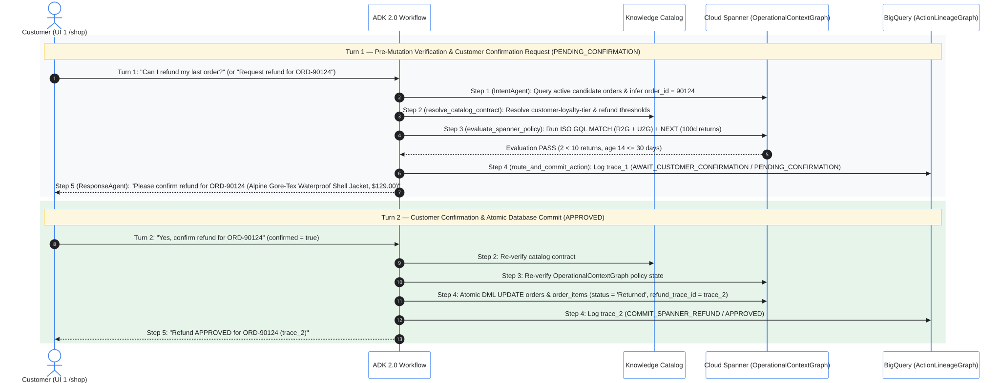

# Dual-Graph System of Action: Autonomous Refund Agent Lab Guide

In this hands-on lab, you explore and verify a **Dual-Graph System of Action**
on Google Cloud using **Google Agent Development Kit 2.0 (ADK 2.0)**, **Cloud
Spanner Graph**, **BigQuery Graph**, **Cloud Spanner Data Boost**, and
**Knowledge Catalog**.

## Lab overview and objectives

Traditional AI customer-support chatbots struggle to execute enterprise actions
safely because they lack two structural guarantees:

- **Deterministic pre-action operational context:** Evaluating whether an order
  qualifies for an autonomous refund requires traversing live relational order
  history alongside multi-tier policy rules before mutating transactional state.
- **Immutable post-action lineage:** Auditing why an autonomous agent approved
  or blocked a transaction requires a tamper-evident analytical graph recording
  every workflow node, catalog contract, policy evaluation, and database action.

During this lab, you complete five hands-on activities across the lab web
interfaces and the **Google Cloud Console** (**Cloud Spanner Studio**,
**BigQuery Studio**, and **Knowledge Catalog**):

1.  **Google Cloud Console Verification (Proving Real Database State):** Inspect
    the live `OperationalContextGraph` property graph in **Cloud Spanner
    Studio**, the `ActionLineageGraph` property graph in **BigQuery Studio**,
    and the governed metric contracts in **Knowledge Catalog** to
    confirm that the application reads and writes live Google Cloud databases.
1.  **Activity 1 (Standard Tier Approval and 2-Turn Confirmation):** Submit an
    eligible refund request as **Customer A (`user_id: 1001`, `STANDARD` tier)**
    for order `ORD-90124` (or ask in natural language, `"Can I refund my last
    order?"`), observe how the agent pauses at `PENDING_CONFIRMATION` before
    mutating **Cloud Spanner**, confirm the order and item details to commit the
    `APPROVED` mutation, and inspect the trace in **UI 2 (`/console`)** and
    **Cloud Spanner Studio**.
1.  **Activity 2 (Standard Tier Policy Denial):** Submit a refund request as
    **Customer B (`user_id: 2048`, `STANDARD` tier)** for order `ORD-90588`
    (`12 >= 10` returns in the last 100 days) and verify how the deterministic
    policy gate blocks the Cloud Spanner mutation (`BLOCK_SPANNER_MUTATION`).
1.  **Activity 3 (VIP Tier Policy Resolution via Knowledge Catalog):** Submit a
    refund request as **Customer C (`user_id: 3072`, `VIP` tier)** for order
    `ORD-90910` (`12 < 20` returns in the last 100 days) and verify how the
    workflow resolves `customer-loyalty-tier` (`VIP`) from **Knowledge
    Catalog** and matches `COND-REFUND-VIP-100D-30D` (`max_refunds_100d = 20`).
1.  **Activity 4 (Cross-Engine Federated Audit):** Execute a BigQuery
    `EXTERNAL_QUERY` over the **Cloud Spanner Data Boost** connection
    (`spanner-data-boost`) in **UI 2 (`/console`)** and **BigQuery Studio**,
    joining live Cloud Spanner operational graph state with BigQuery
    `soa_action_lineage` records.

## How the Dual-Graph System of Action works behind the UI

### Google Cloud components and responsibilities

The following table summarizes which Google Cloud component, property graph, and
policy artifact executes at each layer of the architecture:

| Layer | Google Cloud component | Resource or graph name | Role in the System of Action |
| :--- | :--- | :--- | :--- |
| **Agent orchestration** | Google ADK 2.0 on Cloud Run + Vertex AI (`gemini-3-flash-preview`) | `soa-refund-agent-app` (`RefundSystemOfActionWorkflow`) | Executes the 5-step deterministic + LLM workflow (`IntentAgent` and `ResponseAgent` configured with `ADK_MODEL_NAME = "gemini-3-flash-preview"`, `ThinkingLevel.MINIMAL`, a 4-second single-attempt timeout, single-LLM-call quota optimization on explicit `ORD-<id>` prompt chips, and deterministic fallbacks), streams live `[1/5]..[5/5]` step telemetry (`POST /api/chat/refund/stream`), resolves multi-turn order references and unpurchased products (`unmatched_product`), and enforces the 2-turn customer confirmation gate. |
| **Semantic governance** | Knowledge Catalog (Business Glossary and Aspect Types) | `soa-business-glossary`, `refund-metric-contract` | Governs canonical business terms (`rolling-100d-refund-count`, `order-age-days`, `customer-loyalty-tier`) and attaches machine-readable threshold contracts (`STANDARD` = 10, `VIP` = 20, `return_window_days` = 30). |
| **Operational context graph (Graph 1)** | Cloud Spanner Enterprise (Spanner Graph) | Instance: `soa-graph-instance`, Database: `thelook-soa-db`, Graph: `OperationalContextGraph` | Combines **Relational-to-Graph (R2G)** e-commerce tables (`users`, `orders`, `order_items`, `inventory_items`, `products`, `distribution_centers`) with **Unstructured-to-Graph (U2G)** policy tables (`policies`, `policy_conditions`, `policy_restrictions`) in ISO GQL. |
| **Action lineage graph (Graph 2)** | BigQuery (BigQuery Graph) | Dataset: `soa_action_lineage`, Graph: `ActionLineageGraph` | Stores append-only audit records (`agent_sessions`, `workflow_nodes`, `policy_evaluations`, `agent_actions`) modeling every workflow execution and policy decision. |
| **Cross-engine federation** | BigQuery Cloud Spanner external connection + Spanner Data Boost | Connection: `spanner-data-boost` (`use_data_boost = true`, `use_parallelism = true`) | Pushes read-only ISO GQL queries from BigQuery `EXTERNAL_QUERY` to isolated Spanner Data Boost compute without impacting transactional Cloud Spanner CPU. |

### Dual-Graph architecture and 5-step ADK 2.0 workflow

The diagram below illustrates how **UI 1 (`/shop`)** and **UI 2 (`/console`)**
interact with the 5-step ADK 2.0 workflow, **Knowledge Catalog**,
**Cloud Spanner `OperationalContextGraph`**, and **BigQuery
`ActionLineageGraph`**:

<!-- markdownlint-disable MD013 -->
<!-- MERMAID-DIAGRAM-START
%%{init: {"flowchart": {"nodeSpacing": 28, "rankSpacing": 65, "curve": "basis", "wrappingWidth": 460}}}%%
flowchart LR
  subgraph Col1 ["1. Customer Storefront & Chat (Cloud Run)"]
    Shop["<div style='display:flex;align-items:center;gap:12px;text-align:left;padding:6px 14px 6px 8px;'><div style='width:40px;max-width:40px;flex-shrink:0;'></div><div style='line-height:1.35;white-space:nowrap;'><b style='font-size:14px;color:#202124;'>UI 1: TheLook Shopping Mall &amp; Chat (/shop)</b><br/><span style='font-size:11px;color:#5F6368;'>Persona Switcher, Order Cards &amp; 2-Turn Confirmation</span><br/><span style='font-size:10px;color:#1A73E8;font-weight:600;'>Persists Chat History Across UI 1 ↔ UI 2 Navigation</span></div></div>"]
  end

  subgraph Col2 ["2. ADK 2.0 Refund Agent Workflow (Sequential Step 1 → Step 5 Pipeline)"]
    N1["<div style='display:flex;align-items:center;gap:12px;text-align:left;padding:6px 14px 6px 8px;'><div style='width:40px;max-width:40px;flex-shrink:0;'></div><div style='line-height:1.35;white-space:nowrap;'><b style='font-size:14px;color:#202124;'>Step 1: IntentAgent (gemini-3-flash-preview)</b><br/><span style='font-size:11px;color:#5F6368;'>Classifies Intent, Status Filter &amp; Infers Target Order ID</span></div></div>"]
    N2["<div style='display:flex;align-items:center;gap:12px;text-align:left;padding:6px 14px 6px 8px;'><div style='width:40px;max-width:40px;flex-shrink:0;'></div><div style='line-height:1.35;white-space:nowrap;'><b style='font-size:14px;color:#202124;'>Step 2: resolve_catalog_contract</b><br/><span style='font-size:11px;color:#5F6368;'>Binds Governed Metric Rules (No LLM Math Guessing)</span></div></div>"]
    N3["<div style='display:flex;align-items:center;gap:12px;text-align:left;padding:6px 14px 6px 8px;'><div style='width:40px;max-width:40px;flex-shrink:0;'></div><div style='line-height:1.35;white-space:nowrap;'><b style='font-size:14px;color:#202124;'>Step 3: evaluate_spanner_policy</b><br/><span style='font-size:11px;color:#5F6368;'>Deterministic ISO GQL Policy Evaluation (PASS / FAIL Gate)</span></div></div>"]
    N4["<div style='display:flex;align-items:center;gap:12px;text-align:left;padding:6px 14px 6px 8px;'><div style='width:40px;max-width:40px;flex-shrink:0;'></div><div style='line-height:1.35;white-space:nowrap;'><b style='font-size:14px;color:#202124;'>Step 4: route_and_commit_action</b><br/><span style='font-size:11px;color:#5F6368;'>2-Turn Confirmation Gate + Spanner ACID DML + Audit Lineage</span></div></div>"]
    N5["<div style='display:flex;align-items:center;gap:12px;text-align:left;padding:6px 14px 6px 8px;'><div style='width:40px;max-width:40px;flex-shrink:0;'></div><div style='line-height:1.35;white-space:nowrap;'><b style='font-size:14px;color:#202124;'>Step 5: ResponseAgent (gemini-3-flash-preview)</b><br/><span style='font-size:11px;color:#5F6368;'>Synthesizes Reply Strictly from Verified Graph Facts</span></div></div>"]
  end

  subgraph Pillar1 ["3A. Pillar 1: Zero AI Hallucination (Deterministic Governance & Operational Context Graph)"]
    Glossary["<div style='display:flex;align-items:center;gap:12px;text-align:left;padding:6px 14px 6px 8px;'><div style='width:40px;max-width:40px;flex-shrink:0;'></div><div style='line-height:1.35;white-space:nowrap;'><b style='font-size:14px;color:#202124;'>Knowledge Catalog: Business Glossary &amp; Aspects</b><br/><span style='font-size:11px;color:#5F6368;'>soa-business-glossary | refund-metric-contract (STD=10, VIP=20, 30d)</span><br/><span style='font-size:10px;color:#137333;font-weight:600;'>Eliminates Metric Drift: Machine-Readable Thresholds</span></div></div>"]
    U2G["<div style='display:flex;align-items:center;gap:12px;text-align:left;padding:6px 14px 6px 8px;'><div style='width:40px;max-width:40px;flex-shrink:0;'></div><div style='line-height:1.35;white-space:nowrap;'><b style='font-size:14px;color:#202124;'>Cloud Spanner Graph: U2G Policy Nodes</b><br/><span style='font-size:11px;color:#5F6368;'>OperationalContextGraph: policies, policy_conditions, policy_restrictions</span><br/><span style='font-size:10px;color:#137333;font-weight:600;'>Eliminates Vector RAG Hallucination: Exact Tier Policy Graph</span></div></div>"]
    R2G["<div style='display:flex;align-items:center;gap:12px;text-align:left;padding:6px 14px 6px 8px;'><div style='width:40px;max-width:40px;flex-shrink:0;'></div><div style='line-height:1.35;white-space:nowrap;'><b style='font-size:14px;color:#202124;'>Cloud Spanner Graph: R2G Operational Nodes</b><br/><span style='font-size:11px;color:#5F6368;'>OperationalContextGraph: users, orders, order_items, products, centers</span><br/><span style='font-size:10px;color:#137333;font-weight:600;'>SERIALIZABLE ACID DML + refund_trace_id Reconciliation Key</span></div></div>"]
  end

  subgraph Pillar2 ["3B. Pillar 2: Immutable Action Lineage (Append-Only Audit Graph in BigQuery)"]
    Lineage["<div style='display:flex;align-items:center;gap:12px;text-align:left;padding:6px 14px 6px 8px;'><div style='width:40px;max-width:40px;flex-shrink:0;'></div><div style='line-height:1.35;white-space:nowrap;'><b style='font-size:14px;color:#202124;'>BigQuery Graph: ActionLineageGraph (Append-Only)</b><br/><span style='font-size:11px;color:#5F6368;'>AgentSession → WorkflowNode → PolicyEvaluation → AgentAction</span><br/><span style='font-size:10px;color:#B06000;font-weight:600;'>Tamper-Evident Audit Log Saved on Turn 1 &amp; Turn 2</span></div></div>"]
  end

  subgraph Col4 ["4. Data Engineer Audit & Zero-Impact Federation"]
    Console["<div style='display:flex;align-items:center;gap:12px;text-align:left;padding:6px 14px 6px 8px;'><div style='width:40px;max-width:40px;flex-shrink:0;'></div><div style='line-height:1.35;white-space:nowrap;'><b style='font-size:14px;color:#202124;'>UI 2: Data Engineer Investigation Console (/console)</b><br/><span style='font-size:11px;color:#5F6368;'>Live Trace Feed, Dual-Graph Visualizer &amp; 3-Tab ISO GQL Workbench</span></div></div>"]
    DataBoost["<div style='display:flex;align-items:center;gap:12px;text-align:left;padding:6px 14px 6px 8px;'><div style='width:40px;max-width:40px;flex-shrink:0;'></div><div style='line-height:1.35;white-space:nowrap;'><b style='font-size:14px;color:#202124;'>Spanner Data Boost Federated Audit</b><br/><span style='font-size:11px;color:#5F6368;'>EXTERNAL_QUERY (spanner-data-boost) Cross-Engine Join</span><br/><span style='font-size:10px;color:#1A73E8;font-weight:600;'>Zero OLTP CPU Impact: Joins Live Spanner + BigQuery Lineage</span></div></div>"]
  end

  Shop --&gt;|"1. POST /api/chat/refund/stream"| N1
  Shop -.-&gt; N2
  Shop -.-&gt; N3
  Shop -.-&gt; N4
  Shop <--&gt;|"5. Grounded Verdict + Synced Order Cards"| N5

  N2 --&gt;|"2. Fetch Governed Thresholds"| Glossary
  N3 --&gt;|"3a. Match Tier Policy ([:governed_by])"| U2G
  N3 --&gt;|"3b. ISO GQL MATCH + NEXT (100d Returns)"| R2G
  N4 --&gt;|"4a. Turn 2 Confirmed: ACID DML (status='Returned')"| R2G
  N4 --&gt;|"4b. Turn 1 &amp; 2: Append Immutable Audit Rows"| Lineage

  Glossary --&gt;|"Contract Inspector"| Console
  U2G --&gt;|"U2G Triples Inspector"| Console
  R2G --&gt;|"Tab 1: Snapshot ISO GQL"| Console
  R2G --&gt;|"Live Order State"| DataBoost
  Lineage --&gt;|"Tab 2 &amp; 3: Immutable Lineage GQL"| DataBoost

  linkStyle 1,2,3 stroke:none,fill:none

  style Col1 fill:#E8F0FE,stroke:#4285F4,color:#202124,stroke-width:1.5px,rx:10px,ry:10px
  style Col2 fill:#F8F9FA,stroke:#DADCE0,color:#202124,stroke-width:1.5px,rx:10px,ry:10px
  style Pillar1 fill:#E6F4EA,stroke:#34A853,color:#202124,stroke-width:1.5px,rx:10px,ry:10px
  style Pillar2 fill:#FEF7E0,stroke:#FBBC04,color:#202124,stroke-width:1.5px,rx:10px,ry:10px
  style Col4 fill:#E8F0FE,stroke:#4285F4,color:#202124,stroke-width:1.5px,rx:10px,ry:10px

  style Shop fill:#FFFFFF,stroke:#4285F4,color:#202124,stroke-width:2px,rx:8px,ry:8px
  style Console fill:#FFFFFF,stroke:#4285F4,color:#202124,stroke-width:2px,rx:8px,ry:8px
  style DataBoost fill:#FFFFFF,stroke:#34A853,color:#202124,stroke-width:2px,rx:8px,ry:8px
  style N1 fill:#FFFFFF,stroke:#EA4335,color:#202124,stroke-width:2px,rx:8px,ry:8px
  style N2 fill:#FFFFFF,stroke:#FBBC04,color:#202124,stroke-width:2px,rx:8px,ry:8px
  style N3 fill:#FFFFFF,stroke:#34A853,color:#202124,stroke-width:2px,rx:8px,ry:8px
  style N4 fill:#FFFFFF,stroke:#EA4335,color:#202124,stroke-width:2px,rx:8px,ry:8px
  style N5 fill:#FFFFFF,stroke:#EA4335,color:#202124,stroke-width:2px,rx:8px,ry:8px
  style Glossary fill:#FFFFFF,stroke:#FBBC04,color:#202124,stroke-width:2px,rx:8px,ry:8px
  style U2G fill:#FFFFFF,stroke:#FBBC04,color:#202124,stroke-width:2px,rx:8px,ry:8px
  style R2G fill:#FFFFFF,stroke:#34A853,color:#202124,stroke-width:2px,rx:8px,ry:8px
  style Lineage fill:#FFFFFF,stroke:#FBBC04,color:#202124,stroke-width:2px,rx:8px,ry:8px
MERMAID-DIAGRAM-SOURCE -->


<!-- MERMAID-DIAGRAM-END -->
<!-- markdownlint-enable MD013 -->

### Two-turn confirmation sequence (`PENDING_CONFIRMATION` to `APPROVED` or `DENIED`)

Whenever a valid customer order is resolved (`order_id is not None` and
`order_found == True`), the agent pauses for a two-turn verification protocol so
the customer confirms the resolved order ID, product photo, item name, and price
before committing the Cloud Spanner transaction or issuing the final refund
verdict:

<!-- markdownlint-disable MD013 -->
<!-- MERMAID-DIAGRAM-START
%%{init: {"theme": "base", "themeVariables": {"actorBkg": "#FFFFFF", "actorBorder": "#4285F4", "actorTextColor": "#202124", "signalColor": "#202124", "signalTextColor": "#202124", "labelBoxBkgColor": "#F8F9FA", "labelBoxBorderColor": "#DADCE0", "noteBkgColor": "#FEF7E0", "noteBorderColor": "#FBBC04", "noteTextColor": "#202124"}}}%%
sequenceDiagram
  autonumber
  actor Customer as Customer (UI 1 /shop)
  participant ADK as ADK 2.0 Workflow
  participant Catalog as Knowledge Catalog
  participant Spanner as Cloud Spanner (OperationalContextGraph)
  participant BQ as BigQuery (ActionLineageGraph)

  rect rgb(248, 249, 250)
    Note over Customer,BQ: Turn 1 — Pre-Mutation Verification & Customer Confirmation Request (PENDING_CONFIRMATION)
    Customer-&gt;>ADK: Turn 1: "Can I refund my last order?" (or "Request refund for ORD-90124")
    ADK-&gt;>Spanner: Step 1 (IntentAgent): Query active candidate orders & infer order_id = 90124
    ADK-&gt;>Catalog: Step 2 (resolve_catalog_contract): Resolve customer-loyalty-tier & refund thresholds
    ADK-&gt;>Spanner: Step 3 (evaluate_spanner_policy): Run ISO GQL MATCH (R2G + U2G) + NEXT (100d returns)
    Spanner--&gt;>ADK: Evaluation PASS (2 < 10 returns, age 14 <= 30 days)
    ADK-&gt;>BQ: Step 4 (route_and_commit_action): Log trace_1 (AWAIT_CUSTOMER_CONFIRMATION / PENDING_CONFIRMATION)
    ADK--&gt;>Customer: Step 5 (ResponseAgent): "Please confirm refund for ORD-90124 (Alpine Gore-Tex Waterproof Shell Jacket, $129.00)"
  end

  rect rgb(230, 244, 234)
    Note over Customer,BQ: Turn 2 — Customer Confirmation & Atomic Database Commit (APPROVED)
    Customer-&gt;>ADK: Turn 2: "Yes, confirm refund for ORD-90124" (confirmed = true)
    ADK-&gt;>Catalog: Step 2: Re-verify catalog contract
    ADK-&gt;>Spanner: Step 3: Re-verify OperationalContextGraph policy state
    ADK-&gt;>Spanner: Step 4: Atomic DML UPDATE orders & order_items (status = 'Returned', refund_trace_id = trace_2)
    ADK-&gt;>BQ: Step 4: Log trace_2 (COMMIT_SPANNER_REFUND / APPROVED)
    ADK--&gt;>Customer: Step 5: "Refund APPROVED for ORD-90124 (trace_2)"
  end
MERMAID-DIAGRAM-SOURCE -->


<!-- MERMAID-DIAGRAM-END -->
<!-- markdownlint-enable MD013 -->

### Property graph node and edge schemas

Both graphs share a durable cross-graph reconciliation identifier
(`order_items.refund_trace_id` in Cloud Spanner and `agent_sessions.trace_id` in
BigQuery):

<!-- markdownlint-disable MD013 -->
<!-- MERMAID-DIAGRAM-START
%%{init: {"flowchart": {"nodeSpacing": 35, "rankSpacing": 45, "wrappingWidth": 420}}}%%
flowchart LR
  subgraph SpannerGraph ["Cloud Spanner: OperationalContextGraph"]
    U["<div style='display:flex;align-items:center;gap:12px;text-align:left;padding:6px 14px 6px 8px;'><div style='width:40px;max-width:40px;flex-shrink:0;'></div><div style='line-height:1.35;white-space:nowrap;'><b style='font-size:14px;color:#202124;'>users</b><br/><span style='font-size:11px;color:#5F6368;'>id, email, customer_tier</span></div></div>"]
    O["<div style='display:flex;align-items:center;gap:12px;text-align:left;padding:6px 14px 6px 8px;'><div style='width:40px;max-width:40px;flex-shrink:0;'></div><div style='line-height:1.35;white-space:nowrap;'><b style='font-size:14px;color:#202124;'>orders</b><br/><span style='font-size:11px;color:#5F6368;'>order_id, status, delivered_at</span></div></div>"]
    II["<div style='display:flex;align-items:center;gap:12px;text-align:left;padding:6px 14px 6px 8px;'><div style='width:40px;max-width:40px;flex-shrink:0;'></div><div style='line-height:1.35;white-space:nowrap;'><b style='font-size:14px;color:#202124;'>inventory_items</b><br/><span style='font-size:11px;color:#5F6368;'>id, product_id</span></div></div>"]
    P["<div style='display:flex;align-items:center;gap:12px;text-align:left;padding:6px 14px 6px 8px;'><div style='width:40px;max-width:40px;flex-shrink:0;'></div><div style='line-height:1.35;white-space:nowrap;'><b style='font-size:14px;color:#202124;'>products</b><br/><span style='font-size:11px;color:#5F6368;'>id, name, category</span></div></div>"]
    DC["<div style='display:flex;align-items:center;gap:12px;text-align:left;padding:6px 14px 6px 8px;'><div style='width:40px;max-width:40px;flex-shrink:0;'></div><div style='line-height:1.35;white-space:nowrap;'><b style='font-size:14px;color:#202124;'>distribution_centers</b><br/><span style='font-size:11px;color:#5F6368;'>id, name</span></div></div>"]
    POL["<div style='display:flex;align-items:center;gap:12px;text-align:left;padding:6px 14px 6px 8px;'><div style='width:40px;max-width:40px;flex-shrink:0;'></div><div style='line-height:1.35;white-space:nowrap;'><b style='font-size:14px;color:#202124;'>policies</b><br/><span style='font-size:11px;color:#5F6368;'>POL-REFUND-STD-V1</span></div></div>"]
    COND["<div style='display:flex;align-items:center;gap:12px;text-align:left;padding:6px 14px 6px 8px;'><div style='width:40px;max-width:40px;flex-shrink:0;'></div><div style='line-height:1.35;white-space:nowrap;'><b style='font-size:14px;color:#202124;'>policy_conditions</b><br/><span style='font-size:11px;color:#5F6368;'>STD: max 10, VIP: max 20 (30d window)</span></div></div>"]
    RES["<div style='display:flex;align-items:center;gap:12px;text-align:left;padding:6px 14px 6px 8px;'><div style='width:40px;max-width:40px;flex-shrink:0;'></div><div style='line-height:1.35;white-space:nowrap;'><b style='font-size:14px;color:#202124;'>policy_restrictions</b><br/><span style='font-size:11px;color:#5F6368;'>DENY_AUTONOMOUS_REFUND</span></div></div>"]

    U --&gt;|"[:places]"| O
    O --&gt;|"[:contains_item (order_items.refund_trace_id)]"| II
    II --&gt;|"[:is_product]"| P
    P --&gt;|"[:supplied_by]"| DC
    P --&gt;|"[:governed_by]"| POL
    POL --&gt;|"[:requires_condition]"| COND
    POL --&gt;|"[:enforces_restriction]"| RES
  end

  subgraph BQGraph ["BigQuery: ActionLineageGraph"]
    S["<div style='display:flex;align-items:center;gap:12px;text-align:left;padding:6px 14px 6px 8px;'><div style='width:40px;max-width:40px;flex-shrink:0;'></div><div style='line-height:1.35;white-space:nowrap;'><b style='font-size:14px;color:#202124;'>AgentSession</b><br/><span style='font-size:11px;color:#5F6368;'>trace_id, customer_id, target_order_id</span></div></div>"]
    WN["<div style='display:flex;align-items:center;gap:12px;text-align:left;padding:6px 14px 6px 8px;'><div style='width:40px;max-width:40px;flex-shrink:0;'></div><div style='line-height:1.35;white-space:nowrap;'><b style='font-size:14px;color:#202124;'>WorkflowNode</b><br/><span style='font-size:11px;color:#5F6368;'>node_exec_id, node_name</span></div></div>"]
    PE["<div style='display:flex;align-items:center;gap:12px;text-align:left;padding:6px 14px 6px 8px;'><div style='width:40px;max-width:40px;flex-shrink:0;'></div><div style='line-height:1.35;white-space:nowrap;'><b style='font-size:14px;color:#202124;'>PolicyEvaluation</b><br/><span style='font-size:11px;color:#5F6368;'>eval_id, catalog_term_id, evaluation_result</span></div></div>"]
    ACT["<div style='display:flex;align-items:center;gap:12px;text-align:left;padding:6px 14px 6px 8px;'><div style='width:40px;max-width:40px;flex-shrink:0;'></div><div style='line-height:1.35;white-space:nowrap;'><b style='font-size:14px;color:#202124;'>AgentAction</b><br/><span style='font-size:11px;color:#5F6368;'>action_id, action_type, decision_status</span></div></div>"]

    S --&gt;|"[:executed_node]"| WN
    WN --&gt;|"[:evaluated_policy]"| PE
    PE --&gt;|"[:triggered_action]"| ACT
  end

  O -.-&gt;|"Reconciled via refund_trace_id = trace_id (Spanner Data Boost)"| S

  style SpannerGraph fill:#F8F9FA,stroke:#DADCE0,color:#202124,stroke-width:1.5px,rx:10px,ry:10px
  style BQGraph fill:#F8F9FA,stroke:#DADCE0,color:#202124,stroke-width:1.5px,rx:10px,ry:10px

  style U fill:#FFFFFF,stroke:#4285F4,color:#202124,stroke-width:2px,rx:8px,ry:8px
  style O fill:#FFFFFF,stroke:#34A853,color:#202124,stroke-width:2px,rx:8px,ry:8px
  style II fill:#FFFFFF,stroke:#34A853,color:#202124,stroke-width:2px,rx:8px,ry:8px
  style P fill:#FFFFFF,stroke:#34A853,color:#202124,stroke-width:2px,rx:8px,ry:8px
  style DC fill:#FFFFFF,stroke:#34A853,color:#202124,stroke-width:2px,rx:8px,ry:8px
  style POL fill:#FFFFFF,stroke:#FBBC04,color:#202124,stroke-width:2px,rx:8px,ry:8px
  style COND fill:#FFFFFF,stroke:#FBBC04,color:#202124,stroke-width:2px,rx:8px,ry:8px
  style RES fill:#FFFFFF,stroke:#EA4335,color:#202124,stroke-width:2px,rx:8px,ry:8px
  style S fill:#FFFFFF,stroke:#34A853,color:#202124,stroke-width:2px,rx:8px,ry:8px
  style WN fill:#FFFFFF,stroke:#34A853,color:#202124,stroke-width:2px,rx:8px,ry:8px
  style PE fill:#FFFFFF,stroke:#FBBC04,color:#202124,stroke-width:2px,rx:8px,ry:8px
  style ACT fill:#FFFFFF,stroke:#EA4335,color:#202124,stroke-width:2px,rx:8px,ry:8px
MERMAID-DIAGRAM-SOURCE -->


<!-- MERMAID-DIAGRAM-END -->
<!-- markdownlint-enable MD013 -->

### Reference summary of demo personas, orders, and policies

| Persona | `user_id` | Loyalty tier | Order ID | Order status & delivery age | 100-day prior returns | Matched policy condition | Expected workflow outcome |
| :--- | :--- | :--- | :--- | :--- | :--- | :--- | :--- |
| **Customer A (Alice Chen)** | `1001` | `STANDARD` | `ORD-90124` | `Complete` (14 days ago) | `2` items | `COND-REFUND-STD-100D-30D` (`max_refunds_100d = 10`, `window = 30d`) | Turn 1: `PENDING_CONFIRMATION`, Turn 2: `APPROVED` (`COMMIT_SPANNER_REFUND`) |
| **Customer A (Alice Chen)** | `1001` | `STANDARD` | `ORD-90125` | `Complete` (45 days ago) | `2` items | `COND-REFUND-STD-100D-30D` (`window = 30d`) | Turn 1: `PENDING_CONFIRMATION`, Turn 2: `DENIED` (`RETURN_WINDOW_EXPIRED`) |
| **Customer A (Alice Chen)** | `1001` | `STANDARD` | `ORD-90126` | `Shipped` (in transit) | `2` items | `COND-REFUND-STD-100D-30D` (requires `Complete`) | Turn 1: `PENDING_CONFIRMATION`, Turn 2: `DENIED` (`ORDER_NOT_DELIVERED`) |
| **Customer B (Jordan Taylor)** | `2048` | `STANDARD` | `ORD-90588` | `Complete` (10 days ago) | `12` items | `COND-REFUND-STD-100D-30D` (`max_refunds_100d = 10`) | Turn 1: `PENDING_CONFIRMATION`, Turn 2: `DENIED` (`MAX_REFUNDS_EXCEEDED`, `BLOCK_SPANNER_MUTATION`) |
| **Customer C (Claire Vance)** | `3072` | `VIP` | `ORD-90910` | `Complete` (7 days ago) | `12` items | `COND-REFUND-VIP-100D-30D` (`max_refunds_100d = 20`, `window = 30d`) | Turn 1: `PENDING_CONFIRMATION`, Turn 2: `APPROVED` (`COMMIT_SPANNER_REFUND`) |

## Step 1: Open the lab web interfaces and Google Cloud Console

1.  Locate the Terraform outputs in your Qwiklabs environment panel:
    - **`shopping_mall_url`:** Opens **UI 1 (`TheLook Shopping Mall and Chat
      App`, `/shop`)**.
    - **`data_engineer_console_url`:** Opens **UI 2 (`Data Engineer
      Investigation Console`, `/console`)**.
    - **`gcp_project_id`:** Your Google Cloud project ID.
1.  Open both `shopping_mall_url` and `data_engineer_console_url` in separate
    browser tabs.
1.  Open the **Google Cloud Console** (`https://console.cloud.google.com`) in a
    third browser tab using your Qwiklabs student credentials and ensure your
    lab project (`gcp_project_id`) is selected.

## Step 2: Inspect the underlying databases in the Google Cloud Console

Before triggering any agent actions in the web UI, inspect the underlying
databases and catalog resources directly in the **Google Cloud Console** to see
how the graph schemas, relational tables, and governance contracts are stored.

### 2a. Inspect governed business terms in Knowledge Catalog

1.  In the Google Cloud Console search bar, search for **Knowledge Catalog** and
    open the service, then select **Glossaries** in the left navigation menu.
1.  Click **System of Action Business Glossary** (`soa-business-glossary` in
    location `us`).
1.  Observe the category **Refund Policy Metrics** (`refund-policy-metrics`) and
    click each of the three governed business glossary terms:
    - **`100-Day Rolling Refund Count` (`rolling-100d-refund-count`):** Defines
      how Step 3 counts returned `order_items` (`status = 'Returned'`) over the
      trailing 100 days excluding the target order.
    - **`Order Delivery Age in Days` (`order-age-days`):** Defines the 30-day
      post-delivery eligibility window (`status = 'Complete'` and `age <= 30`).
    - **`Customer Loyalty Tier` (`customer-loyalty-tier`):** Defines the tier
      routing contract (`STANDARD` vs. `VIP`).
1.  In the left navigation menu of **Knowledge Catalog**, click **Aspect Types**
    (or view the **Aspects** tab on any of the three glossary terms) to inspect
    the custom **`Refund Policy Metric Contract` (`refund-metric-contract`)**
    aspect attached to each glossary entry (`standard_max_refunds_100d = 10`,
    `vip_max_refunds_100d = 20`, `return_window_days = 30`). During Step 2 of
    the ADK workflow (`resolve_catalog_contract`), the agent queries these live
    Knowledge Catalog entries via the Catalog API.

### 2b. Query OperationalContextGraph in Cloud Spanner Studio

1.  In the Google Cloud Console navigation menu, go to **Spanner** >
    **Instances**.
1.  Click **System of Action Graph Instance** (`soa-graph-instance`), then click
    the database **`thelook-soa-db`**.
1.  In the left navigation menu of `thelook-soa-db`, click **Spanner Studio** and
    review the database objects in the **Explorer** sidebar:
    - **Tables:** Inspect the 6 Relational-to-Graph (R2G) tables (`users`,
      `orders`, `order_items`, `inventory_items`, `products`,
      `distribution_centers`) and the 3 Unstructured-to-Graph (U2G) policy
      tables (`policies`, `policy_conditions`, `policy_restrictions`).
    - **Graphs:** Expand the **`Graphs`** tree item in the sidebar to find
      **`OperationalContextGraph`**. Click the three-dots (**View actions**)
      menu next to **`OperationalContextGraph`** and select **`View/modify
      visually`** to inspect the visualized graph schema mapping the node tables
      (`users`, `orders`, `inventory_items`, `products`, `distribution_centers`,
      `policies`, `policy_conditions`, `policy_restrictions`) and edge tables
      (`places`, `contains_item`, `is_product`, `supplied_by`, `governed_by`,
      `requires_condition`, `enforces_restriction`).
1.  In **Spanner Studio**, open a new SQL/GQL editor tab and run the following
    native ISO GQL query to visualize the live property graph data in the Google
    Cloud Console:

    ```sql
    -- Purpose: Visualize the live R2G + U2G property graph topology in Spanner Studio.
    -- Target Engine: Cloud Spanner (thelook-soa-db -> OperationalContextGraph).
    -- How It Works: Traverses from users -> orders -> inventory_items -> products
    --   -> distribution_centers and links products to active policies, tier-matched
    --   policy_conditions, and policy_restrictions, returning JSON graph elements.
    -- Information Gathered: Full node/edge JSON objects to render the interactive
    --   property graph in Cloud Spanner Studio (Graph and Table views).
    GRAPH OperationalContextGraph
    MATCH (u:users)-[e_places:places]->(o:orders {order_id: 90124})
            -[e_item:contains_item]->(ii:inventory_items)
            -[e_prod:is_product]->(p:products)
            -[e_dc:supplied_by]->(dc:distribution_centers),
          (p)-[e_gov:governed_by]->(pol:policies {status: 'ACTIVE'})
            -[e_cond:requires_condition]->(cond:policy_conditions),
          (pol)-[e_res:enforces_restriction]->(res:policy_restrictions)
    WHERE cond.applicable_tier = u.customer_tier
    RETURN
      TO_JSON(u) AS user_node,
      TO_JSON(e_places) AS places_edge,
      TO_JSON(o) AS order_node,
      TO_JSON(e_item) AS contains_item_edge,
      TO_JSON(ii) AS inventory_node,
      TO_JSON(p) AS product_node,
      TO_JSON(dc) AS dc_node,
      TO_JSON(pol) AS policy_node,
      TO_JSON(cond) AS condition_node,
      TO_JSON(res) AS restriction_node;
    ```

1.  In the **Spanner Studio** results pane, toggle between the **Graph** view
    (where you can click and drag the Cloud Spanner nodes and edges) and the
    **Table** view. Notice that `o.status` is currently `'Complete'` and
    `e_item.refund_trace_id` is `NULL`.

### 2c. Inspect ActionLineageGraph in BigQuery Studio

1.  In the Google Cloud Console navigation menu, go to **BigQuery** >
    **Studio**.
1.  In the **Explorer** pane, expand your project and expand the dataset
    **`soa_action_lineage`**.
1.  Observe the four lineage tables (`agent_sessions`, `workflow_nodes`,
    `policy_evaluations`, `agent_actions`) and the property graph
    **`ActionLineageGraph`**, as well as the external connection
    **`us-central1.spanner-data-boost`** under **External connections**.

## Step 3: Activity 1: Customer A eligible refund and 2-turn confirmation (`STANDARD` tier)

In this activity, you act as **Customer A (`Alice Chen`, `user_id: 1001`,
`STANDARD` tier)** in **UI 1 (`/shop`)** to test both contextual order inference
and the 2-turn pre-execution confirmation gate, then verify the live database
changes in **Cloud Spanner Studio**, **BigQuery Studio**, and **UI 2
(`/console`)**.

### 3a. Trigger Turn 1 (`PENDING_CONFIRMATION`) in UI 1

1.  In **UI 1 (`/shop`)**, ensure **Alice Chen (`user_id: 1001`, `STANDARD`
    tier)** is selected in the **Active Customer Persona Switcher**.
1.  Review Alice Chen's orders in the main panel:
    - `ORD-90124`: **Alpine Gore-Tex Waterproof Shell Jacket** (`$129.00`),
      status `Complete`, delivered 14 days ago.
    - `ORD-90125`: **Polarized Aviator Titanium Sunglasses** (`$165.00`), status
      `Complete`, delivered 45 days ago.
    - `ORD-90126`: **Cashmere Ribbed Winter Beanie** (`$58.00`), status
      `Shipped` (in transit).
1.  In the **ADK 2.0 Refund Agent** chat widget on the right, either click the
    **Request refund for ORD-90124 (Eligible Standard)** prompt chip or type a
    natural-language request without an order number:

    ```text
    Can I refund my last order?
    ```

1.  Observe what happens behind the UI during **Turn 1** as the chat widget
    streams live `[1/5]..[5/5]` per-node execution progress (`POST
    /api/chat/refund/stream`) and automatically restores keyboard focus to the
    chat input:
    - **Step 1 (`IntentAgent`):** Queries Alice's active non-returned orders in
      Cloud Spanner. When an explicit `ORD-90124` order ID is present (such as
      clicking the prompt chip), Step 1 resolves `order_id = 90124` directly and
      saves Vertex AI quota for Step 5. When a natural-language request like
      `"Can I refund my last order?"` is typed, Step 1 invokes
      `gemini-3-flash-preview` (`ThinkingLevel.MINIMAL`, 4-second timeout with
      deterministic fallback) to infer `order_id = 90124`
      (`resolution_mode = 'inferred'`), the most recently delivered `Complete`
      order.
    - **Step 2 (`resolve_catalog_contract`):** Fetches `rolling-100d-refund-count`
      from **Knowledge Catalog** (`max_refunds_100d = 10`,
      `return_window_days = 30`).
    - **Step 3 (`evaluate_spanner_policy`):** Executes the ISO GQL query on
      `OperationalContextGraph`, matching `COND-REFUND-STD-100D-30D` and
      confirming `prior_refund_count_100d = 2 < 10` and `target_order_age_days =
      14 <= 30` (`evaluation_result = 'PASS'`).
    - **Step 4 (`route_and_commit_action`):** Pauses before mutating Cloud
      Spanner because the customer has not yet confirmed the order and item
      details, logs a `PENDING_CONFIRMATION` trace (`action_type =
      'AWAIT_CUSTOMER_CONFIRMATION'`) to BigQuery, and returns a confirmation
      prompt (synthesized by `ResponseAgent` via `gemini-3-flash-preview` in
      Step 5) with a **Yes, confirm refund for ORD-90124** button.

### 3b. Verify in Cloud Spanner Studio that the order is not yet mutated

1.  Switch to your **Cloud Spanner Studio** browser tab (`thelook-soa-db`) and
    run:

    ```sql
    -- Purpose: Verify the live transactional state of Order 90124 before and after
    --   customer confirmation (Turn 1 PENDING_CONFIRMATION vs. Turn 2 APPROVED).
    -- Target Engine: Cloud Spanner (thelook-soa-db relational tables: orders, order_items).
    -- How It Works: Joins orders and order_items on (user_id, order_id) for order_id = 90124.
    -- Information Gathered: Current order_status ('Complete' before confirmation,
    --   'Returned' after commit), returned_at timestamp, item_status, and the
    --   cross-graph reconciliation key (refund_trace_id).
    SELECT
      o.order_id,
      o.status AS order_status,
      o.returned_at,
      oi.status AS item_status,
      oi.refund_trace_id
    FROM orders AS o
    JOIN order_items AS oi
      ON o.user_id = oi.user_id AND o.order_id = oi.order_id
    WHERE o.order_id = 90124;
    ```

1.  Verify that `order_status` is still `'Complete'` and `refund_trace_id` is
    `NULL`, confirming that Turn 1 (`PENDING_CONFIRMATION`) evaluated the
    operational graph without modifying transactional state.

### 3c. Confirm the refund (Turn 2 `APPROVED`) and verify the mutation

1.  Return to **UI 1 (`/shop`)** and click **Yes, confirm refund for ORD-90124**
    (or type `Yes, please proceed`).
1.  Observe that **Turn 2** re-verifies the policy in `OperationalContextGraph`,
    executes the atomic Cloud Spanner DML transaction updating `ORD-90124` to
    `Returned`, writes the new `trace_id` to `order_items.refund_trace_id`, and
    displays the `APPROVED` badge in the chat widget.
1.  Switch back to **Cloud Spanner Studio** and re-run the same SQL query from
    Step 3b. Confirm that `order_status` and `item_status` are now `'Returned'`,
    `returned_at` is populated with the commit timestamp, and `refund_trace_id`
    contains the exact UUID `trace_id` displayed in the chat widget.

### 3d. Inspect the operational context and lineage graphs in UI 2 and BigQuery Studio

1.  In **UI 1 (`/shop`)**, click **Inspect in Data Engineer Console** on the
    `APPROVED` chat card to open **UI 2 (`/console`)** pre-filtered to Customer
    A's `trace_id`.
1.  In **UI 2 (`/console`)**, click the nodes in the **Interactive Dual-Graph
    Visualizer** (`User 1001`, `Order 90124`, `Product`, `Policy
    POL-REFUND-STD-V1`, `Condition COND-REFUND-STD-100D-30D`, and the orange
    BigQuery lineage nodes) to inspect their live properties in the **Node
    Property Inspector**.
1.  In Tab 1 (**1. Cloud Spanner Context Graph**), click **Run Query** (or run
    the same query directly in **Cloud Spanner Studio**):

    ```sql
    -- Purpose: Evaluate Customer A's operational context and tiered refund policy
    --   eligibility in a single two-stage ISO GQL traversal.
    -- Target Engine: Cloud Spanner (thelook-soa-db -> OperationalContextGraph).
    -- How It Works:
    --   Stage 1 (MATCH): Traverses R2G (users -> orders -> inventory_items ->
    --     products -> distribution_centers) and U2G (products -> policies ->
    --     policy_conditions / policy_restrictions) filtered by customer_tier.
    --   Stage 2 (NEXT + OPTIONAL MATCH): Counts distinct returned items across
    --     other orders within the 100-day rolling window.
    -- Information Gathered: Customer tier, target order status/age/price, product
    --   and fulfillment center names, active policy/condition IDs, 100-day return
    --   cap (max_refunds_100d), 30-day window, and observed prior_refund_count_100d.
    GRAPH OperationalContextGraph
    MATCH (u:users {id: 1001})
            -[:places]->(target_o:orders {order_id: 90124})
            -[target_oi:contains_item]->(ii:inventory_items)-[:is_product]->(p:products)
            -[:supplied_by]->(dc:distribution_centers),
          (p)-[:governed_by]->(pol:policies {status: 'ACTIVE'})
            -[:requires_condition]->(cond:policy_conditions),
          (pol)-[:enforces_restriction]->(res:policy_restrictions)
    WHERE u.customer_tier IN ('STANDARD', 'VIP')
      AND cond.applicable_tier = u.customer_tier
    RETURN
      u.id AS user_id,
      u.email AS email,
      u.customer_tier AS customer_tier,
      target_o.order_id AS target_order_id,
      target_o.status AS target_order_status,
      TIMESTAMP_DIFF(CURRENT_TIMESTAMP(), target_o.delivered_at, DAY) AS target_order_age_days,
      ROUND(SUM(target_oi.sale_price), 2) AS target_order_price,
      STRING_AGG(DISTINCT p.name, ', ') AS product_names,
      STRING_AGG(DISTINCT dc.name, ', ') AS distribution_center_names,
      pol.policy_id AS policy_id,
      pol.name AS policy_name,
      cond.condition_id AS condition_id,
      cond.max_refunds_100d AS max_refunds_100d,
      cond.return_window_days AS return_window_days,
      res.action_code AS restriction_action
    GROUP BY
      user_id, email, customer_tier, target_order_id, target_order_status,
      target_order_age_days, policy_id, policy_name, condition_id,
      max_refunds_100d, return_window_days, restriction_action
    NEXT
    -- Stage 2: Count prior returned items in the rolling 100-day window
    OPTIONAL MATCH (u2:users)-[:places]->(hist_o:orders)-[hist_oi:contains_item]->(:inventory_items)
    WHERE u2.id = user_id
      AND hist_o.order_id != target_order_id
      AND hist_oi.status = 'Returned'
      AND COALESCE(hist_oi.returned_at, hist_o.returned_at, hist_o.created_at)
          >= TIMESTAMP_SUB(CURRENT_TIMESTAMP(), INTERVAL 100 DAY)
    RETURN
      user_id,
      email,
      customer_tier,
      target_order_id,
      target_order_status,
      product_names,
      distribution_center_names,
      target_order_price,
      target_order_age_days,
      COUNT(DISTINCT hist_oi.id) AS prior_refund_count_100d,
      policy_id,
      policy_name,
      condition_id,
      max_refunds_100d,
      return_window_days,
      restriction_action
    GROUP BY
      user_id, email, customer_tier, target_order_id, target_order_status,
      product_names, distribution_center_names, target_order_price,
      target_order_age_days, policy_id, policy_name, condition_id,
      max_refunds_100d, return_window_days, restriction_action;
    ```

1.  Switch to Tab 2 (**2. BigQuery Action Lineage Graph**) in **UI 2
    (`/console`)** and click **Run Query**, or open **BigQuery Studio** and run
    the following query to inspect both the `PENDING_CONFIRMATION` (Turn 1) and
    `APPROVED` (Turn 2) lineage traces recorded for `target_order_id = 90124`:

    ```sql
    -- Purpose: Audit the append-only agent decision lineage for Customer A's
    --   Order 90124 across Turn 1 (PENDING_CONFIRMATION) and Turn 2 (APPROVED).
    -- Target Engine: BigQuery (soa_action_lineage dataset backing ActionLineageGraph).
    -- How It Works: Joins agent_sessions -> workflow_nodes -> policy_evaluations
    --   -> agent_actions along the ActionLineageGraph primary/foreign keys.
    -- Information Gathered: Session trace_id, Knowledge Catalog term (catalog_term_id),
    --   evaluated policy name, observed vs. maximum 100-day refunds, PASS/FAIL
    --   result, executed action_type, decision_status, and commit timestamp.
    SELECT
      s.trace_id,
      s.customer_id,
      s.target_order_id,
      n.node_name,
      pe.catalog_term_id,
      pe.policy_name,
      pe.observed_refunds_100d AS prior_refund_count_100d,
      pe.max_refunds_100d,
      pe.evaluation_result,
      act.action_type,
      act.decision_status,
      act.created_at AS committed_at
    FROM `soa_action_lineage.agent_sessions` AS s
    JOIN `soa_action_lineage.workflow_nodes` AS n
      ON s.trace_id = n.trace_id AND n.node_name = 'evaluate_spanner_policy'
    JOIN `soa_action_lineage.policy_evaluations` AS pe
      ON n.node_exec_id = pe.node_exec_id
    JOIN `soa_action_lineage.agent_actions` AS act
      ON pe.eval_id = act.eval_id
    WHERE s.customer_id = 1001
      AND s.target_order_id = 90124
    ORDER BY s.started_at DESC;
    ```

> [!NOTE]
>
> If your Google Cloud project has a BigQuery Enterprise reservation attached,
> you can also run the ISO GQL `FROM
> GRAPH_TABLE(soa_action_lineage.ActionLineageGraph MATCH ...)` query shown in
> Tab 2 of **UI 2 (`/console`)**. On standard on-demand billing (`gcpfree`), UI
> 2 automatically falls back to the equivalent parameterized SQL `JOIN` above.

## Step 4: Activity 2: Customer B policy denial (`STANDARD` tier)

In this activity, you test how the deterministic graph policy gate blocks an
autonomous refund when **Customer B (`Jordan Taylor`, `user_id: 2048`,
`STANDARD` tier)** reaches or exceeds the 100-day return threshold (`12 >= 10`),
then verify the blocked mutation and rejection lineage in **Cloud Spanner
Studio**, **BigQuery Studio**, and **UI 2 (`/console`)**.

### 4a. Trigger Turn 1 (`PENDING_CONFIRMATION`) and Turn 2 (`DENIED`) in UI 1

1.  Return to **UI 1 (`/shop`)** and select **Jordan Taylor (`user_id: 2048`,
    `STANDARD` tier)** in the **Active Customer Persona Switcher**.
1.  Review Jordan Taylor's order and return profile in the main panel:
    - `100-Day Returned Items`: `12 / 10` (`ORD-81001` through `ORD-81012`
      returned within the trailing 100-day window).
    - `ORD-90588`: **CloudStride Trail Running Shoes** (`$148.00`), status
      `Complete`, delivered 10 days ago.
1.  In the **ADK 2.0 Refund Agent** chat widget on the right, either click the
    **Request refund for ORD-90588 (Standard 12 >= 10 Limit)** prompt chip or
    type:

    ```text
    Please refund my order ORD-90588.
    ```

1.  Observe **Turn 1 (`PENDING_CONFIRMATION`)**, then click **Yes, confirm
    refund for ORD-90588** to execute **Turn 2 (`DENIED`)**. Observe what
    happens behind the UI across both turns:
    - **Step 1 (`IntentAgent`):** Resolves `order_id = 90588` (**CloudStride
      Trail Running Shoes**, `$148.00`) for `user_id = 2048`.
    - **Step 2 (`resolve_catalog_contract`):** Resolves the governed
      `rolling-100d-refund-count` contract (`max_refunds_100d = 10`,
      `return_window_days = 30`) from **Knowledge Catalog**.
    - **Step 3 (`evaluate_spanner_policy`):** Traverses `OperationalContextGraph`
      in Cloud Spanner (`u.customer_tier = 'STANDARD'`, matching
      `COND-REFUND-STD-100D-30D` with `max_refunds_100d = 10`) and counts
      `prior_refund_count_100d = 12` in the `NEXT` stage. Because `12 >= 10`,
      Step 3 returns `evaluation_result = 'FAIL'` and `failure_code =
      'MAX_REFUNDS_EXCEEDED'`.
    - **Step 4 (`route_and_commit_action`):** On Turn 1, the workflow pauses at
      `PENDING_CONFIRMATION` (`action_type = 'AWAIT_CUSTOMER_CONFIRMATION'`) so
      the customer confirms the target order first. On Turn 2, the deterministic
      policy gate blocks the refund (`decision_status = 'DENIED'`,
      `action_type = 'BLOCK_SPANNER_MUTATION'`) without modifying `ORD-90588` in
      Cloud Spanner.

### 4b. Verify in Cloud Spanner Studio that the denied order was not mutated

1.  Switch to your **Cloud Spanner Studio** browser tab (`thelook-soa-db`) and
    run:

    ```sql
    -- Purpose: Verify that Order 90588 remains untouched in Cloud Spanner after
    --   Turn 2 policy denial (BLOCK_SPANNER_MUTATION).
    -- Target Engine: Cloud Spanner (thelook-soa-db relational tables: orders, order_items).
    -- How It Works: Joins orders and order_items on (user_id, order_id) for order_id = 90588.
    -- Information Gathered: Confirms order_status and item_status remain 'Complete',
    --   returned_at is NULL, and refund_trace_id is NULL.
    SELECT
      o.order_id,
      o.status AS order_status,
      o.returned_at,
      oi.status AS item_status,
      oi.refund_trace_id
    FROM orders AS o
    JOIN order_items AS oi
      ON o.user_id = oi.user_id AND o.order_id = oi.order_id
    WHERE o.order_id = 90588;
    ```

1.  Verify that `order_status` and `item_status` are still `'Complete'`,
    `returned_at` is `NULL`, and `refund_trace_id` is `NULL`, confirming that
    `BLOCK_SPANNER_MUTATION` prevented any database write when policy evaluation
    failed.

### 4c. Inspect the policy denial in UI 2 and Cloud Spanner Studio

1.  In **UI 1 (`/shop`)**, click **Inspect in Data Engineer Console** on the
    `DENIED` chat card to open **UI 2 (`/console`)** pre-filtered to Customer
    B's `DENIED` `trace_id`.
1.  In **UI 2 (`/console`)**, click the nodes in the **Interactive Dual-Graph
    Visualizer** (`User 2048`, `Order 90588`, `Product`, `Policy
    POL-REFUND-STD-V1`, `Condition COND-REFUND-STD-100D-30D`, `Restriction
    RES-BLOCK-REFUND`, and the BigQuery `FAIL` / `DENIED` lineage nodes) to
    inspect their live properties in the **Node Property Inspector**. Scroll to
    the bottom of **UI 2 (`/console`)** to review the **Knowledge Catalog
    Semantic Contract** (`rolling-100d-refund-count`, clicking **Preview
    Glossary & Contract** to inspect the governed terms and canonical SQL/GQL
    mappings) and **Policy Document (U2G) & Extracted Triples** (clicking
    **Preview return_policy_v1.md** to inspect the source Markdown return policy
    and U2G conversion pipeline) panels.
1.  In Tab 1 (**1. Cloud Spanner Context Graph**), click the **`Activity 2:
    Customer B (2048 / ORD-90588 Denied)`** preset button and click **Run
    Query** (or run the same query directly in **Cloud Spanner Studio**):

    ```sql
    -- Purpose: Verify why Customer B's Order 90588 triggered a policy denial in
    --   Cloud Spanner OperationalContextGraph.
    -- Target Engine: Cloud Spanner (thelook-soa-db -> OperationalContextGraph).
    -- How It Works:
    --   Stage 1 (MATCH): Resolves Customer B's STANDARD tier condition
    --     (COND-REFUND-STD-100D-30D, max_refunds_100d = 10) and restriction action.
    --   Stage 2 (NEXT + OPTIONAL MATCH): Aggregates prior returned items across
    --     other orders in the last 100 days (prior_refund_count_100d = 12 >= 10).
    -- Information Gathered: Confirms target_order_status remains 'Complete' and
    --   prior_refund_count_100d (12) reaches/exceeds max_refunds_100d (10).
    GRAPH OperationalContextGraph
    MATCH (u:users {id: 2048})
            -[:places]->(target_o:orders {order_id: 90588})
            -[target_oi:contains_item]->(ii:inventory_items)-[:is_product]->(p:products)
            -[:supplied_by]->(dc:distribution_centers),
          (p)-[:governed_by]->(pol:policies {status: 'ACTIVE'})
            -[:requires_condition]->(cond:policy_conditions),
          (pol)-[:enforces_restriction]->(res:policy_restrictions)
    WHERE u.customer_tier IN ('STANDARD', 'VIP')
      AND cond.applicable_tier = u.customer_tier
    RETURN
      u.id AS user_id,
      u.email AS email,
      u.customer_tier AS customer_tier,
      target_o.order_id AS target_order_id,
      target_o.status AS target_order_status,
      TIMESTAMP_DIFF(CURRENT_TIMESTAMP(), target_o.delivered_at, DAY) AS target_order_age_days,
      ROUND(SUM(target_oi.sale_price), 2) AS target_order_price,
      STRING_AGG(DISTINCT p.name, ', ') AS product_names,
      STRING_AGG(DISTINCT dc.name, ', ') AS distribution_center_names,
      pol.policy_id AS policy_id,
      pol.name AS policy_name,
      cond.condition_id AS condition_id,
      cond.max_refunds_100d AS max_refunds_100d,
      cond.return_window_days AS return_window_days,
      res.action_code AS restriction_action
    GROUP BY
      user_id, email, customer_tier, target_order_id, target_order_status,
      target_order_age_days, policy_id, policy_name, condition_id,
      max_refunds_100d, return_window_days, restriction_action
    NEXT
    -- Stage 2: Count prior returned items in the rolling 100-day window
    OPTIONAL MATCH (u2:users)-[:places]->(hist_o:orders)-[hist_oi:contains_item]->(:inventory_items)
    WHERE u2.id = user_id
      AND hist_o.order_id != target_order_id
      AND hist_oi.status = 'Returned'
      AND COALESCE(hist_oi.returned_at, hist_o.returned_at, hist_o.created_at)
          >= TIMESTAMP_SUB(CURRENT_TIMESTAMP(), INTERVAL 100 DAY)
    RETURN
      user_id,
      email,
      customer_tier,
      target_order_id,
      target_order_status,
      product_names,
      distribution_center_names,
      target_order_price,
      target_order_age_days,
      COUNT(DISTINCT hist_oi.id) AS prior_refund_count_100d,
      policy_id,
      policy_name,
      condition_id,
      max_refunds_100d,
      return_window_days,
      restriction_action
    GROUP BY
      user_id, email, customer_tier, target_order_id, target_order_status,
      product_names, distribution_center_names, target_order_price,
      target_order_age_days, policy_id, policy_name, condition_id,
      max_refunds_100d, return_window_days, restriction_action;
    ```

1.  Verify from the query results that although `target_order_status =
    'Complete'` and `target_order_age_days = 10` (within the 30-day window),
    Customer B has `customer_tier = 'STANDARD'`, `condition_id =
    'COND-REFUND-STD-100D-30D'`, `prior_refund_count_100d = 12`, and
    `max_refunds_100d = 10`, triggering `restriction_action =
    'DENY_AUTONOMOUS_REFUND'`.

### 4d. Inspect the rejection lineage in UI 2 and BigQuery Studio

1.  Switch to Tab 2 (**2. BigQuery Action Lineage Graph**) in **UI 2
    (`/console`)**, click the **`Activity 2: ActionLineageGraph GQL (Denial)`**
    preset button (or **`Standard SQL JOIN Equivalent (On-Demand Fallback)`**),
    and click **Run Query**.
1.  To run the same lineage audit directly in **BigQuery Studio**, execute the
    following query to inspect both the Turn 1 (`PENDING_CONFIRMATION`) and Turn
    2 (`DENIED`) lineage records for `target_order_id = 90588`:

    ```sql
    -- Purpose: Audit the append-only agent decision lineage for Customer B's
    --   Order 90588 across Turn 1 (PENDING_CONFIRMATION) and Turn 2 (DENIED).
    -- Target Engine: BigQuery (soa_action_lineage dataset backing ActionLineageGraph).
    -- How It Works: Joins agent_sessions -> workflow_nodes -> policy_evaluations
    --   -> agent_actions along the ActionLineageGraph primary/foreign keys.
    -- Information Gathered: Session trace_id, Knowledge Catalog term (catalog_term_id),
    --   observed vs. maximum 100-day refunds (12 vs. 10), evaluation_result ('FAIL'),
    --   action_type ('BLOCK_SPANNER_MUTATION'), decision_status ('DENIED'), and
    --   the human-readable rejection_reason.
    SELECT
      s.trace_id,
      s.customer_id,
      s.target_order_id,
      n.node_name,
      pe.catalog_term_id,
      pe.policy_name,
      pe.observed_refunds_100d AS prior_refund_count_100d,
      pe.max_refunds_100d,
      pe.evaluation_result,
      act.action_type,
      act.decision_status,
      act.rejection_reason,
      act.created_at AS committed_at
    FROM `soa_action_lineage.agent_sessions` AS s
    JOIN `soa_action_lineage.workflow_nodes` AS n
      ON s.trace_id = n.trace_id AND n.node_name = 'evaluate_spanner_policy'
    JOIN `soa_action_lineage.policy_evaluations` AS pe
      ON n.node_exec_id = pe.node_exec_id
    JOIN `soa_action_lineage.agent_actions` AS act
      ON pe.eval_id = act.eval_id
    WHERE s.customer_id = 2048
      AND s.target_order_id = 90588
    ORDER BY s.started_at DESC;
    ```

1.  Verify that `ActionLineageGraph` records `catalog_term_id =
    'rolling-100d-refund-count'`, `prior_refund_count_100d = 12`,
    `max_refunds_100d = 10`, `evaluation_result = 'FAIL'`, `action_type =
    'BLOCK_SPANNER_MUTATION'`, and `decision_status = 'DENIED'` alongside the
    `rejection_reason`.

## Step 5: Activity 3: Customer C VIP tier approval via Knowledge Catalog (`VIP` tier)

In this activity, you verify how contextual graph routing and **Knowledge
Catalog** resolve a higher policy threshold (`max_refunds_100d = 20`)
for **Customer C (`Claire Vance`, `user_id: 3072`, `VIP` tier)**, approving a
refund even though Customer C has the same 100-day return count (`12` returns)
that blocked Customer B in Activity 2.

### 5a. Trigger Turn 1 (`PENDING_CONFIRMATION`) and Turn 2 (`APPROVED`) in UI 1

1.  Return to **UI 1 (`/shop`)** and select **Claire Vance (`user_id: 3072`,
    `VIP` tier)** in the **Active Customer Persona Switcher**.
1.  Review Claire Vance's order and return profile in the main panel:
    - `100-Day Returned Items`: `12 / 20` (`ORD-82001` through `ORD-82012`
      returned within the trailing 100-day window, governed by the `VIP` tier
      limit of `20`).
    - `ORD-90910`: **Tailored Italian Wool Travel Blazer** (`$210.00`), status
      `Complete`, delivered 7 days ago.
1.  In the **ADK 2.0 Refund Agent** chat widget on the right, click the
    **Request refund for ORD-90910 (VIP 12 < 20 Limit)** prompt chip or type:

    ```text
    Can I refund my last order?
    ```

1.  Observe **Turn 1 (`PENDING_CONFIRMATION`)**, then click **Yes, confirm
    refund for ORD-90910** to execute **Turn 2 (`APPROVED`)**. Observe what
    happens behind the UI across both turns:
    - **Step 1 (`IntentAgent`):** Queries Claire Vance's active orders and
      resolves `order_id = 90910` (**Tailored Italian Wool Travel Blazer**,
      `$210.00`).
    - **Step 2 (`resolve_catalog_contract`):** Detects that `user_id = 3072`
      carries `customer_tier = 'VIP'` and resolves the governed
      **`customer-loyalty-tier`** contract (`standard_tier = 'STANDARD'`,
      `vip_tier = 'VIP'`, `vip_max_refunds_100d = 20`) from **Knowledge
      Catalog**.
    - **Step 3 (`evaluate_spanner_policy`):** Matches `u.customer_tier = 'VIP'`
      against `COND-REFUND-VIP-100D-30D` (`max_refunds_100d = 20`) in
      `OperationalContextGraph`. Because `12 < 20` and `7 <= 30`, policy
      evaluation passes (`evaluation_result = 'PASS'`).
    - **Step 4 (`route_and_commit_action`):** After Turn 1 confirmation
      (`PENDING_CONFIRMATION`), Turn 2 executes the atomic Cloud Spanner DML
      mutation updating `ORD-90910` to `Returned`, writes the new `trace_id` to
      `order_items.refund_trace_id`, and records `COMMIT_SPANNER_REFUND` /
      `APPROVED` in BigQuery.

### 5b. Verify the committed VIP refund in Cloud Spanner Studio

1.  Switch to your **Cloud Spanner Studio** browser tab (`thelook-soa-db`) and
    run:

    ```sql
    -- Purpose: Verify the live transactional state of VIP Order 90910 after Turn 2
    --   customer confirmation and refund approval (COMMIT_SPANNER_REFUND).
    -- Target Engine: Cloud Spanner (thelook-soa-db relational tables: orders, order_items).
    -- How It Works: Joins orders and order_items on (user_id, order_id) for order_id = 90910.
    -- Information Gathered: Confirms order_status and item_status are 'Returned',
    --   returned_at is populated, and refund_trace_id matches the APPROVED trace_id.
    SELECT
      o.order_id,
      o.status AS order_status,
      o.returned_at,
      oi.status AS item_status,
      oi.refund_trace_id
    FROM orders AS o
    JOIN order_items AS oi
      ON o.user_id = oi.user_id AND o.order_id = oi.order_id
    WHERE o.order_id = 90910;
    ```

1.  Confirm that `order_status` and `item_status` are `'Returned'`,
    `returned_at` is populated with the commit timestamp, and `refund_trace_id`
    matches the UUID `trace_id` displayed on the `APPROVED` chat card.

### 5c. Inspect the VIP policy resolution in UI 2 and Cloud Spanner Studio

1.  In **UI 1 (`/shop`)**, click **Inspect in Data Engineer Console** on the
    `APPROVED` chat card for `ORD-90910` to open **UI 2 (`/console`)**
    pre-filtered to Customer C's `trace_id`.
1.  In **UI 2 (`/console`)**, click the nodes in the **Interactive Dual-Graph
    Visualizer** (`User 3072`, `Order 90910`, `Product`, `Policy
    POL-REFUND-STD-V1`, `Condition COND-REFUND-VIP-100D-30D`, and the BigQuery
    `PASS` / `APPROVED` lineage nodes) to inspect their live attributes in the
    **Node Property Inspector**. Check the **Knowledge Catalog Semantic
    Contract** panel at the bottom of **UI 2 (`/console`)** (and click **Preview
    Glossary & Contract**) to see the resolved `customer-loyalty-tier` contract
    (`vip_max_refunds_100d = 20`) and its canonical SQL/GQL mapping.
1.  In Tab 1 (**1. Cloud Spanner Context Graph**), click the **`Activity 3:
    Customer C (3072 / ORD-90910 VIP)`** preset button and click **Run Query**
    (or run the same query directly in **Cloud Spanner Studio**):

    ```sql
    -- Purpose: Verify how Customer C's VIP loyalty tier resolves a higher 100-day
    --   refund threshold (max_refunds_100d = 20) in OperationalContextGraph.
    -- Target Engine: Cloud Spanner (thelook-soa-db -> OperationalContextGraph).
    -- How It Works:
    --   Stage 1 (MATCH): Matches u.customer_tier ('VIP') to cond.applicable_tier,
    --     selecting COND-REFUND-VIP-100D-30D (max_refunds_100d = 20).
    --   Stage 2 (NEXT + OPTIONAL MATCH): Counts prior returned items in the last
    --     100 days (prior_refund_count_100d = 12 < 20).
    -- Information Gathered: Confirms VIP tier condition resolution (12 < 20) and
    --   live order status ('Returned' after Turn 2 confirmation).
    GRAPH OperationalContextGraph
    MATCH (u:users {id: 3072})
            -[:places]->(target_o:orders {order_id: 90910})
            -[target_oi:contains_item]->(ii:inventory_items)-[:is_product]->(p:products)
            -[:supplied_by]->(dc:distribution_centers),
          (p)-[:governed_by]->(pol:policies {status: 'ACTIVE'})
            -[:requires_condition]->(cond:policy_conditions),
          (pol)-[:enforces_restriction]->(res:policy_restrictions)
    WHERE u.customer_tier IN ('STANDARD', 'VIP')
      AND cond.applicable_tier = u.customer_tier
    RETURN
      u.id AS user_id,
      u.email AS email,
      u.customer_tier AS customer_tier,
      target_o.order_id AS target_order_id,
      target_o.status AS target_order_status,
      TIMESTAMP_DIFF(CURRENT_TIMESTAMP(), target_o.delivered_at, DAY) AS target_order_age_days,
      ROUND(SUM(target_oi.sale_price), 2) AS target_order_price,
      STRING_AGG(DISTINCT p.name, ', ') AS product_names,
      STRING_AGG(DISTINCT dc.name, ', ') AS distribution_center_names,
      pol.policy_id AS policy_id,
      pol.name AS policy_name,
      cond.condition_id AS condition_id,
      cond.max_refunds_100d AS max_refunds_100d,
      cond.return_window_days AS return_window_days,
      res.action_code AS restriction_action
    GROUP BY
      user_id, email, customer_tier, target_order_id, target_order_status,
      target_order_age_days, policy_id, policy_name, condition_id,
      max_refunds_100d, return_window_days, restriction_action
    NEXT
    -- Stage 2: Count prior returned items in the rolling 100-day window
    OPTIONAL MATCH (u2:users)-[:places]->(hist_o:orders)-[hist_oi:contains_item]->(:inventory_items)
    WHERE u2.id = user_id
      AND hist_o.order_id != target_order_id
      AND hist_oi.status = 'Returned'
      AND COALESCE(hist_oi.returned_at, hist_o.returned_at, hist_o.created_at)
          >= TIMESTAMP_SUB(CURRENT_TIMESTAMP(), INTERVAL 100 DAY)
    RETURN
      user_id,
      email,
      customer_tier,
      target_order_id,
      target_order_status,
      product_names,
      distribution_center_names,
      target_order_price,
      target_order_age_days,
      COUNT(DISTINCT hist_oi.id) AS prior_refund_count_100d,
      policy_id,
      policy_name,
      condition_id,
      max_refunds_100d,
      return_window_days,
      restriction_action
    GROUP BY
      user_id, email, customer_tier, target_order_id, target_order_status,
      product_names, distribution_center_names, target_order_price,
      target_order_age_days, policy_id, policy_name, condition_id,
      max_refunds_100d, return_window_days, restriction_action;
    ```

1.  Verify from the query results that `customer_tier = 'VIP'`, `condition_id =
    'COND-REFUND-VIP-100D-30D'`, `prior_refund_count_100d = 12`, and
    `max_refunds_100d = 20`.

### 5d. Inspect the VIP approval lineage in UI 2 and BigQuery Studio

1.  Switch to Tab 2 (**2. BigQuery Action Lineage Graph**) in **UI 2
    (`/console`)**, click the **`Activity 1 & 3: ActionLineageGraph GQL
    (Approval)`** preset button (or **`Standard SQL JOIN Equivalent (On-Demand
    Fallback)`**), and click **Run Query**.
1.  To run the same lineage audit directly in **BigQuery Studio**, execute the
    following query to inspect both the Turn 1 (`PENDING_CONFIRMATION`) and Turn
    2 (`APPROVED`) lineage traces recorded for `target_order_id = 90910`:

    ```sql
    -- Purpose: Audit the append-only agent decision lineage for Customer C's
    --   VIP Order 90910 across Turn 1 (PENDING_CONFIRMATION) and Turn 2 (APPROVED).
    -- Target Engine: BigQuery (soa_action_lineage dataset backing ActionLineageGraph).
    -- How It Works: Joins agent_sessions -> workflow_nodes -> policy_evaluations
    --   -> agent_actions along the ActionLineageGraph primary/foreign keys.
    -- Information Gathered: Confirms catalog_term_id = 'customer-loyalty-tier',
    --   prior_refund_count_100d = 12 vs. VIP max_refunds_100d = 20,
    --   evaluation_result = 'PASS', action_type = 'COMMIT_SPANNER_REFUND', and
    --   decision_status = 'APPROVED'.
    SELECT
      s.trace_id,
      s.customer_id,
      s.target_order_id,
      n.node_name,
      pe.catalog_term_id,
      pe.policy_name,
      pe.observed_refunds_100d AS prior_refund_count_100d,
      pe.max_refunds_100d,
      pe.evaluation_result,
      act.action_type,
      act.decision_status,
      act.created_at AS committed_at
    FROM `soa_action_lineage.agent_sessions` AS s
    JOIN `soa_action_lineage.workflow_nodes` AS n
      ON s.trace_id = n.trace_id AND n.node_name = 'evaluate_spanner_policy'
    JOIN `soa_action_lineage.policy_evaluations` AS pe
      ON n.node_exec_id = pe.node_exec_id
    JOIN `soa_action_lineage.agent_actions` AS act
      ON pe.eval_id = act.eval_id
    WHERE s.customer_id = 3072
      AND s.target_order_id = 90910
    ORDER BY s.started_at DESC;
    ```

1.  Verify that `ActionLineageGraph` attributes the approval to `catalog_term_id
    = 'customer-loyalty-tier'` with `prior_refund_count_100d = 12`,
    `max_refunds_100d = 20`, `evaluation_result = 'PASS'`, `action_type =
    'COMMIT_SPANNER_REFUND'`, and `decision_status = 'APPROVED'`.

## Step 6: Activity 4: Cross-engine federated audit with Spanner Data Boost

After completing Activities 1, 2, and 3, run a single cross-engine federated
query that joins BigQuery's `soa_action_lineage` tables with live Cloud Spanner
`OperationalContextGraph` nodes over **Cloud Spanner Data Boost**.

### What is Cloud Spanner Data Boost and why is it beneficial?

**Cloud Spanner Data Boost** is a fully managed, on-demand serverless compute
capability for Cloud Spanner that executes analytical queries, batch exports,
and federated queries (such as BigQuery `EXTERNAL_QUERY`) on isolated compute
capacity separate from your provisioned transactional Spanner instance
(`soa-graph-instance`). When configured on the BigQuery external connection
(`spanner-data-boost` with `use_data_boost = true` and `use_parallelism =
true`), BigQuery splits root-partitionable queries and reads directly from
Spanner's distributed storage layer across parallel serverless workers,
bypassing the primary instance's serving CPUs.

In a Dual-Graph System of Action, **Cloud Spanner Data Boost** provides three
operational benefits:

- **Zero impact on live OLTP workloads (workload isolation):** Running
  analytical scans, compliance audits, or cross-graph traversals directly on a
  production Cloud Spanner instance can consume CPU and increase tail latency
  for customer-facing transactions. Data Boost isolates analytical read compute
  so live ADK 2.0 refund requests on `soa-graph-instance` (`100` processing
  units) experience zero CPU contention or latency degradation.
- **Zero-ETL real-time federation:** Data engineers and compliance auditors can
  join historical BigQuery lineage tables (`soa_action_lineage`) with
  up-to-the-second operational state in Cloud Spanner
  (`OperationalContextGraph`) in a single query without building, maintaining,
  or waiting on Change Data Capture (CDC) or ETL replication pipelines.
- **Elastic parallel execution without over-provisioning:** Data Boost
  dynamically scales parallel serverless compute (`use_parallelism = true`) only
  while the federated query runs, avoiding the cost of permanently
  over-provisioning transactional Spanner nodes for periodic audit workloads.

### Purpose of the example federated query

In an autonomous System of Action, the analytical lineage graph in BigQuery
(`ActionLineageGraph`) records the decision the agent claimed to execute
(`COMMIT_SPANNER_REFUND` / `APPROVED` or `BLOCK_SPANNER_MUTATION` / `DENIED`),
while Cloud Spanner (`OperationalContextGraph`) holds the live system-of-record
database state. The federated query below reconciles both graphs across engines
in real time:

- **How the query works:** Joins BigQuery's four lineage tables
  (`agent_sessions`, `workflow_nodes`, `policy_evaluations`, and
  `agent_actions`) with three root-partitionable ISO GQL subqueries pushed down
  to Spanner Data Boost via `EXTERNAL_QUERY`:
    - `sp_u` (`MATCH (u:users)`): Fetches each customer's live email and
      `customer_tier` (`STANDARD` or `VIP`).
    - `sp_o` (`MATCH (o:orders)`): Fetches each target order's live status
      (`live_spanner_order_status`) and `returned_at` timestamp.
    - `sp_oi` (`MATCH (:orders)-[oi:contains_item]->(:inventory_items)`):
      Fetches the live `refund_trace_id` written to the `order_items` edge.
- **What the query verifies:** Confirms end-to-end state integrity across both
  databases by showing that every `APPROVED` decision in BigQuery (`ORD-90124`
  for `STANDARD` Customer A and `ORD-90910` for `VIP` Customer C) mutated the
  live Spanner order to `status = 'Returned'` and stamped the matching
  `refund_trace_id` (`live_spanner_refund_trace_id = s.trace_id`), while every
  `DENIED` decision (`ORD-90588` for `STANDARD` Customer B) left the live
  Spanner order untouched (`status = 'Complete'`, `refund_trace_id = NULL`).

### Run and verify the federated audit query

1.  In **UI 2 (`/console`)**, select Tab 3 (**3. Federated Spanner Data Boost**)
    and click **Run Query**.
1.  To run the same federated query directly inside the **Google Cloud
    Console**, switch to **BigQuery Studio**, replace `<PROJECT_ID>` with your
    `gcp_project_id`, and run:

    ```sql
    -- Purpose: Perform a zero-ETL cross-engine audit reconciling BigQuery
    --   ActionLineageGraph decisions with live Cloud Spanner OperationalContextGraph state.
    -- Target Engine: BigQuery federated to Cloud Spanner via EXTERNAL_QUERY and
    --   Cloud Spanner Data Boost (<PROJECT_ID>.us-central1.spanner-data-boost).
    -- How It Works: Joins BigQuery's four lineage tables with three root-partitionable
    --   ISO GQL subqueries pushed down to isolated Spanner Data Boost compute
    --   for live users (sp_u), orders (sp_o), and contains_item edges (sp_oi).
    -- Information Gathered: End-to-end reconciliation proving that APPROVED
    --   BigQuery traces match live Spanner 'Returned' orders and identical
    --   refund_trace_id keys, while DENIED traces leave Spanner orders 'Complete'.
    SELECT
      s.trace_id,
      sp_u.email AS live_spanner_email,
      sp_u.customer_tier AS live_spanner_tier,
      s.target_order_id,
      sp_o.live_spanner_order_status,
      sp_o.live_spanner_returned_at,
      sp_oi.live_spanner_refund_trace_id,
      pe.catalog_term_id,
      pe.observed_refunds_100d AS prior_refund_count_100d,
      pe.max_refunds_100d,
      pe.evaluation_result,
      act.action_type,
      act.decision_status
    FROM `soa_action_lineage.agent_sessions` AS s
    JOIN `soa_action_lineage.workflow_nodes` AS n
      ON s.trace_id = n.trace_id AND n.node_name = 'evaluate_spanner_policy'
    JOIN `soa_action_lineage.policy_evaluations` AS pe
      ON n.node_exec_id = pe.node_exec_id
    JOIN `soa_action_lineage.agent_actions` AS act
      ON pe.eval_id = act.eval_id
    -- Push down ISO GQL user lookup to Spanner Data Boost
    JOIN EXTERNAL_QUERY(
      '<PROJECT_ID>.us-central1.spanner-data-boost',
      '''
      GRAPH OperationalContextGraph
      MATCH (u:users)
      WHERE u.id IN (1001, 2048, 3072)
      RETURN
        u.id AS user_id,
        u.email AS email,
        u.customer_tier AS customer_tier
      '''
    ) AS sp_u
      ON s.customer_id = sp_u.user_id
    -- Push down ISO GQL order status lookup to Spanner Data Boost
    JOIN EXTERNAL_QUERY(
      '<PROJECT_ID>.us-central1.spanner-data-boost',
      '''
      GRAPH OperationalContextGraph
      MATCH (o:orders)
      WHERE o.user_id IN (1001, 2048, 3072)
      RETURN
        o.user_id AS user_id,
        o.order_id AS order_id,
        o.status AS live_spanner_order_status,
        CAST(o.returned_at AS STRING) AS live_spanner_returned_at
      '''
    ) AS sp_o
      ON s.customer_id = sp_o.user_id
     AND s.target_order_id = sp_o.order_id
    -- Push down ISO GQL contains_item edge lookup to verify refund_trace_id
    JOIN EXTERNAL_QUERY(
      '<PROJECT_ID>.us-central1.spanner-data-boost',
      '''
      GRAPH OperationalContextGraph
      MATCH (:orders)-[oi:contains_item]->(:inventory_items)
      WHERE oi.user_id IN (1001, 2048, 3072)
      RETURN
        oi.order_id AS order_id,
        oi.refund_trace_id AS live_spanner_refund_trace_id
      '''
    ) AS sp_oi
      ON s.target_order_id = sp_oi.order_id
    ORDER BY s.started_at DESC;
    ```

1.  Verify the cross-graph audit results:
    - Each `EXTERNAL_QUERY` block executes a root-partitionable ISO GQL `GRAPH
      OperationalContextGraph MATCH` query on isolated **Cloud Spanner Data
      Boost** compute (`use_data_boost = true`, `use_parallelism = true`).
    - For `ORD-90124` (`STANDARD`) and `ORD-90910` (`VIP`),
      `live_spanner_order_status` is `'Returned'` and
      `live_spanner_refund_trace_id` matches the BigQuery `APPROVED` `trace_id`.
    - For `ORD-90588` (`STANDARD`), `live_spanner_order_status` remains
      `'Complete'` and `live_spanner_refund_trace_id` is `NULL` alongside
      `decision_status = 'DENIED'`.

## Step 7: Additional edge-case scenarios in UI 1

You can also test additional edge-case and conversational scenarios under
**Customer A (`Alice Chen`, `user_id: 1001`)** in **UI 1 (`/shop`)**:

- **Expired 30-day return window (`ORD-90125`):** Click **Request refund for
  ORD-90125 (Expired 45d Window)** (or type `"Refund my sunglasses"`). Step 1
  infers `order_id = 90125` (**Polarized Aviator Titanium Sunglasses**,
  `$165.00`), pauses for Turn 1 confirmation (`PENDING_CONFIRMATION`), and on
  Turn 2 denies the request with `RETURN_WINDOW_EXPIRED`
  (`target_order_age_days = 45 > 30`).
- **Order not yet delivered (`ORD-90126`):** Click **Request refund for
  ORD-90126 (Shipped / In Transit)** (or type `"Refund my shipped order"`). Step
  1 infers `order_id = 90126` (**Cashmere Ribbed Winter Beanie**, `$58.00`),
  pauses for Turn 1 confirmation (`PENDING_CONFIRMATION`), and on Turn 2 denies
  the request with `ORDER_NOT_DELIVERED` (`target_order_status = 'Shipped'`).
- **Ambiguous order disambiguation (`resolution_mode = 'clarify'`) and negated
  refund (`resolution_mode = 'cancelled'`):** Type a refund request with no
  order ID and no disambiguating cue (such as `"I want a refund"`), decline a
  confirmation prompt (`"No, wrong order"`), or state `"No I don't to refund"`.
  The agent stays in `PENDING_CONFIRMATION` and lists Alice's active non-returned
  orders as clickable candidate chips.
- **Unpurchased storefront product request (`unmatched_product`):** Request a
  refund or order lookup for a storefront catalog item that Alice never
  purchased (such as `"I would like to refund Organic Supima Cotton Shirt
  order."` or `"셔츠 환불해주세요."`). `IntentAgent` (`gemini-3-flash-preview`
  with deterministic `_detect_unmatched_product` fallback) sets
  `unmatched_product = 'Organic Supima Cotton Shirt'`, and `ResponseAgent`
  explains in English or Korean that no order for **Organic Supima Cotton Shirt**
  exists in Alice's purchase history while offering her active orders
  (`ORD-90126`, `ORD-90124`, `ORD-90125`) as clickable candidate chips.
- **Conversational order list, status filtering, and selector follow-ups
  (`ORDER_LIST`, `POLICY_INFO`, `ORDER_INFO`):** Ask `"Show me the list of last
  3 orders"`, then follow up with `"What is oldest order from the list?"` or
  `"What is the cheapest order from the list?"` to resolve the exact single
  order (`ORDER_INFO` with order and delivery dates). Asking `"Which of my
  recent orders are completed?"` filters and synchronizes `candidate_orders` so
  only the 2 `'Complete'` order cards (`ORD-90124` and `ORD-90125`) mentioned in
  the agent's reply are rendered.
