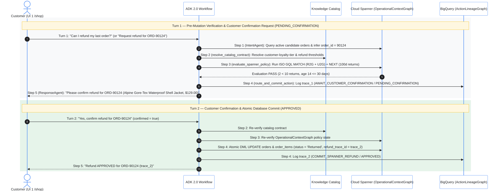

# Dual-Graph System of Action: Autonomous Refund Agent Lab Guide

<!-- markdownlint-disable MD033 -->

## Overview

In this hands-on lab, you explore and verify a Dual-Graph System of Action
on Google Cloud using Google Agent Development Kit 2.0 (ADK 2.0), Cloud
Spanner Graph, BigQuery Graph, Cloud Spanner Data Boost, and Knowledge Catalog.

Autonomous refund workflows require two operational guarantees before and after
modifying data:

- Pre-action context: The agent must verify customer history and tiered policy
  rules against operational databases before modifying an order.
- Post-action lineage: The system must record every evaluation step, policy
  rule, and database mutation in an append-only audit log.

## What you'll learn

- How to inspect OperationalContextGraph schemas and Knowledge Catalog metric
  contracts (`soa-business-glossary`, `refund-metric-contract`) in the Google
  Cloud Console
- How ADK 2.0 (`gemini-3-flash-preview` and ISO GQL) pauses for customer
  confirmation before committing an eligible Standard refund (Activity 1:
  Customer A)
- How Cloud Spanner Graph blocks database writes when a customer exceeds the
  100-day return limit (Activity 2: Customer B)
- How Knowledge Catalog applies tier-aware contracts to approve eligible VIP
  refunds (Activity 3: Customer C)
- How to run cross-engine federated queries joining BigQuery ActionLineageGraph
  and Cloud Spanner OperationalContextGraph over Cloud Spanner Data Boost
  (Activity 4)

## Setup and requirements

<ql-infobox>
Sign into the Google Cloud Console in an incognito browser window using the
temporary student credentials provided in the Qwiklabs control panel.
</ql-infobox>

<ql-warningbox>
Do not use your personal Google Cloud account for this lab. Using your personal
account may incur charges and prevents access to the pre-provisioned lab
resources.
</ql-warningbox>

## How the Dual-Graph System of Action works behind the UI

### Dual-Graph architecture and 5-step ADK 2.0 workflow

The diagram below illustrates how **UI 1 (`/shop`)** and **UI 2 (`/console`)**
interact with the 5-step ADK 2.0 workflow, **Knowledge Catalog**,
**Cloud Spanner `OperationalContextGraph`**, and **BigQuery
`ActionLineageGraph`**:

<!-- markdownlint-disable MD013 -->
<!-- MERMAID-DIAGRAM-START
%%{init: {"flowchart": {"nodeSpacing": 26, "rankSpacing": 46, "curve": "basis", "wrappingWidth": 440}}}%%
flowchart LR
  subgraph Col1A ["1A. Customer Storefront & Chat (Cloud Run)"]
    Shop["<div style='display:flex;align-items:center;gap:12px;text-align:left;padding:6px 16px 6px 8px;'><div style='width:40px;max-width:40px;flex-shrink:0;'></div><div style='line-height:1.35;white-space:nowrap;'><b style='font-size:14px;color:#202124;'>UI 1: Shopping Mall &amp; Support Chat (/shop)</b><br/><span style='font-size:11px;color:#5F6368;'>Personas (STANDARD &amp; VIP), Order Cards &amp; 2-Turn Gate</span></div></div>"]
  end

  subgraph Col1B ["1B. Data Engineer Investigation Workbench (Cloud Run)"]
    Console["<div style='display:flex;align-items:center;gap:12px;text-align:left;padding:6px 16px 6px 8px;'><div style='width:40px;max-width:40px;flex-shrink:0;'></div><div style='line-height:1.35;white-space:nowrap;'><b style='font-size:14px;color:#202124;'>UI 2: Data Engineer Console (/console)</b><br/><span style='font-size:11px;color:#5F6368;'>Live Trace Feed, Dual-Graph Visualizer &amp; GQL Workbench</span></div></div>"]
  end

  subgraph Col2 ["2. ADK 2.0 Hybrid Agent Runtime (google-adk + Vertex AI)"]
    LLM["<div style='display:flex;align-items:center;gap:12px;text-align:left;padding:6px 16px 6px 8px;'><div style='width:40px;max-width:40px;flex-shrink:0;'></div><div style='line-height:1.35;white-space:nowrap;'><b style='font-size:14px;color:#202124;'>Step 1 &amp; 5: Gemini LLM Nodes (gemini-3-flash-preview)</b><br/><span style='font-size:11px;color:#5F6368;'>IntentAgent (Intent &amp; Order ID) → ResponseAgent (Grounded Reply)</span></div></div>"]
    Gov["<div style='display:flex;align-items:center;gap:12px;text-align:left;padding:6px 16px 6px 8px;'><div style='width:40px;max-width:40px;flex-shrink:0;'></div><div style='line-height:1.35;white-space:nowrap;'><b style='font-size:14px;color:#202124;'>Step 2: resolve_catalog_contract (FunctionNode)</b><br/><span style='font-size:11px;color:#5F6368;'>Binds Governed Tier &amp; Metric Rules (No LLM Arithmetic)</span></div></div>"]
    Eval["<div style='display:flex;align-items:center;gap:12px;text-align:left;padding:6px 16px 6px 8px;'><div style='width:40px;max-width:40px;flex-shrink:0;'></div><div style='line-height:1.35;white-space:nowrap;'><b style='font-size:14px;color:#202124;'>Step 3: evaluate_spanner_policy (FunctionNode)</b><br/><span style='font-size:11px;color:#5F6368;'>Parameterized ISO GQL Snapshot Traversal (PASS / FAIL Gate)</span></div></div>"]
    Commit["<div style='display:flex;align-items:center;gap:12px;text-align:left;padding:6px 16px 6px 8px;'><div style='width:40px;max-width:40px;flex-shrink:0;'></div><div style='line-height:1.35;white-space:nowrap;'><b style='font-size:14px;color:#202124;'>Step 4: route_and_commit_action (FunctionNode)</b><br/><span style='font-size:11px;color:#5F6368;'>2-Turn Confirmation Gate → ACID DML + Audit Lineage</span></div></div>"]
    Audit["<div style='display:flex;align-items:center;gap:12px;text-align:left;padding:6px 16px 6px 8px;'><div style='width:40px;max-width:40px;flex-shrink:0;'></div><div style='line-height:1.35;white-space:nowrap;'><b style='font-size:14px;color:#202124;'>Read-Only Audit &amp; Federated Query Router</b><br/><span style='font-size:11px;color:#5F6368;'>Executes Snapshot ISO GQL, Lineage GQL &amp; Data Boost SQL</span></div></div>"]
  end

  subgraph PillarGov ["3A. Active Semantic Governance (Knowledge Catalog)"]
    KC["<div style='display:flex;align-items:center;gap:12px;text-align:left;padding:6px 16px 6px 8px;'><div style='width:40px;max-width:40px;flex-shrink:0;'></div><div style='line-height:1.35;white-space:nowrap;'><b style='font-size:14px;color:#202124;'>Knowledge Catalog: Business Glossary &amp; Aspects</b><br/><span style='font-size:11px;color:#5F6368;'>soa-business-glossary | refund-metric-contract (STD &amp; VIP)</span></div></div>"]
  end

  subgraph Pillar1 ["3B. Graph 1: Operational Context Graph (Acting — Cloud Spanner Graph)"]
    U2G["<div style='display:flex;align-items:center;gap:12px;text-align:left;padding:6px 16px 6px 8px;'><div style='width:40px;max-width:40px;flex-shrink:0;'></div><div style='line-height:1.35;white-space:nowrap;'><b style='font-size:14px;color:#202124;'>Cloud Spanner Graph: U2G Policy Triples</b><br/><span style='font-size:11px;color:#5F6368;'>policies, policy_conditions, policy_restrictions (STD: 10, VIP: 20)</span></div></div>"]
    R2G["<div style='display:flex;align-items:center;gap:12px;text-align:left;padding:6px 16px 6px 8px;'><div style='width:40px;max-width:40px;flex-shrink:0;'></div><div style='line-height:1.35;white-space:nowrap;'><b style='font-size:14px;color:#202124;'>Cloud Spanner Graph: R2G Operational State</b><br/><span style='font-size:11px;color:#5F6368;'>users, orders, order_items, products, centers (SERIALIZABLE ACID)</span></div></div>"]
  end

  subgraph Pillar2 ["3C. Graph 2: Action Lineage Graph & Federation (Remembering — BigQuery Graph)"]
    Lineage["<div style='display:flex;align-items:center;gap:12px;text-align:left;padding:6px 16px 6px 8px;'><div style='width:40px;max-width:40px;flex-shrink:0;'></div><div style='line-height:1.35;white-space:nowrap;'><b style='font-size:14px;color:#202124;'>BigQuery Graph: ActionLineageGraph (Append-Only)</b><br/><span style='font-size:11px;color:#5F6368;'>agent_sessions → workflow_nodes → policy_evaluations → agent_actions</span></div></div>"]
    DataBoost["<div style='display:flex;align-items:center;gap:12px;text-align:left;padding:6px 16px 6px 8px;'><div style='width:40px;max-width:40px;flex-shrink:0;'></div><div style='line-height:1.35;white-space:nowrap;'><b style='font-size:14px;color:#202124;'>Spanner Data Boost Federated Bridge</b><br/><span style='font-size:11px;color:#5F6368;'>EXTERNAL_QUERY Zero-OLTP-Impact Join (refund_trace_id = trace_id)</span></div></div>"]
  end

  Shop <--&gt;|"1. 2-Turn Refund Stream"| LLM
  Console <--&gt;|"Audit &amp; GQL Workbench"| Audit

  Gov --&gt;|"2. Resolve Contract"| KC
  Eval --&gt;|"3a. Match Tier Policy"| U2G
  Eval --&gt;|"3b. ISO GQL Eligibility"| R2G
  Commit --&gt;|"4a. Turn 2 ACID DML"| R2G
  Commit --&gt;|"4b. Append Audit Rows"| Lineage
  Audit --&gt;|"5a. Lineage ISO GQL"| Lineage
  Audit <--&gt;|"5b. Federated Audit"| DataBoost

  style Col1A fill:#E8F0FE,stroke:#4285F4,color:#202124,stroke-width:1.5px,rx:10px,ry:10px
  style Col1B fill:#E8F0FE,stroke:#4285F4,color:#202124,stroke-width:1.5px,rx:10px,ry:10px
  style Col2 fill:#F8F9FA,stroke:#DADCE0,color:#202124,stroke-width:1.5px,rx:10px,ry:10px
  style PillarGov fill:#FEF7E0,stroke:#FBBC04,color:#202124,stroke-width:1.5px,rx:10px,ry:10px
  style Pillar1 fill:#E6F4EA,stroke:#34A853,color:#202124,stroke-width:1.5px,rx:10px,ry:10px
  style Pillar2 fill:#E8F0FE,stroke:#4285F4,color:#202124,stroke-width:1.5px,rx:10px,ry:10px

  style Shop fill:#FFFFFF,stroke:#4285F4,color:#202124,stroke-width:2px,rx:8px,ry:8px
  style Console fill:#FFFFFF,stroke:#4285F4,color:#202124,stroke-width:2px,rx:8px,ry:8px
  style LLM fill:#FFFFFF,stroke:#EA4335,color:#202124,stroke-width:2px,rx:8px,ry:8px
  style Gov fill:#FFFFFF,stroke:#FBBC04,color:#202124,stroke-width:2px,rx:8px,ry:8px
  style Eval fill:#FFFFFF,stroke:#34A853,color:#202124,stroke-width:2px,rx:8px,ry:8px
  style Commit fill:#FFFFFF,stroke:#EA4335,color:#202124,stroke-width:2px,rx:8px,ry:8px
  style Audit fill:#FFFFFF,stroke:#4285F4,color:#202124,stroke-width:2px,rx:8px,ry:8px
  style KC fill:#FFFFFF,stroke:#FBBC04,color:#202124,stroke-width:2px,rx:8px,ry:8px
  style U2G fill:#FFFFFF,stroke:#34A853,color:#202124,stroke-width:2px,rx:8px,ry:8px
  style R2G fill:#FFFFFF,stroke:#34A853,color:#202124,stroke-width:2px,rx:8px,ry:8px
  style Lineage fill:#FFFFFF,stroke:#34A853,color:#202124,stroke-width:2px,rx:8px,ry:8px
  style DataBoost fill:#FFFFFF,stroke:#4285F4,color:#202124,stroke-width:2px,rx:8px,ry:8px
MERMAID-DIAGRAM-SOURCE -->


<!-- MERMAID-DIAGRAM-END -->

<!-- markdownlint-enable MD013 -->

## Task 1. Open the lab web interfaces and Google Cloud Console

<!-- markdownlint-disable MD013 -->
1.  Locate `shopping_mall_url`
    (<ql-variable key="project_0.startup_script.shopping_mall_url" placeholder="shopping_mall_url"></ql-variable>)
    and `data_engineer_console_url`
    (<ql-variable key="project_0.startup_script.data_engineer_console_url" placeholder="data_engineer_console_url"></ql-variable>)
    in your Qwiklabs environment panel and open both URLs in separate browser
    tabs.
1.  Open the **Google Cloud Console** (`https://console.cloud.google.com`) in a
    third browser tab using your Qwiklabs student credentials and verify that
    your lab project
    (<ql-variable key="project_0.project_id" placeholder="YOUR_PROJECT_ID"></ql-variable>)
    is selected.

<!-- markdownlint-enable MD013 -->

## Task 2. Inspect the underlying databases in the Google Cloud Console

Before triggering any agent actions in the web UI, inspect the underlying
databases and catalog resources directly in the **Google Cloud Console** to see
how the graph schemas, relational tables, and governance contracts are stored.

### Property graph node and edge schemas

Both graphs share a durable cross-graph reconciliation identifier
(`order_items.refund_trace_id` in Cloud Spanner and `agent_sessions.trace_id` in
BigQuery):

<!-- markdownlint-disable MD013 -->
<!-- MERMAID-DIAGRAM-START
%%{init: {"flowchart": {"nodeSpacing": 35, "rankSpacing": 45, "wrappingWidth": 420}}}%%
flowchart LR
  subgraph SpannerGraph ["Cloud Spanner: OperationalContextGraph"]
    U["<div style='display:flex;align-items:center;gap:12px;text-align:left;padding:6px 14px 6px 8px;'><div style='width:40px;max-width:40px;flex-shrink:0;'></div><div style='line-height:1.35;white-space:nowrap;'><b style='font-size:14px;color:#202124;'>users</b><br/><span style='font-size:11px;color:#5F6368;'>id, email, customer_tier</span></div></div>"]
    O["<div style='display:flex;align-items:center;gap:12px;text-align:left;padding:6px 14px 6px 8px;'><div style='width:40px;max-width:40px;flex-shrink:0;'></div><div style='line-height:1.35;white-space:nowrap;'><b style='font-size:14px;color:#202124;'>orders</b><br/><span style='font-size:11px;color:#5F6368;'>order_id, status, delivered_at</span></div></div>"]
    II["<div style='display:flex;align-items:center;gap:12px;text-align:left;padding:6px 14px 6px 8px;'><div style='width:40px;max-width:40px;flex-shrink:0;'></div><div style='line-height:1.35;white-space:nowrap;'><b style='font-size:14px;color:#202124;'>inventory_items</b><br/><span style='font-size:11px;color:#5F6368;'>id, product_id</span></div></div>"]
    P["<div style='display:flex;align-items:center;gap:12px;text-align:left;padding:6px 14px 6px 8px;'><div style='width:40px;max-width:40px;flex-shrink:0;'></div><div style='line-height:1.35;white-space:nowrap;'><b style='font-size:14px;color:#202124;'>products</b><br/><span style='font-size:11px;color:#5F6368;'>id, name, category</span></div></div>"]
    DC["<div style='display:flex;align-items:center;gap:12px;text-align:left;padding:6px 14px 6px 8px;'><div style='width:40px;max-width:40px;flex-shrink:0;'></div><div style='line-height:1.35;white-space:nowrap;'><b style='font-size:14px;color:#202124;'>distribution_centers</b><br/><span style='font-size:11px;color:#5F6368;'>id, name</span></div></div>"]
    POL["<div style='display:flex;align-items:center;gap:12px;text-align:left;padding:6px 14px 6px 8px;'><div style='width:40px;max-width:40px;flex-shrink:0;'></div><div style='line-height:1.35;white-space:nowrap;'><b style='font-size:14px;color:#202124;'>policies</b><br/><span style='font-size:11px;color:#5F6368;'>POL-REFUND-STD-V1</span></div></div>"]
    COND["<div style='display:flex;align-items:center;gap:12px;text-align:left;padding:6px 14px 6px 8px;'><div style='width:40px;max-width:40px;flex-shrink:0;'></div><div style='line-height:1.35;white-space:nowrap;'><b style='font-size:14px;color:#202124;'>policy_conditions</b><br/><span style='font-size:11px;color:#5F6368;'>STD: max 10, VIP: max 20 (30d window)</span></div></div>"]
    RES["<div style='display:flex;align-items:center;gap:12px;text-align:left;padding:6px 14px 6px 8px;'><div style='width:40px;max-width:40px;flex-shrink:0;'></div><div style='line-height:1.35;white-space:nowrap;'><b style='font-size:14px;color:#202124;'>policy_restrictions</b><br/><span style='font-size:11px;color:#5F6368;'>DENY_AUTONOMOUS_REFUND</span></div></div>"]

    U --&gt;|"[:places]"| O
    O --&gt;|"[:contains_item (order_items.refund_trace_id)]"| II
    II --&gt;|"[:is_product]"| P
    P --&gt;|"[:supplied_by]"| DC
    P --&gt;|"[:governed_by]"| POL
    POL --&gt;|"[:requires_condition]"| COND
    POL --&gt;|"[:enforces_restriction]"| RES
  end

  subgraph BQGraph ["BigQuery: ActionLineageGraph"]
    S["<div style='display:flex;align-items:center;gap:12px;text-align:left;padding:6px 14px 6px 8px;'><div style='width:40px;max-width:40px;flex-shrink:0;'></div><div style='line-height:1.35;white-space:nowrap;'><b style='font-size:14px;color:#202124;'>AgentSession</b><br/><span style='font-size:11px;color:#5F6368;'>trace_id, customer_id, target_order_id</span></div></div>"]
    WN["<div style='display:flex;align-items:center;gap:12px;text-align:left;padding:6px 14px 6px 8px;'><div style='width:40px;max-width:40px;flex-shrink:0;'></div><div style='line-height:1.35;white-space:nowrap;'><b style='font-size:14px;color:#202124;'>WorkflowNode</b><br/><span style='font-size:11px;color:#5F6368;'>node_exec_id, node_name</span></div></div>"]
    PE["<div style='display:flex;align-items:center;gap:12px;text-align:left;padding:6px 14px 6px 8px;'><div style='width:40px;max-width:40px;flex-shrink:0;'></div><div style='line-height:1.35;white-space:nowrap;'><b style='font-size:14px;color:#202124;'>PolicyEvaluation</b><br/><span style='font-size:11px;color:#5F6368;'>eval_id, catalog_term_id, evaluation_result</span></div></div>"]
    ACT["<div style='display:flex;align-items:center;gap:12px;text-align:left;padding:6px 14px 6px 8px;'><div style='width:40px;max-width:40px;flex-shrink:0;'></div><div style='line-height:1.35;white-space:nowrap;'><b style='font-size:14px;color:#202124;'>AgentAction</b><br/><span style='font-size:11px;color:#5F6368;'>action_id, action_type, decision_status</span></div></div>"]

    S --&gt;|"[:executed_node]"| WN
    WN --&gt;|"[:evaluated_policy]"| PE
    PE --&gt;|"[:triggered_action]"| ACT
  end

  O -.-&gt;|"Reconciled via refund_trace_id = trace_id (Spanner Data Boost)"| S

  style SpannerGraph fill:#F8F9FA,stroke:#DADCE0,color:#202124,stroke-width:1.5px,rx:10px,ry:10px
  style BQGraph fill:#F8F9FA,stroke:#DADCE0,color:#202124,stroke-width:1.5px,rx:10px,ry:10px

  style U fill:#FFFFFF,stroke:#4285F4,color:#202124,stroke-width:2px,rx:8px,ry:8px
  style O fill:#FFFFFF,stroke:#34A853,color:#202124,stroke-width:2px,rx:8px,ry:8px
  style II fill:#FFFFFF,stroke:#34A853,color:#202124,stroke-width:2px,rx:8px,ry:8px
  style P fill:#FFFFFF,stroke:#34A853,color:#202124,stroke-width:2px,rx:8px,ry:8px
  style DC fill:#FFFFFF,stroke:#34A853,color:#202124,stroke-width:2px,rx:8px,ry:8px
  style POL fill:#FFFFFF,stroke:#FBBC04,color:#202124,stroke-width:2px,rx:8px,ry:8px
  style COND fill:#FFFFFF,stroke:#FBBC04,color:#202124,stroke-width:2px,rx:8px,ry:8px
  style RES fill:#FFFFFF,stroke:#EA4335,color:#202124,stroke-width:2px,rx:8px,ry:8px
  style S fill:#FFFFFF,stroke:#34A853,color:#202124,stroke-width:2px,rx:8px,ry:8px
  style WN fill:#FFFFFF,stroke:#34A853,color:#202124,stroke-width:2px,rx:8px,ry:8px
  style PE fill:#FFFFFF,stroke:#FBBC04,color:#202124,stroke-width:2px,rx:8px,ry:8px
  style ACT fill:#FFFFFF,stroke:#EA4335,color:#202124,stroke-width:2px,rx:8px,ry:8px
MERMAID-DIAGRAM-SOURCE -->


<!-- MERMAID-DIAGRAM-END -->

<!-- markdownlint-enable MD013 -->

### 2a. Inspect governed business terms in Knowledge Catalog

The **System of Action Business Glossary** (`soa-business-glossary`) governs
three top-level refund policy metric terms:

- **`Customer Loyalty Tier` (`customer-loyalty-tier`):** Defines the tier
  routing contract (`STANDARD` vs. `VIP`).
- **`Order Age in Days` (`order-age-days`):** Defines the 30-day post-delivery
  eligibility window (`status = 'Complete'` and `age <= 30`).
- **`Rolling 100-Day Refund Count` (`rolling-100d-refund-count`):** Defines how
  Step 3 counts returned `order_items` (`status = 'Returned'`) over the trailing
  100 days excluding the target order.

1.  In the Google Cloud Console search bar, search for **Knowledge Catalog** and
    open the service, then select **Glossaries** in the left navigation menu.
1.  Click **System of Action Business Glossary** (`soa-business-glossary` in
    location `Global`).
1.  Click each of the three governed business glossary terms (**Customer Loyalty
    Tier**, **Order Age in Days**, and **Rolling 100-Day Refund Count**) listed
    directly under the glossary to inspect their definitions.
1.  In the left navigation menu of **Knowledge Catalog**, click **Metadata
    Types** to inspect the custom **`Refund Metric Contract`
    (`refund-metric-contract`)** aspect type. Observe the 5 governed record
    fields (`returned_status` for Returned Order Item Status,
    `eligible_order_status` for Eligible Delivered Order Status,
    `rolling_window_days` for Rolling Refund Window Days, `standard_tier` for
    Standard Customer Tier Code, and `vip_tier` for VIP Customer Tier Code)
    that define canonical status codes and time windows across the system.

<ql-infobox>
<strong>Semantic Contract vs. Graph Policy Rules:</strong> During Step 2 of the
ADK workflow (<code>resolve_catalog_contract</code>), the agent queries these
Knowledge Catalog entries via the Catalog API so canonical parameters
(<code>returned_status = 'Returned'</code>, <code>eligible_order_status =
'Complete'</code>, <code>rolling_window_days = 100</code>) are never hardcoded
in LLM prompts. Meanwhile, the tier-specific operational thresholds
(<code>max_refunds_100d = 10</code> for STANDARD vs. <code>20</code> for VIP,
and <code>return_window_days = 30</code>) are enforced by the
<code>policy_conditions</code> nodes in Cloud Spanner's
<code>OperationalContextGraph</code> (inspected in Task 2b).
</ql-infobox>

### 2b. Query OperationalContextGraph in Cloud Spanner Studio

The `thelook-soa-db` database in Cloud Spanner combines 6 Relational-to-Graph
(R2G) operational tables (`users`, `orders`, `order_items`, `inventory_items`,
`products`, `distribution_centers`) and 3 Unstructured-to-Graph (U2G) policy
tables (`policies`, `policy_conditions`, `policy_restrictions`) into a single
ISO GQL property graph named **`OperationalContextGraph`**.

1.  In the Google Cloud Console navigation menu, go to **Spanner** >
    **Instances**.
1.  Click **System of Action Graph Instance** (`soa-graph-instance`), then click
    the database **`thelook-soa-db`**.
1.  In the left navigation menu of `thelook-soa-db`, click **Spanner Studio**
    and expand **`Tables`** and **`Graphs`** in the **Explorer** sidebar.
1.  Click the three-dots (**View actions**) menu next to
    **`OperationalContextGraph`** and select **`View/modify visually`** to
    inspect the visualized graph schema mapping the 8 node tables and 7 edge
    tables (`places`, `contains_item`, `is_product`, `supplied_by`,
    `governed_by`, `requires_condition`, `enforces_restriction`).
1.  In **Spanner Studio**, open a new SQL/GQL editor tab and run the following
    native ISO GQL query to visualize the live property graph data in the Google
    Cloud Console:

    ```sql
    -- Purpose: Visualize the live R2G + U2G property graph topology in Spanner Studio.
    -- Target Engine: Cloud Spanner (thelook-soa-db -> OperationalContextGraph).
    -- How It Works: Traverses from users -> orders -> inventory_items -> products
    --   -> distribution_centers and links products to active policies, tier-matched
    --   policy_conditions, and policy_restrictions, returning JSON graph elements.
    -- Information Gathered: Full node/edge JSON objects to render the interactive
    --   property graph in Cloud Spanner Studio (Graph and Table views).
    GRAPH OperationalContextGraph
    MATCH (u:users)-[e_places:places]->(o:orders {order_id: 90124})
            -[e_item:contains_item]->(ii:inventory_items)
            -[e_prod:is_product]->(p:products)
            -[e_dc:supplied_by]->(dc:distribution_centers),
          (p)-[e_gov:governed_by]->(pol:policies {status: 'ACTIVE'})
            -[e_cond:requires_condition]->(cond:policy_conditions),
          (pol)-[e_res:enforces_restriction]->(res:policy_restrictions)
    WHERE cond.applicable_tier = u.customer_tier
    RETURN
      TO_JSON(u) AS user_node,
      TO_JSON(e_places) AS places_edge,
      TO_JSON(o) AS order_node,
      TO_JSON(e_item) AS contains_item_edge,
      TO_JSON(ii) AS inventory_node,
      TO_JSON(p) AS product_node,
      TO_JSON(dc) AS dc_node,
      TO_JSON(pol) AS policy_node,
      TO_JSON(cond) AS condition_node,
      TO_JSON(res) AS restriction_node;
    ```

1.  In the **Spanner Studio** results pane, toggle between the **Graph** view
    (where you can click and drag the Cloud Spanner nodes and edges) and the
    **Table** view. Notice that `o.status` is currently `'Complete'` and
    `e_item.refund_trace_id` is `NULL`.

### 2c. Inspect ActionLineageGraph in BigQuery Studio

<!-- markdownlint-disable MD013 -->
1.  In the Google Cloud Console navigation menu, go to **BigQuery** >
    **Studio**.
1.  In the **Explorer** pane, expand your project and expand the dataset
    **`soa_action_lineage`**.
1.  Observe the four lineage tables (`agent_sessions`, `workflow_nodes`,
    `policy_evaluations`, `agent_actions`) under **Tables**, the property graph
    **`ActionLineageGraph`** under the **Graphs** menu item, and the external
    connection **<ql-variable key="project_0.startup_script.gcp_region" placeholder="us-central1"></ql-variable>.spanner-data-boost** under **Connections**.
1.  Click **Graphs** > **`ActionLineageGraph`** to inspect the visualized graph
    schema (`agent_sessions` → `workflow_nodes` → `policy_evaluations` →
    `agent_actions`) and node/edge property definitions in the Google Cloud
    Console.

<!-- markdownlint-enable MD013 -->

## Task 3. Activity 1: Customer A eligible refund and 2-turn confirmation

In this activity, you use **UI 1 (`/shop`)** as **Customer A (Alice Chen,
`user_id: 1001`, `STANDARD` tier)** to test contextual order inference and the
two-turn confirmation gate, then verify the database changes in Cloud Spanner
Studio, BigQuery Studio, and **UI 2 (`/console`)**.

### Two-turn confirmation sequence (`PENDING_CONFIRMATION` → `APPROVED`)

When the agent resolves a valid customer order, it pauses so the customer can
confirm the order number, product photo, item name, and price before committing
the transaction:

<!-- markdownlint-disable MD013 -->
<!-- MERMAID-DIAGRAM-START
%%{init: {"theme": "base", "themeVariables": {"actorBkg": "#FFFFFF", "actorBorder": "#4285F4", "actorTextColor": "#202124", "signalColor": "#202124", "signalTextColor": "#202124", "labelBoxBkgColor": "#F8F9FA", "labelBoxBorderColor": "#DADCE0", "noteBkgColor": "#FEF7E0", "noteBorderColor": "#FBBC04", "noteTextColor": "#202124"}}}%%
sequenceDiagram
  autonumber
  actor Customer as Customer (UI 1 /shop)
  participant ADK as ADK 2.0 Workflow
  participant Catalog as Knowledge Catalog
  participant Spanner as Cloud Spanner (OperationalContextGraph)
  participant BQ as BigQuery (ActionLineageGraph)

  rect rgb(248, 249, 250)
    Note over Customer,BQ: Turn 1 — Pre-Mutation Verification & Customer Confirmation Request (PENDING_CONFIRMATION)
    Customer-&gt;>ADK: Turn 1: "Can I refund my last order?" (or "Request refund for ORD-90124")
    ADK-&gt;>Spanner: Step 1 (IntentAgent): Query active candidate orders & infer order_id = 90124
    ADK-&gt;>Catalog: Step 2 (resolve_catalog_contract): Resolve customer-loyalty-tier & refund thresholds
    ADK-&gt;>Spanner: Step 3 (evaluate_spanner_policy): Run ISO GQL MATCH (R2G + U2G) + NEXT (100d returns)
    Spanner--&gt;>ADK: Evaluation PASS (2 < 10 returns, age 14 <= 30 days)
    ADK-&gt;>BQ: Step 4 (route_and_commit_action): Log trace_1 (AWAIT_CUSTOMER_CONFIRMATION / PENDING_CONFIRMATION)
    ADK--&gt;>Customer: Step 5 (ResponseAgent): "Please confirm refund for ORD-90124 (Alpine Gore-Tex Waterproof Shell Jacket, $129.00)"
  end

  rect rgb(230, 244, 234)
    Note over Customer,BQ: Turn 2 — Customer Confirmation & Atomic Database Commit (APPROVED)
    Customer-&gt;>ADK: Turn 2: "Yes, confirm refund for ORD-90124" (confirmed = true)
    ADK-&gt;>Catalog: Step 2: Re-verify catalog contract
    ADK-&gt;>Spanner: Step 3: Re-verify OperationalContextGraph policy state
    ADK-&gt;>Spanner: Step 4: Atomic DML UPDATE orders & order_items (status = 'Returned', refund_trace_id = trace_2)
    ADK-&gt;>BQ: Step 4: Log trace_2 (COMMIT_SPANNER_REFUND / APPROVED)
    ADK--&gt;>Customer: Step 5: "Refund APPROVED for ORD-90124 (trace_2)"
  end
MERMAID-DIAGRAM-SOURCE -->


<!-- MERMAID-DIAGRAM-END -->

<!-- markdownlint-enable MD013 -->

### 3a. Trigger Turn 1 (`PENDING_CONFIRMATION`) in UI 1

Alice Chen (`user_id: 1001`, `STANDARD` tier) has three active orders in the
storefront:

- `ORD-90124`: **Alpine Gore-Tex Waterproof Shell Jacket** (`$129.00`), status
  `Complete`, delivered 14 days ago (`2` prior returns in 100 days).
- `ORD-90125`: **Polarized Aviator Titanium Sunglasses** (`$165.00`), status
  `Complete`, delivered 45 days ago.
- `ORD-90126`: **Cashmere Ribbed Winter Beanie** (`$58.00`), status `Shipped`
  (in transit).

1.  In **UI 1 (`/shop`)**, ensure **Alice Chen (`user_id: 1001`, `STANDARD`
    tier)** is selected in the **Active Customer Persona Switcher**.
1.  In the **ADK 2.0 Refund Agent** chat widget on the right, either click the
    **Request refund for ORD-90124 (Eligible Standard)** prompt chip or type a
    natural-language request without an order number:

    ```text
    Can I refund my last order?
    ```

1.  Observe the live `[1/5]..[5/5]` step telemetry stream in the chat widget and
    verify that the agent pauses at **`PENDING_CONFIRMATION`** with a
    **`Confirm Refund: ORD-90124 — Alpine Gore-Tex Waterproof Shell Jacket
    ($129.00)`** button.

During Turn 1, the workflow runs through these steps:

- **Step 1 (`IntentAgent`):** Queries Alice's active orders in Cloud Spanner and
  resolves `order_id = 90124` (either from the prompt chip or by inferring it
  from questions like `"Can I refund my last order?"` using
  `gemini-3-flash-preview`).
- **Step 2 (`resolve_catalog_contract`):** Fetches the parameter definitions
  for `rolling-100d-refund-count` from Knowledge Catalog.
- **Step 3 (`evaluate_spanner_policy`):** Runs the ISO GQL query on
  `OperationalContextGraph`, matching `COND-REFUND-STD-100D-30D` and confirming
  `prior_refund_count_100d = 2 < 10` and `target_order_age_days = 14 <= 30`
  (`evaluation_result = 'PASS'`).
- **Step 4 (`route_and_commit_action`):** Waits for customer confirmation
  before updating Cloud Spanner, records a `PENDING_CONFIRMATION` trace
  (`action_type = 'AWAIT_CUSTOMER_CONFIRMATION'`) in BigQuery, and formats the
  confirmation prompt via Step 5 (`ResponseAgent`).

### 3b. Verify in Cloud Spanner Studio that the order is not yet mutated

1.  Switch to your **Cloud Spanner Studio** browser tab (`thelook-soa-db`) and
    run:

    ```sql
    -- Purpose: Verify the live transactional state of Order 90124 before and after
    --   customer confirmation (Turn 1 PENDING_CONFIRMATION vs. Turn 2 APPROVED).
    -- Target Engine: Cloud Spanner (thelook-soa-db relational tables: orders, order_items).
    -- How It Works: Joins orders and order_items on (user_id, order_id) for order_id = 90124.
    -- Information Gathered: Current order_status ('Complete' before confirmation,
    --   'Returned' after commit), returned_at timestamp, item_status, and the
    --   cross-graph reconciliation key (refund_trace_id).
    SELECT
      o.order_id,
      o.status AS order_status,
      o.returned_at,
      oi.status AS item_status,
      oi.refund_trace_id
    FROM orders AS o
    JOIN order_items AS oi
      ON o.user_id = oi.user_id AND o.order_id = oi.order_id
    WHERE o.order_id = 90124;
    ```

1.  Verify that `order_status` is still `'Complete'` and `refund_trace_id` is
    `NULL`:

    <ql-code-block language="plaintext" output>
    order_id | order_status | returned_at | item_status | refund_trace_id
    ---------+--------------+-------------+-------------+----------------
    90124    | Complete     | NULL        | Complete    | NULL
    </ql-code-block>

<ql-infobox>
<strong>Two-Turn Safety Gate:</strong>
Turn 1 (<code>PENDING_CONFIRMATION</code>) checks eligibility against
<code>OperationalContextGraph</code> and records an audit trace in BigQuery
without updating any row in Cloud Spanner.
</ql-infobox>

### 3c. Confirm the refund (Turn 2 `APPROVED`) and verify the mutation

<!-- markdownlint-disable MD013 -->
1.  Return to **UI 1 (`/shop`)** and click **`Confirm Refund: ORD-90124 —
    Alpine Gore-Tex Waterproof Shell Jacket ($129.00)`** (or type `Yes, please
    proceed`).
1.  In Turn 2, the agent re-checks the policy in `OperationalContextGraph`,
    updates `ORD-90124` to `Returned` in Cloud Spanner, writes the new
    `trace_id` to `order_items.refund_trace_id`, and displays the `APPROVED`
    badge.
1.  Switch back to **Cloud Spanner Studio** and re-run the same SQL query from
    Step 3b. Confirm that `order_status` and `item_status` are now `'Returned'`,
    `returned_at` is populated with the commit timestamp, and `refund_trace_id`
    contains the exact UUID `trace_id` displayed in the chat widget:

    <ql-code-block language="plaintext" output>
    order_id | order_status | returned_at                 | item_status | refund_trace_id
    ---------+--------------+-----------------------------+-------------+-------------------------------------------
    90124    | Returned     | 2026-10-29T05:12:41.102345Z | Returned    | trace-a1b2c3d4-5678-4901-b234-567890abcdef
    </ql-code-block>

<!-- markdownlint-enable MD013 -->

### 3d. Inspect the context and lineage graphs in UI 2 and BigQuery Studio

1.  In **UI 1 (`/shop`)**, click **Inspect in Data Engineer Console** on the
    `APPROVED` chat card to open **UI 2 (`/console`)** pre-filtered to Customer
    A's `trace_id`.
1.  In **UI 2 (`/console`)**, click the nodes in the **Interactive Dual-Graph
    Visualizer** (`User 1001`, `Order 90124`, `Product`, `Policy
    POL-REFUND-STD-V1`, `Condition COND-REFUND-STD-100D-30D`, and the orange
    BigQuery lineage nodes) to inspect their live properties in the **Node
    Property Inspector**.
1.  In Tab 1 (**1. Cloud Spanner Context Graph**), click **Run Query** (or run
    the same query directly in **Cloud Spanner Studio**):

    ```sql
    -- Purpose: Evaluate Customer A's operational context and tiered refund policy
    --   eligibility in a single two-stage ISO GQL traversal.
    -- Target Engine: Cloud Spanner (thelook-soa-db -> OperationalContextGraph).
    -- How It Works:
    --   Stage 1 (MATCH): Traverses R2G (users -> orders -> inventory_items ->
    --     products -> distribution_centers) and U2G (products -> policies ->
    --     policy_conditions / policy_restrictions) filtered by customer_tier.
    --   Stage 2 (NEXT + OPTIONAL MATCH): Counts distinct returned items across
    --     other orders within the 100-day rolling window.
    -- Information Gathered: Customer tier, target order status/age/price, product
    --   and fulfillment center names, active policy/condition IDs, 100-day return
    --   cap (max_refunds_100d), 30-day window, and observed prior_refund_count_100d.
    GRAPH OperationalContextGraph
    MATCH (u:users {id: 1001})
            -[:places]->(target_o:orders {order_id: 90124})
            -[target_oi:contains_item]->(ii:inventory_items)-[:is_product]->(p:products)
            -[:supplied_by]->(dc:distribution_centers),
          (p)-[:governed_by]->(pol:policies {status: 'ACTIVE'})
            -[:requires_condition]->(cond:policy_conditions),
          (pol)-[:enforces_restriction]->(res:policy_restrictions)
    WHERE u.customer_tier IN ('STANDARD', 'VIP')
      AND cond.applicable_tier = u.customer_tier
    RETURN
      u.id AS user_id,
      u.email AS email,
      u.customer_tier AS customer_tier,
      target_o.order_id AS target_order_id,
      target_o.status AS target_order_status,
      TIMESTAMP_DIFF(CURRENT_TIMESTAMP(), target_o.delivered_at, DAY) AS target_order_age_days,
      ROUND(SUM(target_oi.sale_price), 2) AS target_order_price,
      STRING_AGG(DISTINCT p.name, ', ') AS product_names,
      STRING_AGG(DISTINCT dc.name, ', ') AS distribution_center_names,
      pol.policy_id AS policy_id,
      pol.name AS policy_name,
      cond.condition_id AS condition_id,
      cond.max_refunds_100d AS max_refunds_100d,
      cond.return_window_days AS return_window_days,
      res.action_code AS restriction_action
    GROUP BY
      user_id, email, customer_tier, target_order_id, target_order_status,
      target_order_age_days, policy_id, policy_name, condition_id,
      max_refunds_100d, return_window_days, restriction_action
    NEXT
    -- Stage 2: Count prior returned items in the rolling 100-day window
    OPTIONAL MATCH (u2:users)-[:places]->(hist_o:orders)-[hist_oi:contains_item]->(:inventory_items)
    WHERE u2.id = user_id
      AND hist_o.order_id != target_order_id
      AND hist_oi.status = 'Returned'
      AND COALESCE(hist_oi.returned_at, hist_o.returned_at, hist_o.created_at)
          >= TIMESTAMP_SUB(CURRENT_TIMESTAMP(), INTERVAL 100 DAY)
    RETURN
      user_id,
      email,
      customer_tier,
      target_order_id,
      target_order_status,
      product_names,
      distribution_center_names,
      target_order_price,
      target_order_age_days,
      COUNT(DISTINCT hist_oi.id) AS prior_refund_count_100d,
      policy_id,
      policy_name,
      condition_id,
      max_refunds_100d,
      return_window_days,
      restriction_action
    GROUP BY
      user_id, email, customer_tier, target_order_id, target_order_status,
      product_names, distribution_center_names, target_order_price,
      target_order_age_days, policy_id, policy_name, condition_id,
      max_refunds_100d, return_window_days, restriction_action;
    ```

1.  Switch to Tab 2 (**2. BigQuery Action Lineage Graph**) in **UI 2
    (`/console`)** and click **Run Query**, or open **BigQuery Studio** and run
    the following query to inspect both the `PENDING_CONFIRMATION` (Turn 1) and
    `APPROVED` (Turn 2) lineage traces recorded for `target_order_id = 90124`:

    ```sql
    -- Purpose: Audit the append-only agent decision lineage for Customer A's
    --   Order 90124 across Turn 1 (PENDING_CONFIRMATION) and Turn 2 (APPROVED).
    -- Target Engine: BigQuery (soa_action_lineage dataset backing ActionLineageGraph).
    -- How It Works: Joins agent_sessions -> workflow_nodes -> policy_evaluations
    --   -> agent_actions along the ActionLineageGraph primary/foreign keys.
    -- Information Gathered: Session trace_id, Knowledge Catalog term (catalog_term_id),
    --   evaluated policy name, observed vs. maximum 100-day refunds, PASS/FAIL
    --   result, executed action_type, decision_status, and commit timestamp.
    SELECT
      s.trace_id,
      s.customer_id,
      s.target_order_id,
      n.node_name,
      pe.catalog_term_id,
      pe.policy_name,
      pe.observed_refunds_100d AS prior_refund_count_100d,
      pe.max_refunds_100d,
      pe.evaluation_result,
      act.action_type,
      act.decision_status,
      act.created_at AS committed_at
    FROM `soa_action_lineage.agent_sessions` AS s
    JOIN `soa_action_lineage.workflow_nodes` AS n
      ON s.trace_id = n.trace_id AND n.node_name = 'evaluate_spanner_policy'
    JOIN `soa_action_lineage.policy_evaluations` AS pe
      ON n.node_exec_id = pe.node_exec_id
    JOIN `soa_action_lineage.agent_actions` AS act
      ON pe.eval_id = act.eval_id
    WHERE s.customer_id = 1001
      AND s.target_order_id = 90124
    ORDER BY s.started_at DESC;
    ```

<ql-infobox>
<strong>Note:</strong> If your Google Cloud project has a BigQuery Enterprise
reservation attached, you can also run the ISO GQL
<code>FROM GRAPH_TABLE(soa_action_lineage.ActionLineageGraph MATCH ...)</code>
query shown in Tab 2 of <strong>UI 2 (<code>/console</code>)</strong>. On
standard on-demand billing (<code>gcpfree</code>), UI 2 automatically falls
back to the equivalent parameterized SQL <code>JOIN</code> above.
</ql-infobox>

## Task 4. Activity 2: Customer B policy denial (`STANDARD` tier)

In this activity, you test how the deterministic graph policy gate blocks an
autonomous refund when **Customer B (`Jordan Taylor`, `user_id: 2048`,
`STANDARD` tier)** reaches or exceeds the 100-day return threshold (`12 >= 10`),
then verify the blocked mutation and rejection lineage in **Cloud Spanner
Studio**, **BigQuery Studio**, and **UI 2 (`/console`)**.

### 4a. Trigger Turn 1 (`PENDING_CONFIRMATION`) and Turn 2 (`DENIED`) in UI 1

1.  Return to **UI 1 (`/shop`)** and select **Jordan Taylor (`user_id: 2048`,
    `STANDARD` tier)** in the **Active Customer Persona Switcher**.
1.  Review Jordan Taylor's order and return profile in the main panel (`100-Day
    Returned Items`: `12 / 10` for `ORD-81001` through `ORD-81012` returned
    within the trailing 100-day window; `ORD-90588`: **CloudStride Trail Running
    Shoes** for `$148.00`, status `Complete`, delivered 10 days ago).
1.  In the **ADK 2.0 Refund Agent** chat widget on the right, either click the
    **Request refund for ORD-90588 (Standard 12 >= 10 Limit)** prompt chip or
    type:

    ```text
    Please refund my order ORD-90588.
    ```

1.  Observe **Turn 1 (`PENDING_CONFIRMATION`)**, then click **`Confirm Refund:
    ORD-90588 — CloudStride Trail Running Shoes ($148.00)`** to execute **Turn 2
    (`DENIED`)**.

During these two turns, the workflow executes the following steps:

- **Step 1 (`IntentAgent`):** Resolves `order_id = 90588` (CloudStride Trail
  Running Shoes, `$148.00`) for `user_id = 2048`.
- **Step 2 (`resolve_catalog_contract`):** Fetches parameter definitions for
  `rolling-100d-refund-count` from Knowledge Catalog.
- **Step 3 (`evaluate_spanner_policy`):** Traverses `OperationalContextGraph` in
  Cloud Spanner (`u.customer_tier = 'STANDARD'`, matching
  `COND-REFUND-STD-100D-30D` with `max_refunds_100d = 10`) and counts
  `prior_refund_count_100d = 12` in the `NEXT` stage. Because `12 >= 10`, Step 3
  returns `evaluation_result = 'FAIL'` and
  `failure_code = 'MAX_REFUNDS_EXCEEDED'`.
- **Step 4 (`route_and_commit_action`):** On Turn 1, the workflow pauses at
  `PENDING_CONFIRMATION` (`action_type = 'AWAIT_CUSTOMER_CONFIRMATION'`) for
  customer verification. On Turn 2, the policy check blocks the refund
  (`decision_status = 'DENIED'`, `action_type = 'BLOCK_SPANNER_MUTATION'`)
  without updating `ORD-90588` in Cloud Spanner.

### 4b. Verify in Cloud Spanner Studio that the denied order was not mutated

1.  Switch to your **Cloud Spanner Studio** browser tab (`thelook-soa-db`) and
    run:

    ```sql
    -- Purpose: Verify that Order 90588 remains untouched in Cloud Spanner after
    --   Turn 2 policy denial (BLOCK_SPANNER_MUTATION).
    -- Target Engine: Cloud Spanner (thelook-soa-db relational tables: orders, order_items).
    -- How It Works: Joins orders and order_items on (user_id, order_id) for order_id = 90588.
    -- Information Gathered: Confirms order_status and item_status remain 'Complete',
    --   returned_at is NULL, and refund_trace_id is NULL.
    SELECT
      o.order_id,
      o.status AS order_status,
      o.returned_at,
      oi.status AS item_status,
      oi.refund_trace_id
    FROM orders AS o
    JOIN order_items AS oi
      ON o.user_id = oi.user_id AND o.order_id = oi.order_id
    WHERE o.order_id = 90588;
    ```

1.  Confirm that `order_status` and `item_status` remain `'Complete'`,
    `returned_at` is `NULL`, and `refund_trace_id` is `NULL`. The
    `BLOCK_SPANNER_MUTATION` action blocked the database write:

    <ql-code-block language="plaintext" output>
    order_id | order_status | returned_at | item_status | refund_trace_id
    ---------+--------------+-------------+-------------+----------------
    90588    | Complete     | NULL        | Complete    | NULL
    </ql-code-block>

<ql-warningbox>
<strong>Policy Enforcement:</strong> Because the condition is evaluated
directly in <code>OperationalContextGraph</code>
(<code>prior_refund_count_100d = 12 &gt;= max_refunds_100d = 10</code>), the
workflow blocks the database update in Step 4 based on the graph query result.
</ql-warningbox>

### 4c. Inspect the policy denial in UI 2 and Cloud Spanner Studio

1.  In **UI 1 (`/shop`)**, click **Inspect in Data Engineer Console** on the
    `DENIED` chat card to open **UI 2 (`/console`)** pre-filtered to Customer
    B's `DENIED` `trace_id`.
1.  In **UI 2 (`/console`)**, click the nodes in the **Interactive Dual-Graph
    Visualizer** (`User 2048`, `Order 90588`, `Product`, `Policy
    POL-REFUND-STD-V1`, `Condition COND-REFUND-STD-100D-30D`, `PolicyRestriction
    (DENY_AUTONOMOUS_REFUND)` with `restriction_id: RES-DENY-AUTO-REFUND`, and
    the BigQuery `FAIL` / `DENIED` lineage nodes) to inspect their live
    properties in the **Node Property Inspector**.
1.  Scroll to the bottom of **UI 2 (`/console`)** and click **Preview Glossary
    & Contract** (in **Knowledge Catalog Semantic Contract**) and **Preview
    return_policy_v1.md** (in **Policy Document (U2G) & Extracted Triples**) to
    inspect the governed `rolling-100d-refund-count` contract and source policy
    rules.
1.  In Tab 1 (**1. Cloud Spanner Context Graph**), click the **`Activity 2:
    Customer B (2048 / ORD-90588 Denied)`** preset button to load the same
    two-stage ISO GQL query from Task 3d filtered for `u:users {id: 2048}` and
    `target_o:orders {order_id: 90588}`, then click **Run Query** (or run the
    generated query in **Cloud Spanner Studio**).
1.  Verify from the query results that although `target_order_status =
    'Complete'` and `target_order_age_days = 10` (within the 30-day window),
    Customer B has `customer_tier = 'STANDARD'`, `condition_id =
    'COND-REFUND-STD-100D-30D'`, `prior_refund_count_100d = 12`, and
    `max_refunds_100d = 10`, triggering `restriction_action =
    'DENY_AUTONOMOUS_REFUND'`.

### 4d. Inspect the rejection lineage in UI 2 and BigQuery Studio

1.  Switch to Tab 2 (**2. BigQuery Action Lineage Graph**) in **UI 2
    (`/console`)**, click the **`Activity 2: ActionLineageGraph GQL (Denial)`**
    preset button (or **`Standard SQL JOIN Equivalent (On-Demand Fallback)`**),
    and click **Run Query**.
1.  Optionally, re-run the BigQuery SQL query from Task 3d in **BigQuery
    Studio** with `WHERE s.customer_id = 2048 AND s.target_order_id = 90588`
    (also adding `act.rejection_reason` to the `SELECT` list) to inspect both
    the Turn 1 (`PENDING_CONFIRMATION`) and Turn 2 (`DENIED`) audit rows.
1.  Verify that `ActionLineageGraph` records `catalog_term_id =
    'rolling-100d-refund-count'`, `prior_refund_count_100d = 12`,
    `max_refunds_100d = 10`, `evaluation_result = 'FAIL'`, `action_type =
    'BLOCK_SPANNER_MUTATION'`, and `decision_status = 'DENIED'` alongside the
    `rejection_reason`.

## Task 5. Activity 3: Customer C VIP approval via Knowledge Catalog (`VIP`)

In this activity, you verify how contextual graph routing and **Knowledge
Catalog** resolve a higher policy threshold (`max_refunds_100d = 20`)
for **Customer C (`Claire Vance`, `user_id: 3072`, `VIP` tier)**, approving a
refund even though Customer C has the same 100-day return count (`12` returns)
that blocked Customer B in Activity 2.

### 5a. Trigger Turn 1 (`PENDING_CONFIRMATION`) and Turn 2 (`APPROVED`) in UI 1

1.  Return to **UI 1 (`/shop`)** and select **Claire Vance (`user_id: 3072`,
    `VIP` tier)** in the **Active Customer Persona Switcher**.
1.  Review Claire Vance's order and return profile in the main panel (`100-Day
    Returned Items`: `12 / 20` for `ORD-82001` through `ORD-82012` returned
    within the trailing 100-day window, governed by the `VIP` tier limit of
    `20`; `ORD-90910`: **Tailored Italian Wool Travel Blazer** for `$210.00`,
    status `Complete`, delivered 7 days ago).
1.  In the **ADK 2.0 Refund Agent** chat widget on the right, click the
    **Request refund for ORD-90910 (VIP 12 < 20 Limit)** prompt chip or type:

    ```text
    Can I refund my last order?
    ```

1.  Observe **Turn 1 (`PENDING_CONFIRMATION`)**, then click **`Confirm Refund:
    ORD-90910 — Tailored Italian Wool Travel Blazer ($210.00)`** to execute
    **Turn 2 (`APPROVED`)**.

During these two turns, the workflow executes the following steps:

- **Step 1 (`IntentAgent`):** Queries Claire Vance's active orders and resolves
  `order_id = 90910` (Tailored Italian Wool Travel Blazer, `$210.00`).
- **Step 2 (`resolve_catalog_contract`):** Identifies `customer_tier = 'VIP'`
  for `user_id = 3072` and resolves the parameter mapping for
  `customer-loyalty-tier` from Knowledge Catalog.
- **Step 3 (`evaluate_spanner_policy`):** Matches `u.customer_tier = 'VIP'`
  against `COND-REFUND-VIP-100D-30D` (`max_refunds_100d = 20`) in
  `OperationalContextGraph`. Because `12 < 20` and `7 <= 30`, the policy
  evaluation passes (`evaluation_result = 'PASS'`).
- **Step 4 (`route_and_commit_action`):** Following customer confirmation in
  Turn 1, Turn 2 updates `ORD-90910` to `Returned` in Cloud Spanner, writes the
  new `trace_id` to `order_items.refund_trace_id`, and records the `APPROVED`
  decision in BigQuery.

### 5b. Verify the committed VIP refund in Cloud Spanner Studio

<!-- markdownlint-disable MD013 -->
1.  Switch to your **Cloud Spanner Studio** browser tab (`thelook-soa-db`) and
    run:

    ```sql
    -- Purpose: Verify the live transactional state of VIP Order 90910 after Turn 2
    --   customer confirmation and refund approval (COMMIT_SPANNER_REFUND).
    -- Target Engine: Cloud Spanner (thelook-soa-db relational tables: orders, order_items).
    -- How It Works: Joins orders and order_items on (user_id, order_id) for order_id = 90910.
    -- Information Gathered: Confirms order_status and item_status are 'Returned',
    --   returned_at is populated, and refund_trace_id matches the APPROVED trace_id.
    SELECT
      o.order_id,
      o.status AS order_status,
      o.returned_at,
      oi.status AS item_status,
      oi.refund_trace_id
    FROM orders AS o
    JOIN order_items AS oi
      ON o.user_id = oi.user_id AND o.order_id = oi.order_id
    WHERE o.order_id = 90910;
    ```

1.  Confirm that `order_status` and `item_status` are `'Returned'`,
    `returned_at` is populated with the commit timestamp, and `refund_trace_id`
    matches the UUID `trace_id` displayed on the `APPROVED` chat card:

    <ql-code-block language="plaintext" output>
    order_id | order_status | returned_at                 | item_status | refund_trace_id
    ---------+--------------+-----------------------------+-------------+-------------------------------------------
    90910    | Returned     | 2026-10-29T06:22:08.512345Z | Returned    | trace-c3d4e5f6-7890-4123-b456-7890abcdef12
    </ql-code-block>

<!-- markdownlint-enable MD013 -->

<ql-infobox>
<strong>Tier-Aware Governance:</strong> Both Customer B and Customer C have
<code>12</code> returned items in the last 100 days. However, Knowledge
Catalog's <code>customer-loyalty-tier</code> contract binds
<code>vip_tier = 'VIP'</code> so Cloud Spanner's
<code>OperationalContextGraph</code> routes Customer C's <code>VIP</code>
profile to <code>COND-REFUND-VIP-100D-30D</code>
(<code>max_refunds_100d = 20</code>), approving the request.
</ql-infobox>

### 5c. Inspect the VIP policy resolution in UI 2 and Cloud Spanner Studio

1.  In **UI 1 (`/shop`)**, click **Inspect in Data Engineer Console** on the
    `APPROVED` chat card for `ORD-90910` to open **UI 2 (`/console`)**
    pre-filtered to Customer C's `trace_id`.
1.  In **UI 2 (`/console`)**, click the nodes in the **Interactive Dual-Graph
    Visualizer** (`User 3072`, `Order 90910`, `Product`, `Policy
    POL-REFUND-STD-V1`, `Condition COND-REFUND-VIP-100D-30D`, and the BigQuery
    `PASS` / `APPROVED` lineage nodes) to inspect their live attributes in the
    **Node Property Inspector**.
1.  At the bottom of **UI 2 (`/console`)**, open **Preview Glossary & Contract**
    in the **Knowledge Catalog Semantic Contract** panel to inspect the resolved
    `customer-loyalty-tier` contract (`vip_tier = 'VIP'`) and its canonical
    SQL/GQL mapping, and open **Preview return_policy_v1.md** in the **Policy
    Document (U2G) & Extracted Triples** panel to verify
    `COND-REFUND-VIP-100D-30D` (`max_refunds_100d = 20`).
1.  In Tab 1 (**1. Cloud Spanner Context Graph**), click the **`Activity 3:
    Customer C (3072 / ORD-90910 VIP)`** preset button to load the two-stage ISO
    GQL query filtered for `u:users {id: 3072}` and `target_o:orders {order_id:
    90910}`, then click **Run Query** (or run the generated query directly in
    **Cloud Spanner Studio**).
1.  Verify from the query results that `customer_tier = 'VIP'`, `condition_id =
    'COND-REFUND-VIP-100D-30D'`, `prior_refund_count_100d = 12`, and
    `max_refunds_100d = 20`.

### 5d. Inspect the VIP approval lineage in UI 2 and BigQuery Studio

1.  Switch to Tab 2 (**2. BigQuery Action Lineage Graph**) in **UI 2
    (`/console`)**, click the **`Activity 1 & 3: ActionLineageGraph GQL
    (Approval)`** preset button (or **`Standard SQL JOIN Equivalent (On-Demand
    Fallback)`**), and click **Run Query**.
1.  Optionally, re-run the BigQuery SQL query from Task 3d in **BigQuery
    Studio** with `WHERE s.customer_id = 3072 AND s.target_order_id = 90910` to
    inspect both the Turn 1 (`PENDING_CONFIRMATION`) and Turn 2 (`APPROVED`)
    lineage traces.
1.  Verify that `ActionLineageGraph` attributes the approval to `catalog_term_id
    = 'customer-loyalty-tier'` with `prior_refund_count_100d = 12`,
    `max_refunds_100d = 20`, `evaluation_result = 'PASS'`, `action_type =
    'COMMIT_SPANNER_REFUND'`, and `decision_status = 'APPROVED'`.

## Task 6. Activity 4: Cross-engine federated audit with Spanner Data Boost

After completing Activities 1, 2, and 3, run a single cross-engine federated
query that joins BigQuery's `soa_action_lineage` tables with live Cloud Spanner
`OperationalContextGraph` nodes over **Cloud Spanner Data Boost**.

<ql-infobox>
<strong>Why Cloud Spanner Data Boost?</strong> When BigQuery runs
<code>EXTERNAL_QUERY</code> over the <code>spanner-data-boost</code> connection
(<code>use_data_boost = true</code>, <code>use_parallelism = true</code>),
partitionable ISO GQL subqueries execute on isolated serverless compute. This
queries live Spanner state without consuming transactional CPU on
<code>soa-graph-instance</code> and without requiring an ETL pipeline.
</ql-infobox>

The federated query pushes three ISO GQL lookups down to Spanner Data Boost
(customer tiers `sp_u`, order statuses `sp_o`, and `refund_trace_id` keys on
`contains_item` edges `sp_oi`) and joins them with BigQuery's four
`ActionLineageGraph` tables:

### Run and verify the federated audit query

<!-- markdownlint-disable MD013 -->
1.  In **UI 2 (`/console`)**, select Tab 3 (**3. Federated Spanner Data Boost**)
    and click **Run Query**.
1.  To run the same federated query directly inside the **Google Cloud
    Console**, switch to **BigQuery Studio**, replace
    `YOUR_PROJECT_ID.us-central1.spanner-data-boost` with your lab's
    `spanner_connection_id`
    (<ql-variable key="project_0.startup_script.spanner_connection_id" placeholder="YOUR_PROJECT_ID.us-central1.spanner-data-boost"></ql-variable>),
    and run the following SQL query:

    ```sql
    -- Purpose: Perform a zero-ETL cross-engine audit reconciling BigQuery
    --   ActionLineageGraph decisions with live Cloud Spanner OperationalContextGraph state.
    -- Target Engine: BigQuery federated to Cloud Spanner via EXTERNAL_QUERY and
    --   Cloud Spanner Data Boost (spanner-data-boost).
    -- How It Works: Joins BigQuery's four lineage tables with three root-partitionable
    --   ISO GQL subqueries pushed down to isolated Spanner Data Boost compute
    --   for live users (sp_u), orders (sp_o), and contains_item edges (sp_oi).
    -- Information Gathered: End-to-end reconciliation proving that APPROVED
    --   BigQuery traces match live Spanner 'Returned' orders and identical
    --   refund_trace_id keys, while DENIED traces leave Spanner orders 'Complete'.
    SELECT
      s.trace_id,
      sp_u.email AS live_spanner_email,
      sp_u.customer_tier AS live_spanner_tier,
      s.target_order_id,
      sp_o.live_spanner_order_status,
      sp_o.live_spanner_returned_at,
      sp_oi.live_spanner_refund_trace_id,
      pe.catalog_term_id,
      pe.observed_refunds_100d AS prior_refund_count_100d,
      pe.max_refunds_100d,
      pe.evaluation_result,
      act.action_type,
      act.decision_status
    FROM `soa_action_lineage.agent_sessions` AS s
    JOIN `soa_action_lineage.workflow_nodes` AS n
      ON s.trace_id = n.trace_id AND n.node_name = 'evaluate_spanner_policy'
    JOIN `soa_action_lineage.policy_evaluations` AS pe
      ON n.node_exec_id = pe.node_exec_id
    JOIN `soa_action_lineage.agent_actions` AS act
      ON pe.eval_id = act.eval_id
    -- Push down ISO GQL user lookup to Spanner Data Boost
    JOIN EXTERNAL_QUERY(
      'YOUR_PROJECT_ID.us-central1.spanner-data-boost',
      '''
      GRAPH OperationalContextGraph
      MATCH (u:users)
      WHERE u.id IN (1001, 2048, 3072)
      RETURN
        u.id AS user_id,
        u.email AS email,
        u.customer_tier AS customer_tier
      '''
    ) AS sp_u
      ON s.customer_id = sp_u.user_id
    -- Push down ISO GQL order status lookup to Spanner Data Boost
    JOIN EXTERNAL_QUERY(
      'YOUR_PROJECT_ID.us-central1.spanner-data-boost',
      '''
      GRAPH OperationalContextGraph
      MATCH (o:orders)
      WHERE o.user_id IN (1001, 2048, 3072)
      RETURN
        o.user_id AS user_id,
        o.order_id AS order_id,
        o.status AS live_spanner_order_status,
        CAST(o.returned_at AS STRING) AS live_spanner_returned_at
      '''
    ) AS sp_o
      ON s.customer_id = sp_o.user_id
     AND s.target_order_id = sp_o.order_id
    -- Push down ISO GQL contains_item edge lookup to verify refund_trace_id
    JOIN EXTERNAL_QUERY(
      'YOUR_PROJECT_ID.us-central1.spanner-data-boost',
      '''
      GRAPH OperationalContextGraph
      MATCH (:orders)-[oi:contains_item]->(:inventory_items)
      WHERE oi.user_id IN (1001, 2048, 3072)
      RETURN
        oi.order_id AS order_id,
        oi.refund_trace_id AS live_spanner_refund_trace_id
      '''
    ) AS sp_oi
      ON s.target_order_id = sp_oi.order_id
    ORDER BY s.started_at DESC;
    ```

1.  Verify the cross-graph audit results in the query output table.

<!-- markdownlint-enable MD013 -->

Confirm these three outcomes in the query output:

- Each `EXTERNAL_QUERY` block runs an ISO GQL `GRAPH OperationalContextGraph
  MATCH` query on isolated Spanner Data Boost compute (`use_data_boost = true`,
  `use_parallelism = true`).
- For `ORD-90124` (Standard) and `ORD-90910` (VIP), `live_spanner_order_status`
  is `'Returned'` and `live_spanner_refund_trace_id` matches the BigQuery
  `APPROVED` `trace_id`.
- For `ORD-90588` (Standard), `live_spanner_order_status` remains `'Complete'`,
  `live_spanner_refund_trace_id` is `NULL`, and `decision_status` is `'DENIED'`.

## Task 7. Additional edge-case scenarios in UI 1

You can also test additional edge-case and conversational scenarios under
**Customer A (`Alice Chen`, `user_id: 1001`)** in **UI 1 (`/shop`)**:

- **Expired 30-day return window (`ORD-90125`):** Click **Request refund for
  ORD-90125 (Expired 45d Window)** (or type `"Refund my sunglasses"`). Step 1
  infers `order_id = 90125` (Polarized Aviator Titanium Sunglasses, `$165.00`),
  pauses for Turn 1 confirmation (`PENDING_CONFIRMATION`), and on Turn 2 denies
  the request with `RETURN_WINDOW_EXPIRED` (`target_order_age_days = 45 > 30`).
- **Order not yet delivered (`ORD-90126`):** Click **Request refund for
  ORD-90126 (Shipped / In Transit)** (or type `"Refund my shipped order"`). Step
  1 infers `order_id = 90126` (Cashmere Ribbed Winter Beanie, `$58.00`), pauses
  for Turn 1 confirmation (`PENDING_CONFIRMATION`), and on Turn 2 denies the
  request with `ORDER_NOT_DELIVERED` (`target_order_status = 'Shipped'`).
- **Ambiguous order disambiguation (`resolution_mode = 'clarify'`) and negated
  refund (`resolution_mode = 'cancelled'`):** Type a refund request with no
  order ID and no disambiguating cue (such as `"I want a refund"`), decline a
  confirmation prompt (`"No, wrong order"`), or state `"No, I don't want to
  refund"`. The agent stays in `PENDING_CONFIRMATION` and lists Alice's active
  non-returned orders as clickable candidate chips.
- **Unpurchased storefront product request (`unmatched_product`):** Request a
  refund or order lookup for a storefront catalog item that Alice never
  purchased (such as `"I would like to refund Organic Supima Cotton Shirt
  order."`). `IntentAgent` detects that **Organic Supima Cotton Shirt** is not
  in Alice's order history, and `ResponseAgent` explains this clearly while
  offering her active orders (`ORD-90126`, `ORD-90124`, `ORD-90125`) as
  clickable candidate chips.
- **Conversational order list, status filtering, and selector follow-ups
  (`ORDER_LIST`, `POLICY_INFO`, `ORDER_INFO`):** Ask `"Show me the list of last
  3 orders"`, then follow up with `"What is the oldest order from the list?"` or
  `"What is the cheapest order from the list?"` to resolve the exact single
  order (`ORDER_INFO` with order and delivery dates). Asking `"Which of my
  recent orders are completed?"` displays only the 2 `'Complete'` order cards
  (`ORD-90124` and `ORD-90125`) matching the agent's reply.

## Task 8. Test your knowledge

Answer the following questions to check your understanding of the lab concepts.

<!-- markdownlint-disable MD013 -->
<ql-multiple-choice-probe stem="Which Google Cloud components provide deterministic pre-action operational context and governed metric thresholds so the refund agent never hallucinates return limits (10 for STANDARD vs. 20 for VIP)?">
  <ql-option>Vector RAG similarity search over PDF return policy documents</ql-option>
  <ql-option>Prompt-only LLM instructions inside IntentAgent (gemini-3-flash-preview)</ql-option>
  <ql-option correct>Knowledge Catalog (refund-metric-contract) paired with Cloud Spanner OperationalContextGraph</ql-option>
  <ql-option>BigQuery ActionLineageGraph append-only audit tables</ql-option>
</ql-multiple-choice-probe>

<ql-multiple-choice-probe stem="Why is Customer C's refund for ORD-90910 APPROVED while Customer B's refund for ORD-90588 is DENIED, even though both customers have 12 returned items in the last 100 days?">
  <ql-option>Customer B's order was delivered more than 30 days ago</ql-option>
  <ql-option correct>Knowledge Catalog resolves Customer C's VIP loyalty tier contract (customer-loyalty-tier) and Cloud Spanner OperationalContextGraph matches COND-REFUND-VIP-100D-30D (max_refunds_100d = 20), whereas Customer B is governed by the STANDARD tier cap of 10</ql-option>
  <ql-option>Customer B never confirmed the refund during Turn 2</ql-option>
  <ql-option>Cloud Spanner Data Boost overrides rejected transactions for high-value items</ql-option>
</ql-multiple-choice-probe>

<ql-multiple-choice-probe stem="Why does Activity 4 use Cloud Spanner Data Boost (spanner-data-boost) when joining BigQuery ActionLineageGraph with live Cloud Spanner OperationalContextGraph data?">
  <ql-option>It automatically rewrites Cloud Spanner DML transactions into BigQuery SQL</ql-option>
  <ql-option correct>It executes BigQuery EXTERNAL_QUERY ISO GQL subqueries on isolated serverless compute with zero CPU impact on the live transactional Spanner instance</ql-option>
  <ql-option>It replaces Knowledge Catalog business glossary terms with BigQuery views</ql-option>
  <ql-option>It caches LLM responses in Cloud Run local memory</ql-option>
</ql-multiple-choice-probe>

<!-- markdownlint-enable MD013 -->
