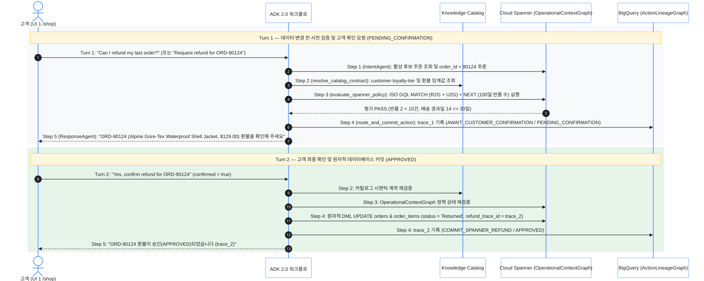

# Dual-Graph System of Action: 자율 환불 에이전트 핸즈온 랩 가이드

이 핸즈온 랩에서는 Google Cloud에서 **Google Agent Development Kit 2.0 (ADK
2.0)**, **Cloud Spanner Graph**, **BigQuery Graph**, **Cloud Spanner Data
Boost**, 그리고 **Knowledge Catalog** 를 결합한 **Dual-Graph System of
Action** 아키텍처를 실습하고 검증합니다.

## 실습 개요 및 목표

기존의 고객 지원 챗봇이 엔터프라이즈 트랜잭션을 안전하게 자동 실행하기 어려운
이유는 두 가지 안전장치가 빠져 있기 때문입니다.

- **결정론적 사전 실행 컨텍스트(Operational Context):** 주문이 자율 환불 요건을
  충족하는지 판단하려면 트랜잭션 상태를 바꾸기 전에 실시간 관계형 주문 이력과
  다계층 정책 규칙을 함께 탐색해야 합니다.
- **불변 사후 실행 계보(Action Lineage):** 자율 에이전트가 왜 특정 트랜잭션을
  승인하거나 차단했는지 감사하려면 모든 워크플로 노드와 카탈로그 계약, 정책 평가
  결과, 데이터베이스 액션을 변조할 수 없는 분석 그래프로 남겨야 합니다.

이 랩에서는 실습 웹 인터페이스와 **Google Cloud Console** (**Cloud Spanner
Studio**, **BigQuery Studio**, **Knowledge Catalog**)을 함께 사용하여
다섯 가지 핸즈온 실습을 진행합니다.

1.  **Google Cloud Console 데이터베이스 및 거버넌스 검증(실제 데이터 상태
    점검):** **Cloud Spanner Studio** 에서 `OperationalContextGraph` 속성
    그래프를, **BigQuery Studio** 에서 `ActionLineageGraph` 속성 그래프를,
    **Knowledge Catalog** 에서 거버넌스 지표 계약을 직접 조회합니다. 이
    데모가 단순 UI 목업이 아니라 실제 Google Cloud 데이터베이스 위에서 동작하는지
    눈으로 살펴봅니다.
1.  **활동 1 (일반 등급 환불 승인 및 2단계 고객 확인):** **UI 1 (`/shop`)** 에서
    **Customer A (`user_id: 1001`, `STANDARD` 등급)** 프로필로 `ORD-90124` 주문
    환불을 요청하거나 자연어(`"Can I refund my last order?"`)로 질문합니다.
    에이전트가 **Cloud Spanner** 를 변경하기 전 `PENDING_CONFIRMATION` 상태에서
    주문 번호와 상품명을 먼저 확인받은 뒤 고객이 승인하면 `APPROVED`로 커밋하는
    흐름을 **UI 2 (`/console`)** 와 **Cloud Spanner Studio** 에서 검증합니다.
1.  **활동 2 (일반 등급 정책 한도 초과 거절):** **Customer B (`user_id: 2048`,
    `STANDARD` 등급)** 프로필로 `ORD-90588` 주문(최근 100일 반품 12건 `>= 10`건
    한도)의 환불을 요청했을 때 정책 게이트가 Cloud Spanner 트랜잭션 변경을 즉시
    차단(`BLOCK_SPANNER_MUTATION`)하는 과정을 살펴봅니다.
1.  **활동 3 (Knowledge Catalog 기반 VIP 등급 환불 승인):** **Customer C
    (`user_id: 3072`, `VIP` 등급)** 프로필로 `ORD-90910` 주문(최근 100일 반품
    12건 `< 20`건 VIP 한도)의 환불을 요청했을 때 **Knowledge Catalog** 의
    `customer-loyalty-tier` 용어 계약과 `COND-REFUND-VIP-100D-30D`
    (`max_refunds_100d = 20`) 조건에 따라 환불이 승인되는 과정을 비교해 봅니다.
1.  **활동 4 (Spanner Data Boost 교차 엔진 연합 감사):** **UI 2 (`/console`)** 와
    **BigQuery Studio** 에서 **Cloud Spanner Data Boost**
    연결(`spanner-data-boost`)로 BigQuery `soa_action_lineage` 계보와
    실시간 Cloud Spanner 그래프 상태를 `EXTERNAL_QUERY`로 조인하여 감사합니다.

## UI 이면의 Dual-Graph System of Action 동작 원리

### 계층별 Google Cloud 구성 요소 및 역할

이 실습의 각 아키텍처 계층에서 사용하는 Google Cloud 서비스와 속성 그래프, 정책
계약의 역할은 다음과 같습니다.

| 계층 | Google Cloud 구성 요소 | 리소스 및 그래프 이름 | System of Action 내 역할 |
| :--- | :--- | :--- | :--- |
| **에이전트 오케스트레이션** | Cloud Run 기반 Google ADK 2.0 + Vertex AI (`gemini-3-flash-preview`) | `soa-refund-agent-app` (`RefundSystemOfActionWorkflow`) | 5단계 결정론적 + LLM 워크플로(`ADK_MODEL_NAME = "gemini-3-flash-preview"`, `ThinkingLevel.MINIMAL`·4초 단일 시도 타임아웃·명시적 `ORD-<id>` 프롬프트 칩의 단일 LLM 호출 할당량 최적화 및 결정론적 폴백이 적용된 `IntentAgent`·`ResponseAgent`)를 실행하며, 실시간 `[1/5]..[5/5]` 단계별 진행 상태를 스트리밍(`POST /api/chat/refund/stream`)하고 멀티턴 주문 참조 및 미구매 상품(`unmatched_product`)을 추론하며 2단계 고객 확인 게이트를 적용합니다. |
| **시맨틱 거버넌스** | Knowledge Catalog (비즈니스 용어집 및 Aspect Type) | `soa-business-glossary`, `refund-metric-contract` | 표준 비즈니스 용어(`rolling-100d-refund-count`, `order-age-days`, `customer-loyalty-tier`)를 관리하고 머신 리더블 임계값 계약(`STANDARD` = 10, `VIP` = 20, `return_window_days` = 30)을 제공합니다. |
| **운영 컨텍스트 그래프 (Graph 1)** | Cloud Spanner Enterprise (Spanner Graph) | 인스턴스: `soa-graph-instance`, 데이터베이스: `thelook-soa-db`, 그래프: `OperationalContextGraph` | **Relational-to-Graph (R2G)** 전자상거래 테이블(`users`, `orders`, `order_items`, `inventory_items`, `products`, `distribution_centers`)과 **Unstructured-to-Graph (U2G)** 정책 테이블(`policies`, `policy_conditions`, `policy_restrictions`)을 ISO GQL로 통합합니다. |
| **실행 계보 그래프 (Graph 2)** | BigQuery (BigQuery Graph) | 데이터세트: `soa_action_lineage`, 그래프: `ActionLineageGraph` | 모든 워크플로 실행 및 정책 결정을 기록하는 추가 전용(Append-only) 감사 테이블(`agent_sessions`, `workflow_nodes`, `policy_evaluations`, `agent_actions`)을 그래프 노드로 모델링합니다. |
| **교차 엔진 연합 쿼리** | BigQuery Cloud Spanner 외부 연결 + Spanner Data Boost | 연결: `spanner-data-boost` (`use_data_boost = true`, `use_parallelism = true`) | BigQuery `EXTERNAL_QUERY`의 읽기 전용 ISO GQL 쿼리를 격리된 Spanner Data Boost 컴퓨팅으로 푸시하여 운영 트랜잭션 CPU에 부하를 주지 않고 교차 감사를 수행합니다. |

### Dual-Graph 아키텍처 및 5단계 ADK 2.0 워크플로

아래 다이어그램은 **UI 1 (`/shop`)** 과 **UI 2 (`/console`)** 가 5단계 ADK 2.0
워크플로, **Knowledge Catalog**, **Cloud Spanner
`OperationalContextGraph`**, **BigQuery `ActionLineageGraph`** 와 상호작용하는
구조를 나타냅니다.

<!-- markdownlint-disable MD013 -->
<!-- MERMAID-DIAGRAM-START
%%{init: {"flowchart": {"nodeSpacing": 28, "rankSpacing": 65, "curve": "basis", "wrappingWidth": 460}}}%%
flowchart LR
  subgraph Col1 ["1. 고객 스토어프론트 및 채팅 (Cloud Run)"]
    Shop["<div style='display:flex;align-items:center;gap:12px;text-align:left;padding:6px 14px 6px 8px;'><div style='width:40px;max-width:40px;flex-shrink:0;'></div><div style='line-height:1.35;white-space:nowrap;'><b style='font-size:14px;color:#202124;'>UI 1: TheLook 쇼핑몰 및 채팅 앱 (/shop)</b><br/><span style='font-size:11px;color:#5F6368;'>페르소나 전환기, 주문 카드 및 2턴 환불 확인</span><br/><span style='font-size:10px;color:#1A73E8;font-weight:600;'>UI 1 ↔ UI 2 화면 이동 시 대화 내역 유지</span></div></div>"]
  end

  subgraph Col2 ["2. ADK 2.0 자율 환불 워크플로 (Step 1 → Step 5 순차 파이프라인)"]
    N1["<div style='display:flex;align-items:center;gap:12px;text-align:left;padding:6px 14px 6px 8px;'><div style='width:40px;max-width:40px;flex-shrink:0;'></div><div style='line-height:1.35;white-space:nowrap;'><b style='font-size:14px;color:#202124;'>Step 1: IntentAgent (gemini-3-flash-preview)</b><br/><span style='font-size:11px;color:#5F6368;'>의도 분류, 상태 필터 및 대상 주문 번호 추론</span></div></div>"]
    N2["<div style='display:flex;align-items:center;gap:12px;text-align:left;padding:6px 14px 6px 8px;'><div style='width:40px;max-width:40px;flex-shrink:0;'></div><div style='line-height:1.35;white-space:nowrap;'><b style='font-size:14px;color:#202124;'>Step 2: resolve_catalog_contract</b><br/><span style='font-size:11px;color:#5F6368;'>표준 지표 계약 바인딩 (LLM 임계값 추측 차단)</span></div></div>"]
    N3["<div style='display:flex;align-items:center;gap:12px;text-align:left;padding:6px 14px 6px 8px;'><div style='width:40px;max-width:40px;flex-shrink:0;'></div><div style='line-height:1.35;white-space:nowrap;'><b style='font-size:14px;color:#202124;'>Step 3: evaluate_spanner_policy</b><br/><span style='font-size:11px;color:#5F6368;'>결정론적 ISO GQL 정책 평가 (PASS / FAIL 게이트)</span></div></div>"]
    N4["<div style='display:flex;align-items:center;gap:12px;text-align:left;padding:6px 14px 6px 8px;'><div style='width:40px;max-width:40px;flex-shrink:0;'></div><div style='line-height:1.35;white-space:nowrap;'><b style='font-size:14px;color:#202124;'>Step 4: route_and_commit_action</b><br/><span style='font-size:11px;color:#5F6368;'>2턴 고객 확인 게이트 + Spanner ACID DML + 계보 기록</span></div></div>"]
    N5["<div style='display:flex;align-items:center;gap:12px;text-align:left;padding:6px 14px 6px 8px;'><div style='width:40px;max-width:40px;flex-shrink:0;'></div><div style='line-height:1.35;white-space:nowrap;'><b style='font-size:14px;color:#202124;'>Step 5: ResponseAgent (gemini-3-flash-preview)</b><br/><span style='font-size:11px;color:#5F6368;'>검증된 그래프 사실만을 바탕으로 응답 생성</span></div></div>"]
  end

  subgraph Pillar1 ["3A. 핵심 기둥 1: AI 환각 원천 차단 (결정론적 거버넌스 및 운영 컨텍스트 그래프)"]
    Glossary["<div style='display:flex;align-items:center;gap:12px;text-align:left;padding:6px 14px 6px 8px;'><div style='width:40px;max-width:40px;flex-shrink:0;'></div><div style='line-height:1.35;white-space:nowrap;'><b style='font-size:14px;color:#202124;'>Knowledge Catalog: 비즈니스 용어집 및 Aspect</b><br/><span style='font-size:11px;color:#5F6368;'>soa-business-glossary | refund-metric-contract (STD=10, VIP=20, 30일)</span><br/><span style='font-size:10px;color:#137333;font-weight:600;'>지표 드리프트 방지: 머신 리더블 임계값 계약</span></div></div>"]
    U2G["<div style='display:flex;align-items:center;gap:12px;text-align:left;padding:6px 14px 6px 8px;'><div style='width:40px;max-width:40px;flex-shrink:0;'></div><div style='line-height:1.35;white-space:nowrap;'><b style='font-size:14px;color:#202124;'>Cloud Spanner Graph: U2G 정책 노드</b><br/><span style='font-size:11px;color:#5F6368;'>OperationalContextGraph: policies, policy_conditions, policy_restrictions</span><br/><span style='font-size:10px;color:#137333;font-weight:600;'>Vector RAG 환각 제거: 등급별 정확 매칭 정책 그래프</span></div></div>"]
    R2G["<div style='display:flex;align-items:center;gap:12px;text-align:left;padding:6px 14px 6px 8px;'><div style='width:40px;max-width:40px;flex-shrink:0;'></div><div style='line-height:1.35;white-space:nowrap;'><b style='font-size:14px;color:#202124;'>Cloud Spanner Graph: R2G 운영 노드</b><br/><span style='font-size:11px;color:#5F6368;'>OperationalContextGraph: users, orders, order_items, products, centers</span><br/><span style='font-size:10px;color:#137333;font-weight:600;'>SERIALIZABLE ACID DML + refund_trace_id 교차 대사 키</span></div></div>"]
  end

  subgraph Pillar2 ["3B. 핵심 기둥 2: 불변 실행 계보 (BigQuery Append-Only 감사 그래프)"]
    Lineage["<div style='display:flex;align-items:center;gap:12px;text-align:left;padding:6px 14px 6px 8px;'><div style='width:40px;max-width:40px;flex-shrink:0;'></div><div style='line-height:1.35;white-space:nowrap;'><b style='font-size:14px;color:#202124;'>BigQuery Graph: ActionLineageGraph (Append-Only)</b><br/><span style='font-size:11px;color:#5F6368;'>AgentSession → WorkflowNode → PolicyEvaluation → AgentAction</span><br/><span style='font-size:10px;color:#B06000;font-weight:600;'>Turn 1 및 Turn 2 의사결정 전 과정을 위변조 불가 감사 로그로 보존</span></div></div>"]
  end

  subgraph Col4 ["4. 데이터 엔지니어 감사 및 무부하 연합 쿼리"]
    Console["<div style='display:flex;align-items:center;gap:12px;text-align:left;padding:6px 14px 6px 8px;'><div style='width:40px;max-width:40px;flex-shrink:0;'></div><div style='line-height:1.35;white-space:nowrap;'><b style='font-size:14px;color:#202124;'>UI 2: 데이터 엔지니어 조사 콘솔 (/console)</b><br/><span style='font-size:11px;color:#5F6368;'>실시간 트레이스 피드, Dual-Graph 시각화 및 3탭 ISO GQL 워크벤치</span></div></div>"]
    DataBoost["<div style='display:flex;align-items:center;gap:12px;text-align:left;padding:6px 14px 6px 8px;'><div style='width:40px;max-width:40px;flex-shrink:0;'></div><div style='line-height:1.35;white-space:nowrap;'><b style='font-size:14px;color:#202124;'>Spanner Data Boost 교차 엔진 감사</b><br/><span style='font-size:11px;color:#5F6368;'>EXTERNAL_QUERY (spanner-data-boost) 교차 그래프 조인</span><br/><span style='font-size:10px;color:#1A73E8;font-weight:600;'>운영 OLTP CPU 영향 0%: 실시간 Spanner + BigQuery 계보 통합 감사</span></div></div>"]
  end

  Shop --&gt;|"1. POST /api/chat/refund/stream"| N1
  Shop -.-&gt; N2
  Shop -.-&gt; N3
  Shop -.-&gt; N4
  Shop <--&gt;|"5. 근거 기반 판정 + 주문 카드 동기화"| N5

  N2 --&gt;|"2. 표준 임계값 계약 조회"| Glossary
  N3 --&gt;|"3a. 등급별 정책 매칭 ([:governed_by])"| U2G
  N3 --&gt;|"3b. ISO GQL MATCH + NEXT (100일 반품 집계)"| R2G
  N4 --&gt;|"4a. Turn 2 승인 시: ACID DML (status='Returned')"| R2G
  N4 --&gt;|"4b. Turn 1 및 2: 불변 감사 계보 행 추가"| Lineage

  Glossary --&gt;|"계약 인스펙터"| Console
  U2G --&gt;|"U2G 트리플 인스펙터"| Console
  R2G --&gt;|"탭 1: 스냅샷 ISO GQL"| Console
  R2G --&gt;|"실시간 주문 상태"| DataBoost
  Lineage --&gt;|"탭 2 및 3: 불변 계보 GQL"| DataBoost

  linkStyle 1,2,3 stroke:none,fill:none

  style Col1 fill:#E8F0FE,stroke:#4285F4,color:#202124,stroke-width:1.5px,rx:10px,ry:10px
  style Col2 fill:#F8F9FA,stroke:#DADCE0,color:#202124,stroke-width:1.5px,rx:10px,ry:10px
  style Pillar1 fill:#E6F4EA,stroke:#34A853,color:#202124,stroke-width:1.5px,rx:10px,ry:10px
  style Pillar2 fill:#FEF7E0,stroke:#FBBC04,color:#202124,stroke-width:1.5px,rx:10px,ry:10px
  style Col4 fill:#E8F0FE,stroke:#4285F4,color:#202124,stroke-width:1.5px,rx:10px,ry:10px

  style Shop fill:#FFFFFF,stroke:#4285F4,color:#202124,stroke-width:2px,rx:8px,ry:8px
  style Console fill:#FFFFFF,stroke:#4285F4,color:#202124,stroke-width:2px,rx:8px,ry:8px
  style DataBoost fill:#FFFFFF,stroke:#34A853,color:#202124,stroke-width:2px,rx:8px,ry:8px
  style N1 fill:#FFFFFF,stroke:#EA4335,color:#202124,stroke-width:2px,rx:8px,ry:8px
  style N2 fill:#FFFFFF,stroke:#FBBC04,color:#202124,stroke-width:2px,rx:8px,ry:8px
  style N3 fill:#FFFFFF,stroke:#34A853,color:#202124,stroke-width:2px,rx:8px,ry:8px
  style N4 fill:#FFFFFF,stroke:#EA4335,color:#202124,stroke-width:2px,rx:8px,ry:8px
  style N5 fill:#FFFFFF,stroke:#EA4335,color:#202124,stroke-width:2px,rx:8px,ry:8px
  style Glossary fill:#FFFFFF,stroke:#FBBC04,color:#202124,stroke-width:2px,rx:8px,ry:8px
  style U2G fill:#FFFFFF,stroke:#FBBC04,color:#202124,stroke-width:2px,rx:8px,ry:8px
  style R2G fill:#FFFFFF,stroke:#34A853,color:#202124,stroke-width:2px,rx:8px,ry:8px
  style Lineage fill:#FFFFFF,stroke:#FBBC04,color:#202124,stroke-width:2px,rx:8px,ry:8px
MERMAID-DIAGRAM-SOURCE -->


<!-- MERMAID-DIAGRAM-END -->
<!-- markdownlint-enable MD013 -->

### 2단계 고객 확인 시퀀스 (`PENDING_CONFIRMATION` → `APPROVED` / `DENIED`)

유효한 고객 주문이 확인되면(`order_id is not None` 및 `order_found == True`)
에이전트는 즉시 Cloud Spanner 데이터를 변경하지 않습니다. 대신 2턴(Two-turn) 확인
절차를 거쳐 고객이 주문 번호, 상품 사진, 상품명, 금액을 최종 확인한 뒤에야
트랜잭션을 커밋하거나 최종 환불 판정을 내립니다.

<!-- markdownlint-disable MD013 -->
<!-- MERMAID-DIAGRAM-START
%%{init: {"theme": "base", "themeVariables": {"actorBkg": "#FFFFFF", "actorBorder": "#4285F4", "actorTextColor": "#202124", "signalColor": "#202124", "signalTextColor": "#202124", "labelBoxBkgColor": "#F8F9FA", "labelBoxBorderColor": "#DADCE0", "noteBkgColor": "#FEF7E0", "noteBorderColor": "#FBBC04", "noteTextColor": "#202124"}}}%%
sequenceDiagram
  autonumber
  actor Customer as 고객 (UI 1 /shop)
  participant ADK as ADK 2.0 워크플로
  participant Catalog as Knowledge Catalog
  participant Spanner as Cloud Spanner (OperationalContextGraph)
  participant BQ as BigQuery (ActionLineageGraph)

  rect rgb(248, 249, 250)
    Note over Customer,BQ: Turn 1 — 데이터 변경 전 사전 검증 및 고객 확인 요청 (PENDING_CONFIRMATION)
    Customer-&gt;>ADK: Turn 1: "Can I refund my last order?" (또는 "Request refund for ORD-90124")
    ADK-&gt;>Spanner: Step 1 (IntentAgent): 활성 후보 주문 조회 및 order_id = 90124 추론
    ADK-&gt;>Catalog: Step 2 (resolve_catalog_contract): customer-loyalty-tier 및 환불 임계값 조회
    ADK-&gt;>Spanner: Step 3 (evaluate_spanner_policy): ISO GQL MATCH (R2G + U2G) + NEXT (100일 반품 수) 실행
    Spanner--&gt;>ADK: 평가 PASS (반품 2 < 10건, 배송 경과일 14 <= 30일)
    ADK-&gt;>BQ: Step 4 (route_and_commit_action): trace_1 기록 (AWAIT_CUSTOMER_CONFIRMATION / PENDING_CONFIRMATION)
    ADK--&gt;>Customer: Step 5 (ResponseAgent): "ORD-90124 (Alpine Gore-Tex Waterproof Shell Jacket, $129.00) 환불을 확인해 주세요"
  end

  rect rgb(230, 244, 234)
    Note over Customer,BQ: Turn 2 — 고객 최종 확인 및 원자적 데이터베이스 커밋 (APPROVED)
    Customer-&gt;>ADK: Turn 2: "Yes, confirm refund for ORD-90124" (confirmed = true)
    ADK-&gt;>Catalog: Step 2: 카탈로그 시맨틱 계약 재검증
    ADK-&gt;>Spanner: Step 3: OperationalContextGraph 정책 상태 재검증
    ADK-&gt;>Spanner: Step 4: 원자적 DML UPDATE orders & order_items (status = 'Returned', refund_trace_id = trace_2)
    ADK-&gt;>BQ: Step 4: trace_2 기록 (COMMIT_SPANNER_REFUND / APPROVED)
    ADK--&gt;>Customer: Step 5: "ORD-90124 환불이 승인(APPROVED)되었습니다 (trace_2)"
  end
MERMAID-DIAGRAM-SOURCE -->


<!-- MERMAID-DIAGRAM-END -->
<!-- markdownlint-enable MD013 -->

### 속성 그래프 노드 및 엣지 스키마

두 그래프는 교차 그래프 조정 키(Cloud Spanner의 `order_items.refund_trace_id` ↔
BigQuery의 `agent_sessions.trace_id`)로 서로 이어집니다.

<!-- markdownlint-disable MD013 -->
<!-- MERMAID-DIAGRAM-START
%%{init: {"flowchart": {"nodeSpacing": 35, "rankSpacing": 45, "wrappingWidth": 420}}}%%
flowchart LR
  subgraph SpannerGraph ["Cloud Spanner: OperationalContextGraph"]
    U["<div style='display:flex;align-items:center;gap:12px;text-align:left;padding:6px 14px 6px 8px;'><div style='width:40px;max-width:40px;flex-shrink:0;'></div><div style='line-height:1.35;white-space:nowrap;'><b style='font-size:14px;color:#202124;'>users</b><br/><span style='font-size:11px;color:#5F6368;'>id, email, customer_tier (고객 노드)</span></div></div>"]
    O["<div style='display:flex;align-items:center;gap:12px;text-align:left;padding:6px 14px 6px 8px;'><div style='width:40px;max-width:40px;flex-shrink:0;'></div><div style='line-height:1.35;white-space:nowrap;'><b style='font-size:14px;color:#202124;'>orders</b><br/><span style='font-size:11px;color:#5F6368;'>order_id, status, delivered_at (주문 노드)</span></div></div>"]
    II["<div style='display:flex;align-items:center;gap:12px;text-align:left;padding:6px 14px 6px 8px;'><div style='width:40px;max-width:40px;flex-shrink:0;'></div><div style='line-height:1.35;white-space:nowrap;'><b style='font-size:14px;color:#202124;'>inventory_items</b><br/><span style='font-size:11px;color:#5F6368;'>id, product_id (재고 아이템 노드)</span></div></div>"]
    P["<div style='display:flex;align-items:center;gap:12px;text-align:left;padding:6px 14px 6px 8px;'><div style='width:40px;max-width:40px;flex-shrink:0;'></div><div style='line-height:1.35;white-space:nowrap;'><b style='font-size:14px;color:#202124;'>products</b><br/><span style='font-size:11px;color:#5F6368;'>id, name, category (상품 노드)</span></div></div>"]
    DC["<div style='display:flex;align-items:center;gap:12px;text-align:left;padding:6px 14px 6px 8px;'><div style='width:40px;max-width:40px;flex-shrink:0;'></div><div style='line-height:1.35;white-space:nowrap;'><b style='font-size:14px;color:#202124;'>distribution_centers</b><br/><span style='font-size:11px;color:#5F6368;'>id, name (물류 센터 노드)</span></div></div>"]
    POL["<div style='display:flex;align-items:center;gap:12px;text-align:left;padding:6px 14px 6px 8px;'><div style='width:40px;max-width:40px;flex-shrink:0;'></div><div style='line-height:1.35;white-space:nowrap;'><b style='font-size:14px;color:#202124;'>policies</b><br/><span style='font-size:11px;color:#5F6368;'>POL-REFUND-STD-V1 (환불 정책 노드)</span></div></div>"]
    COND["<div style='display:flex;align-items:center;gap:12px;text-align:left;padding:6px 14px 6px 8px;'><div style='width:40px;max-width:40px;flex-shrink:0;'></div><div style='line-height:1.35;white-space:nowrap;'><b style='font-size:14px;color:#202124;'>policy_conditions</b><br/><span style='font-size:11px;color:#5F6368;'>STD: 최대 10건, VIP: 최대 20건 (30일 이내)</span></div></div>"]
    RES["<div style='display:flex;align-items:center;gap:12px;text-align:left;padding:6px 14px 6px 8px;'><div style='width:40px;max-width:40px;flex-shrink:0;'></div><div style='line-height:1.35;white-space:nowrap;'><b style='font-size:14px;color:#202124;'>policy_restrictions</b><br/><span style='font-size:11px;color:#5F6368;'>DENY_AUTONOMOUS_REFUND (제한 조치)</span></div></div>"]

    U --&gt;|"[:places]"| O
    O --&gt;|"[:contains_item (order_items.refund_trace_id)]"| II
    II --&gt;|"[:is_product]"| P
    P --&gt;|"[:supplied_by]"| DC
    P --&gt;|"[:governed_by]"| POL
    POL --&gt;|"[:requires_condition]"| COND
    POL --&gt;|"[:enforces_restriction]"| RES
  end

  subgraph BQGraph ["BigQuery: ActionLineageGraph"]
    S["<div style='display:flex;align-items:center;gap:12px;text-align:left;padding:6px 14px 6px 8px;'><div style='width:40px;max-width:40px;flex-shrink:0;'></div><div style='line-height:1.35;white-space:nowrap;'><b style='font-size:14px;color:#202124;'>AgentSession</b><br/><span style='font-size:11px;color:#5F6368;'>trace_id, customer_id, target_order_id (세션 노드)</span></div></div>"]
    WN["<div style='display:flex;align-items:center;gap:12px;text-align:left;padding:6px 14px 6px 8px;'><div style='width:40px;max-width:40px;flex-shrink:0;'></div><div style='line-height:1.35;white-space:nowrap;'><b style='font-size:14px;color:#202124;'>WorkflowNode</b><br/><span style='font-size:11px;color:#5F6368;'>node_exec_id, node_name (워크플로 단계 노드)</span></div></div>"]
    PE["<div style='display:flex;align-items:center;gap:12px;text-align:left;padding:6px 14px 6px 8px;'><div style='width:40px;max-width:40px;flex-shrink:0;'></div><div style='line-height:1.35;white-space:nowrap;'><b style='font-size:14px;color:#202124;'>PolicyEvaluation</b><br/><span style='font-size:11px;color:#5F6368;'>eval_id, catalog_term_id, evaluation_result (정책 평가)</span></div></div>"]
    ACT["<div style='display:flex;align-items:center;gap:12px;text-align:left;padding:6px 14px 6px 8px;'><div style='width:40px;max-width:40px;flex-shrink:0;'></div><div style='line-height:1.35;white-space:nowrap;'><b style='font-size:14px;color:#202124;'>AgentAction</b><br/><span style='font-size:11px;color:#5F6368;'>action_id, action_type, decision_status (최종 액션)</span></div></div>"]

    S --&gt;|"[:executed_node]"| WN
    WN --&gt;|"[:evaluated_policy]"| PE
    PE --&gt;|"[:triggered_action]"| ACT
  end

  O -.-&gt;|"refund_trace_id = trace_id 교차 조정 (Spanner Data Boost)"| S

  style SpannerGraph fill:#F8F9FA,stroke:#DADCE0,color:#202124,stroke-width:1.5px,rx:10px,ry:10px
  style BQGraph fill:#F8F9FA,stroke:#DADCE0,color:#202124,stroke-width:1.5px,rx:10px,ry:10px

  style U fill:#FFFFFF,stroke:#4285F4,color:#202124,stroke-width:2px,rx:8px,ry:8px
  style O fill:#FFFFFF,stroke:#34A853,color:#202124,stroke-width:2px,rx:8px,ry:8px
  style II fill:#FFFFFF,stroke:#34A853,color:#202124,stroke-width:2px,rx:8px,ry:8px
  style P fill:#FFFFFF,stroke:#34A853,color:#202124,stroke-width:2px,rx:8px,ry:8px
  style DC fill:#FFFFFF,stroke:#34A853,color:#202124,stroke-width:2px,rx:8px,ry:8px
  style POL fill:#FFFFFF,stroke:#FBBC04,color:#202124,stroke-width:2px,rx:8px,ry:8px
  style COND fill:#FFFFFF,stroke:#FBBC04,color:#202124,stroke-width:2px,rx:8px,ry:8px
  style RES fill:#FFFFFF,stroke:#EA4335,color:#202124,stroke-width:2px,rx:8px,ry:8px
  style S fill:#FFFFFF,stroke:#34A853,color:#202124,stroke-width:2px,rx:8px,ry:8px
  style WN fill:#FFFFFF,stroke:#34A853,color:#202124,stroke-width:2px,rx:8px,ry:8px
  style PE fill:#FFFFFF,stroke:#FBBC04,color:#202124,stroke-width:2px,rx:8px,ry:8px
  style ACT fill:#FFFFFF,stroke:#EA4335,color:#202124,stroke-width:2px,rx:8px,ry:8px
MERMAID-DIAGRAM-SOURCE -->


<!-- MERMAID-DIAGRAM-END -->
<!-- markdownlint-enable MD013 -->

### 데모 페르소나, 주문 및 정책 요약표

| 페르소나 | `user_id` | 등급 | 주문 번호 | 주문 상태 및 배송 경과일 | 최근 100일 반품 수 | 매칭되는 정책 조건 | 예상 워크플로 결과 |
| :--- | :--- | :--- | :--- | :--- | :--- | :--- | :--- |
| **Customer A (Alice Chen)** | `1001` | `STANDARD` | `ORD-90124` | `Complete` (14일 전) | `2`건 | `COND-REFUND-STD-100D-30D` (`max_refunds_100d = 10`, `window = 30d`) | Turn 1: `PENDING_CONFIRMATION` → Turn 2: `APPROVED` (`COMMIT_SPANNER_REFUND`) |
| **Customer A (Alice Chen)** | `1001` | `STANDARD` | `ORD-90125` | `Complete` (45일 전) | `2`건 | `COND-REFUND-STD-100D-30D` (`window = 30d`) | Turn 1: `PENDING_CONFIRMATION` → Turn 2: `DENIED` (`RETURN_WINDOW_EXPIRED`) |
| **Customer A (Alice Chen)** | `1001` | `STANDARD` | `ORD-90126` | `Shipped` (배송 중) | `2`건 | `COND-REFUND-STD-100D-30D` (`Complete` 필요) | Turn 1: `PENDING_CONFIRMATION` → Turn 2: `DENIED` (`ORDER_NOT_DELIVERED`) |
| **Customer B (Jordan Taylor)** | `2048` | `STANDARD` | `ORD-90588` | `Complete` (10일 전) | `12`건 | `COND-REFUND-STD-100D-30D` (`max_refunds_100d = 10`) | Turn 1: `PENDING_CONFIRMATION` → Turn 2: `DENIED` (`MAX_REFUNDS_EXCEEDED`, `BLOCK_SPANNER_MUTATION`) |
| **Customer C (Claire Vance)** | `3072` | `VIP` | `ORD-90910` | `Complete` (7일 전) | `12`건 | `COND-REFUND-VIP-100D-30D` (`max_refunds_100d = 20`, `window = 30d`) | Turn 1: `PENDING_CONFIRMATION` → Turn 2: `APPROVED` (`COMMIT_SPANNER_REFUND`) |

## 단계 1: 실습 웹 인터페이스 및 Google Cloud Console 열기

1.  먼저 Qwiklabs 환경 패널에서 세 가지 Terraform 출력 값을 찾습니다.
    - **`shopping_mall_url`:** **UI 1 (`TheLook Shopping Mall and Chat App`,
      `/shop`)** 스토어프론트 및 채팅 화면 주소입니다.
    - **`data_engineer_console_url`:** **UI 2 (`Data Engineer Investigation
      Console`, `/console`)** 데이터 엔지니어 콘솔 주소입니다.
    - **`gcp_project_id`:** 실습에 할당된 Google Cloud 프로젝트 ID입니다.
1.  `shopping_mall_url`과 `data_engineer_console_url`을 각각 별도의 브라우저
    탭에서 엽니다.
1.  세 번째 브라우저 탭에서 **Google Cloud Console**
    (`https://console.cloud.google.com`)에 Qwiklabs 수강생 계정으로 로그인한
    뒤 `gcp_project_id` 프로젝트가 선택되어 있는지 점검합니다.

## 단계 2: Google Cloud Console에서 실제 데이터베이스 및 거버넌스 상태 확인하기

웹 UI에서 에이전트를 실행하기 전에 **Google Cloud Console** 에서 데이터베이스와
카탈로그 리소스를 직접 조회해 그래프 스키마, 관계형 테이블, 정책 계약이 어떻게
구성되어 있는지 살펴봅니다.

### 2a. Knowledge Catalog에서 비즈니스 용어집 및 Aspect 계약 확인

1.  Google Cloud Console 상단 검색창에 **Knowledge Catalog** 를 입력해 서비스로
    이동한 뒤 왼쪽 탐색 메뉴에서 **Glossaries** 를 선택합니다.
1.  **System of Action Business Glossary** (`soa-business-glossary`, 리전 `us`)를
    클릭합니다.
1.  **Refund Policy Metrics** (`refund-policy-metrics`) 카테고리를 펼쳐 세
    가지 핵심 비즈니스 용어를 살펴봅니다.
    - **`100-Day Rolling Refund Count` (`rolling-100d-refund-count`):** 대상
      주문을 제외하고 최근 100일 동안 반품 완료(`status = 'Returned'`)된
      `order_items` 개수를 집계하는 규칙을 정의합니다.
    - **`Order Delivery Age in Days` (`order-age-days`):** 배송 완료(`status =
      'Complete'`) 후 30일 이내 반품 가능 기간 규칙을 정의합니다.
    - **`Customer Loyalty Tier` (`customer-loyalty-tier`):** 고객 등급(`STANDARD`
      대 `VIP`)에 따른 정책 분기 계약을 정의합니다.
1.  왼쪽 메뉴의 **Aspect Types** (또는 각 용어 상세 페이지의 **Aspects** 탭)를
    열어 각 용어에 연결된 **`Refund Policy Metric Contract`
    (`refund-metric-contract`)** 의 임계값(`standard_max_refunds_100d = 10`,
    `vip_max_refunds_100d = 20`, `return_window_days = 30`)을 조회합니다. ADK
    워크플로의 Step 2 (`resolve_catalog_contract`)는 실행 시점에 Knowledge
    Catalog API를 호출해 이 값을 실시간으로 읽어 옵니다.

### 2b. Cloud Spanner Studio에서 OperationalContextGraph 조회 및 시각화

1.  Google Cloud Console 탐색 메뉴에서 **Spanner** → **Instances** 로 이동합니다.
1.  **System of Action Graph Instance** (`soa-graph-instance`)를 선택한 다음
    **`thelook-soa-db`** 데이터베이스를 엽니다.
1.  왼쪽 메뉴에서 **Spanner Studio** 를 클릭하고 **Explorer** 사이드바에서
    데이터베이스 구성을 살펴봅니다.
    - **Tables:** 6개의 R2G 운영 테이블(`users`, `orders`, `order_items`,
      `inventory_items`, `products`, `distribution_centers`)과 3개의 U2G 정책
      테이블(`policies`, `policy_conditions`, `policy_restrictions`)이 생성되어
      있습니다.
    - **Graphs:** 사이드바의 **`Graphs`** 트리 항목을 펼쳐
      **`OperationalContextGraph`** 를 찾습니다. **`OperationalContextGraph`**
      오른쪽의 점 세 개 (**View actions** / 작업 보기) 메뉴를 클릭하고
      **`View/modify visually`** 를 선택하면 노드 테이블(`users`, `orders`,
      `inventory_items`, `products`, `distribution_centers`, `policies`,
      `policy_conditions`, `policy_restrictions`)과 엣지 테이블(`places`,
      `contains_item`, `is_product`, `supplied_by`, `governed_by`,
      `requires_condition`, `enforces_restriction`)이 연결된 그래프 스키마를
      시각화된 화면으로 살펴볼 수 있습니다.
1.  **Spanner Studio** 에서 새 쿼리 편집기 탭을 열고 다음 ISO GQL 쿼리를 실행해
    실제 속성 그래프 데이터도 직접 시각화해 봅니다.

    ```sql
    -- 목적: Spanner Studio에서 R2G + U2G 통합 속성 그래프 토폴로지를 시각화합니다.
    -- 실행 대상: Cloud Spanner (thelook-soa-db -> OperationalContextGraph).
    -- 동작 방식: users -> orders -> inventory_items -> products -> distribution_centers
    --   경로와 products -> policies -> policy_conditions / policy_restrictions
    --   경로를 탐색하여 각 노드와 엣지를 JSON 객체로 반환합니다.
    -- 수집 정보: Cloud Spanner Studio(Graph 및 Table 보기)에서 인터랙티브 그래프를
    --   렌더링하기 위한 전체 노드 및 엣지 JSON 속성 정보.
    GRAPH OperationalContextGraph
    MATCH (u:users)-[e_places:places]->(o:orders {order_id: 90124})
            -[e_item:contains_item]->(ii:inventory_items)
            -[e_prod:is_product]->(p:products)
            -[e_dc:supplied_by]->(dc:distribution_centers),
          (p)-[e_gov:governed_by]->(pol:policies {status: 'ACTIVE'})
            -[e_cond:requires_condition]->(cond:policy_conditions),
          (pol)-[e_res:enforces_restriction]->(res:policy_restrictions)
    WHERE cond.applicable_tier = u.customer_tier
    RETURN
      TO_JSON(u) AS user_node,
      TO_JSON(e_places) AS places_edge,
      TO_JSON(o) AS order_node,
      TO_JSON(e_item) AS contains_item_edge,
      TO_JSON(ii) AS inventory_node,
      TO_JSON(p) AS product_node,
      TO_JSON(dc) AS dc_node,
      TO_JSON(pol) AS policy_node,
      TO_JSON(cond) AS condition_node,
      TO_JSON(res) AS restriction_node;
    ```

1.  **Spanner Studio** 결과 창에서 **Graph** 보기(노드와 엣지를 클릭하고 드래그할
    수 있는 인터랙티브 그래프 화면)와 **Table** 보기를 전환해 봅니다. 현재
    `o.status`는 `'Complete'`이고 `e_item.refund_trace_id`는 `NULL`인 상태입니다.

### 2c. BigQuery Studio에서 ActionLineageGraph 스키마 확인

1.  Google Cloud Console 탐색 메뉴에서 **BigQuery** → **Studio** 로 이동합니다.
1.  왼쪽 **Explorer** 창에서 프로젝트를 펼치고 **`soa_action_lineage`**
    데이터세트를 열어 봅니다.
1.  4개의 계보 테이블(`agent_sessions`, `workflow_nodes`, `policy_evaluations`,
    `agent_actions`)과 속성 그래프 **`ActionLineageGraph`**, 그리고 **External
    connections** 아래의 **`us-central1.spanner-data-boost`** 연결이 준비되어
    있는지 점검합니다.

## 단계 3: 활동 1 — Customer A 적격 환불 요청 및 2단계 확인 (`STANDARD` 등급)

이 활동에서는 **UI 1 (`/shop`)** 에서 **Customer A (`Alice Chen`, `user_id:
1001`, `STANDARD` 등급)** 역할로 자연어 주문 추론과 실행 전 2단계 고객 확인
게이트를 테스트한 뒤 **Cloud Spanner Studio**, **BigQuery Studio**, **UI 2
(`/console`)** 에서 실제 데이터베이스 상태 변화를 검증합니다.

### 3a. UI 1에서 Turn 1 (`PENDING_CONFIRMATION`) 실행

1.  **UI 1 (`/shop`)** 상단의 **Active Customer Persona Switcher** 에서 **Alice
    Chen (`user_id: 1001`, `STANDARD` 등급)** 이 선택되어 있는지 봅니다.
1.  Alice Chen의 주문 목록은 다음과 같습니다.
    - `ORD-90124`: **Alpine Gore-Tex Waterproof Shell Jacket** (`$129.00`), 상태
      `Complete`, 14일 전 배송 완료.
    - `ORD-90125`: **Polarized Aviator Titanium Sunglasses** (`$165.00`), 상태
      `Complete`, 45일 전 배송 완료.
    - `ORD-90126`: **Cashmere Ribbed Winter Beanie** (`$58.00`), 상태
      `Shipped` (배송 중).
1.  오른쪽 **ADK 2.0 Refund Agent** 채팅 창에서 **Request refund for ORD-90124
    (Eligible Standard)** 프롬프트 칩을 클릭하거나 주문 번호 없이 다음과 같이
    자연어로 입력합니다.

    ```text
    Can I refund my last order?
    ```

1.  채팅 창에 실시간 `[1/5]..[5/5]` 노드 실행 상태(`POST /api/chat/refund/stream`)가
    스트리밍되고 입력창 포커스가 자동으로 복원되는 동안 **Turn 1** 의 UI 이면에서는
    다음 단계가 순서대로 실행됩니다.
    - **Step 1 (`IntentAgent`):** Cloud Spanner에서 Alice의 미반품 주문 목록을
      조회합니다. 프롬프트 칩 클릭처럼 명시적인 `ORD-90124` 주문 번호가 포함된 경우
      `order_id = 90124`를 즉시 확인해 Step 5를 위한 Vertex AI 할당량을 절약하고,
      `"Can I refund my last order?"`와 같은 자연어 입력인 경우
      `gemini-3-flash-preview` (`ThinkingLevel.MINIMAL`, 4초 타임아웃 및 결정론적
      폴백)로 가장 최근에 배송 완료된 `order_id = 90124`
      (`resolution_mode = 'inferred'`)를 추론합니다.
    - **Step 2 (`resolve_catalog_contract`):** **Knowledge Catalog** 에서
      `rolling-100d-refund-count` 계약(`max_refunds_100d = 10`,
      `return_window_days = 30`)을 조회합니다.
    - **Step 3 (`evaluate_spanner_policy`):** `OperationalContextGraph`에서 ISO
      GQL 쿼리를 실행해 `COND-REFUND-STD-100D-30D` 조건을 매칭한 뒤 최근 100일
      반품 수(`prior_refund_count_100d = 2 < 10`)와 배송 경과일
      (`target_order_age_days = 14 <= 30`)이 모두 기준을 충족(`evaluation_result =
      'PASS'`)하는지 판정합니다.
    - **Step 4 (`route_and_commit_action`):** 고객이 아직 주문 번호와 상품을
      최종 확인하지 않았으므로 Cloud Spanner 데이터를 변경하지 않고 대기합니다.
      BigQuery에는 `PENDING_CONFIRMATION` 상태(`action_type =
      'AWAIT_CUSTOMER_CONFIRMATION'`)를 기록하며 Step 5(`ResponseAgent`의
      `gemini-3-flash-preview`)가 생성한 안내 문구와 함께 채팅 창에 **Yes, confirm
      refund for ORD-90124** 확인 버튼을 띄웁니다.

### 3b. Cloud Spanner Studio에서 승인 전 데이터베이스 상태 검증

1.  **Cloud Spanner Studio** 탭(`thelook-soa-db`)으로 전환해 다음 SQL을
    실행합니다.

    ```sql
    -- 목적: 고객 최종 승인 전(Turn 1 PENDING_CONFIRMATION)과 승인 후(Turn 2 APPROVED)에
    --   주문 90124의 실제 트랜잭션 상태를 검증합니다.
    -- 실행 대상: Cloud Spanner (thelook-soa-db 관계형 테이블: orders, order_items).
    -- 동작 방식: order_id = 90124를 기준으로 orders와 order_items를 (user_id, order_id)로 조인합니다.
    -- 수집 정보: 현재 주문 상태(승인 전 'Complete', 커밋 후 'Returned'), 반품 시각(returned_at),
    --   품목 상태(item_status), 그리고 교차 그래프 대사 키(refund_trace_id).
    SELECT
      o.order_id,
      o.status AS order_status,
      o.returned_at,
      oi.status AS item_status,
      oi.refund_trace_id
    FROM orders AS o
    JOIN order_items AS oi
      ON o.user_id = oi.user_id AND o.order_id = oi.order_id
    WHERE o.order_id = 90124;
    ```

1.  `order_status`가 여전히 `'Complete'`이고 `refund_trace_id`가 `NULL`로 남아
    있는지 봅니다. 이처럼 Turn 1 (`PENDING_CONFIRMATION`)에서는 그래프 정책만
    먼저 검증하고 실제 트랜잭션 데이터는 변경하지 않습니다.

### 3c. 환불 최종 승인(Turn 2 → `APPROVED`) 및 실시간 변경 검증

1.  **UI 1 (`/shop`)** 으로 돌아가 **Yes, confirm refund for ORD-90124** 버튼을
    클릭하거나 `네, 환불 진행해 주세요` (`Yes, please proceed`)라고 입력합니다.
1.  **Turn 2** 에서 워크플로가 `OperationalContextGraph` 정책을 재검증한 후
    Cloud Spanner DML을 원자적 트랜잭션으로 실행해 `ORD-90124`를 `Returned`로
    바꾸고 `order_items.refund_trace_id`에 새 `trace_id`를 기록하며 채팅 창에
    `APPROVED` 배지를 띄웁니다.
1.  다시 **Cloud Spanner Studio** 탭으로 전환해 3b 단계의 SQL 쿼리를 그대로
    실행해 봅니다. 이제 `order_status`와 `item_status`가 `'Returned'`로
    바뀌고 `returned_at` 타임스탬프와 채팅 창에 표시된 UUID
    `refund_trace_id`가 실제 데이터베이스에 기록된 것을 볼 수 있습니다.

### 3d. UI 2 및 BigQuery Studio에서 컨텍스트 그래프와 실행 계보 검증

1.  **UI 1 (`/shop`)** 의 `APPROVED` 카드에서 **Inspect in Data Engineer
    Console** 버튼을 눌러 Customer A의 `trace_id`가 선택된 상태로 **UI 2
    (`/console`)** 를 엽니다.
1.  **UI 2 (`/console`)** 의 **Interactive Dual-Graph Visualizer** 에서 노드(`User
    1001`, `Order 90124`, `Product`, `Policy POL-REFUND-STD-V1`, `Condition
    COND-REFUND-STD-100D-30D`, 그리고 주황색 BigQuery 계보 노드)를 클릭해
    **Node Property Inspector** 의 속성 값을 살펴봅니다.
1.  탭 1 (**1. Cloud Spanner Context Graph**) 에서 **Run Query** 를 클릭합니다(또는
    **Cloud Spanner Studio** 에서 동일하게 실행합니다).

    ```sql
    -- 목적: 단일 2단계 ISO GQL 그래프 탐색으로 Customer A의 운영 컨텍스트와 등급별
    --   환불 정책 적격 여부를 평가합니다.
    -- 실행 대상: Cloud Spanner (thelook-soa-db -> OperationalContextGraph).
    -- 동작 방식:
    --   1단계(MATCH): R2G(users -> orders -> inventory_items -> products ->
    --     distribution_centers) 및 U2G(products -> policies -> policy_conditions /
    --     policy_restrictions) 경로를 고객 등급(customer_tier)에 맞춰 탐색합니다.
    --   2단계(NEXT + OPTIONAL MATCH): 최근 100일 이내 다른 주문에서 반품('Returned')된
    --     고유 품목 수를 집계합니다.
    -- 수집 정보: 고객 등급, 대상 주문 상태/배송 경과일/금액, 상품 및 물류센터 이름,
    --   적용된 정책 및 조건 ID, 100일 반품 한도(max_refunds_100d), 30일 반품 기간,
    --   그리고 실제 100일 반품 횟수(prior_refund_count_100d).
    GRAPH OperationalContextGraph
    MATCH (u:users {id: 1001})
            -[:places]->(target_o:orders {order_id: 90124})
            -[target_oi:contains_item]->(ii:inventory_items)-[:is_product]->(p:products)
            -[:supplied_by]->(dc:distribution_centers),
          (p)-[:governed_by]->(pol:policies {status: 'ACTIVE'})
            -[:requires_condition]->(cond:policy_conditions),
          (pol)-[:enforces_restriction]->(res:policy_restrictions)
    WHERE u.customer_tier IN ('STANDARD', 'VIP')
      AND cond.applicable_tier = u.customer_tier
    RETURN
      u.id AS user_id,
      u.email AS email,
      u.customer_tier AS customer_tier,
      target_o.order_id AS target_order_id,
      target_o.status AS target_order_status,
      TIMESTAMP_DIFF(CURRENT_TIMESTAMP(), target_o.delivered_at, DAY) AS target_order_age_days,
      ROUND(SUM(target_oi.sale_price), 2) AS target_order_price,
      STRING_AGG(DISTINCT p.name, ', ') AS product_names,
      STRING_AGG(DISTINCT dc.name, ', ') AS distribution_center_names,
      pol.policy_id AS policy_id,
      pol.name AS policy_name,
      cond.condition_id AS condition_id,
      cond.max_refunds_100d AS max_refunds_100d,
      cond.return_window_days AS return_window_days,
      res.action_code AS restriction_action
    GROUP BY
      user_id, email, customer_tier, target_order_id, target_order_status,
      target_order_age_days, policy_id, policy_name, condition_id,
      max_refunds_100d, return_window_days, restriction_action
    NEXT
    -- 2단계: 최근 100일 이내 다른 주문의 반품 완료 품목 수 집계
    OPTIONAL MATCH (u2:users)-[:places]->(hist_o:orders)-[hist_oi:contains_item]->(:inventory_items)
    WHERE u2.id = user_id
      AND hist_o.order_id != target_order_id
      AND hist_oi.status = 'Returned'
      AND COALESCE(hist_oi.returned_at, hist_o.returned_at, hist_o.created_at)
          >= TIMESTAMP_SUB(CURRENT_TIMESTAMP(), INTERVAL 100 DAY)
    RETURN
      user_id,
      email,
      customer_tier,
      target_order_id,
      target_order_status,
      product_names,
      distribution_center_names,
      target_order_price,
      target_order_age_days,
      COUNT(DISTINCT hist_oi.id) AS prior_refund_count_100d,
      policy_id,
      policy_name,
      condition_id,
      max_refunds_100d,
      return_window_days,
      restriction_action
    GROUP BY
      user_id, email, customer_tier, target_order_id, target_order_status,
      product_names, distribution_center_names, target_order_price,
      target_order_age_days, policy_id, policy_name, condition_id,
      max_refunds_100d, return_window_days, restriction_action;
    ```

1.  **UI 2 (`/console`)** 의 탭 2 (**2. BigQuery Action Lineage Graph**) 에서 **Run
    Query** 를 클릭하거나 **BigQuery Studio** 에서 다음 SQL 쿼리를 실행해
    `target_order_id = 90124`에 기록된 Turn 1 (`PENDING_CONFIRMATION`)과
    Turn 2 (`APPROVED`) 두 건의 실행 계보를 모두 조회합니다.

    ```sql
    -- 목적: 주문 90124에 기록된 Turn 1(PENDING_CONFIRMATION) 및 Turn 2(APPROVED)
    --   에이전트 의사결정 계보(Lineage)를 감사합니다.
    -- 실행 대상: BigQuery (ActionLineageGraph의 기반인 soa_action_lineage 데이터세트).
    -- 동작 방식: agent_sessions -> workflow_nodes -> policy_evaluations -> agent_actions
    --   테이블을 ActionLineageGraph 기본 키/외래 키 경로에 따라 조인합니다.
    -- 수집 정보: 세션 trace_id, Knowledge Catalog 용어(catalog_term_id), 정책 이름,
    --   실제 반품 수와 허용 한도 비교, PASS/FAIL 평가 결과, 실행된 action_type 및 decision_status.
    SELECT
      s.trace_id,
      s.customer_id,
      s.target_order_id,
      n.node_name,
      pe.catalog_term_id,
      pe.policy_name,
      pe.observed_refunds_100d AS prior_refund_count_100d,
      pe.max_refunds_100d,
      pe.evaluation_result,
      act.action_type,
      act.decision_status,
      act.created_at AS committed_at
    FROM `soa_action_lineage.agent_sessions` AS s
    JOIN `soa_action_lineage.workflow_nodes` AS n
      ON s.trace_id = n.trace_id AND n.node_name = 'evaluate_spanner_policy'
    JOIN `soa_action_lineage.policy_evaluations` AS pe
      ON n.node_exec_id = pe.node_exec_id
    JOIN `soa_action_lineage.agent_actions` AS act
      ON pe.eval_id = act.eval_id
    WHERE s.customer_id = 1001
      AND s.target_order_id = 90124
    ORDER BY s.started_at DESC;
    ```

> [!NOTE]
>
> Google Cloud 프로젝트에 BigQuery Enterprise 예약(Reservation)이 연결된 경우
> **UI 2 (`/console`)** 탭 2에 표시되는 ISO GQL `FROM
> GRAPH_TABLE(soa_action_lineage.ActionLineageGraph MATCH ...)` 쿼리도 직접
> 실행할 수 있습니다. 기본 온디맨드 과금(`gcpfree`) 환경에서는 UI 2가 위와
> 동일한 파라미터화된 SQL `JOIN` 쿼리로 자동 전환해 실행합니다.

## 단계 4: 활동 2 — Customer B 반품 한도 초과 거절 (`STANDARD` 등급)

이 활동에서는 **Customer B (`Jordan Taylor`, `user_id: 2048`, `STANDARD` 등급)** 가
최근 100일 반품 한도(`12 >= 10`)를 초과했을 때 결정론적 그래프 정책 게이트가
어떻게 자율 환불을 차단하는지 테스트하고 **Cloud Spanner Studio**, **BigQuery
Studio**, **UI 2 (`/console`)** 에서 변경 차단 상태와 거절 계보를 검증합니다.

### 4a. UI 1에서 Turn 1 (`PENDING_CONFIRMATION`) 및 Turn 2 (`DENIED`) 실행

1.  **UI 1 (`/shop`)** 으로 돌아가 **Active Customer Persona Switcher** 에서
    **Jordan Taylor (`user_id: 2048`, `STANDARD` 등급)** 을 선택합니다.
1.  메인 패널에서 Jordan Taylor의 주문 및 반품 이력을 살펴봅니다.
    - `100-Day Returned Items`: `12 / 10` (최근 100일 이내 `ORD-81001` ~
      `ORD-81012` 반품 완료).
    - `ORD-90588`: **CloudStride Trail Running Shoes** (`$148.00`), 상태
      `Complete`, 10일 전 배송 완료.
1.  오른쪽 **ADK 2.0 Refund Agent** 채팅 창에서 **Request refund for ORD-90588
    (Standard 12 >= 10 Limit)** 프롬프트 칩을 클릭하거나 다음과 같이 입력합니다.

    ```text
    Please refund my order ORD-90588.
    ```

1.  **Turn 1 (`PENDING_CONFIRMATION`)** 확인 카드가 나타나면 **Yes, confirm
    refund for ORD-90588** 버튼을 클릭해 **Turn 2 (`DENIED`)** 를 실행합니다. 두
    턴에 걸쳐 UI 이면에서는 다음 단계가 실행됩니다.
    - **Step 1 (`IntentAgent`):** `user_id = 2048` 고객의 `order_id = 90588`
      (**CloudStride Trail Running Shoes**, `$148.00`) 주문을 특정합니다.
    - **Step 2 (`resolve_catalog_contract`):** **Knowledge Catalog** 에서
      `rolling-100d-refund-count` 계약(`max_refunds_100d = 10`,
      `return_window_days = 30`)을 읽어 옵니다.
    - **Step 3 (`evaluate_spanner_policy`):** Cloud Spanner의
      `OperationalContextGraph`를 탐색해 `u.customer_tier = 'STANDARD'`에
      해당하는 `COND-REFUND-STD-100D-30D` (`max_refunds_100d = 10`)를 매칭한 뒤
      `NEXT` 단계에서 `prior_refund_count_100d = 12`를 집계합니다. `12 >= 10`
      이므로 `evaluation_result = 'FAIL'`과 `failure_code =
      'MAX_REFUNDS_EXCEEDED'`를 반환합니다.
    - **Step 4 (`route_and_commit_action`):** Turn 1에서는 고객이 주문 정보를
      먼저 확인하도록 `PENDING_CONFIRMATION` (`action_type =
      'AWAIT_CUSTOMER_CONFIRMATION'`) 상태로 대기합니다. 이어서 Turn 2 확인을
      거치면 결정론적 정책 게이트가 환불 요청을 차단(`decision_status =
      'DENIED'`, `action_type = 'BLOCK_SPANNER_MUTATION'`)하고 Cloud Spanner의
      `ORD-90588` 주문 상태를 수정하지 않은 채 그대로 보존합니다.

### 4b. Cloud Spanner Studio에서 거절된 주문이 변경되지 않았는지 검증

1.  **Cloud Spanner Studio** 탭(`thelook-soa-db`)으로 전환해 다음 SQL을
    실행합니다.

    ```sql
    -- 목적: Turn 2 정책 거절(BLOCK_SPANNER_MUTATION) 이후에도 주문 90588이
    --   Cloud Spanner에서 수정되지 않고 그대로 유지되었는지 검증합니다.
    -- 실행 대상: Cloud Spanner (thelook-soa-db 관계형 테이블: orders, order_items).
    -- 동작 방식: order_id = 90588을 기준으로 orders와 order_items를 (user_id, order_id)로 조인합니다.
    -- 수집 정보: order_status와 item_status가 여전히 'Complete'이고, returned_at과
    --   refund_trace_id가 모두 NULL인지 확인합니다.
    SELECT
      o.order_id,
      o.status AS order_status,
      o.returned_at,
      oi.status AS item_status,
      oi.refund_trace_id
    FROM orders AS o
    JOIN order_items AS oi
      ON o.user_id = oi.user_id AND o.order_id = oi.order_id
    WHERE o.order_id = 90588;
    ```

1.  `order_status`와 `item_status`가 여전히 `'Complete'`이고 `returned_at`과
    `refund_trace_id`가 모두 `NULL`인지 확인합니다. 이를 통해 정책 평가 실패 시
    `BLOCK_SPANNER_MUTATION`이 데이터베이스 쓰기 작업을 완벽히 차단했음을 확인할
    수 있습니다.

### 4c. UI 2 및 Cloud Spanner Studio에서 정책 거절 컨텍스트 검증

1.  **UI 1 (`/shop`)** 의 `DENIED` 채팅 카드에서 **Inspect in Data Engineer
    Console** 버튼을 클릭해 Customer B의 `DENIED` `trace_id`가 선택된 상태로
    **UI 2 (`/console`)** 를 엽니다.
1.  **UI 2 (`/console`)** 의 **Interactive Dual-Graph Visualizer** 에서 노드
    (`User 2048`, `Order 90588`, `Product`, `Policy POL-REFUND-STD-V1`,
    `Condition COND-REFUND-STD-100D-30D`, `Restriction RES-BLOCK-REFUND`, 그리고
    BigQuery `FAIL` / `DENIED` 계보 노드)를 클릭해 **Node Property Inspector** 의
    실시간 속성 값을 살펴봅니다. 또한 화면 하단의 **Knowledge Catalog Semantic
    Contract** (`rolling-100d-refund-count`, **Preview Glossary & Contract**
    버튼을 클릭해 표준 용어 정의와 SQL/GQL 매핑 확인) 패널과 **Policy Document
    (U2G) & Extracted Triples** (**Preview return_policy_v1.md** 버튼을 클릭해
    원본 마크다운 반품 정책 문서와 U2G 변환 파이프라인 확인) 패널도 함께
    살펴봅니다.
1.  탭 1 (**1. Cloud Spanner Context Graph**) 에서 **`Activity 2: Customer B
    (2048 / ORD-90588 Denied)`** 프리셋 버튼을 선택하고 **Run Query** 를
    클릭합니다(또는 **Cloud Spanner Studio** 에서 아래 쿼리를 직접 실행합니다).

    ```sql
    -- 목적: Customer B의 주문 90588이 Cloud Spanner OperationalContextGraph에서
    --   왜 정책 거절로 판정되었는지 검증합니다.
    -- 실행 대상: Cloud Spanner (thelook-soa-db -> OperationalContextGraph).
    -- 동작 방식:
    --   1단계(MATCH): Customer B의 STANDARD 등급 조건(COND-REFUND-STD-100D-30D,
    --     max_refunds_100d = 10)과 제한 조치(restriction_action)를 탐색합니다.
    --   2단계(NEXT + OPTIONAL MATCH): 최근 100일 이내 다른 주문에서 반품된 품목 수
    --     (prior_refund_count_100d = 12 >= 10)를 집계합니다.
    -- 수집 정보: target_order_status가 'Complete'로 유지되어 있고,
    --   prior_refund_count_100d(12)가 max_refunds_100d(10) 한도를 초과했음을 확인합니다.
    GRAPH OperationalContextGraph
    MATCH (u:users {id: 2048})
            -[:places]->(target_o:orders {order_id: 90588})
            -[target_oi:contains_item]->(ii:inventory_items)-[:is_product]->(p:products)
            -[:supplied_by]->(dc:distribution_centers),
          (p)-[:governed_by]->(pol:policies {status: 'ACTIVE'})
            -[:requires_condition]->(cond:policy_conditions),
          (pol)-[:enforces_restriction]->(res:policy_restrictions)
    WHERE u.customer_tier IN ('STANDARD', 'VIP')
      AND cond.applicable_tier = u.customer_tier
    RETURN
      u.id AS user_id,
      u.email AS email,
      u.customer_tier AS customer_tier,
      target_o.order_id AS target_order_id,
      target_o.status AS target_order_status,
      TIMESTAMP_DIFF(CURRENT_TIMESTAMP(), target_o.delivered_at, DAY) AS target_order_age_days,
      ROUND(SUM(target_oi.sale_price), 2) AS target_order_price,
      STRING_AGG(DISTINCT p.name, ', ') AS product_names,
      STRING_AGG(DISTINCT dc.name, ', ') AS distribution_center_names,
      pol.policy_id AS policy_id,
      pol.name AS policy_name,
      cond.condition_id AS condition_id,
      cond.max_refunds_100d AS max_refunds_100d,
      cond.return_window_days AS return_window_days,
      res.action_code AS restriction_action
    GROUP BY
      user_id, email, customer_tier, target_order_id, target_order_status,
      target_order_age_days, policy_id, policy_name, condition_id,
      max_refunds_100d, return_window_days, restriction_action
    NEXT
    -- 2단계: 최근 100일 이내 다른 주문의 반품 완료 품목 수 집계
    OPTIONAL MATCH (u2:users)-[:places]->(hist_o:orders)-[hist_oi:contains_item]->(:inventory_items)
    WHERE u2.id = user_id
      AND hist_o.order_id != target_order_id
      AND hist_oi.status = 'Returned'
      AND COALESCE(hist_oi.returned_at, hist_o.returned_at, hist_o.created_at)
          >= TIMESTAMP_SUB(CURRENT_TIMESTAMP(), INTERVAL 100 DAY)
    RETURN
      user_id,
      email,
      customer_tier,
      target_order_id,
      target_order_status,
      product_names,
      distribution_center_names,
      target_order_price,
      target_order_age_days,
      COUNT(DISTINCT hist_oi.id) AS prior_refund_count_100d,
      policy_id,
      policy_name,
      condition_id,
      max_refunds_100d,
      return_window_days,
      restriction_action
    GROUP BY
      user_id, email, customer_tier, target_order_id, target_order_status,
      product_names, distribution_center_names, target_order_price,
      target_order_age_days, policy_id, policy_name, condition_id,
      max_refunds_100d, return_window_days, restriction_action;
    ```

1.  쿼리 결과에서 `target_order_status = 'Complete'`, `target_order_age_days =
    10`(30일 반품 기간 이내)임에도 `customer_tier = 'STANDARD'`, `condition_id =
    'COND-REFUND-STD-100D-30D'`, `prior_refund_count_100d = 12`, `max_refunds_100d
    = 10`으로 인해 `restriction_action = 'DENY_AUTONOMOUS_REFUND'`가 발동되었음을
    확인합니다.

### 4d. UI 2 및 BigQuery Studio에서 거절 계보 검증

1.  **UI 2 (`/console`)** 의 탭 2 (**2. BigQuery Action Lineage Graph**) 로
    전환한 뒤 **`Activity 2: ActionLineageGraph GQL (Denial)`** 프리셋 버튼(또는
    **`Standard SQL JOIN Equivalent (On-Demand Fallback)`**)을 선택하고 **Run
    Query** 를 클릭합니다.
1.  **BigQuery Studio** 에서 직접 거절 계보를 조회하려면 다음 SQL 쿼리를 실행해
    `target_order_id = 90588`에 기록된 Turn 1 (`PENDING_CONFIRMATION`)과 Turn 2
    (`DENIED`) 두 건의 실행 계보를 모두 확인합니다.

    ```sql
    -- 목적: Customer B의 주문 90588에 기록된 Turn 1(PENDING_CONFIRMATION) 및
    --   Turn 2(DENIED) 에이전트 의사결정 계보를 감사합니다.
    -- 실행 대상: BigQuery (ActionLineageGraph의 기반인 soa_action_lineage 데이터세트).
    -- 동작 방식: agent_sessions -> workflow_nodes -> policy_evaluations -> agent_actions
    --   테이블을 ActionLineageGraph 기본 키/외래 키 경로에 따라 조인합니다.
    -- 수집 정보: 세션 trace_id, Knowledge Catalog 용어(catalog_term_id), 실제 반품 수(12)와
    --   허용 한도(10), evaluation_result('FAIL'), action_type('BLOCK_SPANNER_MUTATION'),
    --   decision_status('DENIED'), 그리고 거절 사유(rejection_reason).
    SELECT
      s.trace_id,
      s.customer_id,
      s.target_order_id,
      n.node_name,
      pe.catalog_term_id,
      pe.policy_name,
      pe.observed_refunds_100d AS prior_refund_count_100d,
      pe.max_refunds_100d,
      pe.evaluation_result,
      act.action_type,
      act.decision_status,
      act.rejection_reason,
      act.created_at AS committed_at
    FROM `soa_action_lineage.agent_sessions` AS s
    JOIN `soa_action_lineage.workflow_nodes` AS n
      ON s.trace_id = n.trace_id AND n.node_name = 'evaluate_spanner_policy'
    JOIN `soa_action_lineage.policy_evaluations` AS pe
      ON n.node_exec_id = pe.node_exec_id
    JOIN `soa_action_lineage.agent_actions` AS act
      ON pe.eval_id = act.eval_id
    WHERE s.customer_id = 2048
      AND s.target_order_id = 90588
    ORDER BY s.started_at DESC;
    ```

1.  `ActionLineageGraph`에 `catalog_term_id = 'rolling-100d-refund-count'`,
    `prior_refund_count_100d = 12`, `max_refunds_100d = 10`, `evaluation_result
    = 'FAIL'`, `action_type = 'BLOCK_SPANNER_MUTATION'`, `decision_status =
    'DENIED'`와 함께 상세 `rejection_reason`이 기록되었는지 확인합니다.

## 단계 5: 활동 3 — Knowledge Catalog 기반 Customer C VIP 등급 환불 승인 (`VIP` 등급)

이 활동에서는 **Customer C (`Claire Vance`, `user_id: 3072`, `VIP` 등급)** 가
활동 2의 Customer B와 마찬가지로 최근 100일 반품 수가 `12`건이지만
**Knowledge Catalog** 와 컨텍스트 그래프 라우팅으로 더 높은 정책
임계값(`max_refunds_100d = 20`)을 적용받아 환불이 승인되는 과정을 비교해 봅니다.

### 5a. UI 1에서 Turn 1 (`PENDING_CONFIRMATION`) 및 Turn 2 (`APPROVED`) 실행

1.  **UI 1 (`/shop`)** 으로 돌아가 **Active Customer Persona Switcher** 에서
    **Claire Vance (`user_id: 3072`, `VIP` 등급)** 을 선택합니다.
1.  메인 패널에서 Claire Vance의 주문 및 반품 이력을 살펴봅니다.
    - `100-Day Returned Items`: `12 / 20` (최근 100일 이내 `ORD-82001` ~
      `ORD-82012` 반품 완료, `VIP` 등급 한도 `20`건 적용).
    - `ORD-90910`: **Tailored Italian Wool Travel Blazer** (`$210.00`), 상태
      `Complete`, 7일 전 배송 완료.
1.  오른쪽 **ADK 2.0 Refund Agent** 채팅 창에서 **Request refund for ORD-90910
    (VIP 12 < 20 Limit)** 프롬프트 칩을 클릭하거나 다음과 같이 자연어로
    입력합니다.

    ```text
    Can I refund my last order?
    ```

1.  **Turn 1 (`PENDING_CONFIRMATION`)** 확인 카드를 확인한 뒤 **Yes, confirm
    refund for ORD-90910** 버튼을 눌러 **Turn 2 (`APPROVED`)** 를 실행합니다. 두
    턴에 걸쳐 UI 이면에서는 다음 단계가 실행됩니다.
    - **Step 1 (`IntentAgent`):** Claire Vance의 미반품 주문을 조회해 `order_id
      = 90910` (**Tailored Italian Wool Travel Blazer**, `$210.00`)을
      특정합니다.
    - **Step 2 (`resolve_catalog_contract`):** `user_id = 3072` 고객이 `VIP`
      등급임을 감지하고 **Knowledge Catalog** 에서
      **`customer-loyalty-tier`** 용어 계약(`standard_tier = 'STANDARD'`,
      `vip_tier = 'VIP'`, `vip_max_refunds_100d = 20`)을 조회합니다.
    - **Step 3 (`evaluate_spanner_policy`):** `OperationalContextGraph`에서
      `u.customer_tier = 'VIP'`를 `COND-REFUND-VIP-100D-30D` (`max_refunds_100d
      = 20`) 조건과 매칭합니다. `12 < 20`이고 `7 <= 30`이므로 정책 평가를
      통과(`evaluation_result = 'PASS'`)합니다.
    - **Step 4 (`route_and_commit_action`):** Turn 1 고객 확인
      (`PENDING_CONFIRMATION`) 이후 Turn 2에서 원자적 Cloud Spanner DML
      트랜잭션을 실행해 `ORD-90910`을 `Returned`로 업데이트하고
      `order_items.refund_trace_id`에 새 `trace_id`를 기록하며 BigQuery에
      `COMMIT_SPANNER_REFUND` / `APPROVED` 계보를 남깁니다.

### 5b. Cloud Spanner Studio에서 커밋된 VIP 환불 상태 검증

1.  **Cloud Spanner Studio** 탭(`thelook-soa-db`)으로 전환해 다음 SQL을
    실행합니다.

    ```sql
    -- 목적: Turn 2 고객 확인 및 VIP 환불 승인(COMMIT_SPANNER_REFUND) 이후
    --   주문 90910의 실제 트랜잭션 상태를 검증합니다.
    -- 실행 대상: Cloud Spanner (thelook-soa-db 관계형 테이블: orders, order_items).
    -- 동작 방식: order_id = 90910을 기준으로 orders와 order_items를 (user_id, order_id)로 조인합니다.
    -- 수집 정보: order_status와 item_status가 'Returned'로 변경되었고, returned_at 타임스탬프와
    --   승인 trace_id(refund_trace_id)가 기록되었는지 확인합니다.
    SELECT
      o.order_id,
      o.status AS order_status,
      o.returned_at,
      oi.status AS item_status,
      oi.refund_trace_id
    FROM orders AS o
    JOIN order_items AS oi
      ON o.user_id = oi.user_id AND o.order_id = oi.order_id
    WHERE o.order_id = 90910;
    ```

1.  `order_status`와 `item_status`가 모두 `'Returned'`로 변경되었고
    `returned_at` 시각과 채팅 창의 `APPROVED` 카드에 표시된 UUID
    `refund_trace_id`가 일치하는지 확인합니다.

### 5c. UI 2 및 Cloud Spanner Studio에서 VIP 정책 라우팅 검증

1.  **UI 1 (`/shop`)** 의 `ORD-90910` `APPROVED` 채팅 카드에서 **Inspect in Data
    Engineer Console** 버튼을 클릭해 Customer C의 `trace_id`가 선택된 상태로 **UI
    2 (`/console`)** 를 엽니다.
1.  **UI 2 (`/console`)** 의 **Interactive Dual-Graph Visualizer** 에서 노드
    (`User 3072`, `Order 90910`, `Product`, `Policy POL-REFUND-STD-V1`,
    `Condition COND-REFUND-VIP-100D-30D`, 그리고 BigQuery `PASS` / `APPROVED`
    계보 노드)를 클릭해 **Node Property Inspector** 의 실시간 속성 값을
    살펴봅니다. 화면 하단의 **Knowledge Catalog Semantic Contract** 패널에서
    **Preview Glossary & Contract** 버튼을 클릭해 `customer-loyalty-tier`
    계약(`vip_max_refunds_100d = 20`)과 SQL/GQL 매핑도 함께 확인합니다.
1.  탭 1 (**1. Cloud Spanner Context Graph**) 에서 **`Activity 3: Customer C
    (3072 / ORD-90910 VIP)`** 프리셋 버튼을 선택하고 **Run Query** 를 클릭합니다
    (또는 **Cloud Spanner Studio** 에서 아래 쿼리를 직접 실행합니다).

    ```sql
    -- 목적: Customer C의 VIP 고객 등급이 OperationalContextGraph에서 어떻게 더 높은
    --   100일 반품 허용 한도(max_refunds_100d = 20)로 라우팅되는지 검증합니다.
    -- 실행 대상: Cloud Spanner (thelook-soa-db -> OperationalContextGraph).
    -- 동작 방식:
    --   1단계(MATCH): u.customer_tier('VIP')를 cond.applicable_tier와 매칭해
    --     COND-REFUND-VIP-100D-30D(max_refunds_100d = 20) 조건을 선택합니다.
    --   2단계(NEXT + OPTIONAL MATCH): 최근 100일 이내 반품 품목 수
    --     (prior_refund_count_100d = 12 < 20)를 집계합니다.
    -- 수집 정보: VIP 등급 조건 매칭 결과(12 < 20)와 Turn 2 승인 후 변경된
    --   실시간 주문 상태('Returned')를 확인합니다.
    GRAPH OperationalContextGraph
    MATCH (u:users {id: 3072})
            -[:places]->(target_o:orders {order_id: 90910})
            -[target_oi:contains_item]->(ii:inventory_items)-[:is_product]->(p:products)
            -[:supplied_by]->(dc:distribution_centers),
          (p)-[:governed_by]->(pol:policies {status: 'ACTIVE'})
            -[:requires_condition]->(cond:policy_conditions),
          (pol)-[:enforces_restriction]->(res:policy_restrictions)
    WHERE u.customer_tier IN ('STANDARD', 'VIP')
      AND cond.applicable_tier = u.customer_tier
    RETURN
      u.id AS user_id,
      u.email AS email,
      u.customer_tier AS customer_tier,
      target_o.order_id AS target_order_id,
      target_o.status AS target_order_status,
      TIMESTAMP_DIFF(CURRENT_TIMESTAMP(), target_o.delivered_at, DAY) AS target_order_age_days,
      ROUND(SUM(target_oi.sale_price), 2) AS target_order_price,
      STRING_AGG(DISTINCT p.name, ', ') AS product_names,
      STRING_AGG(DISTINCT dc.name, ', ') AS distribution_center_names,
      pol.policy_id AS policy_id,
      pol.name AS policy_name,
      cond.condition_id AS condition_id,
      cond.max_refunds_100d AS max_refunds_100d,
      cond.return_window_days AS return_window_days,
      res.action_code AS restriction_action
    GROUP BY
      user_id, email, customer_tier, target_order_id, target_order_status,
      target_order_age_days, policy_id, policy_name, condition_id,
      max_refunds_100d, return_window_days, restriction_action
    NEXT
    -- 2단계: 최근 100일 이내 다른 주문의 반품 완료 품목 수 집계
    OPTIONAL MATCH (u2:users)-[:places]->(hist_o:orders)-[hist_oi:contains_item]->(:inventory_items)
    WHERE u2.id = user_id
      AND hist_o.order_id != target_order_id
      AND hist_oi.status = 'Returned'
      AND COALESCE(hist_oi.returned_at, hist_o.returned_at, hist_o.created_at)
          >= TIMESTAMP_SUB(CURRENT_TIMESTAMP(), INTERVAL 100 DAY)
    RETURN
      user_id,
      email,
      customer_tier,
      target_order_id,
      target_order_status,
      product_names,
      distribution_center_names,
      target_order_price,
      target_order_age_days,
      COUNT(DISTINCT hist_oi.id) AS prior_refund_count_100d,
      policy_id,
      policy_name,
      condition_id,
      max_refunds_100d,
      return_window_days,
      restriction_action
    GROUP BY
      user_id, email, customer_tier, target_order_id, target_order_status,
      product_names, distribution_center_names, target_order_price,
      target_order_age_days, policy_id, policy_name, condition_id,
      max_refunds_100d, return_window_days, restriction_action;
    ```

1.  쿼리 결과에서 `customer_tier = 'VIP'`, `condition_id =
    'COND-REFUND-VIP-100D-30D'`, `prior_refund_count_100d = 12`, `max_refunds_100d
    = 20`이 반환되는지 확인합니다.

### 5d. UI 2 및 BigQuery Studio에서 VIP 승인 계보 검증

1.  **UI 2 (`/console`)** 의 탭 2 (**2. BigQuery Action Lineage Graph**) 로
    전환한 뒤 **`Activity 1 & 3: ActionLineageGraph GQL (Approval)`** 프리셋
    버튼(또는 **`Standard SQL JOIN Equivalent (On-Demand Fallback)`**)을
    선택하고 **Run Query** 를 클릭합니다.
1.  **BigQuery Studio** 에서 직접 VIP 승인 계보를 조회하려면 다음 SQL 쿼리를
    실행해 `target_order_id = 90910`에 기록된 Turn 1 (`PENDING_CONFIRMATION`)과
    Turn 2 (`APPROVED`) 두 건의 실행 계보를 모두 확인합니다.

    ```sql
    -- 목적: Customer C의 VIP 주문 90910에 기록된 Turn 1(PENDING_CONFIRMATION) 및
    --   Turn 2(APPROVED) 에이전트 의사결정 계보를 감사합니다.
    -- 실행 대상: BigQuery (ActionLineageGraph의 기반인 soa_action_lineage 데이터세트).
    -- 동작 방식: agent_sessions -> workflow_nodes -> policy_evaluations -> agent_actions
    --   테이블을 ActionLineageGraph 기본 키/외래 키 경로에 따라 조인합니다.
    -- 수집 정보: catalog_term_id = 'customer-loyalty-tier', 실제 반품 수(12)와
    --   VIP 허용 한도(20), evaluation_result('PASS'), action_type('COMMIT_SPANNER_REFUND'),
    --   그리고 decision_status('APPROVED')를 확인합니다.
    SELECT
      s.trace_id,
      s.customer_id,
      s.target_order_id,
      n.node_name,
      pe.catalog_term_id,
      pe.policy_name,
      pe.observed_refunds_100d AS prior_refund_count_100d,
      pe.max_refunds_100d,
      pe.evaluation_result,
      act.action_type,
      act.decision_status,
      act.created_at AS committed_at
    FROM `soa_action_lineage.agent_sessions` AS s
    JOIN `soa_action_lineage.workflow_nodes` AS n
      ON s.trace_id = n.trace_id AND n.node_name = 'evaluate_spanner_policy'
    JOIN `soa_action_lineage.policy_evaluations` AS pe
      ON n.node_exec_id = pe.node_exec_id
    JOIN `soa_action_lineage.agent_actions` AS act
      ON pe.eval_id = act.eval_id
    WHERE s.customer_id = 3072
      AND s.target_order_id = 90910
    ORDER BY s.started_at DESC;
    ```

1.  `ActionLineageGraph`에 `catalog_term_id = 'customer-loyalty-tier'`,
    `prior_refund_count_100d = 12`, `max_refunds_100d = 20`, `evaluation_result
    = 'PASS'`, `action_type = 'COMMIT_SPANNER_REFUND'`, `decision_status =
    'APPROVED'`가 정확히 기록되었는지 확인합니다.

## 단계 6: 활동 4 — Spanner Data Boost 교차 엔진 연합 감사 쿼리 실행

활동 1, 2, 3을 마친 뒤에는 **Cloud Spanner Data Boost** 를 이용해 BigQuery의
`soa_action_lineage` 계보 테이블과 실시간 Cloud Spanner
`OperationalContextGraph` 노드를 단일 쿼리로 조인하여 감사합니다.

### Cloud Spanner Data Boost란 무엇이며 왜 유용한가요?

**Cloud Spanner Data Boost** 는 프로비저닝된 트랜잭션 Spanner 인스턴스
(`soa-graph-instance`)와 분리된 격리 컴퓨팅 자원에서 분석 쿼리, 배치 내보내기,
그리고 BigQuery `EXTERNAL_QUERY` 같은 연합 쿼리를 실행하는 완전 관리형 온디맨드
서버리스 컴퓨팅 기능입니다. BigQuery 외부 연결(`spanner-data-boost`,
`use_data_boost = true`, `use_parallelism = true`)에 Data Boost를 설정하면
BigQuery는 루트 파티션 분할이 가능한 쿼리를 쪼개어 기본 인스턴스의 서빙 CPU를
거치지 않고 병렬 서버리스 워커에서 Spanner 분산 스토리지 계층을 직접 읽어
옵니다.

듀얼 그래프 행동 시스템에서 **Cloud Spanner Data Boost** 는 다음 세 가지 핵심
이점을 제공합니다.

- **실시간 OLTP 워크로드 영향 제로(워크로드 격리):** 운영 중인 Cloud Spanner
  인스턴스에서 대규모 분석 스캔이나 규정 준수 감사, 그래프 탐색을 직접 실행하면
  CPU를 소모하고 고객 대면 트랜잭션의 지연 시간을 높일 수 있습니다. Data
  Boost는 분석 읽기 연산을 별도 컴퓨팅으로 격리하므로 `soa-graph-instance`(`100`
  처리 단위)에서 동시에 처리되는 실시간 ADK 2.0 환불 트랜잭션에 CPU 경합이나
  지연 저하를 전혀 일으키지 않습니다.
- **무복제(Zero-ETL) 실시간 연합 조회:** 데이터 엔지니어와 감사 담당자는 별도의
  변경 데이터 캡처(CDC)나 ETL 복제 파이프라인을 구축하거나 기다릴 필요 없이 단일
  쿼리만으로 BigQuery의 이력 계보 테이블(`soa_action_lineage`)과 Cloud Spanner의
  최신 운영 그래프 상태(`OperationalContextGraph`)를 즉시 조인할 수 있습니다.
- **과잉 프로비저닝 없는 탄력적 병렬 실행:** Data Boost는 연합 쿼리가 실행되는
  동안에만 병렬 서버리스 컴퓨팅(`use_parallelism = true`)을 동적으로 확장하므로
  주기적인 감사 워크로드 때문에 상시 Spanner 노드를 과잉 프로비저닝할 필요가
  없습니다.

### 예제 연합 쿼리의 목적

자율 행동 시스템에서 BigQuery의 분석 계보 그래프(`ActionLineageGraph`)는
에이전트가 수행했다고 기록한 의사결정(`COMMIT_SPANNER_REFUND` / `APPROVED` 또는
`BLOCK_SPANNER_MUTATION` / `DENIED`)을 담고 있으며, Cloud
Spanner(`OperationalContextGraph`)는 실제 원본 시스템(System of Record)의 실시간
데이터베이스 상태를 보유합니다. 아래 연합 쿼리는 두 엔진의 그래프를 실시간으로
교차 대사합니다.

- **쿼리 동작 방식:** BigQuery의 4개 계보 테이블(`agent_sessions`,
  `workflow_nodes`, `policy_evaluations`, `agent_actions`)과 `EXTERNAL_QUERY`를
  통해 Spanner Data Boost로 푸시다운된 3개의 루트 파티션 병렬 ISO GQL 서브쿼리를
  조인합니다.
    - `sp_u` (`MATCH (u:users)`): 각 고객의 실시간 이메일과 `customer_tier`
      (`STANDARD` 또는 `VIP`)를 조회합니다.
    - `sp_o` (`MATCH (o:orders)`): 각 대상 주문의 실시간 상태
      (`live_spanner_order_status`)와 반품 완료 시각(`returned_at`)을
      조회합니다.
    - `sp_oi` (`MATCH (:orders)-[oi:contains_item]->(:inventory_items)`):
      `order_items` 엣지에 기록된 실시간 `refund_trace_id`를 조회합니다.
- **쿼리가 검증하는 내용:** 두 데이터베이스 간 엔드투엔드 상태 무결성을
  입증합니다. 즉 BigQuery에서 `APPROVED`로 기록된 모든 결정(`STANDARD` 등급
  Customer A의 `ORD-90124` 및 `VIP` 등급 Customer C의 `ORD-90910`)이 실제
  Spanner 주문을 `status = 'Returned'`로 변경하고 동일한 `refund_trace_id`
  (`live_spanner_refund_trace_id = s.trace_id`)를 남겼는지, 반대로 `DENIED`로
  기록된 결정(`STANDARD` 등급 Customer B의 `ORD-90588`)이 실제 Spanner 주문을
  건드리지 않고(`status = 'Complete'`, `refund_trace_id = NULL`) 안전하게
  차단했는지 확인합니다.

### 연합 감사 쿼리 실행 및 검증

1.  **UI 2 (`/console`)** 에서 탭 3 (**3. Federated Spanner Data Boost**) 을
    선택하고 **Run Query** 를 클릭합니다.
1.  동일한 연합 쿼리를 **Google Cloud Console** 의 **BigQuery Studio** 에서 직접
    돌려 보려면 `<PROJECT_ID>`를 본인의 `gcp_project_id`로 바꾼 뒤 아래 쿼리를
    실행합니다.

    ```sql
    -- 목적: BigQuery ActionLineageGraph 의사결정 기록과 실시간 Cloud Spanner
    --   OperationalContextGraph 상태를 무복제(Zero-ETL)로 교차 대사합니다.
    -- 실행 대상: EXTERNAL_QUERY 및 Cloud Spanner Data Boost
    --   (<PROJECT_ID>.us-central1.spanner-data-boost) 기반 BigQuery + Spanner 연합 실행.
    -- 동작 방식: BigQuery의 4개 계보 테이블과 격리된 Spanner Data Boost 컴퓨팅으로
    --   푸시다운된 3개의 ISO GQL 서브쿼리(고객 sp_u, 주문 sp_o, 주문 품목 엣지 sp_oi)를 조인합니다.
    -- 수집 정보: BigQuery에서 APPROVED된 결정이 실제 Spanner에서 'Returned' 상태 및
    --   동일한 refund_trace_id로 반영되었는지, 그리고 DENIED된 결정이 'Complete' 상태를
    --   유지하는지 검증하는 엔드투엔드 감사 결과.
    SELECT
      s.trace_id,
      sp_u.email AS live_spanner_email,
      sp_u.customer_tier AS live_spanner_tier,
      s.target_order_id,
      sp_o.live_spanner_order_status,
      sp_o.live_spanner_returned_at,
      sp_oi.live_spanner_refund_trace_id,
      pe.catalog_term_id,
      pe.observed_refunds_100d AS prior_refund_count_100d,
      pe.max_refunds_100d,
      pe.evaluation_result,
      act.action_type,
      act.decision_status
    FROM `soa_action_lineage.agent_sessions` AS s
    JOIN `soa_action_lineage.workflow_nodes` AS n
      ON s.trace_id = n.trace_id AND n.node_name = 'evaluate_spanner_policy'
    JOIN `soa_action_lineage.policy_evaluations` AS pe
      ON n.node_exec_id = pe.node_exec_id
    JOIN `soa_action_lineage.agent_actions` AS act
      ON pe.eval_id = act.eval_id
    -- Spanner Data Boost로 ISO GQL 고객 노드 조회 푸시다운
    JOIN EXTERNAL_QUERY(
      '<PROJECT_ID>.us-central1.spanner-data-boost',
      '''
      GRAPH OperationalContextGraph
      MATCH (u:users)
      WHERE u.id IN (1001, 2048, 3072)
      RETURN
        u.id AS user_id,
        u.email AS email,
        u.customer_tier AS customer_tier
      '''
    ) AS sp_u
      ON s.customer_id = sp_u.user_id
    -- Spanner Data Boost로 ISO GQL 실시간 주문 상태 조회 푸시다운
    JOIN EXTERNAL_QUERY(
      '<PROJECT_ID>.us-central1.spanner-data-boost',
      '''
      GRAPH OperationalContextGraph
      MATCH (o:orders)
      WHERE o.user_id IN (1001, 2048, 3072)
      RETURN
        o.user_id AS user_id,
        o.order_id AS order_id,
        o.status AS live_spanner_order_status,
        CAST(o.returned_at AS STRING) AS live_spanner_returned_at
      '''
    ) AS sp_o
      ON s.customer_id = sp_o.user_id
     AND s.target_order_id = sp_o.order_id
    -- Spanner Data Boost로 ISO GQL contains_item 엣지의 refund_trace_id 조회 푸시다운
    JOIN EXTERNAL_QUERY(
      '<PROJECT_ID>.us-central1.spanner-data-boost',
      '''
      GRAPH OperationalContextGraph
      MATCH (:orders)-[oi:contains_item]->(:inventory_items)
      WHERE oi.user_id IN (1001, 2048, 3072)
      RETURN
        oi.order_id AS order_id,
        oi.refund_trace_id AS live_spanner_refund_trace_id
      '''
    ) AS sp_oi
      ON s.target_order_id = sp_oi.order_id
    ORDER BY s.started_at DESC;
    ```

1.  교차 그래프 감사 결과를 대조해 봅니다.
    - 각 `EXTERNAL_QUERY` 블록은 격리된 **Cloud Spanner Data Boost** 컴퓨팅
      (`use_data_boost = true`, `use_parallelism = true`)에서 파티션 병렬 처리가
      가능한 ISO GQL `GRAPH OperationalContextGraph MATCH` 쿼리를 실행합니다.
    - 승인된 `ORD-90124` (`STANDARD`)와 `ORD-90910` (`VIP`) 주문은
      `live_spanner_order_status = 'Returned'`로 바뀌어 있고
      `live_spanner_refund_trace_id`가 BigQuery의 `APPROVED` `trace_id`와 정확히
      일치합니다.
    - 거절된 `ORD-90588` (`STANDARD`) 주문은 `decision_status = 'DENIED'`와 함께
      `live_spanner_order_status = 'Complete'` 및 `live_spanner_refund_trace_id =
      NULL`로 그대로 남아 있습니다.

## 단계 7: UI 1 추가 엣지 케이스 시나리오 테스트

**UI 1 (`/shop`)** 에서 **Customer A (`Alice Chen`, `user_id: 1001`)** 프로필로
추가 엣지 케이스와 대화형 시나리오도 직접 실험해 보세요.

- **30일 반품 가능 기간 만료 (`ORD-90125`):** **Request refund for ORD-90125
  (Expired 45d Window)** 칩을 클릭하거나 `"Refund my sunglasses"`라고
  입력합니다. Step 1에서 `order_id = 90125` (**Polarized Aviator Titanium
  Sunglasses**, `$165.00`)를 추론해 Turn 1 확인(`PENDING_CONFIRMATION`)을
  요청합니다. 이어지는 Turn 2에서는 `target_order_age_days = 45 > 30`이므로
  `RETURN_WINDOW_EXPIRED` 사유로 거절합니다.
- **배송 미완료 주문 (`ORD-90126`):** **Request refund for ORD-90126 (Shipped /
  In Transit)** 칩을 클릭하거나 `"Refund my shipped order"`라고 입력합니다. Step
  1에서 `order_id = 90126` (**Cashmere Ribbed Winter Beanie**, `$58.00`)을
  추론해 Turn 1 확인(`PENDING_CONFIRMATION`)을 요청합니다. 이어서 Turn 2를
  진행하면 `target_order_status = 'Shipped'`이므로 `ORDER_NOT_DELIVERED` 사유로
  거절합니다.
- **모호한 주문 질의(`resolution_mode = 'clarify'`) 및 환불 취소 의사
  (`resolution_mode = 'cancelled'`):** 주문 번호나 단서 없이 `"I want a
  refund"`라고만 입력하거나 확인 단계에서 `"No, wrong order"` 또는 `"No I don't
  to refund"`라고 입력해 봅니다. 에이전트가 `PENDING_CONFIRMATION` 상태를
  유지하면서 Alice의 미반품 주문 목록을 클릭 가능한 후보 칩으로 제시합니다.
- **미구매 스토어프론트 상품 환불 요청 (`unmatched_product`):** Alice가 구매한
  적이 없는 스토어프론트 카탈로그 상품에 대해 환불이나 주문을 문의해 봅니다 (예:
  `"I would like to refund Organic Supima Cotton Shirt order."` 또는 `"셔츠
  환불해주세요."`). `IntentAgent`(`gemini-3-flash-preview` 및 결정론적
  `_detect_unmatched_product` 폴백)가 `unmatched_product = 'Organic Supima
  Cotton Shirt'`를 감지하고, `ResponseAgent`가 고객의 주문 내역에 **Organic
  Supima Cotton Shirt** 구매 기록이 없음을 안내한 뒤 현재 환불 가능한 보유 주문
  목록(`ORD-90126`, `ORD-90124`, `ORD-90125`)을 클릭 가능한 후보 칩으로
  제시합니다.
- **대화형 주문 목록, 상태 필터링 및 순서/최상급 후속 질의 (`ORDER_LIST`,
  `POLICY_INFO`, `ORDER_INFO`):** `"Show me the list of last 3 orders"`를 입력한
  뒤 `"What is oldest order from the list?"` 또는 `"What is the cheapest order
  from the list?"`를 입력하면 주문일·배송일을 포함한 단일 주문 상세 정보
  (`ORDER_INFO`)를 안내합니다. `"Which of my recent orders are
  completed?"`처럼 특정 상태의 주문만 질문하면 에이전트 답변에 언급된 2건의
  `'Complete'` 주문 카드(`ORD-90124`, `ORD-90125`)만 동기화해 보여줍니다.
