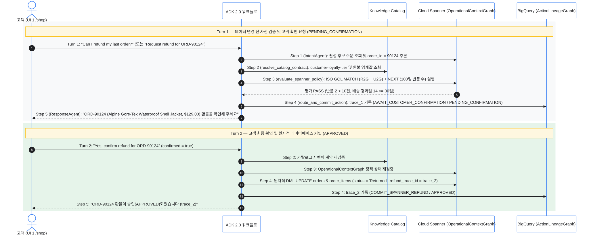

# Dual-Graph System of Action: 자율 환불 에이전트 핸즈온 랩 가이드

<!-- markdownlint-disable MD033 -->

이 핸즈온 랩에서는 Google Cloud에서 **Google Agent Development Kit 2.0 (ADK
2.0)**, **Cloud Spanner Graph**, **BigQuery Graph**, **Cloud Spanner Data
Boost**, 그리고 **Knowledge Catalog** 를 결합한 **Dual-Graph System of
Action** 아키텍처를 실습하고 검증합니다.

## 개요

대부분의 고객 지원 챗봇은 엔터프라이즈 트랜잭션을 안전하게 자동 실행하는 데
어려움을 겪습니다. LLM이 운영 데이터베이스에 직접 연결되면 상태 필드를 잘못
해석하거나 다계층 비즈니스 규칙을 우회하기 쉽습니다. 이 실습에서는 두 가지
보호 계층을 갖춘 아키텍처를 다룹니다.

- **운영 컨텍스트 그래프(Operational Context Graph, Cloud Spanner Graph):**
  데이터베이스 상태를 변경하기 전에 단일 그래프 탐색으로 다계층 적격성 정책과
  트랜잭션 주문 이력을 평가합니다.
- **액션 계보 그래프(Action Lineage Graph, BigQuery Graph):** 감사와 규정
  준수를 위해 모든 워크플로 노드, Knowledge Catalog 계약 용어, 정책 평가 내역을
  추가 전용(append-only) 그래프로 기록합니다.

## What you'll learn

이 랩에서는 실습 웹 인터페이스와 **Google Cloud Console** (**Cloud Spanner
Studio**, **BigQuery Studio**, **Knowledge Catalog**)을 함께 사용하여 다음 다섯
가지 핵심 패턴을 실습합니다.

- **콘솔 및 거버넌스 검증:** **Cloud Spanner Studio** 에서
  `OperationalContextGraph` 속성 그래프를, **BigQuery Studio** 에서
  `ActionLineageGraph` 속성 그래프를, **Knowledge Catalog** 에서 거버넌스 지표
  계약을 직접 조회하여 기본 구성을 확인합니다.
- 활동 1: 일반 등급 환불 승인 및 2단계 고객 확인 (`Customer A`, `user_id: 1001`,
  `STANDARD` 등급) — `ORD-90124` 환불을 요청하고 에이전트가 **Cloud Spanner** 를
  변경하기 전 `PENDING_CONFIRMATION` 상태에서 확인을 요청한 뒤 고객 승인 시
  `APPROVED` 로 커밋하는 흐름을 검증합니다.
- 활동 2: 일반 등급 정책 한도 초과 거절 (`Customer B`, `user_id: 2048`,
  `STANDARD` 등급) — `ORD-90588` 환불을 요청했을 때 최근 100일 반품
  12건(한도: 10건)으로 정책 게이트가 변경을 즉시
  차단(`BLOCK_SPANNER_MUTATION`)하는 과정을 확인합니다.
- 활동 3: Knowledge Catalog 기반 VIP 등급 환불 승인 (`Customer C`, `user_id:
  3072`, `VIP` 등급) — `ORD-90910` 환불을 요청했을 때 **Knowledge Catalog** 의
  `customer-loyalty-tier` 용어 계약 및 `COND-REFUND-VIP-100D-30D` (한도: 20건)
  조건에 따라 환불이 승인되는 과정을 확인합니다.
- 활동 4: 교차 엔진 연합 감사 (`Spanner Data Boost`) — **BigQuery Studio** 에서
  `EXTERNAL_QUERY` 와 **Cloud Spanner Data Boost** 를 사용하여 운영 트랜잭션
  성능에 영향을 주지 않고 BigQuery 감사 추적과 Cloud Spanner 그래프 상태를
  조인합니다.

## 설정 및 요구사항

**Start Lab** 버튼을 클릭하기 전에 아래 안내 사항을 확인하세요. 실습에는 제한
시간이 있으며 일시 중지할 수 없습니다. **Start Lab** 을 클릭하면 타이머가
시작됩니다.

이 핸즈온 랩에서는 시뮬레이션이나 데모 환경이 아닌 실제 Google Cloud 환경에서
직접 실습 활동을 수행합니다. 이를 위해 실습 시간 동안 Google Cloud Console 및
Cloud Run 웹 인터페이스에 접속하고 사용할 수 있는 새로운 임시 자격 증명이
제공됩니다.

이 실습을 완료하려면 다음 환경이 필요합니다.

- 표준 인터넷 브라우저(시크릿 모드의 Chrome 브라우저 권장)
- 실습을 마칠 때까지의 여유 시간

<ql-infobox>
<strong>참고:</strong> 이미 개인용 또는 기업용 Google Cloud 계정이나 프로젝트가
있더라도 이 실습에는 사용하지 마세요. 과금을 방지하기 위해 반드시 Qwiklabs에서
제공하는 임시 계정과 프로젝트를 사용하세요.
</ql-infobox>

<ql-warningbox>
<strong>주의:</strong> 이 실습의 스타트업 스크립트는 Cloud Spanner Graph,
BigQuery Graph, Knowledge Catalog, 그리고 Cloud Run 서비스를 자동으로
프로비저닝합니다. 할당량 초과나 과금 위반으로 계정이 차단되지 않도록 실습에서
안내하는 리소스 외의 추가 리소스를 생성하지 마세요.
</ql-warningbox>

## UI 이면의 Dual-Graph System of Action 동작 원리

### Dual-Graph 아키텍처 및 5단계 ADK 2.0 워크플로

아래 다이어그램은 **UI 1 (`/shop`)** 과 **UI 2 (`/console`)** 가 5단계 ADK 2.0
워크플로, **Knowledge Catalog**, **Cloud Spanner
`OperationalContextGraph`**, **BigQuery `ActionLineageGraph`** 와 상호작용하는
구조를 나타냅니다.

<!-- markdownlint-disable MD013 -->
<!-- MERMAID-DIAGRAM-START
%%{init: {"flowchart": {"nodeSpacing": 26, "rankSpacing": 46, "curve": "basis", "wrappingWidth": 440}}}%%
flowchart LR
  subgraph Col1A ["1A. 고객 스토어프론트 및 고객지원 챗 (Cloud Run)"]
    Shop["<div style='display:flex;align-items:center;gap:12px;text-align:left;padding:6px 16px 6px 8px;'><div style='width:40px;max-width:40px;flex-shrink:0;'></div><div style='line-height:1.35;white-space:nowrap;'><b style='font-size:14px;color:#202124;'>UI 1: 쇼핑몰 및 고객지원 챗 (/shop)</b><br/><span style='font-size:11px;color:#5F6368;'>페르소나 (STANDARD 및 VIP), 주문 카드 및 2턴 게이트</span></div></div>"]
  end

  subgraph Col1B ["1B. 데이터 엔지니어 조사 워크벤치 (Cloud Run)"]
    Console["<div style='display:flex;align-items:center;gap:12px;text-align:left;padding:6px 16px 6px 8px;'><div style='width:40px;max-width:40px;flex-shrink:0;'></div><div style='line-height:1.35;white-space:nowrap;'><b style='font-size:14px;color:#202124;'>UI 2: 데이터 엔지니어 콘솔 (/console)</b><br/><span style='font-size:11px;color:#5F6368;'>실시간 트레이스 피드, Dual-Graph 시각화 및 GQL 워크벤치</span></div></div>"]
  end

  subgraph Col2 ["2. ADK 2.0 하이브리드 에이전트 런타임 (google-adk + Vertex AI)"]
    LLM["<div style='display:flex;align-items:center;gap:12px;text-align:left;padding:6px 16px 6px 8px;'><div style='width:40px;max-width:40px;flex-shrink:0;'></div><div style='line-height:1.35;white-space:nowrap;'><b style='font-size:14px;color:#202124;'>Step 1 &amp; 5: Gemini LLM 노드 (gemini-3-flash-preview)</b><br/><span style='font-size:11px;color:#5F6368;'>IntentAgent (의도 및 주문 ID 파싱) → ResponseAgent (근거 기반 응답)</span></div></div>"]
    Gov["<div style='display:flex;align-items:center;gap:12px;text-align:left;padding:6px 16px 6px 8px;'><div style='width:40px;max-width:40px;flex-shrink:0;'></div><div style='line-height:1.35;white-space:nowrap;'><b style='font-size:14px;color:#202124;'>Step 2: resolve_catalog_contract (FunctionNode)</b><br/><span style='font-size:11px;color:#5F6368;'>거버넌스 등급 및 지표 규칙 바인딩 (LLM 연산 배제)</span></div></div>"]
    Eval["<div style='display:flex;align-items:center;gap:12px;text-align:left;padding:6px 16px 6px 8px;'><div style='width:40px;max-width:40px;flex-shrink:0;'></div><div style='line-height:1.35;white-space:nowrap;'><b style='font-size:14px;color:#202124;'>Step 3: evaluate_spanner_policy (FunctionNode)</b><br/><span style='font-size:11px;color:#5F6368;'>파라미터화된 ISO GQL 스냅샷 탐색 (PASS / FAIL 게이트)</span></div></div>"]
    Commit["<div style='display:flex;align-items:center;gap:12px;text-align:left;padding:6px 16px 6px 8px;'><div style='width:40px;max-width:40px;flex-shrink:0;'></div><div style='line-height:1.35;white-space:nowrap;'><b style='font-size:14px;color:#202124;'>Step 4: route_and_commit_action (FunctionNode)</b><br/><span style='font-size:11px;color:#5F6368;'>2턴 확인 게이트 → ACID DML + 감사 계보 추가</span></div></div>"]
    Audit["<div style='display:flex;align-items:center;gap:12px;text-align:left;padding:6px 16px 6px 8px;'><div style='width:40px;max-width:40px;flex-shrink:0;'></div><div style='line-height:1.35;white-space:nowrap;'><b style='font-size:14px;color:#202124;'>읽기 전용 감사 및 연합 쿼리 라우터</b><br/><span style='font-size:11px;color:#5F6368;'>스냅샷 ISO GQL, 계보 GQL 및 Data Boost SQL 실행</span></div></div>"]
  end

  subgraph PillarGov ["3A. 액티브 시맨틱 거버넌스 (Knowledge Catalog)"]
    KC["<div style='display:flex;align-items:center;gap:12px;text-align:left;padding:6px 16px 6px 8px;'><div style='width:40px;max-width:40px;flex-shrink:0;'></div><div style='line-height:1.35;white-space:nowrap;'><b style='font-size:14px;color:#202124;'>Knowledge Catalog: 비즈니스 용어집 및 Aspect</b><br/><span style='font-size:11px;color:#5F6368;'>soa-business-glossary | refund-metric-contract (STD 및 VIP)</span></div></div>"]
  end

  subgraph Pillar1 ["3B. Graph 1: 운영 컨텍스트 그래프 (실행 — Cloud Spanner Graph)"]
    U2G["<div style='display:flex;align-items:center;gap:12px;text-align:left;padding:6px 16px 6px 8px;'><div style='width:40px;max-width:40px;flex-shrink:0;'></div><div style='line-height:1.35;white-space:nowrap;'><b style='font-size:14px;color:#202124;'>Cloud Spanner Graph: U2G 정책 트리플</b><br/><span style='font-size:11px;color:#5F6368;'>policies, policy_conditions, policy_restrictions (STD: 10건, VIP: 20건)</span></div></div>"]
    R2G["<div style='display:flex;align-items:center;gap:12px;text-align:left;padding:6px 16px 6px 8px;'><div style='width:40px;max-width:40px;flex-shrink:0;'></div><div style='line-height:1.35;white-space:nowrap;'><b style='font-size:14px;color:#202124;'>Cloud Spanner Graph: R2G 운영 상태</b><br/><span style='font-size:11px;color:#5F6368;'>users, orders, order_items, products, centers (SERIALIZABLE ACID)</span></div></div>"]
  end

  subgraph Pillar2 ["3C. Graph 2: 액션 계보 그래프 및 연합 (기억 — BigQuery Graph)"]
    Lineage["<div style='display:flex;align-items:center;gap:12px;text-align:left;padding:6px 16px 6px 8px;'><div style='width:40px;max-width:40px;flex-shrink:0;'></div><div style='line-height:1.35;white-space:nowrap;'><b style='font-size:14px;color:#202124;'>BigQuery Graph: ActionLineageGraph (추가 전용)</b><br/><span style='font-size:11px;color:#5F6368;'>agent_sessions → workflow_nodes → policy_evaluations → agent_actions</span></div></div>"]
    DataBoost["<div style='display:flex;align-items:center;gap:12px;text-align:left;padding:6px 16px 6px 8px;'><div style='width:40px;max-width:40px;flex-shrink:0;'></div><div style='line-height:1.35;white-space:nowrap;'><b style='font-size:14px;color:#202124;'>Spanner Data Boost 연합 브리지</b><br/><span style='font-size:11px;color:#5F6368;'>EXTERNAL_QUERY 무부하 조인 (refund_trace_id = trace_id)</span></div></div>"]
  end

  Shop <--&gt;|"1. 2턴 환불 스트림"| LLM
  Console <--&gt;|"감사 및 GQL 워크벤치"| Audit

  Gov --&gt;|"2. 계약 확인"| KC
  Eval --&gt;|"3a. 등급 정책 매칭"| U2G
  Eval --&gt;|"3b. ISO GQL 자격 평가"| R2G
  Commit --&gt;|"4a. 2턴 ACID DML"| R2G
  Commit --&gt;|"4b. 감사 행 추가"| Lineage
  Audit --&gt;|"5a. 계보 ISO GQL"| Lineage
  Audit <--&gt;|"5b. 연합 감사"| DataBoost

  style Col1A fill:#E8F0FE,stroke:#4285F4,color:#202124,stroke-width:1.5px,rx:10px,ry:10px
  style Col1B fill:#E8F0FE,stroke:#4285F4,color:#202124,stroke-width:1.5px,rx:10px,ry:10px
  style Col2 fill:#F8F9FA,stroke:#DADCE0,color:#202124,stroke-width:1.5px,rx:10px,ry:10px
  style PillarGov fill:#FEF7E0,stroke:#FBBC04,color:#202124,stroke-width:1.5px,rx:10px,ry:10px
  style Pillar1 fill:#E6F4EA,stroke:#34A853,color:#202124,stroke-width:1.5px,rx:10px,ry:10px
  style Pillar2 fill:#E8F0FE,stroke:#4285F4,color:#202124,stroke-width:1.5px,rx:10px,ry:10px

  style Shop fill:#FFFFFF,stroke:#4285F4,color:#202124,stroke-width:2px,rx:8px,ry:8px
  style Console fill:#FFFFFF,stroke:#4285F4,color:#202124,stroke-width:2px,rx:8px,ry:8px
  style LLM fill:#FFFFFF,stroke:#EA4335,color:#202124,stroke-width:2px,rx:8px,ry:8px
  style Gov fill:#FFFFFF,stroke:#FBBC04,color:#202124,stroke-width:2px,rx:8px,ry:8px
  style Eval fill:#FFFFFF,stroke:#34A853,color:#202124,stroke-width:2px,rx:8px,ry:8px
  style Commit fill:#FFFFFF,stroke:#EA4335,color:#202124,stroke-width:2px,rx:8px,ry:8px
  style Audit fill:#FFFFFF,stroke:#4285F4,color:#202124,stroke-width:2px,rx:8px,ry:8px
  style KC fill:#FFFFFF,stroke:#FBBC04,color:#202124,stroke-width:2px,rx:8px,ry:8px
  style U2G fill:#FFFFFF,stroke:#34A853,color:#202124,stroke-width:2px,rx:8px,ry:8px
  style R2G fill:#FFFFFF,stroke:#34A853,color:#202124,stroke-width:2px,rx:8px,ry:8px
  style Lineage fill:#FFFFFF,stroke:#34A853,color:#202124,stroke-width:2px,rx:8px,ry:8px
  style DataBoost fill:#FFFFFF,stroke:#4285F4,color:#202124,stroke-width:2px,rx:8px,ry:8px
MERMAID-DIAGRAM-SOURCE -->


<!-- MERMAID-DIAGRAM-END -->

<!-- markdownlint-enable MD013 -->

## 작업 1. 실습 웹 인터페이스 및 Google Cloud Console 열기

<!-- markdownlint-disable MD013 -->
1.  Qwiklabs 연결 패널에서 **`shopping_mall_url`**
    (<ql-variable key="project_0.startup_script.shopping_mall_url" placeholder="shopping_mall_url"></ql-variable>),
    **`data_engineer_console_url`**
    (<ql-variable key="project_0.startup_script.data_engineer_console_url" placeholder="data_engineer_console_url"></ql-variable>),
    그리고 **`gcp_project_id`**
    (<ql-variable key="project_0.project_id" placeholder="YOUR_PROJECT_ID"></ql-variable>)
    세 가지 출력 값을 찾습니다.
1.  `shopping_mall_url` 과 `data_engineer_console_url` 을 각각 별도의 브라우저
    탭에서 엽니다.
1.  세 번째 브라우저 탭에서 **Google Cloud Console**
    (`https://console.cloud.google.com`)에 Qwiklabs 수강생 계정으로 로그인한
    뒤 `gcp_project_id` 프로젝트가 선택되어 있는지 점검합니다.

<!-- markdownlint-enable MD013 -->

## 작업 2. Google Cloud Console에서 실제 데이터베이스 및 거버넌스 상태 확인하기

웹 UI에서 에이전트를 실행하기 전에 **Google Cloud Console** 에서 데이터베이스와
카탈로그 리소스를 직접 조회해 그래프 스키마, 관계형 테이블, 정책 계약이 어떻게
구성되어 있는지 살펴봅니다.

### 속성 그래프 노드 및 엣지 스키마

두 그래프는 교차 그래프 조정 키(Cloud Spanner의 `order_items.refund_trace_id` ↔
BigQuery의 `agent_sessions.trace_id`)로 서로 이어집니다.

<!-- markdownlint-disable MD013 -->
<!-- MERMAID-DIAGRAM-START
%%{init: {"flowchart": {"nodeSpacing": 35, "rankSpacing": 45, "wrappingWidth": 420}}}%%
flowchart LR
  subgraph SpannerGraph ["Cloud Spanner: OperationalContextGraph"]
    U["<div style='display:flex;align-items:center;gap:12px;text-align:left;padding:6px 14px 6px 8px;'><div style='width:40px;max-width:40px;flex-shrink:0;'></div><div style='line-height:1.35;white-space:nowrap;'><b style='font-size:14px;color:#202124;'>users</b><br/><span style='font-size:11px;color:#5F6368;'>id, email, customer_tier (고객 노드)</span></div></div>"]
    O["<div style='display:flex;align-items:center;gap:12px;text-align:left;padding:6px 14px 6px 8px;'><div style='width:40px;max-width:40px;flex-shrink:0;'></div><div style='line-height:1.35;white-space:nowrap;'><b style='font-size:14px;color:#202124;'>orders</b><br/><span style='font-size:11px;color:#5F6368;'>order_id, status, delivered_at (주문 노드)</span></div></div>"]
    II["<div style='display:flex;align-items:center;gap:12px;text-align:left;padding:6px 14px 6px 8px;'><div style='width:40px;max-width:40px;flex-shrink:0;'></div><div style='line-height:1.35;white-space:nowrap;'><b style='font-size:14px;color:#202124;'>inventory_items</b><br/><span style='font-size:11px;color:#5F6368;'>id, product_id (재고 아이템 노드)</span></div></div>"]
    P["<div style='display:flex;align-items:center;gap:12px;text-align:left;padding:6px 14px 6px 8px;'><div style='width:40px;max-width:40px;flex-shrink:0;'></div><div style='line-height:1.35;white-space:nowrap;'><b style='font-size:14px;color:#202124;'>products</b><br/><span style='font-size:11px;color:#5F6368;'>id, name, category (상품 노드)</span></div></div>"]
    DC["<div style='display:flex;align-items:center;gap:12px;text-align:left;padding:6px 14px 6px 8px;'><div style='width:40px;max-width:40px;flex-shrink:0;'></div><div style='line-height:1.35;white-space:nowrap;'><b style='font-size:14px;color:#202124;'>distribution_centers</b><br/><span style='font-size:11px;color:#5F6368;'>id, name (물류 센터 노드)</span></div></div>"]
    POL["<div style='display:flex;align-items:center;gap:12px;text-align:left;padding:6px 14px 6px 8px;'><div style='width:40px;max-width:40px;flex-shrink:0;'></div><div style='line-height:1.35;white-space:nowrap;'><b style='font-size:14px;color:#202124;'>policies</b><br/><span style='font-size:11px;color:#5F6368;'>POL-REFUND-STD-V1 (환불 정책 노드)</span></div></div>"]
    COND["<div style='display:flex;align-items:center;gap:12px;text-align:left;padding:6px 14px 6px 8px;'><div style='width:40px;max-width:40px;flex-shrink:0;'></div><div style='line-height:1.35;white-space:nowrap;'><b style='font-size:14px;color:#202124;'>policy_conditions</b><br/><span style='font-size:11px;color:#5F6368;'>STD: 최대 10건, VIP: 최대 20건 (30일 이내)</span></div></div>"]
    RES["<div style='display:flex;align-items:center;gap:12px;text-align:left;padding:6px 14px 6px 8px;'><div style='width:40px;max-width:40px;flex-shrink:0;'></div><div style='line-height:1.35;white-space:nowrap;'><b style='font-size:14px;color:#202124;'>policy_restrictions</b><br/><span style='font-size:11px;color:#5F6368;'>DENY_AUTONOMOUS_REFUND (제한 조치)</span></div></div>"]

    U --&gt;|"[:places]"| O
    O --&gt;|"[:contains_item (order_items.refund_trace_id)]"| II
    II --&gt;|"[:is_product]"| P
    P --&gt;|"[:supplied_by]"| DC
    P --&gt;|"[:governed_by]"| POL
    POL --&gt;|"[:requires_condition]"| COND
    POL --&gt;|"[:enforces_restriction]"| RES
  end

  subgraph BQGraph ["BigQuery: ActionLineageGraph"]
    S["<div style='display:flex;align-items:center;gap:12px;text-align:left;padding:6px 14px 6px 8px;'><div style='width:40px;max-width:40px;flex-shrink:0;'></div><div style='line-height:1.35;white-space:nowrap;'><b style='font-size:14px;color:#202124;'>AgentSession</b><br/><span style='font-size:11px;color:#5F6368;'>trace_id, customer_id, target_order_id (세션 노드)</span></div></div>"]
    WN["<div style='display:flex;align-items:center;gap:12px;text-align:left;padding:6px 14px 6px 8px;'><div style='width:40px;max-width:40px;flex-shrink:0;'></div><div style='line-height:1.35;white-space:nowrap;'><b style='font-size:14px;color:#202124;'>WorkflowNode</b><br/><span style='font-size:11px;color:#5F6368;'>node_exec_id, node_name (워크플로 단계 노드)</span></div></div>"]
    PE["<div style='display:flex;align-items:center;gap:12px;text-align:left;padding:6px 14px 6px 8px;'><div style='width:40px;max-width:40px;flex-shrink:0;'></div><div style='line-height:1.35;white-space:nowrap;'><b style='font-size:14px;color:#202124;'>PolicyEvaluation</b><br/><span style='font-size:11px;color:#5F6368;'>eval_id, catalog_term_id, evaluation_result (정책 평가)</span></div></div>"]
    ACT["<div style='display:flex;align-items:center;gap:12px;text-align:left;padding:6px 14px 6px 8px;'><div style='width:40px;max-width:40px;flex-shrink:0;'></div><div style='line-height:1.35;white-space:nowrap;'><b style='font-size:14px;color:#202124;'>AgentAction</b><br/><span style='font-size:11px;color:#5F6368;'>action_id, action_type, decision_status (최종 액션)</span></div></div>"]

    S --&gt;|"[:executed_node]"| WN
    WN --&gt;|"[:evaluated_policy]"| PE
    PE --&gt;|"[:triggered_action]"| ACT
  end

  O -.-&gt;|"refund_trace_id = trace_id 교차 조정 (Spanner Data Boost)"| S

  style SpannerGraph fill:#F8F9FA,stroke:#DADCE0,color:#202124,stroke-width:1.5px,rx:10px,ry:10px
  style BQGraph fill:#F8F9FA,stroke:#DADCE0,color:#202124,stroke-width:1.5px,rx:10px,ry:10px

  style U fill:#FFFFFF,stroke:#4285F4,color:#202124,stroke-width:2px,rx:8px,ry:8px
  style O fill:#FFFFFF,stroke:#34A853,color:#202124,stroke-width:2px,rx:8px,ry:8px
  style II fill:#FFFFFF,stroke:#34A853,color:#202124,stroke-width:2px,rx:8px,ry:8px
  style P fill:#FFFFFF,stroke:#34A853,color:#202124,stroke-width:2px,rx:8px,ry:8px
  style DC fill:#FFFFFF,stroke:#34A853,color:#202124,stroke-width:2px,rx:8px,ry:8px
  style POL fill:#FFFFFF,stroke:#FBBC04,color:#202124,stroke-width:2px,rx:8px,ry:8px
  style COND fill:#FFFFFF,stroke:#FBBC04,color:#202124,stroke-width:2px,rx:8px,ry:8px
  style RES fill:#FFFFFF,stroke:#EA4335,color:#202124,stroke-width:2px,rx:8px,ry:8px
  style S fill:#FFFFFF,stroke:#34A853,color:#202124,stroke-width:2px,rx:8px,ry:8px
  style WN fill:#FFFFFF,stroke:#34A853,color:#202124,stroke-width:2px,rx:8px,ry:8px
  style PE fill:#FFFFFF,stroke:#FBBC04,color:#202124,stroke-width:2px,rx:8px,ry:8px
  style ACT fill:#FFFFFF,stroke:#EA4335,color:#202124,stroke-width:2px,rx:8px,ry:8px
MERMAID-DIAGRAM-SOURCE -->


<!-- MERMAID-DIAGRAM-END -->

<!-- markdownlint-enable MD013 -->

### 2a. Knowledge Catalog에서 비즈니스 용어집 및 Aspect 계약 확인

1.  Google Cloud Console 상단 검색창에 **Knowledge Catalog** 를 입력해 서비스로
    이동한 뒤 왼쪽 탐색 메뉴에서 **Glossaries** 를 선택합니다.
1.  **System of Action Business Glossary** (`soa-business-glossary`, 위치
    `Global`)를 클릭합니다.
1.  용어집 아래에 바로 표시되는 세 가지 핵심 비즈니스 용어( **Customer Loyalty Tier** ,
    **Order Age in Days** , **Rolling 100-Day Refund Count** )를 각각 클릭해 정의를
    살펴봅니다.
1.  왼쪽 탐색 메뉴의 **Metadata Types** 를 클릭하여 커스텀 **`Refund Metric Contract`
    (`refund-metric-contract`)** Aspect Type을 확인합니다. 머신 리더블 시맨틱
    계약을 구성하는 5개 표준 필드(`returned_status` [반품 완료 품목 상태 코드],
    `eligible_order_status` [배송 완료 주문 상태 코드], `rolling_window_days`
    [반품 집계 기간 일수], `standard_tier` [일반 고객 등급 코드], `vip_tier` [VIP
    고객 등급 코드])를 살펴봅니다.

**System of Action Business Glossary** (`soa-business-glossary`)에는 세 가지
표준 비즈니스 용어가 등록되어 있습니다.

- **`Customer Loyalty Tier` (`customer-loyalty-tier`):** 고객 등급(`STANDARD`
  대 `VIP`)에 따른 정책 분기 계약을 정의합니다.
- **`Order Age in Days` (`order-age-days`):** 배송 완료(`status = 'Complete'`)
  후 30일 이내 반품 가능 기간 규칙을 정의합니다.
- **`Rolling 100-Day Refund Count` (`rolling-100d-refund-count`):** 대상 주문을
  제외하고 최근 100일 동안 반품 완료(`status = 'Returned'`)된 `order_items`
  개수를 집계하는 규칙을 정의합니다.

<ql-infobox>
<strong>시맨틱 계약과 그래프 정책 조건의 역할 분담:</strong> ADK 2.0 워크플로의
Step 2(<code>resolve_catalog_contract</code>)는 런타임에 Knowledge Catalog
API를 호출하여 표준 파라미터(<code>returned_status = 'Returned'</code>,
<code>eligible_order_status = 'Complete'</code>,
<code>rolling_window_days = 100</code>)를 읽어 옵니다. 덕분에 LLM이 상태 코드를
임의로 추측하지 않습니다. 고객 등급별 세부 한도(STANDARD
<code>max_refunds_100d = 10</code>, VIP <code>20</code>, 반품 가능 기간
<code>return_window_days = 30</code>)는 작업 2b에서 살펴볼 Cloud Spanner
<code>OperationalContextGraph</code> 의 <code>policy_conditions</code> 노드에서
관리합니다.
</ql-infobox>

### 2b. Cloud Spanner Studio에서 OperationalContextGraph 조회 및 시각화

1.  Google Cloud Console 탐색 메뉴에서 **Spanner** → **Instances** 로 이동합니다.
1.  **System of Action Graph Instance** (`soa-graph-instance`)를 선택한 다음
    **`thelook-soa-db`** 데이터베이스를 엽니다.
1.  왼쪽 메뉴에서 **Spanner Studio** 를 클릭하고 **Explorer** 사이드바에서
    6개의 R2G 운영 테이블(`users`, `orders`, `order_items`, `inventory_items`,
    `products`, `distribution_centers`), 3개의 U2G 정책 테이블(`policies`,
    `policy_conditions`, `policy_restrictions`), 그리고 **`Graphs`** 아래의
    **`OperationalContextGraph`** 구성을 살펴봅니다.
1.  사이드바에서 **`OperationalContextGraph`** 오른쪽의 점 세 개 (**View
    actions** / 작업 보기) 메뉴를 클릭하고 **`View/modify visually`** 를 선택해
    8개 노드 테이블과 7개 엣지 테이블(`places`, `contains_item`, `is_product`,
    `supplied_by`, `governed_by`, `requires_condition`, `enforces_restriction`)이
    연결된 그래프 스키마 다이어그램을 확인합니다.
1.  **Spanner Studio** 에서 새 쿼리 편집기 탭을 열고 다음 ISO GQL 쿼리를 실행해
    실제 속성 그래프 데이터도 직접 시각화해 봅니다.

    ```sql
    -- 목적: Spanner Studio에서 R2G + U2G 통합 속성 그래프 토폴로지를 시각화합니다.
    -- 실행 대상: Cloud Spanner (thelook-soa-db -> OperationalContextGraph).
    -- 동작 방식: users -> orders -> inventory_items -> products -> distribution_centers
    --   경로와 products -> policies -> policy_conditions / policy_restrictions
    --   경로를 탐색하여 각 노드와 엣지를 JSON 객체로 반환합니다.
    -- 수집 정보: Cloud Spanner Studio(Graph 및 Table 보기)에서 인터랙티브 그래프를
    --   렌더링하기 위한 전체 노드 및 엣지 JSON 속성 정보.
    GRAPH OperationalContextGraph
    MATCH (u:users)-[e_places:places]->(o:orders {order_id: 90124})
            -[e_item:contains_item]->(ii:inventory_items)
            -[e_prod:is_product]->(p:products)
            -[e_dc:supplied_by]->(dc:distribution_centers),
          (p)-[e_gov:governed_by]->(pol:policies {status: 'ACTIVE'})
            -[e_cond:requires_condition]->(cond:policy_conditions),
          (pol)-[e_res:enforces_restriction]->(res:policy_restrictions)
    WHERE cond.applicable_tier = u.customer_tier
    RETURN
      TO_JSON(u) AS user_node,
      TO_JSON(e_places) AS places_edge,
      TO_JSON(o) AS order_node,
      TO_JSON(e_item) AS contains_item_edge,
      TO_JSON(ii) AS inventory_node,
      TO_JSON(p) AS product_node,
      TO_JSON(dc) AS dc_node,
      TO_JSON(pol) AS policy_node,
      TO_JSON(cond) AS condition_node,
      TO_JSON(res) AS restriction_node;
    ```

1.  **Spanner Studio** 결과 창에서 **Graph** 보기(노드와 엣지를 클릭하고 드래그할
    수 있는 인터랙티브 그래프 화면)와 **Table** 보기를 전환해 봅니다. 현재
    `o.status` 는 `'Complete'` 이고 `e_item.refund_trace_id` 는 `NULL` 인
    상태입니다.

### 2c. BigQuery Studio에서 ActionLineageGraph 스키마 확인

<!-- markdownlint-disable MD013 -->
1.  Google Cloud Console 탐색 메뉴에서 **BigQuery** → **Studio** 로 이동합니다.
1.  왼쪽 **Explorer** 창에서 프로젝트를 펼치고 **`soa_action_lineage`**
    데이터세트를 열어 봅니다.
1.  **Tables** 아래의 4개 계보 테이블(`agent_sessions`, `workflow_nodes`,
    `policy_evaluations`, `agent_actions`), **Graphs** 메뉴 항목 아래의 속성
    그래프 **`ActionLineageGraph`**, 그리고 **Connections** 아래의
    **<ql-variable key="project_0.startup_script.gcp_region" placeholder="us-central1"></ql-variable>.spanner-data-boost**
    연결이 준비되어 있는지 점검합니다.
1.  **Graphs** → **`ActionLineageGraph`** 를 클릭해 Google Cloud Console에서
    시각화된 그래프 스키마(`agent_sessions` → `workflow_nodes` →
    `policy_evaluations` → `agent_actions`)와 노드·엣지 속성 정보를 확인합니다.

<!-- markdownlint-enable MD013 -->

## 작업 3. 활동 1: Customer A 적격 환불 요청 및 2단계 확인

이 활동에서는 **UI 1 (`/shop`)** 에서 **Customer A (`Alice Chen`, `user_id:
1001`, `STANDARD` 등급)** 역할로 자연어 주문 추론과 2단계 고객 확인 게이트를
테스트합니다. 이어서 **Cloud Spanner Studio**, **BigQuery Studio**, **UI 2
(`/console`)** 에서 실제 데이터베이스 상태 변화를 검증합니다.

### 2단계 고객 확인 시퀀스 (`PENDING_CONFIRMATION` → `APPROVED` / `DENIED`)

유효한 고객 주문이 확인되더라도 에이전트는 곧바로 Cloud Spanner 데이터를 변경하지
않습니다. 2턴 확인 절차를 통해 고객이 주문 번호, 상품 사진, 상품명, 금액을 직접
확인한 뒤에야 트랜잭션을 커밋합니다.

<!-- markdownlint-disable MD013 -->
<!-- MERMAID-DIAGRAM-START
%%{init: {"theme": "base", "themeVariables": {"actorBkg": "#FFFFFF", "actorBorder": "#4285F4", "actorTextColor": "#202124", "signalColor": "#202124", "signalTextColor": "#202124", "labelBoxBkgColor": "#F8F9FA", "labelBoxBorderColor": "#DADCE0", "noteBkgColor": "#FEF7E0", "noteBorderColor": "#FBBC04", "noteTextColor": "#202124"}}}%%
sequenceDiagram
  autonumber
  actor Customer as 고객 (UI 1 /shop)
  participant ADK as ADK 2.0 워크플로
  participant Catalog as Knowledge Catalog
  participant Spanner as Cloud Spanner (OperationalContextGraph)
  participant BQ as BigQuery (ActionLineageGraph)

  rect rgb(248, 249, 250)
    Note over Customer,BQ: Turn 1 — 데이터 변경 전 사전 검증 및 고객 확인 요청 (PENDING_CONFIRMATION)
    Customer-&gt;>ADK: Turn 1: "Can I refund my last order?" (또는 "Request refund for ORD-90124")
    ADK-&gt;>Spanner: Step 1 (IntentAgent): 활성 후보 주문 조회 및 order_id = 90124 추론
    ADK-&gt;>Catalog: Step 2 (resolve_catalog_contract): customer-loyalty-tier 및 환불 임계값 조회
    ADK-&gt;>Spanner: Step 3 (evaluate_spanner_policy): ISO GQL MATCH (R2G + U2G) + NEXT (100일 반품 수) 실행
    Spanner--&gt;>ADK: 평가 PASS (반품 2 < 10건, 배송 경과일 14 <= 30일)
    ADK-&gt;>BQ: Step 4 (route_and_commit_action): trace_1 기록 (AWAIT_CUSTOMER_CONFIRMATION / PENDING_CONFIRMATION)
    ADK--&gt;>Customer: Step 5 (ResponseAgent): "ORD-90124 (Alpine Gore-Tex Waterproof Shell Jacket, $129.00) 환불을 확인해 주세요"
  end

  rect rgb(230, 244, 234)
    Note over Customer,BQ: Turn 2 — 고객 최종 확인 및 원자적 데이터베이스 커밋 (APPROVED)
    Customer-&gt;>ADK: Turn 2: "Yes, confirm refund for ORD-90124" (confirmed = true)
    ADK-&gt;>Catalog: Step 2: 카탈로그 시맨틱 계약 재검증
    ADK-&gt;>Spanner: Step 3: OperationalContextGraph 정책 상태 재검증
    ADK-&gt;>Spanner: Step 4: 원자적 DML UPDATE orders & order_items (status = 'Returned', refund_trace_id = trace_2)
    ADK-&gt;>BQ: Step 4: trace_2 기록 (COMMIT_SPANNER_REFUND / APPROVED)
    ADK--&gt;>Customer: Step 5: "ORD-90124 환불이 승인(APPROVED)되었습니다 (trace_2)"
  end
MERMAID-DIAGRAM-SOURCE -->


<!-- MERMAID-DIAGRAM-END -->

<!-- markdownlint-enable MD013 -->

### 3a. UI 1에서 Turn 1 (`PENDING_CONFIRMATION`) 실행

Alice Chen (`user_id: 1001`, `STANDARD` 등급)의 현재 스토어프론트 보유 주문은
다음 세 건입니다.

- `ORD-90124`: **Alpine Gore-Tex Waterproof Shell Jacket** (`$129.00`), 상태
  `Complete`, 14일 전 배송 완료 (최근 100일 반품 `2` 건).
- `ORD-90125`: **Polarized Aviator Titanium Sunglasses** (`$165.00`), 상태
  `Complete`, 45일 전 배송 완료.
- `ORD-90126`: **Cashmere Ribbed Winter Beanie** (`$58.00`), 상태 `Shipped`
  (배송 중).

1.  **UI 1 (`/shop`)** 상단의 **Active Customer Persona Switcher** 에서 **Alice
    Chen (`user_id: 1001`, `STANDARD` 등급)** 이 선택되어 있는지 확인합니다.
1.  오른쪽 **ADK 2.0 Refund Agent** 채팅 창에서 **Request refund for ORD-90124
    (Eligible Standard)** 프롬프트 칩을 클릭하거나 주문 번호 없이 다음과 같이
    자연어로 입력합니다.

    ```text
    최근 주문 환불할 수 있나요?
    ```

1.  채팅 창에 실시간 `[1/5]..[5/5]` 단계 텔레메트리 스트림이 표시되고 **Turn 1
    (`PENDING_CONFIRMATION`)** 확인 카드와 **`Confirm Refund: ORD-90124 —
    Alpine Gore-Tex Waterproof Shell Jacket ($129.00)`** (한국어 UI 모드에서는
    **`환불 확정: ORD-90124 — Alpine Gore-Tex Waterproof Shell Jacket
    ($129.00)`**) 버튼이 나타나는지 확인합니다.

**Turn 1** 요청을 보내면 백그라운드에서 5단계 워크플로가 순서대로 실행됩니다.

- **Step 1 (`IntentAgent`):** Cloud Spanner에서 Alice의 미반품 주문 목록을
  조회하고 `order_id = 90124` 를 특정합니다 (`ORD-90124` 프롬프트 칩 클릭 시 직접
  확인, 자연어 질문 시 `gemini-3-flash-preview` 문맥 추론).
- **Step 2 (`resolve_catalog_contract`):** **Knowledge Catalog** 에서
  `rolling-100d-refund-count` 용어의 표준 파라미터 계약을 조회합니다.
- **Step 3 (`evaluate_spanner_policy`):** `OperationalContextGraph` 에서 ISO
  GQL 쿼리를 실행해 `COND-REFUND-STD-100D-30D` 조건을 매칭한 뒤 최근 100일
  반품 수(`prior_refund_count_100d = 2 < 10`)와 배송 경과일
  (`target_order_age_days = 14 <= 30`)이 모두 기준을 충족(`evaluation_result =
  'PASS'`)하는지 판정합니다.
- **Step 4 (`route_and_commit_action`):** 고객이 아직 주문 번호와 상품을 최종
  확인하지 않았으므로 Cloud Spanner 데이터를 변경하지 않고 대기합니다.
  BigQuery에는 `PENDING_CONFIRMATION` 상태(`action_type =
  'AWAIT_CUSTOMER_CONFIRMATION'`)를 기록하며 Step 5(`ResponseAgent`)가 검증된
  그래프 사실을 바탕으로 안내 문구와 확인 버튼을 띄웁니다.

### 3b. Cloud Spanner Studio에서 승인 전 데이터베이스 상태 검증

1.  **Cloud Spanner Studio** 탭(`thelook-soa-db`)으로 전환해 다음 SQL을
    실행합니다.

    ```sql
    -- 목적: 고객 최종 승인 전(Turn 1 PENDING_CONFIRMATION)과 승인 후(Turn 2 APPROVED)에
    --   주문 90124의 실제 트랜잭션 상태를 검증합니다.
    -- 실행 대상: Cloud Spanner (thelook-soa-db 관계형 테이블: orders, order_items).
    -- 동작 방식: order_id = 90124를 기준으로 orders와 order_items를 (user_id, order_id)로 조인합니다.
    -- 수집 정보: 현재 주문 상태(승인 전 'Complete', 커밋 후 'Returned'), 반품 시각(returned_at),
    --   품목 상태(item_status), 그리고 교차 그래프 대사 키(refund_trace_id).
    SELECT
      o.order_id,
      o.status AS order_status,
      o.returned_at,
      oi.status AS item_status,
      oi.refund_trace_id
    FROM orders AS o
    JOIN order_items AS oi
      ON o.user_id = oi.user_id AND o.order_id = oi.order_id
    WHERE o.order_id = 90124;
    ```

1.  `order_status` 가 여전히 `'Complete'` 이고 `refund_trace_id` 가 `NULL` 로
    남아 있는지 확인합니다.

    <ql-code-block language="plaintext" output>
    order_id | order_status | returned_at | item_status | refund_trace_id
    ---------+--------------+-------------+-------------+----------------
    90124    | Complete     | NULL        | Complete    | NULL
    </ql-code-block>

<ql-infobox>
<strong>2단계 고객 확인 안전 게이트:</strong> Turn 1
(<code>PENDING_CONFIRMATION</code>)은 <code>OperationalContextGraph</code> 에
대해 실시간 환불 적격 여부만 먼저 검증하고 BigQuery에 감사 추적 로그를 기록하며
Cloud Spanner의 실제 주문 행은 변경하지 않습니다.
</ql-infobox>

### 3c. 환불 최종 승인(Turn 2 → `APPROVED`) 및 실시간 변경 검증

<!-- markdownlint-disable MD013 -->
1.  **UI 1 (`/shop`)** 으로 돌아가 **`Confirm Refund: ORD-90124 — Alpine Gore-Tex Waterproof Shell Jacket ($129.00)`** (한국어 UI 모드에서는 **`환불 확정: ORD-90124 — Alpine Gore-Tex Waterproof Shell Jacket ($129.00)`**) 버튼을
    클릭하거나 `네, 환불 진행해 주세요` (`Yes, please proceed`)라고 입력합니다.
1.  **Turn 2** 에서 워크플로가 `OperationalContextGraph` 정책을 재검증한 후
    Cloud Spanner DML을 원자적 트랜잭션으로 실행해 `ORD-90124` 를 `Returned` 로
    바꾸고 `order_items.refund_trace_id` 에 새 `trace_id` 를 기록하며 채팅 창에
    `APPROVED` 배지를 띄웁니다.
1.  다시 **Cloud Spanner Studio** 탭으로 전환해 3b 단계의 SQL 쿼리를 그대로
    실행해 봅니다. 이제 `order_status` 와 `item_status` 가 `'Returned'` 로
    바뀌고 `returned_at` 타임스탬프와 채팅 창에 표시된 UUID
    `refund_trace_id` 가 실제 데이터베이스에 기록된 것을 볼 수 있습니다.

    <ql-code-block language="plaintext" output>
    order_id | order_status | returned_at                 | item_status | refund_trace_id
    ---------+--------------+-----------------------------+-------------+-------------------------------------------
    90124    | Returned     | 2026-10-29T06:18:42.104829Z | Returned    | trace-8f2a9c41-5b10-4e32-9a7d-123456789abc
    </ql-code-block>

<!-- markdownlint-enable MD013 -->

### 3d. UI 2 및 BigQuery Studio에서 컨텍스트 그래프와 실행 계보 검증

1.  **UI 1 (`/shop`)** 의 `APPROVED` 카드에서 **Inspect in Data Engineer
    Console** 버튼을 눌러 Customer A의 `trace_id` 가 선택된 상태로 **UI 2
    (`/console`)** 를 엽니다.
1.  **UI 2 (`/console`)** 의 **Interactive Dual-Graph Visualizer** 에서 노드(`User
    1001`, `Order 90124`, `Product`, `Policy POL-REFUND-STD-V1`, `Condition
    COND-REFUND-STD-100D-30D`, 그리고 주황색 BigQuery 계보 노드)를 클릭해
    **Node Property Inspector** 의 속성 값을 살펴봅니다.
1.  탭 1 (**1. Cloud Spanner Context Graph**) 에서 **Run Query** 를 클릭합니다(또는
    **Cloud Spanner Studio** 에서 동일하게 실행합니다).

    ```sql
    -- 목적: 단일 2단계 ISO GQL 그래프 탐색으로 Customer A의 운영 컨텍스트와 등급별
    --   환불 정책 적격 여부를 평가합니다.
    -- 실행 대상: Cloud Spanner (thelook-soa-db -> OperationalContextGraph).
    -- 동작 방식:
    --   1단계(MATCH): R2G(users -> orders -> inventory_items -> products ->
    --     distribution_centers) 및 U2G(products -> policies -> policy_conditions /
    --     policy_restrictions) 경로를 고객 등급(customer_tier)에 맞춰 탐색합니다.
    --   2단계(NEXT + OPTIONAL MATCH): 최근 100일 이내 다른 주문에서 반품('Returned')된
    --     고유 품목 수를 집계합니다.
    -- 수집 정보: 고객 등급, 대상 주문 상태/배송 경과일/금액, 상품 및 물류센터 이름,
    --   적용된 정책 및 조건 ID, 100일 반품 한도(max_refunds_100d), 30일 반품 기간,
    --   그리고 실제 100일 반품 횟수(prior_refund_count_100d).
    GRAPH OperationalContextGraph
    MATCH (u:users {id: 1001})
            -[:places]->(target_o:orders {order_id: 90124})
            -[target_oi:contains_item]->(ii:inventory_items)-[:is_product]->(p:products)
            -[:supplied_by]->(dc:distribution_centers),
          (p)-[:governed_by]->(pol:policies {status: 'ACTIVE'})
            -[:requires_condition]->(cond:policy_conditions),
          (pol)-[:enforces_restriction]->(res:policy_restrictions)
    WHERE u.customer_tier IN ('STANDARD', 'VIP')
      AND cond.applicable_tier = u.customer_tier
    RETURN
      u.id AS user_id,
      u.email AS email,
      u.customer_tier AS customer_tier,
      target_o.order_id AS target_order_id,
      target_o.status AS target_order_status,
      TIMESTAMP_DIFF(CURRENT_TIMESTAMP(), target_o.delivered_at, DAY) AS target_order_age_days,
      ROUND(SUM(target_oi.sale_price), 2) AS target_order_price,
      STRING_AGG(DISTINCT p.name, ', ') AS product_names,
      STRING_AGG(DISTINCT dc.name, ', ') AS distribution_center_names,
      pol.policy_id AS policy_id,
      pol.name AS policy_name,
      cond.condition_id AS condition_id,
      cond.max_refunds_100d AS max_refunds_100d,
      cond.return_window_days AS return_window_days,
      res.action_code AS restriction_action
    GROUP BY
      user_id, email, customer_tier, target_order_id, target_order_status,
      target_order_age_days, policy_id, policy_name, condition_id,
      max_refunds_100d, return_window_days, restriction_action
    NEXT
    -- 2단계: 최근 100일 이내 다른 주문의 반품 완료 품목 수 집계
    OPTIONAL MATCH (u2:users)-[:places]->(hist_o:orders)-[hist_oi:contains_item]->(:inventory_items)
    WHERE u2.id = user_id
      AND hist_o.order_id != target_order_id
      AND hist_oi.status = 'Returned'
      AND COALESCE(hist_oi.returned_at, hist_o.returned_at, hist_o.created_at)
          >= TIMESTAMP_SUB(CURRENT_TIMESTAMP(), INTERVAL 100 DAY)
    RETURN
      user_id,
      email,
      customer_tier,
      target_order_id,
      target_order_status,
      product_names,
      distribution_center_names,
      target_order_price,
      target_order_age_days,
      COUNT(DISTINCT hist_oi.id) AS prior_refund_count_100d,
      policy_id,
      policy_name,
      condition_id,
      max_refunds_100d,
      return_window_days,
      restriction_action
    GROUP BY
      user_id, email, customer_tier, target_order_id, target_order_status,
      product_names, distribution_center_names, target_order_price,
      target_order_age_days, policy_id, policy_name, condition_id,
      max_refunds_100d, return_window_days, restriction_action;
    ```

1.  **UI 2 (`/console`)** 의 탭 2 (**2. BigQuery Action Lineage Graph**) 에서 **Run
    Query** 를 클릭하거나 **BigQuery Studio** 에서 다음 SQL 쿼리를 실행해
    `target_order_id = 90124` 에 기록된 Turn 1 (`PENDING_CONFIRMATION`)과
    Turn 2 (`APPROVED`) 두 건의 실행 계보를 모두 조회합니다.

    ```sql
    -- 목적: 주문 90124에 기록된 Turn 1(PENDING_CONFIRMATION) 및 Turn 2(APPROVED)
    --   에이전트 의사결정 계보(Lineage)를 감사합니다.
    -- 실행 대상: BigQuery (ActionLineageGraph의 기반인 soa_action_lineage 데이터세트).
    -- 동작 방식: agent_sessions -> workflow_nodes -> policy_evaluations -> agent_actions
    --   테이블을 ActionLineageGraph 기본 키/외래 키 경로에 따라 조인합니다.
    -- 수집 정보: 세션 trace_id, Knowledge Catalog 용어(catalog_term_id), 정책 이름,
    --   실제 반품 수와 허용 한도 비교, PASS/FAIL 평가 결과, 실행된 action_type 및 decision_status.
    SELECT
      s.trace_id,
      s.customer_id,
      s.target_order_id,
      n.node_name,
      pe.catalog_term_id,
      pe.policy_name,
      pe.observed_refunds_100d AS prior_refund_count_100d,
      pe.max_refunds_100d,
      pe.evaluation_result,
      act.action_type,
      act.decision_status,
      act.created_at AS committed_at
    FROM `soa_action_lineage.agent_sessions` AS s
    JOIN `soa_action_lineage.workflow_nodes` AS n
      ON s.trace_id = n.trace_id AND n.node_name = 'evaluate_spanner_policy'
    JOIN `soa_action_lineage.policy_evaluations` AS pe
      ON n.node_exec_id = pe.node_exec_id
    JOIN `soa_action_lineage.agent_actions` AS act
      ON pe.eval_id = act.eval_id
    WHERE s.customer_id = 1001
      AND s.target_order_id = 90124
    ORDER BY s.started_at DESC;
    ```

<ql-infobox>
<strong>참고:</strong> Google Cloud 프로젝트에 BigQuery Enterprise
예약(Reservation)이 연결된 경우 <strong>UI 2 (<code>/console</code>)</strong> 탭
2에 표시되는 ISO GQL
<code>FROM GRAPH_TABLE(soa_action_lineage.ActionLineageGraph MATCH ...)</code>
쿼리도 직접 실행할 수 있습니다. 기본 온디맨드 과금(<code>gcpfree</code>)
환경에서는 UI 2가 위와 동일한 파라미터화된 SQL <code>JOIN</code> 쿼리로 자동
전환해 실행합니다.
</ql-infobox>

## 작업 4. 활동 2: Customer B 반품 한도 초과 거절 (`STANDARD` 등급)

이 활동에서는 **Customer B (`Jordan Taylor`, `user_id: 2048`, `STANDARD` 등급)** 가
최근 100일 반품 한도(`12 >= 10`)를 초과했을 때 그래프 정책 게이트가 자율 환불을
차단하는 과정을 테스트합니다. 이어서 **Cloud Spanner Studio**, **BigQuery
Studio**, **UI 2 (`/console`)** 에서 변경 차단 상태와 거절 계보를 검증합니다.

### 4a. UI 1에서 Turn 1 (`PENDING_CONFIRMATION`) 및 Turn 2 (`DENIED`) 실행

1.  **UI 1 (`/shop`)** 으로 돌아가 **Active Customer Persona Switcher** 에서
    **Jordan Taylor (`user_id: 2048`, `STANDARD` 등급)** 을 선택합니다.
1.  메인 패널에서 Jordan Taylor의 주문 및 반품 이력(`100-Day Returned Items`:
    `12 / 10`으로 최근 100일 이내 `ORD-81001` ~ `ORD-81012` 반품 완료;
    `ORD-90588`: **CloudStride Trail Running Shoes** `$148.00`, 상태 `Complete`,
    10일 전 배송 완료)을 살펴봅니다.
1.  오른쪽 **ADK 2.0 Refund Agent** 채팅 창에서 **Request refund for ORD-90588
    (Standard 12 >= 10 Limit)** 프롬프트 칩을 클릭하거나 다음과 같이 입력합니다.

    ```text
    주문 ORD-90588 환불해주세요.
    ```

1.  **Turn 1 (`PENDING_CONFIRMATION`)** 확인 카드가 나타나면 **`Confirm Refund:
    ORD-90588 — CloudStride Trail Running Shoes ($148.00)`** (한국어 UI
    모드에서는 **`환불 확정: ORD-90588 — CloudStride Trail Running Shoes
    ($148.00)`**) 버튼을 클릭해 **Turn 2 (`DENIED`)** 를 실행합니다.

두 턴에 걸친 5단계 워크플로의 동작 흐름은 다음과 같습니다.

- **Step 1 (`IntentAgent`):** `user_id = 2048` 고객의 `order_id = 90588`
  (**CloudStride Trail Running Shoes**, `$148.00`) 주문을 특정합니다.
- **Step 2 (`resolve_catalog_contract`):** **Knowledge Catalog** 에서
  `rolling-100d-refund-count` 용어의 표준 파라미터 계약을 읽어 옵니다.
- **Step 3 (`evaluate_spanner_policy`):** Cloud Spanner의
  `OperationalContextGraph` 를 탐색해 `u.customer_tier = 'STANDARD'` 에 해당하는
  `COND-REFUND-STD-100D-30D` (`max_refunds_100d = 10`)를 매칭한 뒤 `NEXT`
  단계에서 `prior_refund_count_100d = 12` 를 집계합니다. `12 >= 10` 이므로
  `evaluation_result = 'FAIL'` 과 `failure_code = 'MAX_REFUNDS_EXCEEDED'` 를
  반환합니다.
- **Step 4 (`route_and_commit_action`):** Turn 1에서는 고객이 주문 정보를 먼저
  확인하도록 `PENDING_CONFIRMATION` (`action_type =
  'AWAIT_CUSTOMER_CONFIRMATION'`) 상태로 대기합니다. 이어서 Turn 2 확인을 거치면
  결정론적 정책 게이트가 환불 요청을 차단(`decision_status = 'DENIED'`,
  `action_type = 'BLOCK_SPANNER_MUTATION'`)하고 Cloud Spanner의 `ORD-90588` 주문
  상태를 수정하지 않은 채 그대로 보존합니다.

### 4b. Cloud Spanner Studio에서 거절된 주문이 변경되지 않았는지 검증

1.  **Cloud Spanner Studio** 탭(`thelook-soa-db`)으로 전환해 다음 SQL을
    실행합니다.

    ```sql
    -- 목적: Turn 2 정책 거절(BLOCK_SPANNER_MUTATION) 이후에도 주문 90588이
    --   Cloud Spanner에서 수정되지 않고 그대로 유지되었는지 검증합니다.
    -- 실행 대상: Cloud Spanner (thelook-soa-db 관계형 테이블: orders, order_items).
    -- 동작 방식: order_id = 90588을 기준으로 orders와 order_items를 (user_id, order_id)로 조인합니다.
    -- 수집 정보: order_status와 item_status가 여전히 'Complete'이고, returned_at과
    --   refund_trace_id가 모두 NULL인지 확인합니다.
    SELECT
      o.order_id,
      o.status AS order_status,
      o.returned_at,
      oi.status AS item_status,
      oi.refund_trace_id
    FROM orders AS o
    JOIN order_items AS oi
      ON o.user_id = oi.user_id AND o.order_id = oi.order_id
    WHERE o.order_id = 90588;
    ```

1.  `order_status` 와 `item_status` 가 여전히 `'Complete'` 이고 `returned_at` 과
    `refund_trace_id` 가 모두 `NULL` 인지 확인합니다. 정책 평가가 실패하면
    `BLOCK_SPANNER_MUTATION` 단계가 데이터베이스 쓰기 작업을 차단합니다.

    <ql-code-block language="plaintext" output>
    order_id | order_status | returned_at | item_status | refund_trace_id
    ---------+--------------+-------------+-------------+----------------
    90588    | Complete     | NULL        | Complete    | NULL
    </ql-code-block>

<ql-warningbox>
<strong>정책 차단 게이트:</strong> 환불 적격 여부가
<code>OperationalContextGraph</code>
(<code>prior_refund_count_100d = 12 &gt;= max_refunds_100d = 10</code>) 쿼리
결과로 직접 판정되므로 Step 4에서 Cloud Spanner 데이터 변경을 차단합니다.
</ql-warningbox>

### 4c. UI 2 및 Cloud Spanner Studio에서 정책 거절 컨텍스트 검증

1.  **UI 1 (`/shop`)** 의 `DENIED` 채팅 카드에서 **Inspect in Data Engineer
    Console** 버튼을 클릭해 Customer B의 `DENIED` `trace_id` 가 선택된 상태로
    **UI 2 (`/console`)** 를 엽니다.
1.  **UI 2 (`/console`)** 의 **Interactive Dual-Graph Visualizer** 에서 노드
    (`User 2048`, `Order 90588`, `Product`, `Policy POL-REFUND-STD-V1`,
    `Condition COND-REFUND-STD-100D-30D`, `PolicyRestriction
    (DENY_AUTONOMOUS_REFUND)` [`restriction_id: RES-DENY-AUTO-REFUND`], 그리고
    BigQuery `FAIL` / `DENIED` 계보 노드)를 클릭해 **Node Property Inspector** 의
    실시간 속성 값을 살펴봅니다.
1.  **UI 2 (`/console`)** 화면 하단으로 스크롤해 **Knowledge Catalog Semantic
    Contract** 패널의 **Preview Glossary & Contract** 버튼과 **Policy Document
    (U2G) & Extracted Triples** 패널의 **Preview return_policy_v1.md** 버튼을
    클릭하여 표준 `rolling-100d-refund-count` 계약과 원본 정책 문서를
    확인합니다.
1.  탭 1 (**1. Cloud Spanner Context Graph**) 에서 **`Activity 2: Customer B
    (2048 / ORD-90588 Denied)`** 프리셋 버튼을 클릭해 작업 3d의 2단계 ISO GQL
    쿼리를 `u:users {id: 2048}` 및 `target_o:orders {order_id: 90588}` 조건으로
    불러와 **Run Query** 를 클릭하거나 **Cloud Spanner Studio** 에서 직접
    실행합니다.
1.  쿼리 결과에서 `target_order_status = 'Complete'`, `target_order_age_days =
    10` (30일 반품 기간 이내)임에도 `customer_tier = 'STANDARD'`, `condition_id =
    'COND-REFUND-STD-100D-30D'`, `prior_refund_count_100d = 12`, 그리고
    `max_refunds_100d = 10` 으로 인해 `restriction_action =
    'DENY_AUTONOMOUS_REFUND'` 가 발동되었음을 확인합니다.

### 4d. UI 2 및 BigQuery Studio에서 거절 계보 검증

1.  **UI 2 (`/console`)** 의 탭 2 (**2. BigQuery Action Lineage Graph**) 로
    전환한 뒤 **`Activity 2: ActionLineageGraph GQL (Denial)`** 프리셋 버튼(또는
    **`Standard SQL JOIN Equivalent (On-Demand Fallback)`**)을 선택하고 **Run
    Query** 를 클릭합니다.
1.  선택 사항으로 **BigQuery Studio** 에서 작업 3d의 BigQuery SQL 쿼리 `WHERE`
    절을 `WHERE s.customer_id = 2048 AND s.target_order_id = 90588` 로 변경하고
    `SELECT` 절에 `act.rejection_reason` 을 추가해 실행하면 Turn 1
    (`PENDING_CONFIRMATION`)과 Turn 2 (`DENIED`) 감사 행을 직접 조회할 수
    있습니다.
1.  `ActionLineageGraph` 에 `catalog_term_id = 'rolling-100d-refund-count'`,
    `prior_refund_count_100d = 12`, `max_refunds_100d = 10`, `evaluation_result
    = 'FAIL'`, `action_type = 'BLOCK_SPANNER_MUTATION'`, `decision_status =
    'DENIED'` 와 함께 상세 `rejection_reason` 이 기록되었는지 확인합니다.

## 작업 5. 활동 3: Knowledge Catalog 기반 Customer C VIP 등급 환불 승인 (`VIP` 등급)

이 활동에서는 **Customer C (`Claire Vance`, `user_id: 3072`, `VIP` 등급)** 도
Customer B와 같이 최근 100일 반품 수가 `12` 건이지만, **Knowledge Catalog** 와
컨텍스트 그래프 라우팅을 통해 `VIP` 한도(`max_refunds_100d = 20`)가 적용되어
환불이 승인되는 과정을 확인합니다.

### 5a. UI 1에서 Turn 1 (`PENDING_CONFIRMATION`) 및 Turn 2 (`APPROVED`) 실행

1.  **UI 1 (`/shop`)** 으로 돌아가 **Active Customer Persona Switcher** 에서
    **Claire Vance (`user_id: 3072`, `VIP` 등급)** 을 선택합니다.
1.  메인 패널에서 Claire Vance의 주문 및 반품 이력(`100-Day Returned Items`:
    `12 / 20`으로 최근 100일 이내 `ORD-82001` ~ `ORD-82012` 반품 완료, `VIP`
    등급 한도 `20`건 적용; `ORD-90910`: **Tailored Italian Wool Travel Blazer**
    `$210.00`, 상태 `Complete`, 7일 전 배송 완료)을 살펴봅니다.
1.  오른쪽 **ADK 2.0 Refund Agent** 채팅 창에서 **Request refund for ORD-90910
    (VIP 12 < 20 Limit)** 프롬프트 칩을 클릭하거나 다음과 같이 자연어로
    입력합니다.

    ```text
    최근 주문 환불할 수 있나요?
    ```

1.  **Turn 1 (`PENDING_CONFIRMATION`)** 확인 카드를 확인한 뒤 **`Confirm Refund:
    ORD-90910 — Tailored Italian Wool Travel Blazer ($210.00)`** (한국어 UI
    모드에서는 **`환불 확정: ORD-90910 — Tailored Italian Wool Travel Blazer
    ($210.00)`**) 버튼을 눌러 **Turn 2 (`APPROVED`)** 를 실행합니다.

두 턴에 걸친 5단계 워크플로의 동작 흐름은 다음과 같습니다.

- **Step 1 (`IntentAgent`):** Claire Vance의 미반품 주문을 조회해 `order_id =
  90910` (**Tailored Italian Wool Travel Blazer**, `$210.00`)을 특정합니다.
- **Step 2 (`resolve_catalog_contract`):** `user_id = 3072` 고객이 `VIP`
  등급임을 확인하고 **Knowledge Catalog** 에서 **`customer-loyalty-tier`** 용어의
  파라미터 매핑(`standard_tier = 'STANDARD'`, `vip_tier = 'VIP'`)을 조회합니다.
- **Step 3 (`evaluate_spanner_policy`):** `OperationalContextGraph` 에서
  `u.customer_tier = 'VIP'` 를 `COND-REFUND-VIP-100D-30D` (`max_refunds_100d =
  20`) 조건과 매칭합니다. `12 < 20` 이고 `7 <= 30` 이므로 정책 평가를
  통과(`evaluation_result = 'PASS'`)합니다.
- **Step 4 (`route_and_commit_action`):** Turn 1 고객 확인
  (`PENDING_CONFIRMATION`) 이후 Turn 2에서 원자적 Cloud Spanner DML 트랜잭션을
  실행해 `ORD-90910` 을 `Returned` 로 업데이트하고
  `order_items.refund_trace_id` 에 새 `trace_id` 를 기록하며 BigQuery에
  `COMMIT_SPANNER_REFUND` / `APPROVED` 계보를 남깁니다.

### 5b. Cloud Spanner Studio에서 커밋된 VIP 환불 상태 검증

<!-- markdownlint-disable MD013 -->
1.  **Cloud Spanner Studio** 탭(`thelook-soa-db`)으로 전환해 다음 SQL을
    실행합니다.

    ```sql
    -- 목적: Turn 2 고객 확인 및 VIP 환불 승인(COMMIT_SPANNER_REFUND) 이후
    --   주문 90910의 실제 트랜잭션 상태를 검증합니다.
    -- 실행 대상: Cloud Spanner (thelook-soa-db 관계형 테이블: orders, order_items).
    -- 동작 방식: order_id = 90910을 기준으로 orders와 order_items를 (user_id, order_id)로 조인합니다.
    -- 수집 정보: order_status와 item_status가 'Returned'로 변경되었고, returned_at 타임스탬프와
    --   승인 trace_id(refund_trace_id)가 기록되었는지 확인합니다.
    SELECT
      o.order_id,
      o.status AS order_status,
      o.returned_at,
      oi.status AS item_status,
      oi.refund_trace_id
    FROM orders AS o
    JOIN order_items AS oi
      ON o.user_id = oi.user_id AND o.order_id = oi.order_id
    WHERE o.order_id = 90910;
    ```

1.  `order_status` 와 `item_status` 가 모두 `'Returned'` 로 변경되었고
    `returned_at` 시각과 채팅 창의 `APPROVED` 카드에 표시된 UUID
    `refund_trace_id` 가 일치하는지 확인합니다.

    <ql-code-block language="plaintext" output>
    order_id | order_status | returned_at                 | item_status | refund_trace_id
    ---------+--------------+-----------------------------+-------------+-------------------------------------------
    90910    | Returned     | 2026-10-29T06:22:08.512345Z | Returned    | trace-c3d4e5f6-7890-4123-b456-7890abcdef12
    </ql-code-block>

<!-- markdownlint-enable MD013 -->

<ql-infobox>
<strong>등급 기반 거버넌스 라우팅:</strong> Customer B와 Customer C 모두 최근
100일 동안 반품한 품목 수가 <code>12</code> 건으로 동일하지만 Knowledge Catalog의
<code>customer-loyalty-tier</code> 계약이 Customer C의 <code>VIP</code>
프로필(<code>vip_tier = 'VIP'</code>)을 바인딩하고 Cloud Spanner
<code>OperationalContextGraph</code> 가 코드 수정 없이
<code>COND-REFUND-VIP-100D-30D</code> (<code>max_refunds_100d = 20</code>)로
라우팅하여 환불을 승인합니다.
</ql-infobox>

### 5c. UI 2 및 Cloud Spanner Studio에서 VIP 정책 라우팅 검증

1.  **UI 1 (`/shop`)** 의 `ORD-90910` `APPROVED` 채팅 카드에서 **Inspect in Data
    Engineer Console** 버튼을 클릭해 Customer C의 `trace_id` 가 선택된 상태로
    **UI 2 (`/console`)** 를 엽니다.
1.  **UI 2 (`/console`)** 의 **Interactive Dual-Graph Visualizer** 에서 노드
    (`User 3072`, `Order 90910`, `Product`, `Policy POL-REFUND-STD-V1`,
    `Condition COND-REFUND-VIP-100D-30D`, 그리고 BigQuery `PASS` / `APPROVED`
    계보 노드)를 클릭해 **Node Property Inspector** 의 실시간 속성 값을
    살펴봅니다.
1.  **UI 2 (`/console`)** 화면 하단의 **Knowledge Catalog Semantic Contract**
    패널에서 **Preview Glossary & Contract** 버튼을 클릭해
    `customer-loyalty-tier` 계약(`standard_tier = 'STANDARD'`, `vip_tier =
    'VIP'`)과 SQL/GQL 매핑을 확인하고, **Policy Document (U2G) & Extracted
    Triples** 패널에서 **Preview return_policy_v1.md** 를 클릭해 추출된
    `COND-REFUND-VIP-100D-30D` (`max_refunds_100d = 20`) 트리플을 확인합니다.
1.  탭 1 (**1. Cloud Spanner Context Graph**) 에서 **`Activity 3: Customer C
    (3072 / ORD-90910 VIP)`** 프리셋 버튼을 클릭해 작업 3d의 2단계 ISO GQL
    쿼리를 `u:users {id: 3072}` 및 `target_o:orders {order_id: 90910}` 조건으로
    불러와 **Run Query** 를 클릭하거나 **Cloud Spanner Studio** 에서 직접
    실행합니다.
1.  쿼리 결과에서 `customer_tier = 'VIP'`, `condition_id =
    'COND-REFUND-VIP-100D-30D'`, `prior_refund_count_100d = 12`, 그리고
    `max_refunds_100d = 20` 이 반환되는지 확인합니다.

### 5d. UI 2 및 BigQuery Studio에서 VIP 승인 계보 검증

1.  **UI 2 (`/console`)** 의 탭 2 (**2. BigQuery Action Lineage Graph**) 로
    전환한 뒤 **`Activity 1 & 3: ActionLineageGraph GQL (Approval)`** 프리셋
    버튼(또는 **`Standard SQL JOIN Equivalent (On-Demand Fallback)`**)을
    선택하고 **Run Query** 를 클릭합니다.
1.  선택 사항으로 **BigQuery Studio** 에서 작업 3d의 BigQuery SQL 쿼리 `WHERE`
    절을 `WHERE s.customer_id = 3072 AND s.target_order_id = 90910` 으로 변경해
    실행하면 Turn 1 (`PENDING_CONFIRMATION`)과 Turn 2 (`APPROVED`) 두 건의 실행
    계보를 직접 확인할 수 있습니다.
1.  `ActionLineageGraph` 에 `catalog_term_id = 'customer-loyalty-tier'`,
    `prior_refund_count_100d = 12`, `max_refunds_100d = 20`, `evaluation_result
    = 'PASS'`, `action_type = 'COMMIT_SPANNER_REFUND'`, `decision_status =
    'APPROVED'` 가 정확히 기록되었는지 확인합니다.

## 작업 6. 활동 4: Spanner Data Boost 교차 엔진 연합 감사 쿼리 실행

활동 1, 2, 3을 마친 뒤에는 **Cloud Spanner Data Boost** 를 사용해 BigQuery의
`soa_action_lineage` 계보 테이블과 실시간 Cloud Spanner
`OperationalContextGraph` 노드를 단일 쿼리로 조인하여 감사합니다.

<ql-infobox>
<strong>왜 Cloud Spanner Data Boost를 사용하나요?</strong> BigQuery가
<code>spanner-data-boost</code> 외부 연결(<code>use_data_boost = true</code>,
<code>use_parallelism = true</code>)로 <code>EXTERNAL_QUERY</code> 를 실행하면
루트 파티션 분할이 가능한 ISO GQL 서브쿼리가 격리된 온디맨드 서버리스 컴퓨팅에서
병렬 실행됩니다. 운영 트랜잭션 인스턴스(<code>soa-graph-instance</code>)에
부하를 주지 않고도 별도 데이터 복제 없이 BigQuery 감사 로그와 실시간 Cloud
Spanner 상태를 대조할 수 있습니다.
</ql-infobox>

아래 연합 쿼리는 **Spanner Data Boost** 로 3개의 ISO GQL 조회(실시간 고객 등급
`sp_u`, 실시간 주문 상태 `sp_o`, `contains_item` 엣지의 실시간 `refund_trace_id`
`sp_oi`)를 푸시다운하고 BigQuery의 4개 `ActionLineageGraph` 테이블과 조인합니다.

### 연합 감사 쿼리 실행 및 검증

<!-- markdownlint-disable MD013 -->
1.  **UI 2 (`/console`)** 에서 탭 3 (**3. Federated Spanner Data Boost**) 을
    선택하고 **Run Query** 를 클릭합니다.
1.  동일한 연합 쿼리를 **Google Cloud Console** 의 **BigQuery Studio** 에서 직접
    돌려 보려면 아래 SQL 쿼리에서 `YOUR_PROJECT_ID.us-central1.spanner-data-boost` 를
    실습 환경의 `spanner_connection_id`
    (<ql-variable key="project_0.startup_script.spanner_connection_id" placeholder="YOUR_PROJECT_ID.us-central1.spanner-data-boost"></ql-variable>)
    값으로 바꾼 뒤 실행합니다.

    ```sql
    -- 목적: BigQuery ActionLineageGraph 의사결정 기록과 실시간 Cloud Spanner
    --   OperationalContextGraph 상태를 무복제(Zero-ETL)로 교차 대사합니다.
    -- 실행 대상: EXTERNAL_QUERY 및 Cloud Spanner Data Boost
    --   (spanner-data-boost) 기반 BigQuery + Spanner 연합 실행.
    -- 동작 방식: BigQuery의 4개 계보 테이블과 격리된 Spanner Data Boost 컴퓨팅으로
    --   푸시다운된 3개의 ISO GQL 서브쿼리(고객 sp_u, 주문 sp_o, 주문 품목 엣지 sp_oi)를 조인합니다.
    -- 수집 정보: BigQuery에서 APPROVED된 결정이 실제 Spanner에서 'Returned' 상태 및
    --   동일한 refund_trace_id로 반영되었는지, 그리고 DENIED된 결정이 'Complete' 상태를
    --   유지하는지 검증하는 엔드투엔드 감사 결과.
    SELECT
      s.trace_id,
      sp_u.email AS live_spanner_email,
      sp_u.customer_tier AS live_spanner_tier,
      s.target_order_id,
      sp_o.live_spanner_order_status,
      sp_o.live_spanner_returned_at,
      sp_oi.live_spanner_refund_trace_id,
      pe.catalog_term_id,
      pe.observed_refunds_100d AS prior_refund_count_100d,
      pe.max_refunds_100d,
      pe.evaluation_result,
      act.action_type,
      act.decision_status
    FROM `soa_action_lineage.agent_sessions` AS s
    JOIN `soa_action_lineage.workflow_nodes` AS n
      ON s.trace_id = n.trace_id AND n.node_name = 'evaluate_spanner_policy'
    JOIN `soa_action_lineage.policy_evaluations` AS pe
      ON n.node_exec_id = pe.node_exec_id
    JOIN `soa_action_lineage.agent_actions` AS act
      ON pe.eval_id = act.eval_id
    -- Spanner Data Boost로 ISO GQL 고객 노드 조회 푸시다운
    JOIN EXTERNAL_QUERY(
      'YOUR_PROJECT_ID.us-central1.spanner-data-boost',
      '''
      GRAPH OperationalContextGraph
      MATCH (u:users)
      WHERE u.id IN (1001, 2048, 3072)
      RETURN
        u.id AS user_id,
        u.email AS email,
        u.customer_tier AS customer_tier
      '''
    ) AS sp_u
      ON s.customer_id = sp_u.user_id
    -- Spanner Data Boost로 ISO GQL 실시간 주문 상태 조회 푸시다운
    JOIN EXTERNAL_QUERY(
      'YOUR_PROJECT_ID.us-central1.spanner-data-boost',
      '''
      GRAPH OperationalContextGraph
      MATCH (o:orders)
      WHERE o.user_id IN (1001, 2048, 3072)
      RETURN
        o.user_id AS user_id,
        o.order_id AS order_id,
        o.status AS live_spanner_order_status,
        CAST(o.returned_at AS STRING) AS live_spanner_returned_at
      '''
    ) AS sp_o
      ON s.customer_id = sp_o.user_id
     AND s.target_order_id = sp_o.order_id
    -- Spanner Data Boost로 ISO GQL contains_item 엣지의 refund_trace_id 조회 푸시다운
    JOIN EXTERNAL_QUERY(
      'YOUR_PROJECT_ID.us-central1.spanner-data-boost',
      '''
      GRAPH OperationalContextGraph
      MATCH (:orders)-[oi:contains_item]->(:inventory_items)
      WHERE oi.user_id IN (1001, 2048, 3072)
      RETURN
        oi.order_id AS order_id,
        oi.refund_trace_id AS live_spanner_refund_trace_id
      '''
    ) AS sp_oi
      ON s.target_order_id = sp_oi.order_id
    ORDER BY s.started_at DESC;
    ```

1.  쿼리 결과 표에서 교차 그래프 감사 결과를 대조해 봅니다.

<!-- markdownlint-enable MD013 -->

연합 쿼리 결과 행에서 세 가지 항목을 확인합니다.

- 각 `EXTERNAL_QUERY` 블록은 격리된 **Cloud Spanner Data Boost** 컴퓨팅
  (`use_data_boost = true`, `use_parallelism = true`)에서 파티션 병렬 처리가
  가능한 ISO GQL `GRAPH OperationalContextGraph MATCH` 쿼리를 실행합니다.
- 승인된 `ORD-90124` (`STANDARD`)와 `ORD-90910` (`VIP`) 주문은
  `live_spanner_order_status = 'Returned'` 로 바뀌어 있고
  `live_spanner_refund_trace_id` 가 BigQuery의 `APPROVED` `trace_id` 와 정확히
  일치합니다.
- 거절된 `ORD-90588` (`STANDARD`) 주문은 `decision_status = 'DENIED'` 와 함께
  `live_spanner_order_status = 'Complete'` 및 `live_spanner_refund_trace_id =
  NULL` 로 그대로 남아 있습니다.

## 작업 7. UI 1 추가 엣지 케이스 시나리오 테스트

**UI 1 (`/shop`)** 에서 **Customer A (`Alice Chen`, `user_id: 1001`)** 프로필로
추가 엣지 케이스와 대화형 시나리오도 직접 실험해 보세요.

- **30일 반품 가능 기간 만료 (`ORD-90125`):** **Request refund for ORD-90125
  (Expired 45d Window)** 칩을 클릭하거나 `"선글라스 환불해주세요."` 라고
  입력합니다. Step 1에서 `order_id = 90125` (**Polarized Aviator Titanium
  Sunglasses**, `$165.00`)를 추론해 Turn 1 확인(`PENDING_CONFIRMATION`)을
  요청합니다. 이어지는 Turn 2에서는 `target_order_age_days = 45 > 30` 이므로
  `RETURN_WINDOW_EXPIRED` 사유로 거절합니다.
- **배송 미완료 주문 (`ORD-90126`):** **Request refund for ORD-90126 (Shipped /
  In Transit)** 칩을 클릭하거나 `"배송 중인 주문 환불해주세요."` 라고 입력합니다.
  Step 1에서 `order_id = 90126` (**Cashmere Ribbed Winter Beanie**, `$58.00`)을
  추론해 Turn 1 확인(`PENDING_CONFIRMATION`)을 요청합니다. 이어서 Turn 2를
  진행하면 `target_order_status = 'Shipped'` 이므로 `ORDER_NOT_DELIVERED` 사유로
  거절합니다.
- **모호한 주문 질의(`resolution_mode = 'clarify'`) 및 환불 취소 의사
  (`resolution_mode = 'cancelled'`):** 주문 번호나 단서 없이 `"환불해주세요."`
  라고만 입력하거나 확인 단계에서 `"아니요, 다른 주문이에요."` 또는 `"환불
  취소할게요."` 라고 입력해 봅니다. 에이전트가 `PENDING_CONFIRMATION` 상태를
  유지하면서 Alice의 미반품 주문 목록을 클릭 가능한 후보 칩으로 제시합니다.
- **미구매 스토어프론트 상품 환불 요청 (`unmatched_product`):** Alice가 구매한
  적이 없는 스토어프론트 카탈로그 상품에 대해 환불이나 주문을 문의해 봅니다 (예:
  `"셔츠 환불해주세요."`). `IntentAgent` 가 **Organic Supima Cotton Shirt** 가
  Alice의 주문 이력에 없음을 감지하고 `ResponseAgent` 가 이를 명확히 안내하면서
  현재 환불 가능한 보유 주문 목록(`ORD-90126`, `ORD-90124`, `ORD-90125`)을 클릭
  가능한 후보 칩으로 제시합니다.
- **대화형 주문 목록, 상태 필터링 및 순서/최상급 후속 질의 (`ORDER_LIST`,
  `POLICY_INFO`, `ORDER_INFO`):** `"최근 주문 목록 3개 보여주세요."` 를 입력한 뒤
  `"목록에서 가장 오래된 주문이 뭐예요?"` 또는 `"목록에서 가장 저렴한 주문이
  뭐예요?"` 를 입력하면 주문일·배송일을 포함한 단일 주문 상세 정보
  (`ORDER_INFO`)를 안내합니다. `"최근 주문 중 배송 완료된 주문이 뭐예요?"` 처럼
  특정 상태의 주문만 질문하면 에이전트 답변에 언급된 2건의 `'Complete'` 주문
  카드(`ORD-90124`, `ORD-90125`)만 동기화해 보여줍니다.

## 작업 8. 핵심 개념 확인 퀴즈

다음 객관식 문제를 풀어 Dual-Graph System of Action 아키텍처의 핵심 개념을
점검해 보세요.

<!-- markdownlint-disable MD013 -->
<ql-multiple-choice-probe stem="환불 에이전트가 반품 허용 한도(STANDARD 10건 대 VIP 20건)를 추측하거나 환각하지 않도록 결정론적 사전 실행 컨텍스트와 거버넌스 임계값 계약을 제공하는 Google Cloud 구성 요소 조합은 무엇인가요?">
  <ql-option>PDF 반품 정책 문서에 대한 Vector RAG 유사도 검색</ql-option>
  <ql-option>IntentAgent (gemini-3-flash-preview) 내부의 시스템 프롬프트 지침 단독 사용</ql-option>
  <ql-option correct>Knowledge Catalog (refund-metric-contract) 및 Cloud Spanner OperationalContextGraph</ql-option>
  <ql-option>BigQuery ActionLineageGraph 추가 전용(Append-only) 감사 테이블 단독 사용</ql-option>
</ql-multiple-choice-probe>

<ql-multiple-choice-probe stem="Customer B와 Customer C 모두 최근 100일 동안 반품한 품목 수가 12건으로 동일한데, 왜 Customer B의 ORD-90588 환불 요청은 거절(DENIED)되고 Customer C의 ORD-90910 환불 요청은 승인(APPROVED)되나요?">
  <ql-option>Customer B의 주문이 배송 완료 후 30일을 초과했기 때문</ql-option>
  <ql-option correct>Knowledge Catalog가 Customer C의 VIP 등급 계약(customer-loyalty-tier)을 해석하고 Cloud Spanner OperationalContextGraph가 COND-REFUND-VIP-100D-30D (max_refunds_100d = 20) 조건으로 라우팅하는 반면 Customer B는 STANDARD 등급 한도(10건)의 적용을 받기 때문</ql-option>
  <ql-option>Customer B가 Turn 2에서 환불 최종 확인을 누르지 않았기 때문</ql-option>
  <ql-option>Cloud Spanner Data Boost가 고가 상품에 대한 거절 판정을 자동으로 덮어쓰기 때문</ql-option>
</ql-multiple-choice-probe>

<ql-multiple-choice-probe stem="활동 4에서 BigQuery ActionLineageGraph와 실시간 Cloud Spanner OperationalContextGraph 데이터를 조인할 때 Cloud Spanner Data Boost (spanner-data-boost)가 필요한 까닭은 무엇인가요?">
  <ql-option>Cloud Spanner DML 트랜잭션을 BigQuery SQL로 자동 변환하기 위해</ql-option>
  <ql-option correct>실시간 트랜잭션 Spanner 인스턴스의 CPU에 부하를 주지 않고 격리된 서버리스 컴퓨팅에서 BigQuery EXTERNAL_QUERY ISO GQL 서브쿼리를 병렬 실행하기 위해</ql-option>
  <ql-option>Knowledge Catalog 비즈니스 용어집을 BigQuery 뷰로 대체하기 위해</ql-option>
  <ql-option>Cloud Run 로컬 메모리에 LLM 응답을 캐싱하기 위해</ql-option>
</ql-multiple-choice-probe>

<!-- markdownlint-enable MD013 -->
