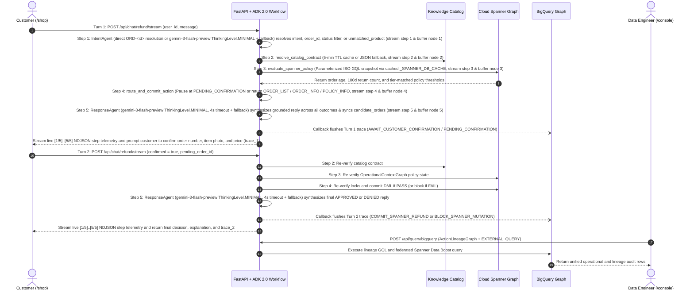

# System architecture and multi-region infrastructure

This document defines the architectural pillars, goals and non-goals, design
alternatives, risk mitigations, cost and timeline budgets, verification gates,
and multi-region Terraform configuration for the **Dual-Graph System of Action**
Qwiklabs V2 lab.

## Overview and state of the art

### Objectives

This project provides a deployable reference application and hands-on lab that
evaluates customer refund requests against structured e-commerce records and
corporate policy rules before mutating operational data, while logging every
evaluation step into an analytical graph for auditability.

### Limits of current practice

Enterprise teams building transactional AI agents typically rely on three
patterns that fail under production audit and consistency requirements:

1.  **Vector RAG over policy documents:** Embedding policy PDFs into vector
    stores retrieves text chunks by cosine similarity, which drops hard boolean
    thresholds (such as a 30-day delivery window combined with a 100-day return
    cap) and relies on the LLM to perform arithmetic in token space.
1.  **Direct natural language-to-SQL generation:** Allowing an LLM to generate
    ad-hoc SQL over multi-table schemas (`users`, `orders`, `order_items`,
    `inventory_items`, `products`) introduces multi-item join fan-out errors and
    SQL injection risks.
1.  **Autonomous LLM tool-calling loops:** Granting an LLM direct tool access to
    update database rows allows prompt injection or fabricated arguments to
    commit unauthorized refunds without an immutable causal link between the
    observed database state and the executed mutation.

## Four architectural pillars

To address those limits, the lab implements a **Dual-Graph Architecture** over
Google Cloud's public **`thelook_ecommerce` (`thelook`)** dataset:

1.  **ADK 2.0 graph-based workflow runtime:** Implements the refund agent using
    [Google Agent Development Kit 2.0 (ADK 2.0)](https://adk.dev/2.0/)
    (`google.adk` `Workflow`, `Agent`, `Context`, `FunctionNode`, and
    `InMemoryRunner` primitives). The workflow compiles the 5-step DAG into
    `refund_system_of_action.adk_workflow`, configures Gemini `Agent` nodes
    (`before_agent_callback` with `ThinkingLevel.MINIMAL`, `max_output_tokens =
    250..300`, and a single-attempt 4-second HTTP timeout) for natural language
    intent parsing and response synthesis, wraps Knowledge Catalog lookup,
    cached Cloud Spanner Graph evaluation (`_SPANNER_DB_CACHE`), and
    transactional mutations in `FunctionNode` step nodes, and executes each
    session turn through `InMemoryRunner.run_async(...)`. See
    [app/agent/README.md](../app/agent/README.md).
1.  **Operational Context Graph in Cloud Spanner Graph (Acting):** Corresponds
    to the operational **Knowledge Graph** in the `projects/beyond-the-chatbot`
    reference series. It combines the six Relational-to-Graph (R2G) operational
    order and fulfillment tables from `thelook_ecommerce` (`users`, `orders`,
    `order_items`, `inventory_items`, `products`, and `distribution_centers`)
    with Unstructured-to-Graph (U2G) refund policy triples (`policies`,
    tier-qualified `policy_conditions`, and `policy_restrictions`) compiled from
    corporate return policy documents. The workflow evaluates multi-hop refund
    eligibility (matching `cond.applicable_tier = u.customer_tier`) in a single
    parameterized ISO Graph Query Language (GQL) traversal before mutating
    database state. See [data/README.md](../data/README.md).
1.  **Action Lineage Graph in BigQuery Graph (Remembering):** Corresponds to the
    **Decision-Trace Context Graph** in the `projects/beyond-the-chatbot`
    reference series. An ADK 2.0 `after_node_callbacks` hook buffers each
    workflow node transition, evaluated policy rule, observed customer metric,
    and action decision in `ctx.state["lineage_buffer"]` and flushes the
    verified session trace into BigQuery
    (`soa_action_lineage.ActionLineageGraph`) when Step 5 completes. Data
    engineers run federated analytical queries across live Spanner nodes and
    historical BigQuery lineage records using **Spanner Data Boost**.
1.  **Active semantic governance in Knowledge Catalog:** Separates
    metadata governance from operational graph storage:
    - **Knowledge Catalog (Business Glossary and Metadata Aspects):**
      Owns the governed **semantic metric contracts** defining how business
      metrics such as `Rolling 100-Day Refund Count`
      (`prior_refund_count_100d`), `Order Age in Days`
      (`target_order_age_days`), and `Customer Loyalty Tier` (`customer_tier`
      verified against governed `'STANDARD'` and `'VIP'` glossary literals) map
      to verified `thelook_ecommerce` status values (`order_items.status =
      'Returned'` and `orders.status = 'Complete'`).
    - **Cloud Spanner U2G policy nodes:** Own the **operational policy
      parameters** extracted from corporate policy documents (`max_refunds_100d
      = 10` for `STANDARD` tier, `max_refunds_100d = 20` for `VIP` tier,
      `return_window_days = 30`, and `action_code = 'DENY_AUTONOMOUS_REFUND'`)
      assigned to `thelook` products via `products.policy_id`.

## Goals and non-goals

### Goals

- Deploy a self-contained Dual-Graph System of Action across five Qwiklabs
  regions (`us-central1`, `us-west1`, `us-west4`, `us-east1`, `us-east4`) under
  a single Cloud Run service (`soa-refund-agent-app`).
- Enforce deterministic refund eligibility checks in Cloud Spanner Graph using
  parameterized ISO GQL and read-write transactions before mutating order rows.
- Capture a complete, queryable decision audit trail in BigQuery Graph
  (`soa_action_lineage.ActionLineageGraph`) joined to Cloud Spanner through
  `target_order_id`, `policy_id`, and `order_items.refund_trace_id`.
- Provide two browser interfaces (`/shop` and `/console`) so students can test
  approved, denied, VIP-tier, and edge-case refund requests and run ISO GQL
  queries without switching tools.

### Non-goals

- **Custom Virtual Private Cloud (VPC) networking:** All backing services
  communicate over Google Cloud serverless APIs using Identity and Access
  Management (IAM) credentials.
- **Colab Enterprise notebooks:** UI 2 (`/console`) embeds a 3-tab ISO GQL
  workbench directly in the web application.
- **Live runtime Document AI PDF extraction during lab startup:** To avoid
  Document AI processor quota delays during Qwiklabs provisioning, the
  repository includes pre-compiled U2G policy triples in
  `data/policies/u2g_policy_triples.json`.
- **Automated Qwiklabs grading scripts (`assessments/`):** This lab is an
  ungraded hands-on exploration experience.

## Alternatives considered

The table below summarizes the main architectural trade-offs and rejected
alternatives:

| Design dimension | Chosen approach | Rejected alternative | Trade-off and rationale for rejection |
| :--- | :--- | :--- | :--- |
| **Graph storage topology** | **Dual-Graph** (Cloud Spanner Graph for operational state + BigQuery Graph for append-only action lineage) | **Single-engine graph** (storing both operational orders and high-volume agent telemetry in Spanner, or running operational transactions in BigQuery) | Storing high-volume agent trace logs in Cloud Spanner increases operational storage and compute costs, while BigQuery is optimized for append-only analytical scans and Cloud Spanner handles low-latency row-level read-write transactions. |
| **Agent orchestration** | **ADK 2.0 hybrid workflow** (LLM nodes for intent/response + deterministic Python nodes for policy check and mutation) | **Autonomous LLM tool-calling loop** (single LLM deciding which tools to call and whether to commit the refund) | Autonomous tool-calling exposes database mutation tools to prompt injection and non-deterministic LLM arithmetic. Deterministic Python nodes guarantee that mutations only occur when `evaluation_result == 'PASS'`. |
| **Database seeding in Qwiklabs** | **Idempotent Cloud Run lifespan bootstrap** (`ensure_bootstrapped()` calling `seed_spanner_if_empty()`) | **Terraform `local-exec` provisioner** running Python seed scripts on the Qwiklabs runner | The Qwiklabs Terraform runner container uses an immutable image that does not pre-install `google-cloud-spanner` or `google-cloud-bigquery` Python packages. Running seeding inside the Cloud Run container guarantees locked dependencies. |
| **Spanner-to-BigQuery federation** | **`EXTERNAL_QUERY` over `spanner-data-boost`** (`use_data_boost = true` for ISO GQL pushdown) | **Scheduled ETL replication** or **`CREATE EXTERNAL SCHEMA` alone** | Scheduled ETL introduces replication lag, while `CREATE EXTERNAL SCHEMA` exposes only relational tables in BigQuery SQL and cannot push `GRAPH OperationalContextGraph MATCH` GQL queries down to Spanner Data Boost. |

## End-to-end runtime interaction

For the component topology diagram, see
[README.md](../README.md#system-architecture). The sequence diagram below shows
the runtime execution flow across a two-turn confirmed refund request (as well
as read-only informational queries) and data engineer audit:

## Multi-region Terraform and Qwiklabs V2 configuration

Terraform (`runtime.yaml` pinned to `terraform` version `1.15.6`, with
`providers.tf` pinning `hashicorp/google ~> 6.0`, `hashicorp/google-beta ~>
6.0`, and `hashicorp/http ~> 3.4`) provisions all infrastructure across the five
Qwiklabs-allowed Google Cloud regions (`us-central1`, `us-west1`, `us-west4`,
`us-east1`, and `us-east4`).

### Regional service mapping

Qwiklabs (or a standalone operator) passes the target region through
`var.gcp_region`. `main.tf` maps each Google Cloud service to its regional or
global endpoint:

- **Google Cloud API activation (`google_project_service` `for_each`):**
  Activates `spanner.googleapis.com`, `bigquery.googleapis.com`,
  `bigqueryconnection.googleapis.com`, `run.googleapis.com`,
  `cloudbuild.googleapis.com`, `artifactregistry.googleapis.com`,
  `dataplex.googleapis.com`, `aiplatform.googleapis.com`, `iam.googleapis.com`,
  `cloudresourcemanager.googleapis.com`, and (when `local.enable_iap` is `true`,
  i.e., `var.argolis || var.enable_iap`) `iap.googleapis.com` using a single
  `for_each` loop with `disable_on_destroy = false`.
- **Cloud Spanner instance (`regional-${var.gcp_region}`):** Configures `config
  = "regional-${var.gcp_region}"`, `edition = "ENTERPRISE"` (required for
  `CREATE PROPERTY GRAPH`), and `processing_units = 100` (0.1 node for Qwiklabs
  quota compliance). Terraform applies the Spanner Data Definition Language
  (DDL) statements through `google_spanner_database`. On container startup,
  `ensure_bootstrapped()` calls `seed_spanner_if_empty()` in
  `data/spanner_seed.py` so scale-out or cold-start instances never overwrite
  committed demo orders.
- **BigQuery dataset and Spanner Data Boost (`var.gcp_region`):** Provisions the
  `soa_action_lineage` dataset, base lineage tables, and a
  `google_bigquery_connection` (`connection_id = "spanner-data-boost"`,
  `cloud_spanner` with `use_data_boost = true` and `use_parallelism = true`)
  in `location = var.gcp_region`. `main.tf` grants `soa-app-sa`
  `roles/bigquery.connectionUser`, `roles/spanner.databaseUser`, and
  `roles/spanner.databaseReaderWithDataBoost` (while `qwiklabs.yaml` grants the
  student `gcp_user` resource `roles/bigquery.connectionUser`,
  `roles/bigquery.jobUser`, `roles/bigquery.dataViewer`, and
  `roles/spanner.databaseReaderWithDataBoost` via its `permissions` list).
  Queries use `EXTERNAL_QUERY` over `spanner-data-boost` to push root-partitionable
  ISO GQL queries (`GRAPH OperationalContextGraph MATCH ...`) directly to Cloud
  Spanner Data Boost serverless compute. Because BigQuery treats the GQL string
  inside `EXTERNAL_QUERY` as opaque, queries include filter predicates (`WHERE
  u.id IN (1001, 2048, 3072)`) inside the inner GQL string because outer
  BigQuery `JOIN` conditions are not pushed into an opaque GQL query.
- **BigQuery property graph and on-demand `gcpfree` compatibility:** During
  container bootstrap, `ensure_bootstrapped()` attempts to execute `CREATE OR
  REPLACE PROPERTY GRAPH soa_action_lineage.ActionLineageGraph`. In Qwiklabs
  `gcpfree` projects running in on-demand mode without a BigQuery Enterprise
  slot reservation, BigQuery property graph DDL or `GRAPH_TABLE` queries can
  return reservation errors. To prevent startup failure, `ensure_bootstrapped()`
  treats property graph DDL exceptions as non-blocking, sets `"bq_graph_mode":
  "sql_fallback"`, uses parameterized SQL in `GET /api/traces/{trace_id}/graph`,
  and maps the Console's built-in `ActionLineageGraph` preset query templates in
  `POST /api/query/bigquery` (extracting the `trace_id` literal via
  `r"trace_id\s*:\s*['\"]([^'\"]+)['\"]"` and dispatching between the Activity 2
  denial and Activity 1 / Activity 3 approval SQL `JOIN` templates).
- **Artifact Registry, Cloud Build, Cloud Run (`soa-refund-agent-app`), and IAP
  toggle (`var.gcp_region`):** Provisions a Docker
  `google_artifact_registry_repository` (`repository_id = "soa-repo"`, `location
  = var.gcp_region`), grants the Cloud Build service account
  `roles/artifactregistry.writer`, `roles/storage.admin`, and
  `roles/logging.logWriter`, and uses `module "cli"`
  (`terraform-google-modules/gcloud/google` `version = "~> 4.0"`,
  `gcloud_sdk_version = "420.0.0"`) to execute `scripts/qwiklab.sh` (which
  stages `data/` into `app/data` and runs `gcloud builds submit` with `app/` as
  the build context) so `app/Dockerfile` builds a multi-stage, non-root (`USER
  appuser`) Python 3.12 container with hash-locked dependencies (`pip install
  --require-hashes -r requirements.txt`). `main.tf` sets `APP_BUILD_HASH =
  "${module.cli.wait}-${sha256(jsonencode(local.app_build_triggers))}"` on
  `google_cloud_run_v2_service.soa_app` (tracking SHA-256 hashes of backend,
  frontend, policy, and product image files) so any application or asset change
  triggers a new Cloud Run revision. FastAPI binds port `8080` on startup,
  schedules `ensure_bootstrapped()` inside an `asyncio.Lock`-guarded lifespan
  task, and awaits `_await_startup_bootstrap()` on `/api/*` requests (verified by
  Terraform through a `data "http"` readiness check with `retry` when
  `local.enable_iap = false` against `GET /api/health`). The service runs under
  a dedicated service account (`soa-app-sa`) granted
  `roles/spanner.databaseUser`,
  `roles/spanner.databaseReaderWithDataBoost`, `roles/bigquery.dataEditor`,
  `roles/bigquery.jobUser`, `roles/bigquery.connectionUser`,
  `roles/dataplex.catalogEditor`, `roles/aiplatform.user`, and
  `roles/logging.logWriter`. `main.tf` controls ingress access through
  `local.enable_iap = var.argolis || var.enable_iap` (both `var.argolis` and
  `var.enable_iap` default to `false`):
    - **Qwiklabs student and standalone browser mode (`argolis = false` and
      `enable_iap = false`, default):** Matches sibling Qwiklabs labs
      (`projects/operational-ai-leap`) by granting `roles/run.invoker` to
      `allUsers` on `soa-refund-agent-app` so `shopping_mall_url` and
      `data_engineer_console_url` open in one click from ephemeral student
      incognito browser sessions without OAuth org-restriction blocks.
    - **Argolis / Enterprise IAP mode (`argolis = true` or `enable_iap =
      true`):** Enables `iap.googleapis.com` and configures Cloud Run built-in
      **Identity-Aware Proxy (IAP)**, granting the IAP Service Agent
      (`service-<PROJECT_NUMBER>@gcp-sa-iap.iam.gserviceaccount.com`)
      `roles/run.invoker` and granting the authenticated Terraform caller
      (`data.google_client_openid_userinfo.me.email`)
      `roles/iap.httpsResourceAccessor` and `roles/run.invoker`.
- **Presubmit validation (`buildtest.dockerfile`):** Uses a multi-stage
  `python:3.12-slim` image that installs `git` (for fetching the `gcloud`
  Terraform module), copies `/bin/terraform` from `hashicorp/terraform:1.15.6` to
  `/usr/local/bin/terraform`, sets `ENV TF_DATA_DIR=/tmp/.terraform` (so local
  `./kokoro/ci-tasks/04-unit-tests --force-local` runs do not write
  `.terraform/` into the bind-mounted workspace), installs
  `app/requirements.txt`, and validates both the Terraform root module
  (`terraform init -backend=false -input=false -lockfile=readonly && terraform
  validate`) and the Python unit test suite (`python3 -m unittest discover -s
  app/tests -t . -p 'test_*.py'`).
- **Knowledge Catalog and Vertex AI (`global`):**
  Provisions a Knowledge Catalog Business Glossary (`glossary_id =
  "soa-business-glossary"`) and Aspect Type (`aspect_type_id =
  "refund-metric-contract"`) in `location = "global"` (with a local JSON
  fallback in `data/policies/business_glossary.json`) and invokes
  Vertex AI `gemini-3-flash-preview` on the `GOOGLE_CLOUD_LOCATION = "global"`
  endpoint (`locations/global/publishers/google/models/gemini-3-flash-preview`).

## Risks, limitations, and mitigations

The table below lists the primary operational risks and their mitigations:

| Risk or limitation | Impact if unmitigated | Mitigation implemented in specification |
| :--- | :--- | :--- |
| **Qwiklabs `gcpfree` on-demand BigQuery mode lacks Enterprise slot reservation** | `CREATE PROPERTY GRAPH` or `GRAPH_TABLE` fails in BigQuery, breaking `/api/health` and UI 2 queries. | `ensure_bootstrapped()` catches property graph DDL errors without blocking `/api/health`, sets `bq_graph_mode = "sql_fallback"`, and `bq_lineage.py` maps the Console's built-in `ActionLineageGraph` preset query templates to parameterized relational `JOIN` statements. |
| **Vertex AI `429 RESOURCE_EXHAUSTED` or `504 DEADLINE_EXCEEDED` spikes in shared lab regions** | Chat requests stall or fail during `IntentAgent` or `ResponseAgent` LLM calls. | `_generate_gemini_text_fast()` enforces `ThinkingLevel.MINIMAL` (`~1.1s` latency), `HttpOptions(timeout=4000, retry_options=HttpRetryOptions(attempts=1))` so no LLM call can block for more than 4 seconds, skips redundant Step 1 LLM calls when an explicit `ORD-<id>` or `confirmed=True` flag is already provided, and falls back immediately to deterministic inference (`_infer_order_from_candidates`, `_detect_unmatched_product`) and bilingual templates (`_format_bilingual_fallback_response`). |
| **Knowledge Catalog API propagation delay** | Step 2 (`resolve_catalog_contract`) fails or adds high latency on every chat turn. | `catalog_client.py` caches the resolved contract in memory with a 5-minute time-to-live (TTL) and falls back to `data/policies/business_glossary.json` if the API is unreachable. |
| **Concurrent refund requests for the same order (TOCTOU race)** | Two concurrent requests both pass Step 3 read-only evaluation and double-refund an order or emit contradictory lineage rows. | `commit_spanner_order_refund()` re-verifies order ownership, `status == catalog_contract["eligible_order_status"]`, `target_order_age_days <= policy_eval["return_window_days"]`, and `prior_refund_count_100d < policy_eval["max_refunds_100d"]` under the Spanner read-write transaction lock, updates `ctx.state["policy_eval"]` if aborted, and flushes buffered BigQuery lineage rows only after Step 5 completes. |
| **Transient BigQuery streaming failure after Spanner commit** | Cloud Spanner marks the order `Returned`, but `soa_action_lineage` lacks the action record. | `commit_spanner_order_refund()` writes `trace_id` directly to `order_items.refund_trace_id` in Spanner as a durable reconciliation identifier, and `bq_lineage.py` retries `insert_rows_json` with exponential backoff. |

## Cost, timeline, impact, and verification gates

### Per-lab resource and cost footprint

Each Qwiklabs session runs for up to 90 minutes (1.5 hours) and provisions:

- **Cloud Spanner Enterprise Edition:** 100 processing units (0.1 node) in a
  single regional configuration (approximately $0.14 per lab session).
- **Spanner Data Boost and BigQuery:** On-demand serverless queries over less
  than 10 MB of seeded operational and lineage data (under $0.02 per lab
  session).
- **Cloud Run (`soa-refund-agent-app`):** 1 vCPU, 1 GiB RAM with
  `min_instance_count = 0` and `max_instance_count = 2` (under $0.05 per lab
  session).
- **Vertex AI (`gemini-3-flash-preview`):** Approximately 500 input/output
  tokens per chat turn across 5 to 10 student turns (under $0.01 per lab
  session).

### Timeline budget

The provisioning and student execution timeline targets the following budgets:

- **Infrastructure provisioning (`terraform apply`):** Target completion within
  5 minutes (Cloud Spanner DDL creation, Cloud Build image build, Cloud Run
  deployment, and `/api/health` bootstrap readiness).
- **Student lab completion:** Designed for a 45 to 60 minute guided hands-on
  session (15 minutes for Demo Activity 1, 15 minutes for Demo Activity 2, 10
  minutes for Demo Activity 3 VIP comparison, and 15 minutes for federated Data
  Boost and edge-case exploration).

### Target learner impact

Cloud architects, data engineers, and AI engineers learn how to separate LLM
language tasks from deterministic graph policy checks, eliminate unverified
database writes using transactional preconditions, and audit multi-step agent
decisions across Cloud Spanner Graph and BigQuery Graph.

### Verification gates (Metrics and exams)

The specification enforces two verification gates before release:

1.  **Mid-term gate (Presubmit and bootstrap verification):**
    - `./kokoro/ci-tasks/04-unit-tests --force-local
      projects/dual-graph-system-of-action` passes `terraform validate` and 100%
      of unit tests in `app/tests/`.
    - `GET /api/health` returns HTTP `200` with `"status": "ok"` and
      `"spanner_seeded": true` across all five allowed regions.
1.  **Final gate (End-to-end deterministic scenario verification):**
    - **Activity 1 (Customer A, `STANDARD`, `order_id: 90124`):** Returns
      `evaluation_result = 'PASS'`, `decision_status = 'APPROVED'`, mutates
      `orders.status` and `order_items.status` to `'Returned'`, sets
      `order_items.refund_trace_id = trace_id`, and records all 5
      `workflow_nodes` in BigQuery.
    - **Activity 2 (Customer B, `STANDARD`, `order_id: 90588`):** Returns
      `evaluation_result = 'FAIL'`, `failure_code = 'MAX_REFUNDS_EXCEEDED'`,
      `decision_status = 'DENIED'`, leaves `orders.status = 'Complete'`, and
      records the rejection lineage in BigQuery (`12 >= 10`).
    - **Activity 3 (Customer C, `VIP`, `order_id: 90910`):** Verifies
      `u.customer_tier = 'VIP'` against the `customer-loyalty-tier` Knowledge
      Catalog Glossary contract, matches `COND-REFUND-VIP-100D-30D`
      (`max_refunds_100d = 20`), returns `evaluation_result = 'PASS'` (`12 <
      20`) and `decision_status = 'APPROVED'`, records `catalog_term_id =
      'customer-loyalty-tier'` in BigQuery `soa_action_lineage`, mutates
      `orders.status` and `order_items.status` to `'Returned'`, and sets
      `order_items.refund_trace_id = trace_id`.
    - **Edge cases (`ORD-90125`, `ORD-90126`, cross-user `90124`, omitted order
      ID, unpurchased storefront product (`unmatched_product`), negated refund,
      and informational queries):** Deterministically fail closed with
      `RETURN_WINDOW_EXPIRED`, `ORDER_NOT_DELIVERED`,
      `ORDER_NOT_FOUND_OR_UNAUTHORIZED`, and `MISSING_ORDER_ID` on refund
      requests, while interactive `clarify` / `cancelled` turns pause at
      `PENDING_CONFIRMATION` (explaining when a requested catalog product was
      never purchased by the customer) and read-only queries (`ORDER_LIST`,
      `ORDER_INFO`, `POLICY_INFO`) synchronize displayed order cards with the
      synthesized agent response.

## Terraform input variables (`variables.tf`)

`variables.tf` declares the four Qwiklabs mandatory system-populated variables
alongside eight custom variables (each mapped 1:1 in `qwiklabs.yaml`
`custom_properties` per `references/qwiklabs-scripts.md`):

| Variable name | Type | Default | Description |
| :--- | :--- | :--- | :--- |
| `gcp_project_id` | `string` | `""` | Qwiklabs mandatory variable: Target Google Cloud project ID. |
| `gcp_region` | `string` | `"us-central1"` | Qwiklabs mandatory variable: Target Google Cloud region (`us-central1`, `us-west1`, `us-west4`, `us-east1`, `us-east4`). |
| `gcp_zone` | `string` | `"us-central1-a"` | Qwiklabs mandatory variable: Target Google Cloud zone. |
| `service_account_key_file` | `string` | `""` | Qwiklabs mandatory variable: Path to the runner service account key file. |
| `spanner_instance_id` | `string` | `"soa-graph-instance"` | Cloud Spanner Enterprise instance ID (100 processing units). |
| `spanner_database_id` | `string` | `"thelook-soa-db"` | Cloud Spanner database ID hosting `thelook_ecommerce` and `OperationalContextGraph`. |
| `bigquery_dataset_id` | `string` | `"soa_action_lineage"` | BigQuery dataset ID hosting `ActionLineageGraph`. |
| `adk_model_name` | `string` | `"gemini-3-flash-preview"` | Vertex AI Gemini model used by the ADK 2.0 `IntentAgent` and `ResponseAgent`. |
| `max_refunds_100d_limit` | `number` | `10` | Standard tier refund policy threshold: maximum allowed returned items within a 100-day rolling window. |
| `vip_max_refunds_100d_limit` | `number` | `20` | VIP tier refund policy threshold: maximum allowed returned items within a 100-day rolling window. |
| `argolis` | `bool` | `false` | When `true`, enables Cloud Run built-in Identity-Aware Proxy (IAP) for internal Google Argolis environments where `allUsers` IAM bindings are restricted by organization policy. |
| `enable_iap` | `bool` | `false` | When `true` (or when `var.argolis` is `true`), enables Cloud Run built-in IAP; when `false` (default for Qwiklabs student sessions and standalone deployments), grants `roles/run.invoker` to `allUsers` for 1-click browser access. |

## Qwiklabs V2 specification and student visible outputs (`qwiklabs.yaml` and `outputs.tf`)

`qwiklabs.yaml` (`entity_type: Lab`, `version: 2`, `default_locale: en`)
declares a `gcp_project` resource (`id: project_0`, `variant: gcpfree`,
`allowed_locations: [us-central1, us-west1, us-west4, us-east1, us-east4]`,
`startup_script.type: Qwiklabs-Script`, `startup_script.path: .`) and a
`gcp_user` resource (`id: user_0`, `permissions: [roles/viewer,
roles/bigquery.connectionUser, roles/bigquery.jobUser,
roles/bigquery.dataViewer, roles/spanner.databaseReaderWithDataBoost,
roles/spanner.databaseUser, roles/dataplex.catalogViewer, roles/run.invoker]`).
When the startup script finishes, Qwiklabs exposes the following outputs in the
student connection panel:

| Output key | Qwiklabs label | Description |
| :--- | :--- | :--- |
| `shopping_mall_url` | `TheLook Shopping Mall and Chat App URL (UI 1)` | Cloud Run URL (`/shop`) for Customer A, Customer B, and Customer C refund requests. |
| `data_engineer_console_url` | `Data Engineer Investigation Console URL (UI 2)` | Cloud Run URL (`/console`) for monitoring requests and querying Spanner and BigQuery graphs. |
| `spanner_instance_id` | `Cloud Spanner Instance ID` | Provisioned Cloud Spanner instance identifier (`soa-graph-instance`). |
| `spanner_database_id` | `Cloud Spanner Database ID` | Database containing `thelook_ecommerce` tables and `OperationalContextGraph` (`thelook-soa-db`). |
| `bigquery_dataset_id` | `BigQuery Lineage Dataset ID` | Dataset containing the `ActionLineageGraph` property graph (`soa_action_lineage`). |
| `spanner_connection_id` | `BigQuery Spanner Data Boost Connection ID` | BigQuery Cloud Spanner connection ID (`${local.gcp_project_id}.${var.gcp_region}.spanner-data-boost`) for `EXTERNAL_QUERY`. |
| `gcp_project_id` | `Google Cloud Project ID` | Active Google Cloud project ID. |
| `gcp_region` | `Google Cloud Region` | Active deployment region selected from `allowed_locations`. |
