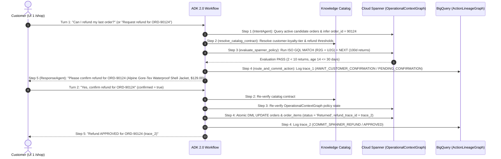

# Hands-on lab demo activities and GQL queries

Students complete guided end-to-end scenarios during the Qwiklabs session to
verify how the Dual-Graph System of Action evaluates Standard and VIP tier
refund requests using the unified `thelook_ecommerce` Relational-to-Graph (R2G)
and Unstructured-to-Graph (U2G) policy graph in ISO Graph Query Language (GQL).

- For web interface details, see
  [app/frontend/README.md](../app/frontend/README.md).
- For database schemas and seed data rules, see
  [data/README.md](../data/README.md).

## Behind the UI: Workflow execution and two-turn confirmation

When a customer submits a refund request in **UI 1 (`/shop`)**, the 5-step
**Google ADK 2.0** workflow (`RefundSystemOfActionWorkflow`) coordinates
**Knowledge Catalog**, **Cloud Spanner Graph
(`OperationalContextGraph`)**, and **BigQuery Graph (`ActionLineageGraph`)**.
Whenever a valid customer order is resolved (`order_id is not None` and
`order_found == True`), Step 4 enforces a universal two-turn customer
confirmation gate (`PENDING_CONFIRMATION` on Turn 1, followed by `APPROVED` or
`DENIED` on Turn 2) so that no Cloud Spanner DML mutation or final refund
verdict occurs until the customer verifies the resolved order number, product
thumbnail, item name, and price:



## Pre-lab verification in the Google Cloud Console

Before running the web UI scenarios, students can verify the live database and
catalog resources directly in the **Google Cloud Console**:

1.  **Knowledge Catalog (`Knowledge Catalog` > `Glossaries` >
    `soa-business-glossary`):** Inspect the `Refund Policy Metrics` category and
    the three governed terms (`rolling-100d-refund-count`, `order-age-days`, and
    `customer-loyalty-tier`), each carrying the **`refund-metric-contract`**
    aspect (`standard_max_refunds_100d = 10`, `vip_max_refunds_100d = 20`,
    `return_window_days = 30`).
1.  **Cloud Spanner Studio (`Spanner` > `soa-graph-instance` > `thelook-soa-db`
    > `Spanner Studio`):** Inspect the 6 R2G tables (`users`, `orders`,
    `order_items`, `inventory_items`, `products`, `distribution_centers`), the 3
    U2G policy tables (`policies`, `policy_conditions`, `policy_restrictions`),
    and the **`OperationalContextGraph`** property graph, and run ISO GQL
    queries with interactive node/edge visualization in the **Graph** tab.
1.  **BigQuery Studio (`BigQuery` > `Studio` > `soa_action_lineage`):** Inspect
    the four lineage tables (`agent_sessions`, `workflow_nodes`,
    `policy_evaluations`, `agent_actions`), the **`ActionLineageGraph`**
    property graph, and the **`us-central1.spanner-data-boost`** external
    connection.

## Demo activity 1: Customer A requests an eligible refund (Standard tier)

In this activity, students submit a refund request as **Customer A**
(`STANDARD` tier) in **UI 1 (`TheLook Shopping Mall and Chat App`, `/shop`)**,
confirm the order and item details across the two-turn confirmation gate, and
switch to **UI 2 (`Data Engineer Investigation Console`, `/console`)** and
**Cloud Spanner Studio** to verify why the workflow approved the refund.

### Step 1: Request and confirm a refund in UI 1

1.  Open **UI 1 (`TheLook Shopping Mall and Chat App`, `shopping_mall_url`)**
    and select **Customer A** (`user_id: 1001`, email `alice.chen@example.com`,
    `STANDARD` tier).
1.  Locate Order `90124` (`ORD-90124`, **Alpine Gore-Tex Waterproof Shell
    Jacket**, `$129.00`, delivered 14 days ago with `thelook` status `Complete`)
    and open the support chat widget.
1.  Click the **Request refund for ORD-90124 (Eligible Standard)** prompt chip
    or type a natural-language request such as `Can I refund my last order?`
1.  Observe **Turn 1 (`PENDING_CONFIRMATION`)** as the chat widget streams live
    `[1/5]..[5/5]` per-node execution progress (`POST /api/chat/refund/stream`)
    and automatically restores keyboard focus to the chat input:
    - Step 1 (`IntentAgent`) resolves `order_id = 90124` directly when an
      explicit `ORD-90124` order ID is present (conserving Qwiklabs Vertex AI
      quota for Step 5), or runs `gemini-3-flash-preview` (with
      `ThinkingLevel.MINIMAL`, a 4-second single-attempt timeout, and
      deterministic fallback) to infer `order_id = 90124` from Alice's active
      orders when a natural-language prompt is typed.
    - Step 3 (`evaluate_spanner_policy`) verifies `evaluation_result = 'PASS'`
      in `OperationalContextGraph` (`prior_refund_count_100d = 2 < 10`,
      `target_order_age_days = 14 <= 30`).
    - Step 4 (`route_and_commit_action`) pauses before mutating Cloud Spanner,
      logs `action_type = 'AWAIT_CUSTOMER_CONFIRMATION'` (`decision_status =
      'PENDING_CONFIRMATION'`) in BigQuery, and prompts you to verify `ORD-90124`
      and item **Alpine Gore-Tex Waterproof Shell Jacket ($129.00)** (synthesized
      by `ResponseAgent` via `gemini-3-flash-preview` in Step 5).
    - *(Optional verification in Cloud Spanner Studio):* Run `SELECT order_id,
      status, returned_at FROM orders WHERE order_id = 90124;` in **Spanner
      Studio** to confirm that `status` is still `'Complete'` before you click
      confirm.
1.  Click **Yes, confirm refund for ORD-90124** (or type `Yes, please proceed`)
    to execute **Turn 2 (`APPROVED`)**. The workflow updates `orders.status` and
    `order_items.status` for `order_id = 90124` from `Complete` to `Returned`,
    sets `returned_at = CURRENT_TIMESTAMP()`, writes a UUID `trace_id` (such as
    `trace-a1b2c3d4`) to `order_items.refund_trace_id`, and displays the
    `trace_id` in the chat UI. Click **Inspect in Data Engineer Console**
    (`/console?trace_id=...`) to open UI 2 on this trace.

### Step 2: Inspect the operational context graph in Cloud Spanner

1.  In **UI 2 (`Data Engineer Investigation Console`,
    `data_engineer_console_url`)**, select the generated `trace_id` from the
    live feed. Click nodes in the **Dual-Graph Visualizer** to inspect their
    Cloud Spanner and BigQuery properties in the **Node Property Inspector**.
    Scroll to the bottom of **UI 2 (`/console`)** and click **Preview Glossary &
    Contract** in the **Knowledge Catalog Semantic Contract** card (to inspect
    how Step 2, Step 3, and Step 4 consume the three governed glossary terms)
    and **Preview return_policy_v1.md** in the **Policy Document (U2G) &
    Extracted Triples** card (to inspect how `return_policy_v1.md` is compiled
    into `u2g_policy_triples.json`).
1.  Run the following query in the **Cloud Spanner Context Graph** tab (or
    directly inside **Cloud Spanner Studio**). The first `MATCH` stage traverses
    the Relational-to-Graph (R2G) path (`users` to `orders` to `inventory_items`
    to `products` to `distribution_centers`) and the U2G `[:governed_by]` edge
    to the active `policies` node and its tier-matched `policy_conditions` node
    (`WHERE cond.applicable_tier = u.customer_tier`). The `NEXT` stage counts
    prior returned items across other orders (`hist_o.order_id !=
    target_order_id` and `hist_oi.status = 'Returned'`) within the 100-day
    rolling window:

    ```sql
    -- Purpose: Evaluate Customer A's operational context and tiered refund policy
    --   eligibility in a single two-stage ISO GQL traversal.
    -- Target Engine: Cloud Spanner (thelook-soa-db -> OperationalContextGraph).
    -- How It Works:
    --   Stage 1 (MATCH): Traverses R2G (users -> orders -> inventory_items ->
    --     products -> distribution_centers) and U2G (products -> policies ->
    --     policy_conditions / policy_restrictions) filtered by customer_tier.
    --   Stage 2 (NEXT + OPTIONAL MATCH): Counts distinct returned items across
    --     other orders within the 100-day rolling window.
    -- Information Gathered: Customer tier ('STANDARD'), target order status/age/price,
    --   product and fulfillment center names, active policy/condition IDs, 100-day
    --   return cap (max_refunds_100d = 10), and observed prior_refund_count_100d (2).
    GRAPH OperationalContextGraph
    MATCH (u:users {id: 1001})
            -[:places]->(target_o:orders {order_id: 90124})
            -[target_oi:contains_item]->(ii:inventory_items)-[:is_product]->(p:products)
            -[:supplied_by]->(dc:distribution_centers),
          (p)-[:governed_by]->(pol:policies {status: 'ACTIVE'})
            -[:requires_condition]->(cond:policy_conditions),
          (pol)-[:enforces_restriction]->(res:policy_restrictions)
    WHERE u.customer_tier IN ('STANDARD', 'VIP')
      AND cond.applicable_tier = u.customer_tier
    RETURN
      u.id AS user_id,
      u.email AS email,
      u.customer_tier AS customer_tier,
      target_o.order_id AS target_order_id,
      target_o.status AS target_order_status,
      TIMESTAMP_DIFF(CURRENT_TIMESTAMP(), target_o.delivered_at, DAY) AS target_order_age_days,
      ROUND(SUM(target_oi.sale_price), 2) AS target_order_price,
      STRING_AGG(DISTINCT p.name, ', ') AS product_names,
      STRING_AGG(DISTINCT dc.name, ', ') AS distribution_center_names,
      pol.policy_id AS policy_id,
      pol.name AS policy_name,
      cond.condition_id AS condition_id,
      cond.max_refunds_100d AS max_refunds_100d,
      cond.return_window_days AS return_window_days,
      res.action_code AS restriction_action
    GROUP BY
      user_id, email, customer_tier, target_order_id, target_order_status,
      target_order_age_days, policy_id, policy_name, condition_id,
      max_refunds_100d, return_window_days, restriction_action
    NEXT
    -- Stage 2: Count prior returned items in the rolling 100-day window
    OPTIONAL MATCH (u2:users)-[:places]->(hist_o:orders)-[hist_oi:contains_item]->(:inventory_items)
    WHERE u2.id = user_id
      AND hist_o.order_id != target_order_id
      AND hist_oi.status = 'Returned'
      AND COALESCE(hist_oi.returned_at, hist_o.returned_at, hist_o.created_at)
          >= TIMESTAMP_SUB(CURRENT_TIMESTAMP(), INTERVAL 100 DAY)
    RETURN
      user_id,
      email,
      customer_tier,
      target_order_id,
      target_order_status,
      product_names,
      distribution_center_names,
      target_order_price,
      target_order_age_days,
      COUNT(DISTINCT hist_oi.id) AS prior_refund_count_100d,
      policy_id,
      policy_name,
      condition_id,
      max_refunds_100d,
      return_window_days,
      restriction_action
    GROUP BY
      user_id, email, customer_tier, target_order_id, target_order_status,
      product_names, distribution_center_names, target_order_price,
      target_order_age_days, policy_id, policy_name, condition_id,
      max_refunds_100d, return_window_days, restriction_action;
    ```

1.  Verify the context graph result:
    - Because Turn 2 in Step 1 committed the refund, running this live query in
      UI 2 or **Cloud Spanner Studio** returns `target_order_status =
      'Returned'` (whereas the agent observed `target_order_status = 'Complete'`
      during Turn 1 and before Turn 2 mutation, or after you click **Reset Demo
      Data**).
    - `customer_tier = 'STANDARD'` matches `condition_id =
      'COND-REFUND-STD-100D-30D'` (`max_refunds_100d = 10`,
      `return_window_days = 30`).
    - `target_order_age_days = 14`, which satisfies `return_window_days = 30`.
    - `prior_refund_count_100d = 2` (excluding `target_order_id = 90124`), which
      is below `max_refunds_100d = 10`.

### Step 3: Inspect the action lineage graph in BigQuery

> [!NOTE]
>
> You can run either the ISO GQL `GRAPH_TABLE` query or the standard SQL `JOIN`
> query below. In Qwiklabs `gcpfree` projects without a BigQuery Enterprise
> reservation, UI 2 (`/console`) runs the SQL `JOIN` equivalent when
> `GRAPH_TABLE` is unavailable.

1.  Switch to the **BigQuery Action Lineage Graph** tab in UI 2 (which pre-fills
    your selected `trace_id`, or replace `<YOUR_CUSTOMER_A_TRACE_ID>` manually
    in **BigQuery Studio**) and run the BigQuery `GRAPH_TABLE` GQL query against
    `soa_action_lineage.ActionLineageGraph`:

    ```sql
    -- Purpose: Audit the append-only agent decision lineage for Customer A's
    --   trace_id using BigQuery's ISO GQL property graph syntax.
    -- Target Engine: BigQuery (soa_action_lineage.ActionLineageGraph).
    -- How It Works: Traverses AgentSession -[:executed_node]-> WorkflowNode
    --   -[:evaluated_policy]-> PolicyEvaluation -[:triggered_action]-> AgentAction
    --   inside GRAPH_TABLE(soa_action_lineage.ActionLineageGraph ...).
    -- Information Gathered: Session trace_id, Knowledge Catalog term, evaluated
    --   policy name, observed vs. maximum 100-day refunds, PASS/FAIL result,
    --   executed action_type, decision_status, and commit timestamp.
    SELECT
      trace_id,
      customer_id,
      target_order_id,
      node_name,
      catalog_term_id,
      policy_name,
      prior_refund_count_100d,
      max_refunds_100d,
      evaluation_result,
      action_type,
      decision_status,
      committed_at
    FROM GRAPH_TABLE(soa_action_lineage.ActionLineageGraph
      MATCH (s:AgentSession {trace_id: '<YOUR_CUSTOMER_A_TRACE_ID>'})
            -[:executed_node]->(n:WorkflowNode {node_name: 'evaluate_spanner_policy'})
            -[:evaluated_policy]->(pe:PolicyEvaluation)
            -[:triggered_action]->(act:AgentAction)
      RETURN
        s.trace_id AS trace_id,
        s.customer_id AS customer_id,
        s.target_order_id AS target_order_id,
        n.node_name AS node_name,
        pe.catalog_term_id AS catalog_term_id,
        pe.policy_name AS policy_name,
        pe.observed_refunds_100d AS prior_refund_count_100d,
        pe.max_refunds_100d AS max_refunds_100d,
        pe.evaluation_result AS evaluation_result,
        act.action_type AS action_type,
        act.decision_status AS decision_status,
        act.created_at AS committed_at
    );
    ```

    *Standard SQL `JOIN` equivalent for on-demand BigQuery Studio execution:*

    ```sql
    -- Purpose: Audit the append-only agent decision lineage for Customer A's
    --   trace_id on standard on-demand BigQuery projects without Enterprise slots.
    -- Target Engine: BigQuery (soa_action_lineage underlying relational tables).
    -- How It Works: Joins agent_sessions -> workflow_nodes -> policy_evaluations
    --   -> agent_actions along the exact foreign-key edges of ActionLineageGraph.
    -- Information Gathered: Identical lineage output to the GRAPH_TABLE query above.
    SELECT
      s.trace_id,
      s.customer_id,
      s.target_order_id,
      n.node_name,
      pe.catalog_term_id,
      pe.policy_name,
      pe.observed_refunds_100d AS prior_refund_count_100d,
      pe.max_refunds_100d,
      pe.evaluation_result,
      act.action_type,
      act.decision_status,
      act.created_at AS committed_at
    FROM `soa_action_lineage.agent_sessions` AS s
    JOIN `soa_action_lineage.workflow_nodes` AS n
      ON s.trace_id = n.trace_id AND n.node_name = 'evaluate_spanner_policy'
    JOIN `soa_action_lineage.policy_evaluations` AS pe
      ON n.node_exec_id = pe.node_exec_id
    JOIN `soa_action_lineage.agent_actions` AS act
      ON pe.eval_id = act.eval_id
    WHERE s.trace_id = '<YOUR_CUSTOMER_A_TRACE_ID>';
    ```

1.  Confirm that `ActionLineageGraph` records `evaluation_result = 'PASS'`
    (`prior_refund_count_100d = 2 < 10`), `action_type =
    'COMMIT_SPANNER_REFUND'`, and `decision_status = 'APPROVED'` for Turn 2
    (and `action_type = 'AWAIT_CUSTOMER_CONFIRMATION'` / `decision_status =
    'PENDING_CONFIRMATION'` for Turn 1).

## Demo activity 2: Customer B requests a refund that exceeds Standard policy limits

In this activity, students test how the ADK 2.0 workflow and graph policy model
immediately block a refund when **Customer B** (`STANDARD` tier) reaches or
exceeds the 100-day return limit (`prior_refund_count_100d = 12 >= 10`).

### Step 1: Request and confirm a refund as Customer B in UI 1

1.  Return to **UI 1 (`TheLook Shopping Mall and Chat App`,
    `shopping_mall_url`)** and switch the active profile to **Customer B**
    (`user_id: 2048`, email `jordan.taylor@example.com`, `STANDARD` tier).
1.  Select Order `90588` (`ORD-90588`, **CloudStride Trail Running Shoes**,
    `$148.00`, delivered 10 days ago with `thelook` status `Complete`) and
    submit the refund request in the chat widget:
    `Please refund my order ORD-90588.`
1.  Observe **Turn 1 (`PENDING_CONFIRMATION`)** and click **Yes, confirm refund
    for ORD-90588** to execute **Turn 2 (`DENIED`)**. Because Customer B already
    has 12 returned items (`status = 'Returned'`) within the past 100 days
    (reaching or exceeding the `STANDARD` tier limit of 10), the workflow blocks
    the Cloud Spanner mutation (`BLOCK_SPANNER_MUTATION`), leaves `ORD-90588` in
    `Complete` status, and returns a UUID `trace_id` (such as `trace-e5f6a7b8`).
    Copy this `trace_id` for your investigation.

### Step 2: Inspect the denial in Cloud Spanner Context Graph

1.  In **UI 2 (`Data Engineer Investigation Console`,
    `data_engineer_console_url`)**, select the `DENIED` trace from the live
    feed.
1.  Run the unified GQL query for `user_id: 2048` and `order_id: 90588` in the
    **Cloud Spanner Context Graph** tab (or in **Cloud Spanner Studio**):

    ```sql
    -- Purpose: Verify why Customer B's Order 90588 triggered a policy denial in
    --   Cloud Spanner OperationalContextGraph.
    -- Target Engine: Cloud Spanner (thelook-soa-db -> OperationalContextGraph).
    -- How It Works:
    --   Stage 1 (MATCH): Resolves Customer B's STANDARD tier condition
    --     (COND-REFUND-STD-100D-30D, max_refunds_100d = 10) and restriction action.
    --   Stage 2 (NEXT + OPTIONAL MATCH): Aggregates prior returned items across
    --     other orders in the last 100 days (prior_refund_count_100d = 12 >= 10).
    -- Information Gathered: Confirms target_order_status remains 'Complete' and
    --   prior_refund_count_100d (12) reaches/exceeds max_refunds_100d (10).
    GRAPH OperationalContextGraph
    MATCH (u:users {id: 2048})
            -[:places]->(target_o:orders {order_id: 90588})
            -[target_oi:contains_item]->(ii:inventory_items)-[:is_product]->(p:products)
            -[:supplied_by]->(dc:distribution_centers),
          (p)-[:governed_by]->(pol:policies {status: 'ACTIVE'})
            -[:requires_condition]->(cond:policy_conditions),
          (pol)-[:enforces_restriction]->(res:policy_restrictions)
    WHERE u.customer_tier IN ('STANDARD', 'VIP')
      AND cond.applicable_tier = u.customer_tier
    RETURN
      u.id AS user_id,
      u.email AS email,
      u.customer_tier AS customer_tier,
      target_o.order_id AS target_order_id,
      target_o.status AS target_order_status,
      TIMESTAMP_DIFF(CURRENT_TIMESTAMP(), target_o.delivered_at, DAY) AS target_order_age_days,
      ROUND(SUM(target_oi.sale_price), 2) AS target_order_price,
      STRING_AGG(DISTINCT p.name, ', ') AS product_names,
      STRING_AGG(DISTINCT dc.name, ', ') AS distribution_center_names,
      pol.policy_id AS policy_id,
      pol.name AS policy_name,
      cond.condition_id AS condition_id,
      cond.max_refunds_100d AS max_refunds_100d,
      cond.return_window_days AS return_window_days,
      res.action_code AS restriction_action
    GROUP BY
      user_id, email, customer_tier, target_order_id, target_order_status,
      target_order_age_days, policy_id, policy_name, condition_id,
      max_refunds_100d, return_window_days, restriction_action
    NEXT
    -- Stage 2: Count prior returned items in the rolling 100-day window
    OPTIONAL MATCH (u2:users)-[:places]->(hist_o:orders)-[hist_oi:contains_item]->(:inventory_items)
    WHERE u2.id = user_id
      AND hist_o.order_id != target_order_id
      AND hist_oi.status = 'Returned'
      AND COALESCE(hist_oi.returned_at, hist_o.returned_at, hist_o.created_at)
          >= TIMESTAMP_SUB(CURRENT_TIMESTAMP(), INTERVAL 100 DAY)
    RETURN
      user_id,
      email,
      customer_tier,
      target_order_id,
      target_order_status,
      product_names,
      distribution_center_names,
      target_order_price,
      target_order_age_days,
      COUNT(DISTINCT hist_oi.id) AS prior_refund_count_100d,
      policy_id,
      policy_name,
      condition_id,
      max_refunds_100d,
      return_window_days,
      restriction_action
    GROUP BY
      user_id, email, customer_tier, target_order_id, target_order_status,
      product_names, distribution_center_names, target_order_price,
      target_order_age_days, policy_id, policy_name, condition_id,
      max_refunds_100d, return_window_days, restriction_action;
    ```

1.  Verify from the Cloud Spanner Context Graph output that although
    `target_order_status = 'Complete'` and `target_order_age_days = 10` (within
    the 30-day window), Customer B has `customer_tier = 'STANDARD'`,
    `condition_id = 'COND-REFUND-STD-100D-30D'`, and
    `prior_refund_count_100d = 12` (`>= max_refunds_100d = 10`), which triggers
    `restriction_action = 'DENY_AUTONOMOUS_REFUND'`.

### Step 3: Inspect the rejection lineage in BigQuery Action Lineage Graph

1.  Switch to the **BigQuery Action Lineage Graph** tab, replace
    `<YOUR_CUSTOMER_B_TRACE_ID>` with the `trace_id` from Step 1, and run the
    following BigQuery GQL query:

    ```sql
    -- Purpose: Audit the DENIED policy evaluation and blocked action lineage for
    --   Customer B's trace_id using BigQuery ISO GQL.
    -- Target Engine: BigQuery (soa_action_lineage.ActionLineageGraph).
    -- How It Works: Traverses AgentSession -> WorkflowNode -> PolicyEvaluation
    --   (filtered to evaluation_result = 'FAIL') -> AgentAction.
    -- Information Gathered: Observed vs. allowed 100-day refunds (12 vs. 10),
    --   evaluation_result ('FAIL'), action_type ('BLOCK_SPANNER_MUTATION'),
    --   decision_status ('DENIED'), and the human-readable rejection_reason.
    SELECT
      trace_id,
      customer_id,
      target_order_id,
      catalog_term_id,
      policy_name,
      prior_refund_count_100d,
      max_refunds_100d,
      evaluation_result,
      action_type,
      decision_status,
      rejection_reason
    FROM GRAPH_TABLE(soa_action_lineage.ActionLineageGraph
      MATCH (s:AgentSession {trace_id: '<YOUR_CUSTOMER_B_TRACE_ID>'})
            -[:executed_node]->(n:WorkflowNode {node_name: 'evaluate_spanner_policy'})
            -[:evaluated_policy]->(pe:PolicyEvaluation {evaluation_result: 'FAIL'})
            -[:triggered_action]->(act:AgentAction)
      RETURN
        s.trace_id AS trace_id,
        s.customer_id AS customer_id,
        s.target_order_id AS target_order_id,
        pe.catalog_term_id AS catalog_term_id,
        pe.policy_name AS policy_name,
        pe.observed_refunds_100d AS prior_refund_count_100d,
        pe.max_refunds_100d AS max_refunds_100d,
        pe.evaluation_result AS evaluation_result,
        act.action_type AS action_type,
        act.decision_status AS decision_status,
        act.rejection_reason AS rejection_reason
    );
    ```

    *Standard SQL `JOIN` equivalent for on-demand BigQuery Studio execution:*

    ```sql
    -- Purpose: Audit Customer B's DENIED lineage trace using standard BigQuery SQL
    --   JOINs (compatible with on-demand billing without Enterprise reservations).
    -- Target Engine: BigQuery (soa_action_lineage underlying relational tables).
    -- How It Works: Joins agent_sessions, workflow_nodes, policy_evaluations
    --   (pe.evaluation_result = 'FAIL'), and agent_actions for Customer B's trace_id.
    -- Information Gathered: Identical denial lineage metrics and rejection_reason
    --   as the GRAPH_TABLE query above.
    SELECT
      s.trace_id,
      s.customer_id,
      s.target_order_id,
      pe.catalog_term_id,
      pe.policy_name,
      pe.observed_refunds_100d AS prior_refund_count_100d,
      pe.max_refunds_100d,
      pe.evaluation_result,
      act.action_type,
      act.decision_status,
      act.rejection_reason
    FROM `soa_action_lineage.agent_sessions` AS s
    JOIN `soa_action_lineage.workflow_nodes` AS n
      ON s.trace_id = n.trace_id AND n.node_name = 'evaluate_spanner_policy'
    JOIN `soa_action_lineage.policy_evaluations` AS pe
      ON n.node_exec_id = pe.node_exec_id AND pe.evaluation_result = 'FAIL'
    JOIN `soa_action_lineage.agent_actions` AS act
      ON pe.eval_id = act.eval_id
    WHERE s.trace_id = '<YOUR_CUSTOMER_B_TRACE_ID>';
    ```

1.  Verify that `ActionLineageGraph` records `prior_refund_count_100d = 12`,
    `max_refunds_100d = 10`, `evaluation_result = 'FAIL'`, `action_type =
    'BLOCK_SPANNER_MUTATION'`, and `decision_status = 'DENIED'`.

## Demo activity 3: Customer C (VIP tier) requests an eligible refund above the Standard limit

In this activity, students verify how contextual graph routing resolves a higher
policy threshold (`max_refunds_100d = 20`) for **Customer C** (`VIP` tier),
approving a refund even though Customer C has the same 100-day return count
(`prior_refund_count_100d = 12`) that blocked Customer B in Activity 2.

### Step 1: Request and confirm a refund as Customer C in UI 1

1.  Return to **UI 1 (`TheLook Shopping Mall and Chat App`,
    `shopping_mall_url`)** and switch the active profile to **Customer C**
    (`user_id: 3072`, email `claire.vance@example.com`, `VIP` tier).
1.  Select Order `90910` (`ORD-90910`, **Tailored Italian Wool Travel Blazer**,
    `$210.00`, delivered 7 days ago with `thelook` status `Complete`) and submit
    the refund request in the chat widget:
    `I would like to refund my order ORD-90910.`
1.  Observe **Turn 1 (`PENDING_CONFIRMATION`)**: Step 2
    (`resolve_catalog_contract`) resolves the `customer-loyalty-tier` glossary
    contract (`standard_tier = 'STANDARD'`, `vip_tier = 'VIP'`) from
    Knowledge Catalog, and Step 3 (`evaluate_spanner_policy`) verifies
    `u.customer_tier IN ('STANDARD', 'VIP')` in `OperationalContextGraph`,
    matching `u.customer_tier = 'VIP'` against `COND-REFUND-VIP-100D-30D`
    (`max_refunds_100d = 20`). Because `12 < 20`, the agent pauses at
    `PENDING_CONFIRMATION` and asks Customer C to confirm `ORD-90910`
    (**Tailored Italian Wool Travel Blazer**, `$210.00`).
1.  Click **Yes, confirm refund for ORD-90910** to execute **Turn 2
    (`APPROVED`)**. Even though Customer C has 12 returned items in the last 100
    days, the workflow updates `ORD-90910` to `Returned`, writes the new
    `trace_id` (such as `trace-c9d0e1f2`) to `order_items.refund_trace_id`, and
    links to UI 2.

### Step 2: Inspect the VIP policy resolution in Cloud Spanner and BigQuery

1.  In **UI 2 (`Data Engineer Investigation Console`,
    `data_engineer_console_url`)**, select Customer C's `APPROVED` trace from
    the live feed and run the Cloud Spanner Context Graph query for `user_id:
    3072` and `order_id: 90910`:

    ```sql
    -- Purpose: Verify how Customer C's VIP loyalty tier resolves a higher 100-day
    --   refund threshold (max_refunds_100d = 20) in OperationalContextGraph.
    -- Target Engine: Cloud Spanner (thelook-soa-db -> OperationalContextGraph).
    -- How It Works:
    --   Stage 1 (MATCH): Matches u.customer_tier ('VIP') to cond.applicable_tier,
    --     selecting COND-REFUND-VIP-100D-30D (max_refunds_100d = 20).
    --   Stage 2 (NEXT + OPTIONAL MATCH): Counts prior returned items in the last
    --     100 days (prior_refund_count_100d = 12 < 20).
    -- Information Gathered: Confirms VIP tier condition resolution (12 < 20) and
    --   live order status ('Returned' after Turn 2 confirmation).
    GRAPH OperationalContextGraph
    MATCH (u:users {id: 3072})
            -[:places]->(target_o:orders {order_id: 90910})
            -[target_oi:contains_item]->(ii:inventory_items)-[:is_product]->(p:products)
            -[:supplied_by]->(dc:distribution_centers),
          (p)-[:governed_by]->(pol:policies {status: 'ACTIVE'})
            -[:requires_condition]->(cond:policy_conditions),
          (pol)-[:enforces_restriction]->(res:policy_restrictions)
    WHERE u.customer_tier IN ('STANDARD', 'VIP')
      AND cond.applicable_tier = u.customer_tier
    RETURN
      u.id AS user_id,
      u.email AS email,
      u.customer_tier AS customer_tier,
      target_o.order_id AS target_order_id,
      target_o.status AS target_order_status,
      TIMESTAMP_DIFF(CURRENT_TIMESTAMP(), target_o.delivered_at, DAY) AS target_order_age_days,
      ROUND(SUM(target_oi.sale_price), 2) AS target_order_price,
      STRING_AGG(DISTINCT p.name, ', ') AS product_names,
      STRING_AGG(DISTINCT dc.name, ', ') AS distribution_center_names,
      pol.policy_id AS policy_id,
      pol.name AS policy_name,
      cond.condition_id AS condition_id,
      cond.max_refunds_100d AS max_refunds_100d,
      cond.return_window_days AS return_window_days,
      res.action_code AS restriction_action
    GROUP BY
      user_id, email, customer_tier, target_order_id, target_order_status,
      target_order_age_days, policy_id, policy_name, condition_id,
      max_refunds_100d, return_window_days, restriction_action
    NEXT
    -- Stage 2: Count prior returned items in the rolling 100-day window
    OPTIONAL MATCH (u2:users)-[:places]->(hist_o:orders)-[hist_oi:contains_item]->(:inventory_items)
    WHERE u2.id = user_id
      AND hist_o.order_id != target_order_id
      AND hist_oi.status = 'Returned'
      AND COALESCE(hist_oi.returned_at, hist_o.returned_at, hist_o.created_at)
          >= TIMESTAMP_SUB(CURRENT_TIMESTAMP(), INTERVAL 100 DAY)
    RETURN
      user_id,
      email,
      customer_tier,
      target_order_id,
      target_order_status,
      product_names,
      distribution_center_names,
      target_order_price,
      target_order_age_days,
      COUNT(DISTINCT hist_oi.id) AS prior_refund_count_100d,
      policy_id,
      policy_name,
      condition_id,
      max_refunds_100d,
      return_window_days,
      restriction_action
    GROUP BY
      user_id, email, customer_tier, target_order_id, target_order_status,
      product_names, distribution_center_names, target_order_price,
      target_order_age_days, policy_id, policy_name, condition_id,
      max_refunds_100d, return_window_days, restriction_action;
    ```

1.  Verify that `customer_tier = 'VIP'`, `condition_id =
    'COND-REFUND-VIP-100D-30D'`, `prior_refund_count_100d = 12`, and
    `max_refunds_100d = 20`, and confirm in the **BigQuery Action Lineage
    Graph** tab that `ActionLineageGraph` records `catalog_term_id =
    'customer-loyalty-tier'`, `prior_refund_count_100d = 12` (aliased from
    `observed_refunds_100d`), `max_refunds_100d = 20`, `evaluation_result =
    'PASS'`, `action_type = 'COMMIT_SPANNER_REFUND'`, and `decision_status =
    'APPROVED'`.

## Cross-engine federated audit with Spanner Data Boost

After completing Activities 1, 2, and 3, students run a cross-engine query that
joins BigQuery lineage records with live Cloud Spanner operational graph nodes:

1.  Switch to the **Federated Spanner Data Boost** tab in UI 2 (which pre-fills
    `${SPANNER_CONNECTION_ID}`, or run the query directly in **BigQuery Studio**
    by replacing `${SPANNER_CONNECTION_ID}` with
    `<PROJECT_ID>.us-central1.spanner-data-boost`).
1.  Run the following BigQuery query. Using `EXTERNAL_QUERY` over the
    `spanner-data-boost` connection, BigQuery pushes a `GRAPH
    OperationalContextGraph MATCH` query to Cloud Spanner Data Boost compute and
    joins the operational graph results with `soa_action_lineage` traces.
    Because BigQuery does not push outer SQL `JOIN` predicates into an opaque
    GQL string inside `EXTERNAL_QUERY`, the inner GQL query filters on
    `WHERE u.id IN (1001, 2048, 3072)` (matching all demo orders including
    `90124`, `90125`, `90126`, `90588`, and `90910`) and projects
    `u.customer_tier` and `oi.refund_trace_id` to verify the durable cross-graph
    reconciliation identifier:

    ```sql
    -- Purpose: Perform a zero-ETL cross-engine audit reconciling BigQuery
    --   ActionLineageGraph decisions with live Cloud Spanner OperationalContextGraph state.
    -- Target Engine: BigQuery federated to Cloud Spanner via EXTERNAL_QUERY and
    --   Cloud Spanner Data Boost (${SPANNER_CONNECTION_ID}).
    -- How It Works: Joins BigQuery's four lineage tables with three root-partitionable
    --   ISO GQL subqueries pushed down to isolated Spanner Data Boost compute
    --   for live users (sp_u), orders (sp_o), and contains_item edges (sp_oi).
    -- Information Gathered: End-to-end reconciliation proving that APPROVED
    --   BigQuery traces match live Spanner 'Returned' orders and identical
    --   refund_trace_id keys, while DENIED traces leave Spanner orders 'Complete'.
    SELECT
      s.trace_id,
      sp_u.email AS live_spanner_email,
      sp_u.customer_tier AS live_spanner_tier,
      s.target_order_id,
      sp_o.live_spanner_order_status,
      sp_o.live_spanner_returned_at,
      sp_oi.live_spanner_refund_trace_id,
      pe.observed_refunds_100d AS prior_refund_count_100d,
      pe.max_refunds_100d,
      pe.evaluation_result,
      act.action_type,
      act.decision_status
    FROM `soa_action_lineage.agent_sessions` AS s
    JOIN `soa_action_lineage.workflow_nodes` AS n
      ON s.trace_id = n.trace_id AND n.node_name = 'evaluate_spanner_policy'
    JOIN `soa_action_lineage.policy_evaluations` AS pe
      ON n.node_exec_id = pe.node_exec_id
    JOIN `soa_action_lineage.agent_actions` AS act
      ON pe.eval_id = act.eval_id
    -- Push down ISO GQL user lookup to Spanner Data Boost
    JOIN EXTERNAL_QUERY(
      '${SPANNER_CONNECTION_ID}',
      '''
      GRAPH OperationalContextGraph
      MATCH (u:users)
      WHERE u.id IN (1001, 2048, 3072)
      RETURN
        u.id AS user_id,
        u.email AS email,
        u.customer_tier AS customer_tier
      '''
    ) AS sp_u
      ON s.customer_id = sp_u.user_id
    -- Push down ISO GQL order status lookup to Spanner Data Boost
    JOIN EXTERNAL_QUERY(
      '${SPANNER_CONNECTION_ID}',
      '''
      GRAPH OperationalContextGraph
      MATCH (o:orders)
      WHERE o.user_id IN (1001, 2048, 3072)
      RETURN
        o.user_id AS user_id,
        o.order_id AS order_id,
        o.status AS live_spanner_order_status,
        CAST(o.returned_at AS STRING) AS live_spanner_returned_at
      '''
    ) AS sp_o
      ON s.customer_id = sp_o.user_id
     AND s.target_order_id = sp_o.order_id
    -- Push down ISO GQL contains_item edge lookup to verify refund_trace_id
    JOIN EXTERNAL_QUERY(
      '${SPANNER_CONNECTION_ID}',
      '''
      GRAPH OperationalContextGraph
      MATCH (:orders)-[oi:contains_item]->(:inventory_items)
      WHERE oi.user_id IN (1001, 2048, 3072)
      RETURN
        oi.order_id AS order_id,
        oi.refund_trace_id AS live_spanner_refund_trace_id
      '''
    ) AS sp_oi
      ON s.target_order_id = sp_oi.order_id
    ORDER BY s.started_at DESC;
    ```

1.  Verify that Customer A's order (`90124`, `STANDARD`) and Customer C's order
    (`90910`, `VIP`) both show `live_spanner_order_status = 'Returned'` and
    `live_spanner_refund_trace_id = s.trace_id` alongside `decision_status =
    'APPROVED'`, while Customer B's order (`90588`, `STANDARD`) shows
    `live_spanner_order_status = 'Complete'` and `live_spanner_refund_trace_id =
    NULL` alongside `decision_status = 'DENIED'`.

## Additional edge-case scenarios in UI 1

Students can also test additional edge-case and conversational scenarios under
**Customer A** (`user_id: 1001`) in **UI 1 (`TheLook Shopping Mall and Chat App`,
`/shop`)**:

- **Expired 30-day return window (`ORD-90125`):** Delivered 45 days ago
  (**Polarized Aviator Titanium Sunglasses**, `$165.00`, `status = 'Complete'`).
  Clicking **Request refund for ORD-90125 (Expired 45d Window)** or typing
  `"Refund my sunglasses"` infers `order_id = 90125`, pauses for Turn 1
  confirmation (`PENDING_CONFIRMATION`), and on Turn 2 denies the refund request
  with `RETURN_WINDOW_EXPIRED` because `target_order_age_days = 45` exceeds
  `return_window_days = 30`.
- **Order not yet delivered (`ORD-90126`):** Currently in transit (**Cashmere
  Ribbed Winter Beanie**, `$58.00`, `status = 'Shipped'`, `delivered_at = NULL`).
  Clicking **Request refund for ORD-90126 (Shipped / In Transit)** or typing
  `"Refund my shipped order"` infers `order_id = 90126`, pauses for Turn 1
  confirmation (`PENDING_CONFIRMATION`), and on Turn 2 denies the refund request
  with `ORDER_NOT_DELIVERED` because `target_order_status != 'Complete'`.
- **Ambiguous order disambiguation (`resolution_mode = 'clarify'`) and negated
  refund (`resolution_mode = 'cancelled'`):** Typing a refund request without an
  order ID or disambiguating keyword (such as `"I want a refund"`), declining a
  confirmation prompt (`"No, wrong order"`), or stating `"No I don't to refund"`
  keeps the session in `PENDING_CONFIRMATION` and renders clickable candidate
  order chips for active non-returned orders (`ORD-90126`, `ORD-90124`,
  `ORD-90125`).
- **Unpurchased storefront product request (`unmatched_product`):** Requesting a
  refund or order lookup for a storefront catalog item that Customer A never
  purchased (such as `"I would like to refund Organic Supima Cotton Shirt
  order."` or `"셔츠 환불해주세요."`) causes `IntentAgent` (`gemini-3-flash-preview`
  with `_detect_unmatched_product` fallback) to set `unmatched_product =
  'Organic Supima Cotton Shirt'` and `ResponseAgent` to explain in English or
  Korean that no order for **Organic Supima Cotton Shirt** exists in Alice's
  purchase history while offering her active orders (`ORD-90126`, `ORD-90124`,
  `ORD-90125`) as clickable candidate chips.
- **Conversational order list, status filtering, and selector follow-ups
  (`ORDER_LIST`, `POLICY_INFO`, `ORDER_INFO`):** Asking `"Show me the list of
  last 3 orders"` returns `ORDER_LIST` (`3` cards), followed by `"What is oldest
  order from the list?"` or `"What is the cheapest order from the list?"` which
  resolves the exact single order (`ORDER_INFO` with order and delivery dates).
  Asking `"Which of my recent orders are completed?"` filters and synchronizes
  `candidate_orders` so only the 2 `'Complete'` order cards (`ORD-90124` and
  `ORD-90125`) mentioned in the agent's reply are rendered.
