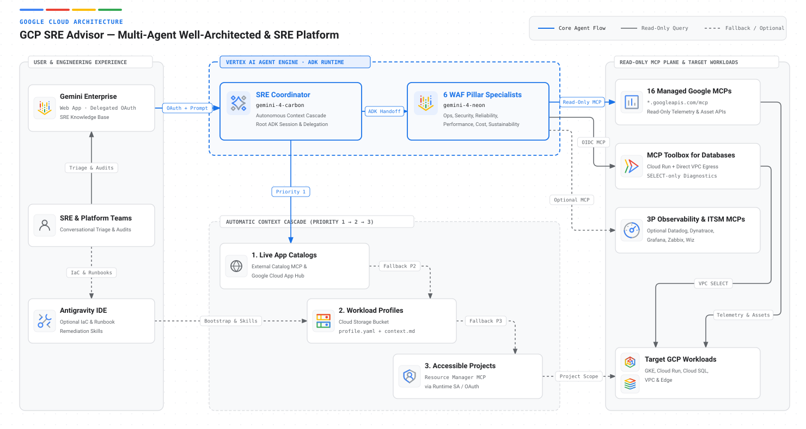

# GCP SRE Advisor

Multi-agent Site Reliability Engineering and cloud architecture advisor built
with the Google Agent Development Kit (`google-adk`), deployed to Vertex AI
Agent Engine, and surfaced in Gemini Enterprise.

The coordinator orchestrates six specialist sub-agents aligned with the pillars
of the Google Cloud Architecture Framework: Operational Excellence, Security and
Compliance, Reliability, Performance Optimization, Cost Optimization, and
Sustainability. Telemetry and resource configurations are inspected in read-only
mode through Google Cloud Managed Remote MCP servers, Google MCP Toolbox for
Databases, and optional third-party enterprise MCP connectors, while
architectural context resolves automatically through a priority cascade without
assuming a hardcoded default application.



## Architecture overview

| Capability                | Implementation                                                                                                                                                                                                                  |
| :------------------------ | :------------------------------------------------------------------------------------------------------------------------------------------------------------------------------------------------------------------------------ |
| Agent topology            | Root coordinator `gemini-4-carbon` with direct `sub_agents` handoff and concurrent six-pillar sweep tool `gemini-4-neon`                                                                                                        |
| Automatic context cascade | Single `ReasoningEngine` that checks live application catalogs and Google Cloud App Hub first, falls back to Cloud Storage Workload Profiles second, and discovers accessible GCP projects via Cloud Resource Manager MCP third |
| Identity model            | Delegated end-user OAuth pass-through from Gemini Enterprise via `DELEGATED_OAUTH_AUTH_ID` with read-only service account fallback                                                                                              |
| Inventory governance      | Continuous comparison against registered Google Cloud App Hub services and workloads, declarative `profile.yaml` baselines, and live Cloud Asset Inventory                                                                      |
| Tooling plane             | 16 Google Cloud Managed Remote MCP endpoints plus optional Cloud Run MCP Toolbox for Databases and enterprise catalog or observability MCP connectors                                                                           |

## Automatic context resolution cascade

Engineers never need to select modes or specify where workload documentation
lives. Whenever a session starts or a user names a target system, the root
coordinator automatically resolves architectural and operational context in
strict priority order:

| Priority         | Context source                                         | Target enterprise profile                                                                                                             | Onboarding effort                                                | Concrete use case                                                                                                                                                                                             |
| :--------------- | :----------------------------------------------------- | :------------------------------------------------------------------------------------------------------------------------------------ | :--------------------------------------------------------------- | :------------------------------------------------------------------------------------------------------------------------------------------------------------------------------------------------------------ |
| **1st Priority** | **Live application catalogs and Google Cloud App Hub** | Platform-mature enterprises operating an Internal Developer Portal, active CMDB, CNAPP security graph, or native Google Cloud App Hub | Connect `CATALOG_MCP_URL` or register App Hub applications       | Zero-maintenance governance where ownership, criticality, SLOs, delivery tooling, accepted risk exceptions, and bound cloud resources resolve live on every session                                           |
| **2nd Priority** | **Declarative Workload Profiles in Cloud Storage**     | Cloud Centers of Excellence and migration teams whose corporate CMDB is incomplete or disconnected from cloud-native topologies       | Minutes via `python3 cli.py bootstrap` and `python3 cli.py sync` | Calibrating diagnostics to business peak windows, multi-project Shared VPC mappings, FinOps labels, accepted architectural trade-offs, and team-specific IaC formats                                          |
| **3rd Priority** | **Accessible GCP projects via runtime identity**       | Greenfield accounts, M&A inherited environments, sandboxes, or urgent Day-0 triage with no catalog entry or profile bundle            | Zero setup; reuses existing IAM bindings                         | Automatically lists active Google Cloud projects accessible to the runtime service account or delegated user OAuth token via `cloudresourcemanager.googleapis.com/mcp` and asks which project to inspect live |

## Enterprise ecosystem integrations

Enterprise environments rarely rely on a single inventory or monitoring tool.
The MCP architecture supports read-only integration across two complementary
planes:

| Integration plane                               | Supported market platforms                                                                                | Connection pattern                                                                                                                                | Operational value                                                                                                                                    |
| :---------------------------------------------- | :-------------------------------------------------------------------------------------------------------- | :------------------------------------------------------------------------------------------------------------------------------------------------ | :--------------------------------------------------------------------------------------------------------------------------------------------------- |
| **ITSM, CMDB, and architecture catalogs**       | ServiceNow CMDB & CSDM, Atlassian Jira Service Management & Compass, GLPI, BMC Helix, TopDesk, SAP LeanIX | Gemini Enterprise native connectors, official Atlassian Rovo MCP, `CATALOG_MCP_URL` REST/GraphQL MCP adapters, or `catalog_toolbox` for SQL CMDBs | Feeds live resolution with system ownership, business criticality, change-management mode, and open change windows                                   |
| **Internal developer portals**                  | Google Cloud App Hub, Backstage, Port, Cortex, OpsLevel                                                   | Native `apphub.googleapis.com` inspection, official Port MCP server, or Backstage/OpenAPI MCP connectors                                          | Maps logical applications to multi-project cloud services, repositories, and SRE maturity scorecards without static YAML maintenance                 |
| **Cloud security graphs**                       | Wiz, Palo Alto Prisma Cloud, CrowdStrike Falcon Cloud Security, Orca Security                             | Official Wiz MCP server over the Wiz Security Graph or read-only GraphQL MCP adapters                                                             | Enriches context discovery and the Security specialist with agentless workload inventories, exposure paths, and CISO risk exceptions                 |
| **Commercial APM and full-stack observability** | Datadog, Dynatrace, New Relic, Splunk Observability, Cisco AppDynamics, Elastic Observability             | Official vendor MCP servers (`Datadog MCP`, `Dynatrace Hub MCP`, `New Relic MCP`, `Elastic Kibana MCP`, `Splunk MCP`) with read-only API scopes   | Correlates code-level distributed traces, Smartscape/Service Maps, and NRQL/DQL/SPL alerts with underlying Google Cloud SQL, GKE, VPC, and CDN state |
| **Open-source and hybrid monitoring**           | Grafana, Prometheus, Mimir, Loki, Tempo, Zabbix, OpenTelemetry                                            | Official `mcp-grafana` with `--disable-write`, read-only Zabbix JSON-RPC MCP, and OpenTelemetry Collector dual-shipping to Cloud Trace            | Bridges hybrid cloud and on-premises triage by correlating Google Cloud egress metrics with datacenter, VMware, or network alerts                    |
| **Incident response, GitOps, and FinOps**       | PagerDuty, Opsgenie, ArgoCD, GitHub, GitLab, Azure DevOps, HCP Terraform, IBM Cloudability, OpenCost      | Official PagerDuty, GitHub, and Terraform MCP servers, ArgoCD MCP, and Gemini Enterprise Git connectors                                           | Connects latency or error spikes to recent GitOps syncs, on-call schedules, and Kubernetes namespace cost allocation                                 |

## Repository layout

```text
.
├── cli.py                         # Simplified Python CLI entrypoint
├── pyproject.toml                 # Package metadata and dependencies
├── .env.example                   # Environment variable template
├── mcp_config.example.json        # Managed Remote MCP endpoints for IDE clients
├── docs/
│   └── diagrams/
│       └── gcp-sre-advisor-architecture.svg
├── app/
│   ├── agent.py                   # Root LlmAgent and ADK App definition
│   ├── config.py                  # Runtime, model, OAuth, and MCP settings
│   ├── prompts.py                 # Dynamic context-cascade instructions
│   ├── sub_agents.py              # Six Google Cloud Architecture Framework specialists
│   ├── app_utils/
│   │   └── profile_loader.py      # Cascade session context resolver
│   ├── profiles/
│   │   └── _sample/               # Reference profile excluded from live catalog sync
│   │       ├── profile.yaml
│   │       └── context.md
│   └── tools/
│       ├── catalog_tools.py       # Context activation and drift baseline tools
│       ├── mcp_registry.py        # Cached ADC/OIDC/Bearer auth and MCP builders
│       └── sweep_tool.py          # Concurrent six-pillar assessment tool
├── deployment/
│   ├── auth.py                    # Shared credential and gcloud helpers
│   ├── bootstrap_profile.py       # Cloud Asset Inventory draft profile generator
│   ├── check_profile_drift.py     # Declarative stack versus live inventory audit
│   ├── cli.py                     # Unified gcp-sre-advisor CLI implementation
│   ├── deploy_agent_engine.py     # Vertex AI Agent Engine deployment and update
│   ├── inspect_catalog.py         # Readiness check across context cascade sources
│   ├── setup_gemini_enterprise.py # Gemini Enterprise registration and OAuth binding
│   ├── sync_profiles_gcs.py       # Cloud Storage profile catalog publisher
│   ├── validate_profile.py        # Schema validator for Workload Profiles
│   └── terraform/                 # Terraform module for SA, APIs, bucket, toolboxes
├── .agents/skills/
│   ├── sre-remediation-assistant/
│   └── workload-profile-bootstrapper/
├── mcp_toolbox/
│   ├── tools.yaml                 # Read-only SQL diagnostics for private databases
│   └── catalog_tools.yaml         # Reference SQL CMDB catalog MCP configuration
└── tests/
    └── test_agent_structure.py
```

## Setup and local development

Create the virtual environment, install the package with development
dependencies, and run the test suite:

```bash
python3 -m venv .venv
source .venv/bin/activate
pip install -e ".[dev]"
ruff check .
pytest
```

Copy `.env.example` to `.env` and set your runtime Google Cloud project and
Cloud Storage staging bucket. Inspect the context resolution cascade or launch
the local ADK web playground:

```bash
python3 cli.py catalog
python3 cli.py playground
```

## Provisioning and deployment

### 1. Provision base infrastructure with Terraform

The module in [deployment/terraform/](deployment/terraform/) enables the
required Google Cloud APIs (including `apphub.googleapis.com`,
`cloudasset.googleapis.com`, `cloudresourcemanager.googleapis.com`,
`aiplatform.googleapis.com`, `discoveryengine.googleapis.com`, and
`run.googleapis.com`), creates the read-only runtime service account
`sa-sre-advisor-reader` with least-privilege inspection roles across
`project_id` and `target_project_ids`, provisions the versioned Cloud Storage
bucket for Agent Engine staging and Workload Profiles, and optionally deploys
private Cloud Run MCP Toolbox gateways for databases (`database_toolbox`) or SQL
CMDB catalogs (`catalog_toolbox`).

```bash
cp deployment/terraform/terraform.tfvars.example deployment/terraform/terraform.tfvars
```

Edit `deployment/terraform/terraform.tfvars` with your `project_id`, `region`,
and optional `target_project_ids`, then apply:

```bash
terraform -chdir=deployment/terraform init
terraform -chdir=deployment/terraform plan
terraform -chdir=deployment/terraform apply
```

Capture the Terraform outputs to populate `.env`:

```bash
terraform -chdir=deployment/terraform output
```

### 2. Deploy to Vertex AI Agent Engine and Gemini Enterprise

Use `cli.py` to verify context sources, deploy or update the `ReasoningEngine`
runtime, and register **GCP SRE Advisor** in Gemini Enterprise:

```bash
python3 cli.py catalog
python3 cli.py deploy
python3 cli.py register
```

`register` reads the Reasoning Engine ID from `deployment_metadata.json` or
`REASONING_ENGINE_ID`. Pass `--skip-sync` to `deploy` when updating runtime code
or environment variables without uploading local profile folders. To enable
delegated end-user OAuth pass-through in Gemini Enterprise, set
`OAUTH_CLIENT_ID` and `OAUTH_CLIENT_SECRET` in `.env` before running
`python3 cli.py register`.

## Configuring context sources

### 1. Live application catalogs and Google Cloud App Hub

When platform engineering or ITSM teams maintain an authoritative inventory, the
coordinator resolves ownership, criticality, target GCP projects, SLOs, delivery
tooling, accepted risks, and bound cloud resources dynamically on every session
through two mechanisms:

1.  **External application catalog MCP via `CATALOG_MCP_URL`:** Connects any
    Streamable HTTP MCP server exposing an Internal Developer Portal, CMDB, APM
    catalog, or security graph, including relational CMDBs served through
    Google MCP Toolbox for Databases with `mcp_toolbox/catalog_tools.yaml`.
1.  **Google Cloud App Hub via `apphub.googleapis.com`:** Available
    automatically when the runtime service account holds `roles/apphub.viewer`,
    allowing specialists to correlate registered App Hub applications alongside
    bound `services` and `workloads`.

Configure external catalog connectivity in `.env` before deploying:

```ini
CATALOG_MCP_URL=https://your-catalog-mcp-endpoint.example.com/mcp
CATALOG_MCP_AUTH_MODE=oidc
CATALOG_MCP_BEARER_TOKEN=
CATALOG_MCP_TOKEN_SECRET_ID=
CATALOG_MCP_HEADERS_JSON=
CATALOG_MCP_PROVIDER_NAME=backstage
CATALOG_MCP_TOOLS=
```

Supported `CATALOG_MCP_AUTH_MODE` and `OBSERVABILITY_MCP_AUTH_MODE` values:

- `oidc`: mints and caches Google OIDC identity tokens for IAM-protected Cloud
  Run MCP gateways.
- `adc`: forwards delegated Gemini Enterprise user OAuth tokens or Google
  Application Default Credentials.
- `bearer`: sends a static bearer token from `*_BEARER_TOKEN` or fetches it at
  runtime from Google Secret Manager via `*_TOKEN_SECRET_ID`.
- `headers`: sends custom HTTP headers from `*_HEADERS_JSON` or fetches the JSON
  header map from Google Secret Manager via `*_TOKEN_SECRET_ID`.
- `none`: connects without an `Authorization` header on private VPC-isolated
  networks.

#### Connecting Datadog or third-party observability MCP servers

No Python code changes are required to connect Datadog, Dynatrace, New Relic,
Grafana, or Zabbix MCP servers. Store a read-only token in Google Secret
Manager, grant `roles/secretmanager.secretAccessor` to `sa-sre-advisor-reader`,
configure `.env`, validate with `python3 cli.py catalog`, and update the runtime
with `python3 cli.py deploy --skip-sync`:

```bash
printf '%s' 'YOUR_READONLY_DATADOG_SERVICE_ACCESS_TOKEN' | \
  gcloud secrets create datadog-mcp-readonly-token --data-file=- --project=your-runtime-project-id

gcloud secrets add-iam-policy-binding datadog-mcp-readonly-token \
  --member="serviceAccount:sa-sre-advisor-reader@your-runtime-project-id.iam.gserviceaccount.com" \
  --role="roles/secretmanager.secretAccessor" \
  --project=your-runtime-project-id
```

- **Use Datadog for APM traces, monitors, metrics, and logs across all six
  specialists** while keeping another CMDB or App Hub in `CATALOG_MCP_URL`:

```ini
OBSERVABILITY_MCP_URL=https://mcp.datadoghq.com/v1/mcp?toolsets=apm,metrics,logs,monitors
OBSERVABILITY_MCP_AUTH_MODE=bearer
OBSERVABILITY_MCP_TOKEN_SECRET_ID=datadog-mcp-readonly-token
OBSERVABILITY_MCP_PROVIDER_NAME=datadog
OBSERVABILITY_MCP_TOOLS=
```

- **Also use Datadog Software Catalog as the primary application catalog** in
  the coordinator cascade:

```ini
CATALOG_MCP_URL=https://mcp.datadoghq.com/v1/mcp?toolsets=software_catalog
CATALOG_MCP_AUTH_MODE=bearer
CATALOG_MCP_TOKEN_SECRET_ID=datadog-mcp-readonly-token
CATALOG_MCP_PROVIDER_NAME=datadog
```

- **Self-hosted or legacy API-key MCP wrappers** requiring custom headers such
  as `DD-API-KEY` and `DD-APPLICATION-KEY` can store
  `{"DD-API-KEY":"...","DD-APPLICATION-KEY":"..."}` in Secret Manager and set
  `OBSERVABILITY_MCP_AUTH_MODE=headers`.

#### Multi-MCP priority, pillar scoping, and concurrency governance

When enterprises operate multiple catalog or observability platforms side by
side—such as Backstage plus ServiceNow CMDB, or Datadog APM alongside Zabbix
hybrid monitoring and Wiz cloud security—configure ordered arrays via
`CATALOG_MCP_SERVERS_JSON` and `OBSERVABILITY_MCP_SERVERS_JSON`:

```ini
OBSERVABILITY_MCP_SERVERS_JSON='[
  {
    "name": "datadog",
    "priority": 1,
    "url": "https://mcp.datadoghq.com/v1/mcp?toolsets=apm,monitors,logs",
    "auth_mode": "bearer",
    "token_secret_id": "datadog-mcp-readonly-token",
    "pillars": ["operational_excellence", "reliability", "performance_optimization"],
    "layer_role": "In-process application APM traces, spans, and service monitors"
  },
  {
    "name": "zabbix",
    "priority": 2,
    "url": "https://zabbix-mcp-gateway.example.run.app/mcp",
    "auth_mode": "oidc",
    "pillars": ["operational_excellence", "reliability"],
    "layer_role": "Hybrid on-premises hosts, VMware clusters, and WAN links"
  },
  {
    "name": "wiz",
    "priority": 1,
    "url": "https://wiz-mcp-gateway.example.run.app/mcp",
    "auth_mode": "bearer",
    "token_secret_id": "wiz-mcp-readonly-token",
    "pillars": ["security_compliance"],
    "layer_role": "Agentless container vulnerability graph and exposure paths"
  }
]'
```

Four built-in mechanisms prevent tool collisions, contradictory diagnoses, and
third-party API rate-limit exhaustion:

1.  **Deterministic namespace isolation:** Each MCP server receives a sanitized,
    unique `tool_name_prefix` (`datadog_*`, `zabbix_*`, `wiz_*`, or
    `app_catalog_backstage_*` and `app_catalog_servicenow_*`) so identical tool
    names across vendors never collide.
1.  **Pillar-scoped attachment (`pillars`):** Each third-party MCP toolset
    attaches only to the specialist sub-agents listed in `pillars`, keeping
    unrelated schemas out of other pillars' context windows and avoiding
    unnecessary API calls during six-pillar sweeps.
1.  **Explicit priority and layer authority (`priority` and `layer_role`):**
    Specialists receive servers sorted by `priority`, respect per-application
    observability provider affinity from the active catalog or profile before
    querying competing APMs, and apply strict layer authority when signals
    diverge—treating APM tools as authoritative for code-level spans, Google
    Cloud Managed MCPs as authoritative for cloud control-plane and managed
    database state, and hybrid MCPs as authoritative for on-premises
    infrastructure.
1.  **Bounded sweep concurrency (`SWEEP_CONCURRENCY_LIMIT`):** Concurrent
    six-pillar sweeps throttle parallel execution via an async semaphore
    (`default: 3`) with exponential-backoff retries to respect external SaaS API
    rate limits.

### 2. Declarative Workload Profiles in Cloud Storage

When an application is not present in a live catalog MCP, the coordinator
automatically checks declarative Workload Profiles stored in `PROFILES_GCS_URI`.
Only [app/profiles/\_sample/](app/profiles/_sample/) is committed to Git;
directories prefixed with `_` are excluded from `list_available_profiles()` and
`python3 cli.py sync` so sample data never leaks into production catalogs, while
`python3 cli.py validate _sample` validates the reference schema directly.

Generate an initial draft automatically from Cloud Asset Inventory and an
optional Infrastructure-as-Code repository, validate it, check for drift, and
publish to Cloud Storage:

```bash
python3 cli.py bootstrap your-workload-project-id payments-prod --tier prod --iac-dir /path/to/iac-repo
python3 cli.py validate payments-prod
python3 cli.py drift payments-prod
python3 cli.py sync
```

By default, `sync` uploads local non-underscore profile folders without deleting
profiles that already exist in Cloud Storage. Pass `--prune` only when remote
profiles absent from `app/profiles/` should be removed from the bucket.

#### Filling `profile.yaml`

Every profile defines ten top-level sections:

| Section                            | Required keys and purpose                                                                                                                                                                                                            |
| :--------------------------------- | :----------------------------------------------------------------------------------------------------------------------------------------------------------------------------------------------------------------------------------- |
| `workload_identity`                | `id` matching the folder name, `display_name`, `business_domain`, `criticality` set to `mission-critical`, `business-critical`, or `standard`, `criticality_summary`, and `peak_windows`.                                            |
| `environment_and_projects`         | `environment_tier` set to `prod`, `staging`/`uat`/`hml`, or `dev`, `primary_region`, `primary_zone`, and `projects_by_role` mapping logical roles such as `application`, `data`, or `shared_networking` to Google Cloud project IDs. |
| `architecture_archetype`           | Short descriptor of the topology such as `cloud-native-microservices`, `serverless-api`, `hybrid-gke-data`, or `lift-and-modernize`.                                                                                                 |
| `active_stack`                     | Lists of provisioned service tokens under `compute`, `databases`, `caching_messaging`, and `edge_networking`. Used for MCP tool filtering in single-profile mode and Cloud Asset Inventory drift checks.                             |
| `network_and_protocol_constraints` | `egress_static_ips` for partner IP allowlists and `special_protocols` for HTTP/2, gRPC, WebSockets, byte-range streaming, or Private Service Access CIDR rules.                                                                      |
| `finops_and_cost_controls`         | `required_labels` audited across cloud resources and `nonprod_cost_saving_policy` describing off-hours scaling or log exclusion expectations.                                                                                        |
| `slo_and_resilience_targets`       | Numerical `availability_slo_pct`, `latency_p95_ms`, `rpo_minutes`, `rto_minutes`, and `critical_business_windows`.                                                                                                                   |
| `external_boundaries`              | Lists under `identity_providers`, `edge_and_dns`, and `external_apis_or_clouds` so specialists separate Google Cloud components from external dependencies during triage.                                                            |
| `accepted_exceptions`              | List of approved architectural trade-offs with `id`, `pillar`, `summary`, `rationale`, and `review_date` so agents respect documented risk acceptances while noting expired review dates.                                            |
| `change_delivery_model`            | `delivery_mode` set to `declarative_iac` or `standard_operational_runbook`, `tooling`, and `remediation_format` controlling how specialists format remediation snippets.                                                             |

#### Supported `active_stack` tokens and enabled MCP servers

Core read-only MCP servers `logging`, `monitoring`, `resourcemanager`, `iam`,
`orgpolicy`, `cloudasset`, `storage`, `gcloud_cli`, `developerknowledge`, and
`discoveryengine` are always available. Declaring stack tokens in `active_stack`
maps the workload to additional Managed MCP endpoints and drift rules:

| Category            | Supported tokens                                                                            | Additional Managed MCPs enabled                                                   |
| :------------------ | :------------------------------------------------------------------------------------------ | :-------------------------------------------------------------------------------- |
| `compute`           | `gke`, `compute_engine`                                                                     | `compute`, `cloudtrace`                                                           |
| `compute`           | `cloud_run`, `cloud_run_jobs`, `cloud_run_worker_pools`                                     | `cloudrun`, `cloudtrace`                                                          |
| `databases`         | `cloudsql_mysql`, `cloudsql_postgres`, `cloudsql_sqlserver`                                 | `sqladmin` plus Cloud Run `db_toolbox` when `DATABASE_MCP_TOOLBOX_URL` is set     |
| `databases`         | `bigquery`                                                                                  | `bigquery`                                                                        |
| `databases`         | `alloydb`, `spanner`, `firestore`                                                           | Audited via `gcloud_cli`, `cloudasset`, `monitoring`, `logging`, and drift checks |
| `caching_messaging` | `pubsub`                                                                                    | `pubsub`                                                                          |
| `caching_messaging` | `eventarc`                                                                                  | `pubsub`, `cloudrun`, `cloudtrace`                                                |
| `caching_messaging` | `memorystore_redis`                                                                         | Audited via `monitoring`, `logging`, `gcloud_cli`, and drift checks               |
| `edge_networking`   | `global_external_alb`, `regional_alb`, `cloud_cdn`, `cloud_armor`, `cloud_nat`, `cloud_dns` | Audited via `monitoring`, `logging`, `gcloud_cli`, and drift checks               |

#### Writing `context.md`

Keep `context.md` under roughly 400 words covering business impact, end-to-end
request flow, deliberate design constraints, and operational conventions. Store
long postmortems and runbooks in the Gemini Enterprise knowledge base Data Store
rather than pasting them into `context.md`.

### 3. Automatic discovery of accessible GCP projects

When neither a live catalog MCP nor a Cloud Storage profile is available, the
coordinator invokes `resourcemanager_search_projects` on
`https://cloudresourcemanager.googleapis.com/mcp` using the delegated Gemini
Enterprise end-user OAuth token or the runtime service account's IAM
permissions, lists the active Google Cloud projects it has permission to read,
and asks which project to inspect live. Once selected, specialists discover
provisioned services dynamically via Managed Remote MCP endpoints and
`cloudasset.googleapis.com` and emit tool-neutral operational guidance.

## IDE agent skills

Two optional skills in `.agents/skills/` extend IDE coding workflows for
engineers acting on advisor findings:

- [sre-remediation-assistant](.agents/skills/sre-remediation-assistant/SKILL.md):
  Validates live baseline state with Managed Remote MCPs
  (`mcp_config.example.json`), resolves the workload's `change_delivery_model`,
  and prepares validated IaC diffs or runbook sequences.
- [workload-profile-bootstrapper](.agents/skills/workload-profile-bootstrapper/SKILL.md):
  Bootstraps, validates, checks drift, and publishes new Workload Profiles from
  Cloud Asset Inventory and workspace repositories.
