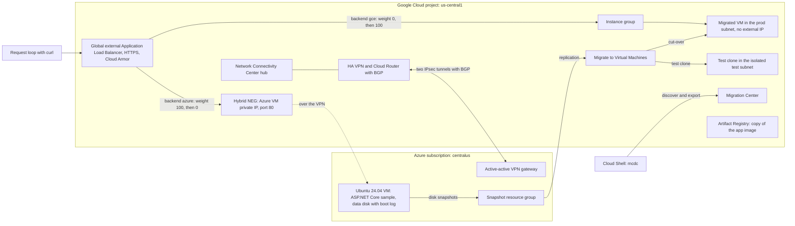

# Migrate an Azure VM to Compute Engine

This demo moves an Azure virtual machine (VM) to Compute Engine without
rebuilding it. It follows
[Migrate from Azure to Google Cloud: Migrate Azure Virtual Machines to Compute Engine](https://googlecloudplatform.github.io/cloud-solutions/migrate-from-azure-to-google-cloud/migrate-from-azure-vms-to-compute-engine/),
and walks through the guide's steps on a sample VM:

1.  Build the inventory and total cost of ownership (TCO) report with Migration
    Center.
1.  Build the Google Cloud foundation and high-availability (HA) VPN connection
    between clouds.
1.  Replicate the Azure VM and verify a test clone in an isolated subnet.
1.  Cut over, shift load balancer traffic, and finalize.
1.  Configure disk backups and copy the container image to Artifact Registry.

> [!WARNING]
>
> This demo creates billable resources in Google Cloud and Azure, including VPN
> gateways and tunnels, a load balancer, a Google Cloud Armor policy, Cloud NAT,
> VMs, disks, and replication storage. Complete [Clean up](#clean-up) after your
> session.

## Architecture

Before cut-over, a global external Application Load Balancer sends all traffic
to the Azure VM through a hybrid network endpoint group (NEG) over HA VPN. At
cut-over, the load balancer's backend weights switch to the migrated Compute
Engine VM, so clients keep the same IP address.



The source VM runs Ubuntu 24.04 (UEFI/Gen2) with Microsoft's ASP.NET Core sample
app in a container and a managed data disk holding `/data/evidence/boots.log`.
Each boot appends a line with the platform vendor, product, and firmware, so
after cut-over the file shows the Azure boots followed by the Compute Engine
boot.

## Before you begin

Confirm that your Google Cloud project, Azure subscription, permissions, and
local tools meet these prerequisites.

### Environments

- **Google Cloud project:** Use a new project with billing enabled. The project
  serves as both the Migrate to Virtual Machines host and target project, and
  needs quota in `us-central1` for at least 2 `N4` vCPUs and 47 GB (6,282 IOPS
  and 350 MiB/s) of `Hyperdisk Balanced`, or 2 `N2` vCPUs and 47 GB of
  `Balanced persistent disk` for the fallback.
- **Azure subscription:** Use a dedicated test subscription with quota in
  `centralus` for 2 `DSv5` vCPUs and 3 public IP addresses. The custom role that
  Terraform creates for Migrate to Virtual Machines can delete snapshot resource
  groups in the subscription.

### Permissions

Grant these Google Cloud roles on the project:

- `roles/artifactregistry.admin`
- `roles/compute.admin`
- `roles/iam.serviceAccountAdmin`
- `roles/iap.tunnelResourceAccessor`
- `roles/logging.viewer`
- `roles/migrationcenter.admin`
- `roles/networkconnectivity.hubAdmin`
- `roles/orgpolicy.policyViewer`
- `roles/resourcemanager.projectIamAdmin`
- `roles/serviceusage.serviceUsageAdmin`
- `roles/vmmigration.admin`

If your organization enforces `compute.restrictVpnPeerIPs`, also get
`roles/orgpolicy.policyAdmin` on the organization so Terraform can add a
project-level exception for the Azure VPN gateway IPs.

On Azure, get **Contributor** and **User Access Administrator** on the
subscription, plus permission to register applications in Microsoft Entra ID
(**Application Developer** if restricted).

### Tools

Use Linux or macOS with bash or zsh and install:

- [Google Cloud CLI](https://cloud.google.com/sdk/docs/install)
- [Azure CLI](https://learn.microsoft.com/cli/azure/install-azure-cli)
- [Terraform](https://developer.hashicorp.com/terraform/install) 1.12.2 or later
- `git`, `curl`, `ssh-keygen`, [`jq`](https://github.com/jqlang/jq), and
  `openssl` (1.1.1+ or LibreSSL 3.1.1+ for `-addext`)
- [`gcrane`](https://cloud.google.com/artifact-registry/docs/docker/copy-images#gcrane-local)
  (extract in a temporary directory or pass `gcrane` to `tar`—for example,
  `tar -zxvf go-containerregistry.tar.gz gcrane`—so the archive's `README.md`
  doesn't overwrite this guide)

The Migration Center discovery client CLI (`mcdc`) runs inside Cloud Shell
through `gcloud cloud-shell ssh`, so you don't install it locally.

## Set up the environment

Clone the demo directory, sign in to both clouds, enable the initial APIs, and
check quotas and organization policies.

### Authenticate and create temp/demo.env

1.  Clone the demo directory from the repository and enter it:

    ```bash
    git clone --filter=blob:none --no-checkout https://github.com/GoogleCloudPlatform/cloud-solutions.git
    cd cloud-solutions
    git sparse-checkout set --cone projects/migrate-from-azure-to-google-cloud/vm-to-compute-engine
    git checkout
    cd projects/migrate-from-azure-to-google-cloud/vm-to-compute-engine
    ```

1.  Set your Google Cloud project ID and Azure subscription ID:

    ```bash
    GOOGLE_CLOUD_PROJECT_ID="YOUR_GOOGLE_CLOUD_PROJECT_ID"
    AZURE_SUBSCRIPTION_ID="YOUR_AZURE_SUBSCRIPTION_ID"
    ```

    Replace `YOUR_GOOGLE_CLOUD_PROJECT_ID` with your Google Cloud project ID
    (not the project name or number) and `YOUR_AZURE_SUBSCRIPTION_ID` with your
    Azure subscription ID.

1.  Authenticate to Google Cloud and set Application Default Credentials (ADC)
    with your project as the quota project:

    ```bash
    gcloud auth login
    gcloud config set project "${GOOGLE_CLOUD_PROJECT_ID}"
    gcloud auth application-default login
    gcloud auth application-default set-quota-project "${GOOGLE_CLOUD_PROJECT_ID}"
    ```

1.  Authenticate to Azure:

    ```bash
    az login
    az account set --subscription "${AZURE_SUBSCRIPTION_ID}"
    ```

1.  Create and source `temp/demo.env` once. Later steps append `TF_VAR_*`
    Terraform inputs and `LB_IP` to it:

    ```bash
    mkdir -p temp && chmod 700 temp
    cat > temp/demo.env <<EOF
    unset LB_IP TF_VAR_cross_cloud TF_VAR_gce_weight TF_VAR_ha_vpn_interface_ips TF_VAR_migrated_instance_name TF_VAR_operator_member TF_VAR_ssl_certificate_name TF_VAR_vpn_peer_policy_enforced
    export GOOGLE_CLOUD_PROJECT_ID="${GOOGLE_CLOUD_PROJECT_ID}"
    export REGION="us-central1"
    export ZONE="us-central1-a"
    export AZURE_SUBSCRIPTION_ID="${AZURE_SUBSCRIPTION_ID}"
    export AZURE_TENANT_ID="$(az account show --query tenantId --output tsv)"
    export AZURE_LOCATION="centralus"
    export TF_VAR_project_id="${GOOGLE_CLOUD_PROJECT_ID}"
    export TF_VAR_region="us-central1"
    export TF_VAR_zone="us-central1-a"
    export TF_VAR_subscription_id="${AZURE_SUBSCRIPTION_ID}"
    export TF_VAR_location="centralus"
    EOF
    chmod 600 temp/demo.env
    source temp/demo.env
    ```

### Enable APIs and check org policy

1.  Enable the APIs required before Terraform runs:

    ```bash
    gcloud services enable \
      cloudresourcemanager.googleapis.com \
      cloudshell.googleapis.com \
      compute.googleapis.com \
      cloudquotas.googleapis.com \
      orgpolicy.googleapis.com \
      migrationcenter.googleapis.com \
      --project="${GOOGLE_CLOUD_PROJECT_ID}"
    ```

1.  Register the Azure Compute and Network resource providers:

    ```bash
    az provider register --namespace Microsoft.Compute --wait
    az provider register --namespace Microsoft.Network --wait
    ```

1.  Check whether your organization enforces `compute.restrictVpnPeerIPs`, and
    save the result to `temp/demo.env`:

    ```bash
    VPN_PEER_POLICY_ENFORCED="$(gcloud org-policies describe compute.restrictVpnPeerIPs --effective --project="${GOOGLE_CLOUD_PROJECT_ID}" --billing-project="${GOOGLE_CLOUD_PROJECT_ID}" --format=json | jq '[.spec.rules // [] | .[] | select(.allowAll != true)] | length > 0')"
    if [ "${VPN_PEER_POLICY_ENFORCED}" = "true" ] || [ "${VPN_PEER_POLICY_ENFORCED}" = "false" ]; then
      echo "export TF_VAR_vpn_peer_policy_enforced=${VPN_PEER_POLICY_ENFORCED}" >> temp/demo.env
      source temp/demo.env
      echo "TF_VAR_vpn_peer_policy_enforced=${TF_VAR_vpn_peer_policy_enforced}"
    else
      echo "The lookup failed. Fix the error, and run this step again."
    fi
    ```

## Deploy the Azure source environment

Provision the Azure virtual network, Ubuntu 24.04 VM and data disk, two Entra ID
app registrations, and the active-active VPN gateway.

1.  Create an SSH key pair for the Azure VM, and append the SSH public key and
    VPN pre-shared key to `temp/demo.env`. The `grep` check preserves an
    existing pre-shared key across re-runs, and both local Terraform states also
    store the key:

    ```bash
    test -f "${HOME}/.ssh/vm-demo-azure" || ssh-keygen -t ed25519 -N "" -C "vm-demo-azure" -f "${HOME}/.ssh/vm-demo-azure"
    grep -q '^export TF_VAR_vpn_shared_key=' temp/demo.env || cat >> temp/demo.env <<EOF
    export TF_VAR_ssh_public_key="$(cat "${HOME}/.ssh/vm-demo-azure.pub")"
    export TF_VAR_vpn_shared_key="$(openssl rand -hex 16)"
    EOF
    source temp/demo.env
    ```

1.  Initialize and apply `terraform/azure`:

    ```bash
    terraform -chdir=terraform/azure init
    terraform -chdir=terraform/azure apply -auto-approve
    ```

    Creating the Azure VPN gateway typically takes 30 to 45 minutes.

1.  Verify the app's `/healthz` endpoint and boot log on the Azure VM through
    the VM agent:

    ```bash
    az vm run-command invoke \
      --subscription "${AZURE_SUBSCRIPTION_ID}" \
      --resource-group "vm-demo-rg" \
      --name "vm-demo-vm" \
      --command-id RunShellScript \
      --scripts "curl --silent --show-error --fail http://localhost/healthz; echo; cat /data/evidence/boots.log" \
      --query "value[0].message" \
      --output tsv
    ```

    Confirm the output shows `Healthy` and a boot line with
    `vendor="Microsoft Corporation"` and `firmware=UEFI`.

## Assess the VM with Migration Center

Discover the Azure VM with Migration Center, generate primary (`N4`) and
fallback (`N2`) TCO reports, and define a capacity fallback order.

1.  In the Google Cloud console, go to the **Migration Center** page and
    activate Migration Center:

    1.  If prompted, click **Enable APIs**.
    1.  In the **Region** list, select `us-central1`. You can't change the
        region later.
    1.  If prompted for an **Expert Request number**, click **Skip** or enter
        `DEMO` for all required fields.
    1.  To accept the default migration preferences, click **Next**.
    1.  Click **Continue**.

1.  Create a 7-day client secret for the discovery app registration:

    ```bash
    DISCOVERY_CLIENT_ID="$(terraform -chdir=terraform/azure output -raw discovery_client_id)"
    DISCOVERY_SECRET_END="$(date -u -v+7d '+%Y-%m-%dT%H:%M:%S+00:00' 2>/dev/null || date -u -d '+7 days' '+%Y-%m-%dT%H:%M:%S+00:00')"
    DISCOVERY_CLIENT_SECRET="$(az ad app credential reset \
      --id "${DISCOVERY_CLIENT_ID}" \
      --append \
      --display-name "mcdc" \
      --end-date "${DISCOVERY_SECRET_END}" \
      --query password \
      --output tsv)"
    ```

1.  Download and verify `mcdc` in Cloud Shell:

    ```bash
    gcloud cloud-shell ssh --authorize-session --quiet --command='
      mkdir -p ~/vm-demo-mcdc && cd ~/vm-demo-mcdc &&
      curl -fsSLO https://mc-release.storage.googleapis.com/mcdc/6.3.15/mcdc &&
      echo "e2e95b99d32d9f6b967feb381c53d77a35be6b3eb055371cb224bd65ea18664f  mcdc" | sha256sum --check &&
      chmod +x mcdc'
    ```

    Then discover the Azure VM, and export the data to Migration Center:

    ```bash
    printf '%s\n' "${DISCOVERY_CLIENT_SECRET}" |
      gcloud cloud-shell ssh --authorize-session --quiet --command="\
        IFS= read -r MCDC_SECRET && cd ~/vm-demo-mcdc && \
        ./mcdc discover azure \
          --tenant '${AZURE_TENANT_ID}' \
          --client '${DISCOVERY_CLIENT_ID}' \
          --secret \"\${MCDC_SECRET}\" \
          --subscription '${AZURE_SUBSCRIPTION_ID}' \
          --resource-group vm-demo-rg && \
        ./mcdc export mc --project '${GOOGLE_CLOUD_PROJECT_ID}' --wait"

    unset DISCOVERY_CLIENT_SECRET
    ```

    Confirm the output prints `Collected 1 VMs` and
    `[✓] Export to Migration Center is done`.

1.  In the Google Cloud console under **Migration Center**, create two migration
    preferences so your TCO assessment prices both your primary target (`N4`
    with `Hyperdisk Balanced`) and an in-zone capacity fallback (`N2` with
    `Balanced persistent disk`) in case `us-central1-a` runs out of `N4`
    capacity at cut-over. Because `N4` and `N2` require different disk families,
    you model them as separate preference sets:

    1.  Go to **Migration preferences** and click **Create migration
        preferences**.
    1.  Enter `vm-demo-n4` for **Name**, and select `us-central1` for
        **Region**.
    1.  Under **Servers**, select **Google Compute Engine** and keep
        **Multi-tenant**.
    1.  Under **Machine series**, clear the preselected series and select only
        **N4**.
    1.  Under **Storage configuration**, clear any preselected disk types and
        select only **Hyperdisk Balanced** for **Disk type** and click
        **Create**.
    1.  Click **Create migration preferences** again, enter `vm-demo-n2` for
        **Name**, and apply the same settings except select only **N2** under
        **Machine series** and **Balanced persistent disk** for **Disk type**.

1.  Group the discovered VM:

    1.  Go to **Groups** (under **Discovery**) and click **Create group**.
    1.  Enter `vm-demo-group` for **Name** and click **Next**.
    1.  Select `vm-demo-vm` (`web-01`) and click **Create**.

1.  Generate the primary and fallback TCO reports:

    1.  Go to **Create reports** and click **TCO and detailed pricing reports**.
    1.  Enter `vm-demo-tco` for **Name** and click **Next**.
    1.  Select `vm-demo-group` and click **Next**.
    1.  In **Select migration preferences**, select `vm-demo-n4`, and
        `vm-demo-n2`.
    1.  Click **Generate report**.
    1.  On **Reports**, open each report to review the `N4` and `N2` cost
        summary. To view the per-VM `n4-standard-2` and `n2-standard-2`
        recommendations, click **Export report > Export detailed pricing report
        to CSV/Google Sheets**.

## Build the Google Cloud foundation and VPN

This section provisions the Google Cloud target network, connects it to Azure
over active-active HA VPN with Border Gateway Protocol (BGP), and fronts the
Azure VM with a global external Application Load Balancer so clients keep the
same IP address across cut-over. Because each cloud needs the other's VPN
gateway IP addresses (and the TLS certificate needs the reserved load balancer
IP), you deploy the Google Cloud foundation first, connect the Azure VPN
gateway, and then add the VPN tunnels and load balancer.

### Deploy the Google Cloud foundation

Enable the remaining APIs and create the Virtual Private Cloud (VPC) network
with the `vm-demo-prod` and `vm-demo-test` subnets, Cloud NAT, firewall rules,
VM service account, Artifact Registry repository, optional VPN peer policy
exception, HA VPN gateway, Cloud Router, and load balancer static IP.

1.  Save the Google Cloud Terraform inputs to `temp/demo.env` and apply
    `terraform/gcp`:

    ```bash
    ACCOUNT="${CLOUDSDK_AUTH_IMPERSONATE_SERVICE_ACCOUNT:-$(gcloud config get-value account)}"
    MEMBER_PREFIX="user"
    if [[ "${ACCOUNT}" == *.gserviceaccount.com ]]; then MEMBER_PREFIX="serviceAccount"; fi
    printf "export TF_VAR_operator_member='%s:%s'\nexport TF_VAR_cross_cloud='%s'\n" \
      "${MEMBER_PREFIX}" "${ACCOUNT}" \
      "$(terraform -chdir=terraform/azure output -json cross_cloud | jq -c .)" >> temp/demo.env
    source temp/demo.env
    terraform -chdir=terraform/gcp init
    terraform -chdir=terraform/gcp apply -auto-approve
    ```

    Ignore the module's deprecation warnings about `enable_logging`.

1.  Save the load balancer IP to `temp/demo.env`:

    ```bash
    echo "export LB_IP=\"$(terraform -chdir=terraform/gcp output -raw lb_ip)\"" >> temp/demo.env
    source temp/demo.env
    ```

### Connect the Azure VPN gateway

Pass Google Cloud's HA VPN interface IP addresses to `terraform/azure` to create
the Azure local network gateways and VPN connections:

```bash
printf "export TF_VAR_ha_vpn_interface_ips='%s'\n" \
  "$(terraform -chdir=terraform/gcp output -json ha_vpn_interface_ips | jq -c .)" >> temp/demo.env
source temp/demo.env
terraform -chdir=terraform/azure apply -auto-approve
```

### Deploy the VPN tunnels and load balancer

Create the Google Cloud VPN tunnels, BGP sessions, Network Connectivity Center
hub and spoke, hybrid NEG pointing to the Azure VM, and global external
Application Load Balancer with Google Cloud Armor (100% weight to Azure, 0% to
Compute Engine).

1.  Create a 30-day self-signed SSL certificate for `${LB_IP}`, unless a
    matching `temp/lb.crt` exists already, and upload it:

    ```bash
    (test -f temp/lb.key && openssl x509 -in temp/lb.crt -noout -text 2>/dev/null | sed 's/^ *//' | grep -Fxq "IP Address:${LB_IP}") || \
      openssl req -x509 -newkey rsa:2048 -sha256 -nodes \
        -days 30 \
        -subj "/CN=${LB_IP}" \
        -addext "subjectAltName=IP:${LB_IP}" \
        -keyout temp/lb.key \
        -out temp/lb.crt
    chmod 600 temp/lb.key
    gcloud compute ssl-certificates create "vm-demo-lb-cert" \
      --certificate=temp/lb.crt \
      --private-key=temp/lb.key \
      --global \
      --project="${GOOGLE_CLOUD_PROJECT_ID}"
    ```

1.  Set `ssl_certificate_name` and apply `terraform/gcp`:

    ```bash
    echo 'export TF_VAR_ssl_certificate_name="vm-demo-lb-cert"' >> temp/demo.env
    source temp/demo.env
    terraform -chdir=terraform/gcp apply -auto-approve
    ```

    The plan can start with `Note: Objects have changed outside of Terraform`
    about `labels = {}` on the Artifact Registry repository. The provider reads
    the empty labels back after the first apply, and the plan changes nothing
    for it. If the apply fails with a VPN peer organization policy error, wait
    up to 15 minutes for the policy exception to propagate and run `apply`
    again.

1.  Verify that both VPN tunnels are `ESTABLISHED`, BGP sessions are
    `UP Established` (advertising `10.20.0.0/16`), and the load balancer serves
    `x-served-by: azure`:

    ```bash
    for tunnel in $(terraform -chdir=terraform/gcp output -json vpn_tunnel_names | jq -r '.[]'); do
      gcloud compute vpn-tunnels describe "${tunnel}" \
        --region="${REGION}" \
        --project="${GOOGLE_CLOUD_PROJECT_ID}" \
        --format="value(name,status)"
    done
    gcloud compute routers get-status "$(terraform -chdir=terraform/gcp output -raw router_name)" \
      --region="${REGION}" \
      --project="${GOOGLE_CLOUD_PROJECT_ID}" \
      --format=json |
      jq -r '(.result.bgpPeerStatus[] | "\(.name) \(.status) \(.state)"), (.result.bestRoutesForRouter[]?.destRange)'
    until HEADERS="$(curl --silent --show-error --fail --max-time 10 --cacert temp/lb.crt --output /dev/null --dump-header - "https://${LB_IP}/healthz")" && grep -i '^x-served-by' <<<"${HEADERS}"; do sleep 15; done
    ```

    The `until` loop prints a `curl` error every 15 seconds until the load
    balancer serves, which can take a few minutes. The load balancer adds the
    `X-Served-By` response header with the label of the backend service it
    routed the request to (`azure` or `gce`).

### Run the request loop

Open a second terminal in the `vm-to-compute-engine` directory, source
`temp/demo.env`, and poll `https://${LB_IP}/` once per second to watch traffic
and errors across cut-over:

```bash
source temp/demo.env
while true; do
  printf '%s ' "$(date -u +%Y-%m-%dT%H:%M:%SZ)"
  curl --silent --output /dev/null --dump-header - --write-out '%{http_code}' --max-time 2 --cacert temp/lb.crt "https://${LB_IP}/" \
    | awk 'tolower($1)=="x-served-by:"{gsub(/\r/,"",$2);h=$2} /^[0-9][0-9][0-9]$/{code=$1} END{print (code!=""?code:"err"),(h!=""?h:"-")}'
  sleep 1
done
```

Before cut-over, the lines show `200 azure`. An occasional failed line, or a
burst of failures shorter than a minute, can appear. During cut-over, lines show
`000 -` or `503 azure`/`503 gce` until the migrated VM passes its health check
and switches to `200 gce`. Leave this loop running, and return to your first
terminal for the remaining steps.

## Migrate the VM

Use
[Migrate to Virtual Machines](https://console.cloud.google.com/compute/mfce/sources)
to replicate `vm-demo-vm`, verify a test clone in `vm-demo-test`, cut over to
Compute Engine, and shift load balancer traffic.

### Create the Azure source

Create a source to connect Migrate to Virtual Machines to your Azure
subscription.

1.  Generate a 30-day client secret for the Migrate to Virtual Machines app
    registration and print the source details (avoid recording or screen-sharing
    your terminal while the client secret is visible):

    ```bash
    M2VM_CLIENT_ID="$(terraform -chdir=terraform/azure output -raw m2vm_client_id)"
    M2VM_SECRET_END="$(date -u -v+30d '+%Y-%m-%dT%H:%M:%S+00:00' 2>/dev/null || date -u -d '+30 days' '+%Y-%m-%dT%H:%M:%S+00:00')"
    M2VM_CLIENT_SECRET="$(az ad app credential reset \
      --id "${M2VM_CLIENT_ID}" \
      --append \
      --display-name "m2vm" \
      --end-date "${M2VM_SECRET_END}" \
      --query password \
      --output tsv)"
    printf '%s\n' \
      "Name: vm-demo-azure" \
      "Google Cloud region: ${REGION}" \
      "Azure location: ${AZURE_LOCATION}" \
      "Subscription ID: ${AZURE_SUBSCRIPTION_ID}" \
      "Tenant ID: ${AZURE_TENANT_ID}" \
      "Client ID: ${M2VM_CLIENT_ID}" \
      "Client secret: ${M2VM_CLIENT_SECRET}"
    ```

1.  Navigate to **Migrate to Virtual Machines** > **Sources** tab.

1.  Click **Add source** > **Add Azure source**.

1.  Enter the printed source details:
    - **Name**: `vm-demo-azure`
    - **Google Cloud region**: `us-central1`
    - **Azure location**: `centralus`
    - **Subscription ID**: Enter the printed `Subscription ID`
    - **Tenant ID**: Enter the printed `Tenant ID`
    - **Client ID**: Enter the printed `Client ID`
    - **Client secret**: Enter the printed `Client secret`

1.  Click **Create**.

1.  Wait up to 15 minutes for the source **Status** to become **Active**, then
    clear the secret from your terminal:

    ```bash
    unset M2VM_CLIENT_SECRET
    ```

### Start replication

Onboard `vm-demo-vm` and replicate its disks to Google Cloud.

1.  On the **Sources** tab, open `vm-demo-azure`, select `vm-demo-vm`, click
    **Add migrations** > **VM migration**, and click **Confirm**.

1.  Click the **Migrate VMs** tab, select `vm-demo-vm`, and click
    **Migration** > **Start replication**.

1.  Wait about 15 minutes for the first sync to finish and **Replication
    status** to reach **Active (Idle)**.

### Edit target details

Configure the Compute Engine instance settings, starting with the isolated test
clone.

1.  On the **Migrate VMs** tab, select `vm-demo-vm` and click **Edit target
    details**.

1.  In **Target details**, configure the tabs in order (selecting **Project**
    and **Zone** in **General** unlocks the fields on the remaining tabs):

    1.  **General**:
        - **Instance name**: `vm-demo-clone`
        - **Project**: Select your project (`${GOOGLE_CLOUD_PROJECT_ID}`)
        - **Zone**: `us-central1-a`

    1.  **Machine configuration**:
        - **Machine type series**: `n4`
        - **Machine type**: `n4-standard-2`
        - Under **Management**:
            - **On host maintenance**: `Migrate VM instance`
            - **Automatic restart**: `On`

    1.  **Networking**:
        - Under **Network interfaces**:
            - **Network**: `vm-demo-vpc`
            - **Subnetwork**: `vm-demo-test`
            - **External IP**: `None`
            - **Internal IP**: `Ephemeral (Automatic)`
        - Under **Network configuration**, click **Add network tag** twice to
          add `migrated-app` and `test-clone`.

    1.  **Additional configuration**:
        - Under **Configuration**:
            - **Service account**:
              `vm-demo-vm@${GOOGLE_CLOUD_PROJECT_ID}.iam.gserviceaccount.com`
              (**Migrated VM**)
            - **Disk type**: `Hyperdisk Balanced`
        - Under **Encryption**, turn on:
            - **Secure boot**
            - **vTPM**
            - **Integrity monitoring** (available after enabling **vTPM**)

    1.  Leave **Sole tenancy** and **Replication policy** at their defaults.

1.  Click **Save**.

> [!NOTE]
>
> If `us-central1-a` has no `N4` capacity, edit target details to select `N2`
> for **Machine type series**, `n2-standard-2` for **Machine type**, and
> `Balanced persistent disk` for **Disk type**.

### Test a clone

Verify a test clone in the isolated `vm-demo-test` subnet before cutting over
live traffic.

1.  On the **Migrate VMs** tab, select `vm-demo-vm`, click **Cut-over and
    Test-clone**, and select **Test-Clone**.

1.  Review the details and confirm to start the test clone.

1.  On the **Migrate VMs** tab, monitor the **Test-Clone/Cut-Over status**
    column for `vm-demo-vm` until it changes to `Clone completed` (for example,
    `Clone completed 3 minutes ago`).

1.  Verify `/data/evidence/boots.log` and `/healthz` over Identity-Aware Proxy
    (IAP). If SSH fails right after the clone job ends, wait a minute for the
    first boot to finish:

    ```bash
    gcloud compute ssh "vm-demo-clone" \
      --zone="${ZONE}" \
      --project="${GOOGLE_CLOUD_PROJECT_ID}" \
      --tunnel-through-iap \
      --quiet \
      --command="cat /data/evidence/boots.log; curl --silent --show-error --fail http://localhost/healthz; echo"
    ```

    Confirm the log shows the Azure boots followed by `vendor="Google"` and
    `Healthy`.

1.  Delete the test clone and its disks before cut-over so it doesn't consume
    quota:

    ```bash
    gcloud compute instances delete "vm-demo-clone" \
      --zone="${ZONE}" \
      --project="${GOOGLE_CLOUD_PROJECT_ID}" \
      --delete-disks=all \
      --quiet
    ```

### Cut over

Update target details for production, stop the source VM, run the final sync,
and create the Compute Engine instance.

1.  On the **Migrate VMs** tab, select `vm-demo-vm`, click **Edit target
    details**, update these three settings for production, and click **Save**:
    - **General** > **Instance name**: `vm-demo-app`
    - **Networking** > **Subnetwork**: `vm-demo-prod`
    - **Networking** > **Network tags**: Remove `test-clone` (keep
      `migrated-app`)

1.  Confirm that **Replication status** shows **Active (Idle)** and the request
    loop prints `200 azure`.

1.  Select `vm-demo-vm`, click **Cut-over and Test-clone**, and select
    **Cut-Over**.

1.  Review the details and confirm to start the cut-over.

1.  On the **Migrate VMs** tab, monitor the **Test-Clone/Cut-Over status**
    column for `vm-demo-vm` until it changes to `Cut-Over completed` (for
    example, `Cut-Over completed 5 minutes ago`). On `N4` with
    `Hyperdisk Balanced`, cut-over takes about 15 to 35 minutes.

### Configure load balancing

Attach the migrated Compute Engine VM to the load balancer and verify the
cut-over.

1.  Attach `vm-demo-app` to the `gce` instance group and shift 100% of load
    balancer traffic from Azure to Compute Engine:

    ```bash
    cat >> temp/demo.env <<'EOF'
    export TF_VAR_migrated_instance_name="vm-demo-app"
    export TF_VAR_gce_weight=100
    EOF
    source temp/demo.env
    terraform -chdir=terraform/gcp apply -auto-approve
    ```

    The request loop can alternate between `503 gce` and `200 gce` for a few
    minutes while URL map weights and backend health propagate across global
    load balancer proxies. Confirm that the loop settles on `200 gce`.

1.  Confirm that the Azure VM stopped, verify `/data/evidence/boots.log` on
    `vm-demo-app`, and point `chrony` at the Compute Engine metadata server
    (`metadata.google.internal`) instead of Hyper-V's `/dev/ptp_hyperv`:

    ```bash
    az vm get-instance-view \
      --subscription "${AZURE_SUBSCRIPTION_ID}" \
      --resource-group "vm-demo-rg" \
      --name "vm-demo-vm" \
      --query "instanceView.statuses[?starts_with(code, 'PowerState/')].displayStatus" \
      --output tsv

    gcloud compute ssh "vm-demo-app" \
      --zone="${ZONE}" \
      --project="${GOOGLE_CLOUD_PROJECT_ID}" \
      --tunnel-through-iap \
      --quiet \
      --command="cat /data/evidence/boots.log && sudo sed -i 's|^refclock PHC /dev/ptp_hyperv|#&|' /etc/chrony/chrony.conf && echo 'server metadata.google.internal prefer iburst' | sudo tee /etc/chrony/sources.d/google.sources && sudo systemctl restart chrony && chronyc waitsync 10 && chronyc -n sources && timedatectl show --property=NTPSynchronized"
    ```

    Confirm the boot log shows the Azure boots followed by `vendor="Google"` and
    `NTPSynchronized=yes`.

### Finalize the migration

Finalize the migration to delete replication storage and stop replication
billing. Before you finalize, replication data remains intact, so you can
[roll back from cut-over](https://cloud.google.com/migrate/virtual-machines/docs/5.0/migrate/migrating-vms#rollback_from_cut-over)
by starting the Azure VM, setting `TF_VAR_gce_weight=0`, applying
`terraform/gcp`, and resuming replication.

1.  In the Google Cloud console, return to **Migrate to Virtual Machines** and
    select the **Migrate VMs** tab.

1.  In the migrations table, select `vm-demo-vm`, click **Migration** >
    **Finalize replication**, and confirm when prompted.

1.  Wait for the status of `vm-demo-vm` to change to **Finalized**.

## Configure backups and copy the app image

Protect the migrated VM's disks with a daily snapshot schedule, and copy the
application container image to Artifact Registry.

1.  Attach a daily 7-day snapshot schedule to the migrated VM's disks:

    ```bash
    gcloud compute resource-policies create snapshot-schedule "vm-demo-daily" \
      --region="${REGION}" \
      --daily-schedule \
      --start-time=04:00 \
      --max-retention-days=7 \
      --project="${GOOGLE_CLOUD_PROJECT_ID}"
    for disk in $(gcloud compute instances describe "vm-demo-app" --zone="${ZONE}" --project="${GOOGLE_CLOUD_PROJECT_ID}" --format=json | jq -r '.disks[].source | split("/") | last'); do
      gcloud compute disks add-resource-policies "${disk}" \
        --resource-policies="vm-demo-daily" \
        --zone="${ZONE}" \
        --project="${GOOGLE_CLOUD_PROJECT_ID}"
    done
    ```

1.  Copy the app container image to Artifact Registry using `gcrane` so Google
    Cloud holds a copy independent of the source registry for rollbacks,
    vulnerability scanning, or future modernization:

    ```bash
    APP_IMAGE="$(sed -n 's/^readonly APP_IMAGE="\(.*\)"$/\1/p' terraform/azure/vm_setup.sh)"
    gcrane cp "${APP_IMAGE}" "${REGION}-docker.pkg.dev/${GOOGLE_CLOUD_PROJECT_ID}/vm-demo-images/samples:aspnetapp-10.0"
    gcloud artifacts docker images list "${REGION}-docker.pkg.dev/${GOOGLE_CLOUD_PROJECT_ID}/vm-demo-images" \
      --include-tags \
      --project="${GOOGLE_CLOUD_PROJECT_ID}"
    ```

    Confirm the output lists the four platform manifests and the multi-arch
    index tagged `aspnetapp-10.0`:

    ```text
    IMAGE                    DIGEST            TAGS            ...  SIZE
    us-central1-.../samples  sha256:55a7c6...                  ...  60074905
    us-central1-.../samples  sha256:5bec99...                  ...  57974853
    us-central1-.../samples  sha256:8e3790...                  ...  62174769
    us-central1-.../samples  sha256:925618...                  ...  179965640
    us-central1-.../samples  sha256:aacefb...  aspnetapp-10.0  ...  None
    ```

## Clean up

Remove all resources created during this demo:

1.  Stop the request loop with `Ctrl-C`, and return to the
    `vm-to-compute-engine` directory.

1.  Run the cleanup script to delete the migrated VM, Migrate to Virtual
    Machines migration and Azure source, Entra ID client secrets, SSL
    certificate, snapshot schedule, Google Cloud and Azure Terraform resources,
    and any leftover Migrate to Virtual Machines snapshot resource group in
    Azure:

    ```bash
    ./scripts/cleanup.sh
    ```

1.  Optional: in Migration Center, delete the `vm-demo-tco` reports,
    `vm-demo-group`, `vm-demo-n4`, `vm-demo-n2`, the imported asset, and the
    `vm-demo-vm` source. Delete the local state, secrets, and SSH keys:

    ```bash
    rm -f temp/demo.env temp/lb.crt temp/lb.key "${HOME}/.ssh/vm-demo-azure" "${HOME}/.ssh/vm-demo-azure.pub"
    rmdir temp 2>/dev/null || true
    find terraform/azure terraform/gcp -maxdepth 1 -type f -name 'terraform.tfstate*' -delete
    ```
