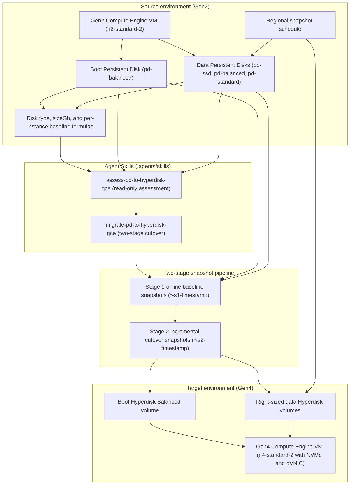

# Migrate Compute Engine Persistent Disks to Hyperdisk

Fourth-generation (Gen4) Compute Engine machine series, such as `c4`, `c4a`,
`c4d`, `m4`, `n4`, and `x4`, and select third-generation (Gen3) machine series,
such as `c3d`, `h3`, and `z3`, support only Google Cloud Hyperdisk storage
volumes and require Non-Volatile Memory Express (NVMe) storage drivers and
Google Virtual NIC (gVNIC) network interfaces. While transitional Gen3 machine
series such as `c3` and `m3` support both Persistent Disk and Hyperdisk,
existing second-generation (Gen2) Virtual Machine (VM) instances that use
Persistent Disk types such as `pd-standard`, `pd-balanced`, `pd-ssd`, or
`pd-extreme` cannot change their machine type in place to a Gen4 series while
Persistent Disks remain attached.

This project provides a reference architecture, a Terraform lab environment, and
two [Agent Skills](https://agentskills.io/home) that assess Gen2 VMs and
Persistent Disks and execute a low-downtime two-stage snapshot migration to Gen4
Compute Engine instances backed by Hyperdisk volumes.

## Architecture

The migration workflow uses a two-stage snapshot pipeline to reduce the
maintenance window to the time required to capture incremental block changes,
create Hyperdisk volumes from those snapshots, and boot the target Gen4
instance.



### Components

- **Terraform lab environment (`terraform/`)**: Provisions an isolated Virtual
  Private Cloud (VPC) network and subnetwork with Private Google Access enabled,
  Identity-Aware Proxy (IAP) Secure Shell (SSH) firewall rules, a
  least-privilege VM service account, a regional snapshot schedule, and two Gen2
  (`n2-standard-2`) Debian 12 instances: a single-data-disk instance (`pd-ssd`)
  and a three-data-disk instance with transactional (`pd-ssd`), write-ahead log
  (WAL) (`pd-balanced`), and throughput-spool (`pd-standard`) disks.
- **Assessment skill (`.agents/skills/assess-pd-to-hyperdisk-gce/`)**: Performs
  a read-only discovery of a single Compute Engine instance or a multi-VM
  migration wave. It evaluates Gen4 compatibility gates, calculates effective
  source Persistent Disk Input/Output Operations Per Second (IOPS) and
  throughput baselines from disk type, capacity (`sizeGb`), and per-instance
  sharing rules, checks regional Hyperdisk and virtual CPU (vCPU) quotas, and
  outputs a structured readiness report with right-sized `hyperdisk-balanced`,
  `hyperdisk-extreme`, or `hyperdisk-throughput` targets.
- **Migration skill (`.agents/skills/migrate-pd-to-hyperdisk-gce/`)**: Executes
  the two-stage cutover workflow with explicit user approval gates before any
  state-changing operation:
    - **Pre-cutover capture and guest verification**: Exports source VM and disk
      JavaScript Object Notation (JSON) manifests, checks Resource Manager tag
      bindings, and verifies over SSH that `/etc/fstab` uses filesystem
      Universally Unique Identifiers (UUIDs) or labels rather than `/dev/sd*`
      device names and that the guest kernel includes NVMe (`nvme`) and gVNIC
      (`gve`) drivers.
    - **Stage 1 (online baseline snapshots)**: Creates baseline snapshots of
      every attached Persistent Disk while the Gen2 VM remains running and
      serves traffic.
    - **Stage 2 (maintenance-window cutover snapshots)**: Stops the Gen2 VM
      after explicit user confirmation and creates incremental snapshots that
      transfer only blocks modified since Stage 1.
    - **Target provisioning and verification**: Creates target Hyperdisk volumes
      with the assessed IOPS and throughput limits, transfers regional snapshot
      schedules, boots the target Gen4 VM with NVMe and gVNIC, and verifies
      mounts, `google-*` udev symlinks, and workload integrity checks while
      keeping the stopped Gen2 VM and Persistent Disks intact for rollback.

## Requirements

To deploy the lab environment and run the Agent Skills, you need:

- A Google Cloud project with billing enabled.
- An account granted the following Identity and Access Management (IAM) roles on
  the project:
    - Compute Instance Admin (v1) (`roles/compute.instanceAdmin.v1`)
    - Compute Storage Admin (`roles/compute.storageAdmin`)
    - Compute Network Admin (`roles/compute.networkAdmin`)
    - Compute Security Admin (`roles/compute.securityAdmin`)
    - Service Account Admin (`roles/iam.serviceAccountAdmin`)
    - Service Account User (`roles/iam.serviceAccountUser`)
    - Project IAM Admin (`roles/resourcemanager.projectIamAdmin`)
    - Browser (`roles/browser`) or Viewer (`roles/viewer`)
    - Cloud Quotas Viewer (`roles/cloudquotas.viewer`)
    - Service Usage Admin (`roles/serviceusage.serviceUsageAdmin`)
    - Tag Viewer (`roles/resourcemanager.tagViewer`) and Tag User
      (`roles/resourcemanager.tagUser`)
    - IAP-secured Tunnel User (`roles/iap.tunnelResourceAccessor`)
- The
  [Google Cloud command-line interface (CLI)](https://cloud.google.com/sdk/docs/install)
  (`gcloud`, with the `gcloud alpha` component installed or `curl` for the
  Representational State Transfer (REST) quota fallback), `jq`, and `curl`.
- [Terraform](https://developer.hashicorp.com/terraform/install) installed.
- An AI coding agent CLI that supports the
  [Agent Skills](https://agentskills.io/home) specification, such as
  [Gemini CLI](https://geminicli.com/docs/cli/skills/) or
  [Antigravity CLI](https://antigravity.google/docs/skills).

## Prepare the environment

1.  Set your project, region, and zone environment variables and configure the
    `gcloud` CLI:

    ```bash
    export PROJECT_ID="YOUR_PROJECT_ID"
    export REGION="us-central1"
    export ZONE="us-central1-a"
    gcloud config set project "${PROJECT_ID}"
    gcloud auth login
    gcloud auth application-default login
    ```

1.  Clone the repository and change the working directory:

    ```bash
    git clone --filter=blob:none --no-checkout https://github.com/GoogleCloudPlatform/cloud-solutions
    cd cloud-solutions
    git sparse-checkout set --cone projects/migrate-persistent-disks-to-hyperdisks
    git checkout
    cd projects/migrate-persistent-disks-to-hyperdisks
    ```

## Deploy the lab environment with Terraform

If you already have Gen2 Compute Engine instances with Persistent Disks that you
want to assess or migrate, skip to
[Assess Persistent Disks and Gen2 VMs](#assess-persistent-disks-and-gen2-vms).

To provision the sample Gen2 testbed:

1.  Initialize Terraform in the `terraform` directory:

    ```bash
    terraform -chdir=terraform init
    ```

1.  Apply the Terraform configuration to create both the single-disk Gen2 VM and
    the multi-disk Gen2 VM:

    ```bash
    terraform -chdir=terraform apply \
      -var="project_id=${PROJECT_ID}" \
      -var="region=${REGION}" \
      -var="zone=${ZONE}"
    ```

1.  Inspect the provisioned VM and Persistent Disk names from the Terraform
    outputs:

    ```bash
    terraform -chdir=terraform output
    ```

    The startup script formats the attached Persistent Disks, mounts them by
    filesystem UUID with the `nofail` option in `/etc/fstab`, and writes a
    reference dataset and Secure Hash Algorithm 256-bit (SHA-256) manifest
    (`checksums.sha256`) on each mounted data volume so the migration skill can
    verify data integrity before and after cutover.

## Assess Persistent Disks and Gen2 VMs

Start your agent CLI from the `projects/migrate-persistent-disks-to-hyperdisks`
directory so it discovers the skills under `.agents/skills/`.

1.  To assess every Compute Engine VM and Persistent Disk in the project, give
    your agent the following prompt:

    ```text
    Use the assess-pd-to-hyperdisk-gce skill to assess all Compute Engine VMs
    and Persistent Disks in project <PROJECT_ID> for migration to n4-standard-2
    and Hyperdisk.
    ```

1.  To assess a single Gen2 instance in a specific zone, give your agent the
    following prompt:

    ```text
    Use the assess-pd-to-hyperdisk-gce skill to assess instance <SOURCE_VM_NAME>
    in zone <ZONE> of project <PROJECT_ID> for migration to n4-standard-2.
    ```

1.  Review the generated assessment report, which includes:
    - Disk inventory covering disk types such as `pd-balanced`, `pd-ssd`, and
      `pd-standard`, attached snapshot schedules, encryption type, and
      architecture.
    - Compatibility and blocker status for the target Gen4 machine series,
      including NVMe and gVNIC support, regional zone availability, and per-VM
      Hyperdisk attachment limits.
    - Source Persistent Disk effective IOPS and throughput baselines computed
      from disk type, capacity (`sizeGb`), and per-instance sharing rules, along
      with right-sized target Hyperdisk types, IOPS, and throughput values.
    - Regional quota headroom and pre-filled `gcloud` commands for the two-stage
      cutover.

## Migrate Persistent Disks to Hyperdisk

After reviewing the assessment report, use the `migrate-pd-to-hyperdisk-gce`
skill to execute the two-stage snapshot migration.

1.  Prompt your agent with the source Gen2 VM name, target Gen4 VM name, target
    machine type, and assessed Hyperdisk parameters:

    ```text
    Use the migrate-pd-to-hyperdisk-gce skill to migrate instance
    <SOURCE_VM_NAME> in zone <ZONE> of project <PROJECT_ID> to target instance
    <TARGET_VM_NAME> with machine type n4-standard-2 using the Hyperdisk sizing
    from the assessment report.
    ```

1.  Review and approve each gate as the skill progresses:
    - **Step 1 (Pre-cutover manifests and guest checks)**: The skill exports
      JSON manifests of the source VM and disks and runs a read-only SSH check
      to confirm `/etc/fstab` UUID entries, `nvme` and `gve` kernel drivers, and
      pre-cutover `checksums.sha256` verification.
    - **Step 2 (Stage 1 online baseline snapshots)**: After your approval, the
      skill creates baseline snapshots (`*-s1-<timestamp>`) of the boot and data
      Persistent Disks while the Gen2 VM continues running.
    - **Step 3 (Stage 2 maintenance-window stop and incremental snapshots)**:
      When you confirm the maintenance window, the skill stops the source Gen2
      VM (`TERMINATED`) and captures incremental snapshots (`*-s2-<timestamp>`)
      containing only blocks modified since Stage 1.
    - **Step 4 (Target Hyperdisk creation and schedule transfer)**: The skill
      provisions the target `hyperdisk-balanced`, `hyperdisk-extreme`, or
      `hyperdisk-throughput` volumes from the Stage 2 snapshots and transfers
      any regional snapshot schedules from the source Persistent Disks to the
      new Hyperdisk volumes.
    - **Step 5 (Target Gen4 VM creation and verification)**: The skill creates
      the target VM with `--network-interface="nic-type=GVNIC"`, waits for
      `google-guest-agent` to publish the SSH host keys to Compute Engine guest
      attributes (`hostkeys/`), and runs a post-cutover check over IAP SSH to
      confirm `/dev/nvme*n*` devices, `/dev/disk/by-id/google-*` symlinks,
      `gvnic` driver binding, mounted filesystems, and `checksums.sha256`
      integrity.

## Clean up the environment

To remove all resources created in the lab environment and avoid ongoing
charges, destroy the Terraform configuration:

```bash
terraform -chdir=terraform destroy \
  -var="project_id=${PROJECT_ID}" \
  -var="region=${REGION}" \
  -var="zone=${ZONE}"
```

During `terraform destroy`, the `terraform_data.migration_cleanup` destroy-time
provisioner runs `terraform/scripts/cleanup_migrated_resources.sh` to delete any
migrated Gen4 VMs, reserved internal Internet Protocol (IP) addresses, Hyperdisk
volumes, and snapshots matching the lab's naming prefix before Terraform
destroys the regional snapshot schedule and VPC network.
