# Demo 2 - Migrate from SQL Server to AlloyDB using Database Migration Service

## Overview

In this lab, you migrate an enterprise SQL Server database (Cloud SQL for SQL
Server) to **AlloyDB for PostgreSQL** using Google Cloud **Database Migration
Service (DMS)**.

Migrating across different database engines is known as a **heterogeneous
migration**. You first transform the database schema and stored logic from
Transact-SQL (T-SQL) to Procedural Language/PostgreSQL (PL/pgSQL), and then
replicate data in real time with minimal downtime.

### System architecture

The following diagram illustrates the end-to-end lab architecture. It highlights
network isolation across Virtual Private Cloud (VPC) networks, Change Data
Capture (CDC) replication through DMS, and the TCP proxy bridge to the source
database:

<!-- markdownlint-disable MD013 -->
<!-- MERMAID-DIAGRAM-START
%%{init: {"flowchart": {"wrappingWidth": 400}}}%%
flowchart TD
    subgraph VPC1 ["VPC 1 - Source Network (10.10.0.0/24)"]
        LOADER["<div style='display:flex;align-items:center;gap:12px;text-align:left;padding:4px;'><div style='width:40px;max-width:40px;flex-shrink:0;'></div><div style='line-height:1.3;white-space:nowrap;'><b style='font-size:14px;color:#202124;'>Compute Engine: sqlserver-loader-vm</b><br/><span style='font-size:11px;color:#5F6368;'>BigQuery Data Preloader</span></div></div>"]
        SQLSERVER["<div style='display:flex;align-items:center;gap:12px;text-align:left;padding:4px;'><div style='width:40px;max-width:40px;flex-shrink:0;'></div><div style='line-height:1.3;white-space:nowrap;'><b style='font-size:14px;color:#202124;'>Cloud SQL for SQL Server: sqlserver-source</b><br/><span style='font-size:11px;color:#5F6368;'>Port 1433 | DB: thelook_ecommerce</span></div></div>"]
        PROXY["<div style='display:flex;align-items:center;gap:12px;text-align:left;padding:4px;'><div style='width:40px;max-width:40px;flex-shrink:0;'></div><div style='line-height:1.3;white-space:nowrap;'><b style='font-size:14px;color:#202124;'>Compute Engine: tcp-proxy-vm</b><br/><span style='font-size:11px;color:#5F6368;'>TCP Proxy Port 1433 Bridge</span></div></div>"]
        LOADER --&gt;|"Preload standard dataset"| SQLSERVER
        PROXY --&gt; SQLSERVER
    end

    subgraph PEERING ["VPC Peering (vpc1-to-vpc2)"]
        ROUTES["<div style='display:flex;align-items:center;gap:12px;text-align:left;padding:4px;'><div style='width:40px;max-width:40px;flex-shrink:0;'></div><div style='line-height:1.3;white-space:nowrap;'><b style='font-size:14px;color:#202124;'>VPC Network Peering</b><br/><span style='font-size:11px;color:#5F6368;'>Bidirectional Route Exchange</span></div></div>"]
    end

    subgraph DMS ["Database Migration Service (Serverless Control Plane)"]
        PRIV_CONN["<div style='display:flex;align-items:center;gap:12px;text-align:left;padding:4px;'><div style='width:40px;max-width:40px;flex-shrink:0;'></div><div style='line-height:1.3;white-space:nowrap;'><b style='font-size:14px;color:#202124;'>DMS Private Connectivity Configuration</b><br/><span style='font-size:11px;color:#5F6368;'>sqlserver-vpc1-private-conn | VPC Peering to vpc-1</span></div></div>"]
        SRC_CP["<div style='display:flex;align-items:center;gap:12px;text-align:left;padding:4px;'><div style='width:40px;max-width:40px;flex-shrink:0;'></div><div style='line-height:1.3;white-space:nowrap;'><b style='font-size:14px;color:#202124;'>DMS Source Connection Profile</b><br/><span style='font-size:11px;color:#5F6368;'>sqlserver-source-cp | SQL Server using Private IP</span></div></div>"]
        DEST_CP["<div style='display:flex;align-items:center;gap:12px;text-align:left;padding:4px;'><div style='width:40px;max-width:40px;flex-shrink:0;'></div><div style='line-height:1.3;white-space:nowrap;'><b style='font-size:14px;color:#202124;'>DMS Destination Connection Profile</b><br/><span style='font-size:11px;color:#5F6368;'>alloydb-dest-cp | AlloyDB using Private Service Connect</span></div></div>"]
        CW["<div style='display:flex;align-items:center;gap:12px;text-align:left;padding:4px;'><div style='width:40px;max-width:40px;flex-shrink:0;'></div><div style='line-height:1.3;white-space:nowrap;'><b style='font-size:14px;color:#202124;'>DMS Conversion Workspace</b><br/><span style='font-size:11px;color:#5F6368;'>sqlserver-to-alloydb-schema | T-SQL to PL/pgSQL</span></div></div>"]
        JOB["<div style='display:flex;align-items:center;gap:12px;text-align:left;padding:4px;'><div style='width:40px;max-width:40px;flex-shrink:0;'></div><div style='line-height:1.3;white-space:nowrap;'><b style='font-size:14px;color:#202124;'>DMS Continuous Migration Job</b><br/><span style='font-size:11px;color:#5F6368;'>sqlserver-to-alloydb-data | CDC Replication</span></div></div>"]
    end

    subgraph VPC2 ["VPC 2 - Destination Network (10.20.0.0/24)"]
        ALLOYDB["<div style='display:flex;align-items:center;gap:12px;text-align:left;padding:4px;'><div style='width:40px;max-width:40px;flex-shrink:0;'></div><div style='line-height:1.3;white-space:nowrap;'><b style='font-size:14px;color:#202124;'>AlloyDB for PostgreSQL: alloydb-destination</b><br/><span style='font-size:11px;color:#5F6368;'>PostgreSQL 15 Compatible</span></div></div>"]
        STUDIO["<div style='display:flex;align-items:center;gap:12px;text-align:left;padding:4px;'><div style='width:40px;max-width:40px;flex-shrink:0;'></div><div style='line-height:1.3;white-space:nowrap;'><b style='font-size:14px;color:#202124;'>AlloyDB Studio</b><br/><span style='font-size:11px;color:#5F6368;'>Query Verification & Cutover</span></div></div>"]
        STUDIO --&gt; ALLOYDB
    end

    VPC1 <--&gt; PEERING
    PEERING <--&gt; VPC2
    PROXY <--&gt;|"Private IP Peering"| PRIV_CONN
    PRIV_CONN --&gt; SRC_CP
    SRC_CP -.-&gt;|"Schema Snapshot"| CW
    SRC_CP ==&gt;|"Initial Dump & CDC Stream"| JOB
    CW -.-&gt;|"Apply Converted DDL"| DEST_CP
    JOB ==&gt;|"Replicate Data"| DEST_CP
    DEST_CP ==&gt;|"Private Service Connect"| ALLOYDB

    style VPC1 fill:#F8F9FA,stroke:#dadce0,color:#202124,stroke-width:1.5px,rx:10px,ry:10px
    style PEERING fill:#F8F9FA,stroke:#dadce0,color:#202124,stroke-width:1.5px,rx:10px,ry:10px
    style DMS fill:#F8F9FA,stroke:#dadce0,color:#202124,stroke-width:1.5px,rx:10px,ry:10px
    style VPC2 fill:#F8F9FA,stroke:#dadce0,color:#202124,stroke-width:1.5px,rx:10px,ry:10px

    style LOADER fill:#FFFFFF,stroke:#4285F4,color:#202124,stroke-width:2px,rx:8px,ry:8px
    style SQLSERVER fill:#FFFFFF,stroke:#34A853,color:#202124,stroke-width:2px,rx:8px,ry:8px
    style PROXY fill:#FFFFFF,stroke:#4285F4,color:#202124,stroke-width:2px,rx:8px,ry:8px
    style ROUTES fill:#FFFFFF,stroke:#4285F4,color:#202124,stroke-width:2px,rx:8px,ry:8px
    style PRIV_CONN fill:#FFFFFF,stroke:#FBBC04,color:#202124,stroke-width:2px,rx:8px,ry:8px
    style SRC_CP fill:#FFFFFF,stroke:#FBBC04,color:#202124,stroke-width:2px,rx:8px,ry:8px
    style DEST_CP fill:#FFFFFF,stroke:#FBBC04,color:#202124,stroke-width:2px,rx:8px,ry:8px
    style CW fill:#FFFFFF,stroke:#FBBC04,color:#202124,stroke-width:2px,rx:8px,ry:8px
    style JOB fill:#FFFFFF,stroke:#FBBC04,color:#202124,stroke-width:2px,rx:8px,ry:8px
    style ALLOYDB fill:#FFFFFF,stroke:#34A853,color:#202124,stroke-width:2px,rx:8px,ry:8px
    style STUDIO fill:#FFFFFF,stroke:#EA4335,color:#202124,stroke-width:2px,rx:8px,ry:8px
MERMAID-DIAGRAM-SOURCE -->

<!-- MERMAID-DIAGRAM-END -->
<!-- markdownlint-enable MD013 -->

## Objectives

In this lab, you complete the following objectives:

1.  **Environment verification:** Inspect the pre-provisioned source SQL Server
    database containing the `thelook_ecommerce` dataset imported from BigQuery.
1.  **VPC networking:** Establish bidirectional VPC Network Peering between the
    source network (`vpc-1`) and destination network (`vpc-2`), and initialize
    the DMS service identity.
1.  **Private connectivity and connection profiles:** Configure a DMS private
    connectivity configuration (`sqlserver-vpc1-private-conn`) and create source
    (`sqlserver-source-cp`) and destination (`alloydb-dest-cp`) connection
    profiles.
1.  **Schema and code conversion:** Use a DMS conversion workspace to translate
    T-SQL schema definitions to PostgreSQL PL/pgSQL syntax, and apply the
    converted schema to the **AlloyDB for PostgreSQL** cluster in `vpc-2`.
1.  **Continuous replication:** Configure and run a serverless DMS continuous
    migration job using a TCP Proxy VM to stream CDC events with minimal
    downtime.
1.  **Data validation and cutover:** Verify table row counts and schema
    integrity in AlloyDB Studio, and promote the AlloyDB cluster to a standalone
    primary database.

## Prerequisites

To complete this lab, you need the following prerequisites:

- A **Google Cloud project** with `Editor` Identity and Access Management (IAM)
  permissions.
- Basic familiarity with Google Cloud console navigation, SQL Server (T-SQL),
  and PostgreSQL concepts.

## Setup and verification

Terraform provisions the initial lab environment. Upon deployment, `vpc-1`
contains a Cloud SQL for SQL Server 2022 instance (`sqlserver-source`) and a
helper Compute Engine VM (`sqlserver-loader-vm`) that populates the sample
dataset.

1.  Open **Cloud Shell**, verify that the lab infrastructure resources are
    deployed, and inspect the generated connection values (IP addresses, Private
    Service Connect (PSC) Domain Name System (DNS) name, and passwords) using
    `terraform output`:

    ```bash
    terraform state list
    terraform output
    ```

1.  Confirm that the helper VM has finished loading the sample
    `thelook_ecommerce` dataset (7 tables sourced from BigQuery public data)
    into SQL Server:

    ```bash
    gcloud compute ssh sqlserver-loader-vm --zone=us-central1-a --command="tail -f /var/log/startup-script.log"
    ```

> [!NOTE]
>
> The initial data import from BigQuery into SQL Server takes approximately 3
> to 5 minutes to complete. Wait for `Startup script finished.` in the log
> output before proceeding.

## Task 1. VPC Network Peering and DMS service initialization

In enterprise environments, source databases and target managed instances often
reside in isolated VPC networks. Before configuring Database Migration Service,
you establish **VPC Network Peering** between the source and destination
networks and initialize the **DMS service identity**.

### Step 1.1: Create bidirectional VPC Network Peering between VPC 1 and VPC 2

1.  In **Cloud Shell**, create the peering connection from `vpc-1` (source
    network) to `vpc-2` (target network):

    ```bash
    gcloud compute networks peerings create vpc1-to-vpc2 --network=vpc-1 --peer-network=vpc-2 --export-custom-routes --import-custom-routes
    ```

1.  Create the reverse peering connection from `vpc-2` to `vpc-1`:

    ```bash
    gcloud compute networks peerings create vpc2-to-vpc1 --network=vpc-2 --peer-network=vpc-1 --export-custom-routes --import-custom-routes
    ```

1.  Confirm that both peering connections report an `ACTIVE` state:

    ```bash
    gcloud compute networks peerings list --network=vpc-1
    gcloud compute networks peerings list --network=vpc-2
    ```

> [!NOTE]
>
> Bidirectional route exchange allows resources in `vpc-2` to route traffic to
> `vpc-1`.

### Step 1.2: Enable the Database Migration Service API and service identity

1.  In **Cloud Shell**, enable the Database Migration Service API and initialize
    the **DMS Service Agent**, a Per-Product, Per-Project Service Account
    (P4SA). This identity allows Google Cloud Tenant Manager to provision your
    private connectivity tenant project:

    ```bash
    gcloud beta services identity create --service=datamigration.googleapis.com --project=$(gcloud config get-value project)
    ```

1.  In the **Google Cloud console** top search bar, search for `Database
    Migration` and select **Database Migration**.

## Task 2. Configure DMS private connectivity and connection profiles

With network peering and the DMS service identity in place, you now configure
**DMS private connectivity** and create the **source** and **destination
connection profiles** that DMS uses for schema conversion and continuous data
replication.

### Step 2.1: Create a DMS private connectivity configuration

A **DMS private connectivity configuration** establishes a dedicated VPC Network
Peering connection between the Database Migration Service Google-managed
serverless network and your customer VPC.

Cloud SQL for SQL Server (`sqlserver-source`) resides in the `vpc-1` Private
Services Access (PSA) network, and Google Cloud VPC Network Peering is
non-transitive. A pre-provisioned Compute Engine VM (`tcp-proxy-vm`) in `vpc-1`
(`vpc-1-subnet`) forwards port `1433` traffic to `sqlserver-source`. Creating
`sqlserver-vpc1-private-conn` enables DMS to reach `tcp-proxy-vm` in `vpc-1`
over private IP during both schema conversion and continuous data replication
without exposing database traffic to the public internet.

1.  In the left navigation menu of **Database Migration**, select **Private
    connectivity**.
1.  Click **Create configuration** at the top of the page.
1.  Configure the private connectivity parameters:

    - **Configuration name:** Enter `sqlserver-vpc1-private-conn`.
    - **Region:** Select `us-central1`.
    - **Connectivity method:** Select **VPC peering**.
    - **Authorized VPC network:** Select `vpc-1`.
    - **Allocate an IP range:** Enter `10.10.1.0/29`.

1.  Click **Create** and wait 5 to 10 minutes until the configuration status
    becomes **Active**.

### Step 2.2: Create the source connection profile (`sqlserver-source-cp`)

A **DMS connection profile** is a reusable resource that stores the host
address, authentication credentials, and network connectivity settings for a
source or destination database. Creating `sqlserver-source-cp` upfront lets two
DMS resources connect to the `thelook_ecommerce` database on
`sqlserver-source`: the **conversion workspace** in Task 3 (to pull the SQL
Server schema snapshot) and the **continuous migration job** in Task 4 (to
stream initial and CDC data).

> [!IMPORTANT]
>
> Enter the internal IP address of **`tcp-proxy-vm`** (such as `10.10.0.X`),
> not the private IP address of `sqlserver-source`. The TCP Proxy VM bridges the
> DMS VPC peering connection to the Private Services Access IP address of
> `sqlserver-source`.

1.  In **Cloud Shell**, retrieve the internal IP address of the pre-provisioned
    **TCP Proxy VM (`tcp-proxy-vm`)** in `vpc-1`:

    ```bash
    gcloud compute instances describe tcp-proxy-vm --zone=us-central1-a --format="value(networkInterfaces[0].networkIP)"
    ```

1.  In the left navigation menu of **Database Migration**, select **Connection
    profiles**.
1.  Click **Create profile**.
1.  Configure the source profile settings:

    - **Source engine:** Select **SQL Server**.
    - **Destination engine:** Select **AlloyDB for PostgreSQL**.
    - **Profile type:** Select **Source**.
    - **Connection profile name:** Enter `sqlserver-source-cp`.
    - **Region:** Select `us-central1`.

1.  Under **Define connection configurations**, in the **SQL Server to
    PostgreSQL** (or **SQL Server to AlloyDB for PostgreSQL**) card, click
    **Edit** and enter the connection credentials:

    - **Host / IP:** Enter the internal IP address of `tcp-proxy-vm` retrieved
      in step 1 (or copy the `tcp_proxy_private_ip` value from `terraform
      output`).
    - **Port:** Enter `1433`.
    - **Username:** Enter `sqlserver`.
    - **Password:** Enter the `sql_server_password` value from `terraform
      output`.
    - **Database:** Enter `thelook_ecommerce`.
    - **Encryption type:** Select **None**.
    - **Connectivity method:** Select **Private connectivity**.
    - **Private connectivity configuration:** Select
      `sqlserver-vpc1-private-conn` (created in Step 2.1).

1.  In the **Test connection profile** section, click **Test** and verify the
    result.
1.  After the test succeeds without error, click **Save**, and then click
    **Create** to save `sqlserver-source-cp`.

### Step 2.3: Create the destination connection profile (`alloydb-dest-cp`)

Creating `alloydb-dest-cp` upfront enables the **conversion workspace** in Task
3 to dry-run test and apply the converted PostgreSQL Data Definition Language
(DDL) onto the pre-provisioned AlloyDB cluster (`alloydb-destination`). In Task
4, the **continuous migration job** reuses this profile to replicate rows into
AlloyDB over **Private Service Connect (PSC)**.

> [!NOTE]
>
> PostgreSQL client connections bind directly to a specific database during the
> initial connection handshake. Because DMS conversion workspaces apply
> converted schemas and tables inside an existing database rather than executing
> `CREATE DATABASE`, the destination database (`thelook_ecommerce`) must exist
> before testing or applying the schema. Terraform pre-created this database on
> `alloydb-destination` at lab startup.

1.  In the left navigation menu of **Database Migration**, select **Connection
    profiles** and click **Create profile**.
1.  In the **Define connection settings** section, configure the following
    settings:

    - **Source engine:** Select **SQL Server**.
    - **Destination engine:** Select **AlloyDB for PostgreSQL**.
    - **Profile type:** Select **Destination**.
    - **Connection profile name:** Enter `alloydb-dest-cp`.
    - **Region:** Select `us-central1`.
    - **Cluster ID:** Select `alloydb-destination`.
    - **Host / IP:** Use the pre-populated value or enter the
      `alloydb_psc_dns_name` value from `terraform output` (such as
      `<uid>.us-central1.alloydb-psc.goog.`).
    - **Port:** Enter `5432`.
    - **Authentication method:** Select **Username and Password**.
    - **Username:** Enter `postgres`.
    - **Password:** Enter the `alloydb_password` value from `terraform output`.
    - **Database Name:** Enter `thelook_ecommerce`.

1.  In the **Define connectivity method** section, configure the connectivity
    method:

    - **Connectivity method:** Select **Private IP**.

1.  In the **Test connection profile** section, click **Run test** and verify
    that the test succeeds.
1.  After the connection profile test succeeds, click **Create** to save
    `alloydb-dest-cp`.

## Task 3. Schema and code conversion (T-SQL to PL/pgSQL)

Because SQL Server and PostgreSQL handle data types, system functions, primary
keys, and procedural logic differently, heterogeneous migrations require a
**conversion workspace**. DMS parses the source SQL Server DDL and generates
compatible PostgreSQL DDL.

### Step 3.1: Create a conversion workspace and pull a schema snapshot

1.  In the left navigation menu of **Database Migration**, select **Conversion
    workspaces**.
1.  Click **Set up Workspace**.
1.  Configure the workspace parameters:

    - **Workspace name:** Enter `sqlserver-to-alloydb-schema`.
    - **Source database engine:** Select `SQL Server`.
    - **Destination database engine:** Select `AlloyDB for PostgreSQL`.
    - **Destination region:** Select `us-central1`.

1.  Click **Create workspace & continue**.
1.  On the **Define source and pull schema snapshot** page, select
    `sqlserver-source-cp` (created in Step 2.2) from the **Source connection
    profile** drop-down menu and click **Pull schema snapshot & continue**.

### Step 3.2: Convert schema objects and review DDL translation

1.  Expand the `thelook_ecommerce` database in the schema list and select the
    `dbo` schema (if the system `cdc` schema appears, leave `cdc` unchecked).
1.  Click **Convert** to run the conversion engine.
1.  After conversion completes, click the **Review and convert** tab to view the
    side-by-side DDL comparison. Observe how SQL Server types such as `FLOAT`
    and `DATETIME` convert to PostgreSQL `DOUBLE PRECISION` and `TIMESTAMP
    WITHOUT TIME ZONE`, while bounded `VARCHAR(n)` columns retain their length
    constraints.

> [!NOTE]
>
> The conversion dashboard displays **7 `CW_SP0314` (SQL feature not
> supported)** issues under the **Issues** tab—one for each of the 7 tables in
> the `dbo` schema. These warnings flag SQL Server-specific physical index and
> storage attributes (such as `CLUSTERED` primary key options) that PostgreSQL
> does not use. DMS generates valid PostgreSQL `CREATE TABLE` DDL, so ignore
> these warnings and do not attempt to resolve them with Gemini.

### Step 3.3: Test and apply converted schema to destination

With both connection profiles prepared in Task 2, dry-run test the converted
PostgreSQL DDL against `alloydb-destination` and then apply the schema:

1.  In the conversion workspace, click **Apply to destination** and select
    **Test (Recommended)** from the menu.
1.  In the **Define destination** dialog, select `alloydb-dest-cp` (created in
    Step 2.3) from the **Destination connection profile** drop-down list, click
    **Test**, and confirm that connectivity validation succeeds with zero
    errors.
1.  Click **Define & Continue**, select the `dbo` schema object, and click
    **Test Application** to dry-run the converted DDL.
1.  Wait until **Test Application** completes, verify that all objects pass
    validation, and then close the test results dialog.
1.  Click **Apply to destination** and select **Apply** from the menu.
1.  Confirm that `alloydb-dest-cp` is selected, select the `dbo` schema object,
    and click **Apply** to execute the converted `CREATE TABLE` DDL statements
    on `alloydb-destination`.

## Task 4. Continuous data replication with minimal downtime

With the schema and tables created in AlloyDB, launch a **continuous migration
job**. DMS takes an initial data snapshot and streams ongoing changes (CDC) from
SQL Server to AlloyDB until cutover.

### Step 4.1: Create the continuous migration job

1.  Navigate to **Database Migration** > **Migration jobs** from the left menu
    and click **Create migration job**.
1.  Set the migration parameters:

    - **Migration job name:** Enter `sqlserver-to-alloydb-data`.
    - **Source database engine:** Select `SQL Server`.
    - **Destination database engine:** Select `AlloyDB for PostgreSQL`.
    - **Migration job type:** Select `Continuous`.

1.  Click **Save & continue**.

### Step 4.2: Define source and destination connection profiles

Bind the migration job to the source and destination connection profiles created
in Task 2. Under the hood, `sqlserver-source-cp` routes traffic through the DMS
private connectivity configuration (`sqlserver-vpc1-private-conn`) and
`tcp-proxy-vm` in `vpc-1`, while `alloydb-dest-cp` connects to
`alloydb-destination` in `vpc-2` over Private Service Connect (PSC):

1.  On the **Define a source connection profile** page, select
    `sqlserver-source-cp` from the **Source connection profile** drop-down list
    to read the initial snapshot and ongoing transaction log changes from the
    source SQL Server instance.
1.  Click **Save & continue**.
1.  On the **Define a destination connection profile** page, select
    `alloydb-dest-cp` from the **Destination connection profile** drop-down list
    to stream replicated data into the target AlloyDB cluster.
1.  Click **Save & continue**.

### Step 4.3: Configure migration objects

Link the migration job to the conversion workspace created in Task 3 so DMS maps
each source SQL Server table in the `dbo` schema to its converted PostgreSQL
counterpart in `thelook_ecommerce`:

1.  On the **Configure migration objects** page, for **Conversion workspace**,
    select `sqlserver-to-alloydb-schema` (created in Task 3).
1.  In the **Select objects to migrate** section, expand the `dbo` schema and
    verify that all 7 converted tables (`distribution_centers`, `events`,
    `inventory_items`, `order_items`, `orders`, `products`, and `users`) are
    selected for replication.
1.  Click **Save & continue**.

### Step 4.4: Test and create the migration job

Before launching replication, run an end-to-end pre-flight check to verify
network reachability, database credentials, SQL Server CDC configuration, and
target schema compatibility:

1.  On the **Test and create migration job** page, review the summary details of
    the migration job configuration.
1.  In the **Test the migration job** section, click **Test** and wait for the
    validation check to complete with zero errors.
1.  Click **Create & start job**, and then click **Create & start** in the
    confirmation dialog to launch the migration job.
1.  Monitor the job status on the migration job details page as it transitions
    through the following phases:

    - `Starting`: DMS initializes the serverless replication pipeline and
      establishes private connections to both databases.
    - `Full dump`: DMS reads the initial baseline snapshot of all selected
      tables from SQL Server and loads the rows into AlloyDB.
    - `Running` (CDC): After the initial dump completes, DMS continuously
      streams ongoing transaction log changes from SQL Server to AlloyDB in
      near-real time.

## Task 5. Data integrity and schema validation in AlloyDB Studio

Before performing cutover, validate that DMS migrated all tables, rows, and
relationships from SQL Server into AlloyDB:

1.  Navigate to **AlloyDB** > **Clusters** in the Google Cloud console and click
    `alloydb-destination`.
1.  Click **AlloyDB Studio** in the left menu.
1.  Authenticate with the following details:

    - **Database:** Select `thelook_ecommerce`.
    - **User:** Enter `postgres`.
    - **Password:** Enter the `alloydb_password` value from `terraform output`.

1.  Click **Authenticate**.
1.  In the SQL Editor, run the following query to verify row counts across all
    migrated tables in the `dbo` schema:

    ```sql
    SELECT 'dbo.users' AS table_name, COUNT(*) AS row_count FROM dbo.users
    UNION ALL
    SELECT 'dbo.products', COUNT(*) FROM dbo.products
    UNION ALL
    SELECT 'dbo.orders', COUNT(*) FROM dbo.orders
    UNION ALL
    SELECT 'dbo.order_items', COUNT(*) FROM dbo.order_items
    UNION ALL
    SELECT 'dbo.inventory_items', COUNT(*) FROM dbo.inventory_items
    UNION ALL
    SELECT 'dbo.distribution_centers', COUNT(*) FROM dbo.distribution_centers
    UNION ALL
    SELECT 'dbo.events', COUNT(*) FROM dbo.events
    ORDER BY table_name;
    ```

> [!NOTE]
>
> Confirm that row counts match the source dataset (for example, `dbo.events`
> contains 100,000 rows).

## Task 6. Promote AlloyDB cluster to primary (cutover)

After you verify continuous replication and replication latency reaches zero
seconds, perform the final migration cutover by **promoting** the AlloyDB
instance:

1.  Navigate back to **Database Migration** > **Migration jobs**.
1.  Click `sqlserver-to-alloydb-data`.
1.  Click the **Monitoring** tab, check the **Replication delay** chart, and
    verify that the delay is `0 seconds`.
1.  Click **Promote** on the top action bar.
1.  In the confirmation dialog, click **Promote**.
1.  Wait for the job status to update to `Completed` (click **View Logs** at the
    top of the page to inspect detailed promotion progress in **Logs
    Explorer**).

> [!NOTE]
>
> Promoting the migration job stops CDC replication, disconnects the source SQL
> Server instance, and converts the AlloyDB cluster into a standalone, writable
> primary database ready to serve production workloads.

## Congratulations

You have completed a heterogeneous database modernization from **SQL Server to
AlloyDB for PostgreSQL** using Google Cloud Database Migration Service.

In this lab, you completed the following tasks:

- Configured cross-VPC networking using VPC Network Peering.
- Transformed T-SQL database logic and schema to PostgreSQL PL/pgSQL using DMS
  conversion workspaces.
- Established continuous CDC streaming through a TCP Proxy VM bridge.
- Verified schema integrity using AlloyDB Studio and completed a minimal-downtime
  cutover promotion.
