# Migrate from PostgreSQL to AlloyDB using Database Migration Service

## Overview

In this lab, you will migrate a self-managed PostgreSQL database to AlloyDB for
PostgreSQL using Google Cloud Database Migration Service (DMS).

### System Architecture

<!-- markdownlint-disable MD013 -->
<!-- MERMAID-DIAGRAM-START
%%{init: {"flowchart": {"wrappingWidth": 400}}}%%
flowchart TD
    subgraph VPC1 ["VPC 1 - Source Network (10.10.0.0/24)"]
        PGVM["<div style='display:flex;align-items:center;gap:12px;text-align:left;padding:4px;'><div style='width:40px;max-width:40px;flex-shrink:0;'></div><div style='line-height:1.3;white-space:nowrap;'><b style='font-size:14px;color:#202124;'>Compute Engine: self-managed-postgres-vm</b><br/><span style='font-size:11px;color:#5F6368;'>Port 5432 | DB: fraud_detection | pglogical</span></div></div>"]
    end

    subgraph PEERING ["VPC Peering (vpc1-to-vpc2)"]
        ROUTES["<div style='display:flex;align-items:center;gap:12px;text-align:left;padding:4px;'><div style='width:40px;max-width:40px;flex-shrink:0;'></div><div style='line-height:1.3;white-space:nowrap;'><b style='font-size:14px;color:#202124;'>VPC Network Peering</b><br/><span style='font-size:11px;color:#5F6368;'>Bidirectional Route Exchange</span></div></div>"]
    end

    subgraph DMS ["Database Migration Service (Serverless Control Plane)"]
        SRC_CP["<div style='display:flex;align-items:center;gap:12px;text-align:left;padding:4px;'><div style='width:40px;max-width:40px;flex-shrink:0;'></div><div style='line-height:1.3;white-space:nowrap;'><b style='font-size:14px;color:#202124;'>DMS Source Connection Profile</b><br/><span style='font-size:11px;color:#5F6368;'>self-managed-cp | PostgreSQL Source</span></div></div>"]
        JOB["<div style='display:flex;align-items:center;gap:12px;text-align:left;padding:4px;'><div style='width:40px;max-width:40px;flex-shrink:0;'></div><div style='line-height:1.3;white-space:nowrap;'><b style='font-size:14px;color:#202124;'>DMS Continuous Migration Job</b><br/><span style='font-size:11px;color:#5F6368;'>self-managed-to-alloydb | pglogical Replication</span></div></div>"]
        SRC_CP --&gt; JOB
    end

    subgraph VPC2 ["VPC 2 - Destination Network (10.20.0.0/24)"]
        PROXY["<div style='display:flex;align-items:center;gap:12px;text-align:left;padding:4px;'><div style='width:40px;max-width:40px;flex-shrink:0;'></div><div style='line-height:1.3;white-space:nowrap;'><b style='font-size:14px;color:#202124;'>Compute Engine: tcp-proxy-vm</b><br/><span style='font-size:11px;color:#5F6368;'>TCP Proxy Port 5432 Bridge</span></div></div>"]
        ALLOYDB["<div style='display:flex;align-items:center;gap:12px;text-align:left;padding:4px;'><div style='width:40px;max-width:40px;flex-shrink:0;'></div><div style='line-height:1.3;white-space:nowrap;'><b style='font-size:14px;color:#202124;'>AlloyDB for PostgreSQL: managed-alloydb-cluster</b><br/><span style='font-size:11px;color:#5F6368;'>PostgreSQL 16 Compatible</span></div></div>"]
        STUDIO["<div style='display:flex;align-items:center;gap:12px;text-align:left;padding:4px;'><div style='width:40px;max-width:40px;flex-shrink:0;'></div><div style='line-height:1.3;white-space:nowrap;'><b style='font-size:14px;color:#202124;'>AlloyDB Studio</b><br/><span style='font-size:11px;color:#5F6368;'>Query Verification & Cutover</span></div></div>"]
        PROXY ==&gt;|"Forward Port 5432"| ALLOYDB
        STUDIO --&gt; ALLOYDB
    end

    VPC1 <--&gt; PEERING
    PEERING <--&gt; VPC2
    PGVM -.-&gt;|"Source Metadata"| SRC_CP
    PGVM ==&gt;|"pglogical Change Stream"| PROXY
    JOB -.-&gt;|"Orchestrate Replication & Cutover"| ALLOYDB

    style VPC1 fill:#F8F9FA,stroke:#dadce0,color:#202124,stroke-width:1.5px,rx:10px,ry:10px
    style PEERING fill:#F8F9FA,stroke:#dadce0,color:#202124,stroke-width:1.5px,rx:10px,ry:10px
    style DMS fill:#F8F9FA,stroke:#dadce0,color:#202124,stroke-width:1.5px,rx:10px,ry:10px
    style VPC2 fill:#F8F9FA,stroke:#dadce0,color:#202124,stroke-width:1.5px,rx:10px,ry:10px

    style PGVM fill:#FFFFFF,stroke:#4285F4,color:#202124,stroke-width:2px,rx:8px,ry:8px
    style ROUTES fill:#FFFFFF,stroke:#4285F4,color:#202124,stroke-width:2px,rx:8px,ry:8px
    style SRC_CP fill:#FFFFFF,stroke:#FBBC04,color:#202124,stroke-width:2px,rx:8px,ry:8px
    style JOB fill:#FFFFFF,stroke:#FBBC04,color:#202124,stroke-width:2px,rx:8px,ry:8px
    style PROXY fill:#FFFFFF,stroke:#4285F4,color:#202124,stroke-width:2px,rx:8px,ry:8px
    style ALLOYDB fill:#FFFFFF,stroke:#34A853,color:#202124,stroke-width:2px,rx:8px,ry:8px
    style STUDIO fill:#FFFFFF,stroke:#EA4335,color:#202124,stroke-width:2px,rx:8px,ry:8px
MERMAID-DIAGRAM-SOURCE -->

<!-- MERMAID-DIAGRAM-END -->
<!-- markdownlint-enable MD013 -->

## Objectives

1.  Configure VPC Peering between source VPC `vpc-1` and destination VPC
    `vpc-2`.
1.  Create a Database Migration Service continuous migration job.
1.  Verify data replication in AlloyDB Studio.
1.  Promote AlloyDB cluster to primary.

## Setup & Verification

1.  In the **Cloud Shell**, verify that the lab environment is provisioned.

```bash
terraform state list
```

1.  Retrieve the PostgreSQL `pgadmin` user password from the VM logs.

```bash
gcloud compute ssh self-managed-postgres-vm --zone=us-central1-a --command="cat /var/log/pgadmin_password.log"
```

---

## Task 1. Migration Preparation

### Create VPC Peering between VPC 1 and VPC 2

1.  In **Cloud Shell**, run gcloud command to create VPC Peering from `vpc-1` to
    `vpc-2`.

```bash
gcloud compute networks peerings create vpc1-to-vpc2 --network=vpc-1 --peer-network=vpc-2 --export-custom-routes --import-custom-routes
```

1.  Create reverse VPC Peering from `vpc-2` to `vpc-1`.

```bash
gcloud compute networks peerings create vpc2-to-vpc1 --network=vpc-2 --peer-network=vpc-1 --export-custom-routes --import-custom-routes
```

1.  Verify VPC Peering status is active.

```bash
gcloud compute networks peerings list --network=vpc-1
gcloud compute networks peerings list --network=vpc-2
```

### Enable Database Migration API

1.  Search for `Database Migration` in **Google Cloud Console** and select
    **Database Migration**.
1.  Click **Enable** to activate the API.

---

## Task 2. Database Migration Service

### Create a Migration Job

1.  On **Database Migration** page, click **Migration jobs** in the left menu,
    then click **Create migration job**.
1.  Set **Migration job name** to `self-managed-to-alloydb`.
1.  Set **Source database engine** to `PostgreSQL`.
1.  Set **Destination database engine** to `AlloyDB for PostgreSQL`.
1.  Set **Migration job type** to `Continuous`.
1.  Click **Save & continue**.

### Define Source Connection

1.  Click **Select source connection profile** > **Create a connection
    profile**.
1.  Set **Connection profile name** to `self-managed-cp`.
1.  Select **PostgreSQL to PostgreSQL**.
1.  Retrieve the internal IP of `self-managed-postgres-vm`:

```bash
gcloud compute instances describe self-managed-postgres-vm --zone=us-central1-a --format="value(networkInterfaces.networkIP)"
```

1.  Enter connection configuration:

- Host / IP: Internal IP address of `self-managed-postgres-vm`
- Port: `5432`
- Username: `pgadmin`
- Password: Password retrieved from `/var/log/pgadmin_password.log`

1.  Click **Save**, then click **Create**.
1.  Select `self-managed-cp` and click **Save & continue**.

### Define Destination AlloyDB Cluster

1.  Set **Type of destination cluster** to `New cluster`.
1.  Set **Cluster ID** to `managed-alloydb-cluster`.
1.  Generate or input a password for `postgres` user.
1.  Set **Database version** to `PostgreSQL 16 compatible`.
1.  Set **Network** to `vpc-2`.
1.  Click **Confirm network setup**.
1.  Configure Primary Instance:

- Set **Instance ID** to `managed-alloydb-cluster-primary`.
- Set **Zonal availability** to `Single zone`.
- Set **Machine Type** to `2 vCPU, 16 GB`.

1.  Click **Save & continue** > **Create Destination & Continue**.

### Define Connectivity Method

1.  Select **Proxy via cloud-hosted VM - TCP**.
1.  Set **VM Name** to `tcp-proxy-vm`.
1.  Set **Subnetwork** to `vpc-2-subnet`.
1.  Click **Continue**.
1.  Click **View script**, copy the script, and execute it in **Cloud Shell**:

```bash
chmod +x deploy-tcp-proxy.sh
./deploy-tcp-proxy.sh
```

1.  Enter the `INTERNAL_IP` from script output into **TCP Proxy private IP**.
1.  Click **Configure & continue**.

### Start Migration Job

1.  Select `All databases`.
1.  Click **Save & continue**.
1.  Click **Create & start job**.

---

## Task 3. Verify Migration

1.  Navigate to **AlloyDB** > **AlloyDB Studio**.
1.  Authenticate using:

- Database: `fraud_detection`
- User: `postgres`
- Password: Your generated password

1.  Run verification query:

```sql
SELECT * FROM transactions LIMIT 100;
```

---

## Task 4. Promote Migration

1.  Return to **Migration jobs** page.
1.  Verify **Replication delay** is `0`.
1.  Click **Promote** from top action bar and confirm.
