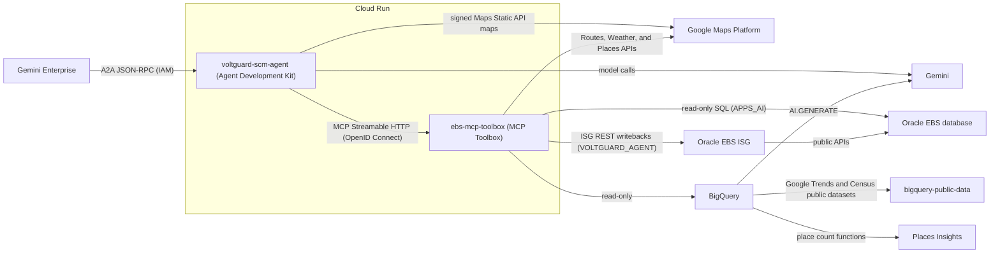

# VoltGuard context-aware inventory and supply chain resiliency agent

A reference architecture for agentic AI on Oracle E-Business Suite (EBS) with
Google Cloud: an agent that senses demand surges and helps planners prevent
stockouts across inventory hubs. An Agent Development Kit (ADK) agent on Cloud
Run connects to Gemini Enterprise through the Agent2Agent (A2A) protocol and
uses Gemini Flash models with automatic failover. It builds on
the [Oracle EBS Gemini Enterprise Model Context Protocol (MCP) framework][framework-repo],
whose MCP Toolbox for Databases is the only path to data: read-only SQL on
Oracle EBS as a SELECT-only user and on BigQuery, plus the Google Maps Platform
Routes, Weather, and Places APIs. Writebacks run through Oracle Integrated SOA
Gateway (ISG) REST services that call Oracle public APIs, only after the
planner replies `Confirmed`. BigQuery ML `AI.FORECAST` (TimesFM) forecasts
daily demand, adjusted by regional search-surge signals.
[Places Insights][places-insights] and US Census data score distribution zones
in SQL, `AI.GENERATE` adds a Gemini pull-forward tier, and the Maps Static API
draws zone maps, heatmaps, and transfer lanes. Semantic maps let the agent
write governed SQL, guardrails validate every query and screen for prompt
injection, and one script deploys the stack with Terraform.

In the demo scenario, a brownout drives generator demand in South Florida, and
the Miami distribution center runs out of generators in under four days, well
inside the 14-day material requirements planning (MRP) lead time. Ask _"What
needs my attention today?"_, and the agent scans every hub and item, finds that
gap, and explains what drives it. From there, it maps the ZIP codes where
homes, hospitals, pharmacies, grocery stores, and hardware stores concentrate
demand, and finds the partner stores nearby. It sets aside the stock that
service level agreement (SLA) reservations lock, and ranks the source hubs by
net financial benefit, with live truck routes, traffic delays, and weather
alerts. Executive charts show projected stock, stock by hub, net benefit by
source hub, and freight by lane. The agent then plans the transfer, the safety
stock update, and the requisition, and it evaluates and closes planner alerts,
such as a delayed purchase order.

To try it, [deploy the agent](#deployment) on an Oracle EBS Vision instance and
follow the [recommended prompts](#recommended-prompts-for-testing).

> [!IMPORTANT]
>
> **Prerequisites and required Identity and Access Management (IAM) roles**:
>
> - **Tools**: Google Cloud CLI (`gcloud`), Terraform 1.11 or later (without
>   it, the scripts run Terraform in Docker), SQL\*Plus, Python 3, `curl`, and
>   `uv` for the automated tests.
> - **Oracle EBS Vision instance**: an Oracle EBS R12.2 Vision instance on
>   Google Cloud. Deploy one with the [Oracle EBS Toolkit][ebs-sample-repo].
> - **Oracle EBS MCP framework**: the framework database objects
>   (`install_all_mcp_db.sql`) from the [framework repository][framework-repo].
> - **ISG REST services**: enabled on the Oracle EBS instance. See
>   [Publishing the ISG writeback service][isg-publishing].
> - **Gemini Enterprise entitlement**: an active Gemini Enterprise license on
>   the Google Cloud organization.
> - **Places Insights subscription (optional)**: the
>   [Places Insights][places-insights] US listing, with the linked dataset
>   `places_insights___us` in the project's US multi-region. Without it, the
>   deployment skips the zone exposure and place density tables.
> - **IAM roles**: Owner on the project, or the admin roles for Cloud Run, IAM,
>   Secret Manager, Artifact Registry, Cloud Build, Cloud Storage, BigQuery,
>   API Keys, Service Usage, Gemini Enterprise Agent Platform
>   (`roles/aiplatform.admin`), and Discovery Engine
>   (`roles/discoveryengine.admin`).
> - **Google Cloud APIs**: Terraform enables Gemini Enterprise Agent Platform
>   (`aiplatform.googleapis.com`), Discovery Engine
>   (`discoveryengine.googleapis.com`), Gemini for Google Cloud
>   (`cloudaicompanion.googleapis.com`), Cloud Run (`run.googleapis.com`),
>   Secret Manager (`secretmanager.googleapis.com`), Artifact Registry
>   (`artifactregistry.googleapis.com`), Cloud Build
>   (`cloudbuild.googleapis.com`), Cloud Storage (`storage.googleapis.com`),
>   BigQuery (`bigquery.googleapis.com`), BigQuery Connection
>   (`bigqueryconnection.googleapis.com`), BigQuery Data Transfer
>   (`bigquerydatatransfer.googleapis.com`), Compute Engine
>   (`compute.googleapis.com`), IAM (`iam.googleapis.com`), Cloud Resource
>   Manager (`cloudresourcemanager.googleapis.com`), Cloud Logging
>   (`logging.googleapis.com`), API Keys (`apikeys.googleapis.com`), Routes
>   (`routes.googleapis.com`), Weather (`weather.googleapis.com`), Places
>   (`places.googleapis.com`), and Maps Static
>   (`static-maps-backend.googleapis.com`). Terraform enables them through the
>   Service Usage API (`serviceusage.googleapis.com`), which is on by default
>   in projects that you create in the Google Cloud console or with the Google
>   Cloud CLI.

## Architecture



1.  **Agent (`voltguard-scm-agent`)**: an ADK `LlmAgent` on `gemini-3.8-flash`
    that fails over to `gemini-3.7-flash` and then `gemini-3.5-flash-lite`. A
    Cloud Storage bucket deletes its chart and map images after a day. One
    instance holds each conversation in memory until it's idle for 2 hours or
    the instance stops.
1.  **MCP Toolbox (`ebs-mcp-toolbox`)**: the framework's MCP Toolbox for
    Databases server, with the SQL, Google Maps Platform, and writeback tools
    in `mcp-servers/mcp-toolbox-ebs/tools.yaml`. Both services scale to zero.
1.  **Oracle EBS objects (`ebs-scripts/`)**: the supply chain views, the ISG
    writeback package, the read-only and writeback users, and the demo seed.
1.  **BigQuery (`bigquery/sql/`)**: the forecast, which a scheduled query
    refreshes daily, the search signals, hub coordinates, lane freight rates,
    and the Places Insights tables. The demo seeds a labeled surge signal,
    because Google Trends rarely lists a product search, and 90 days of issue
    history. Deploy again each month to load the new Places Insights snapshot.

## Deployment

Before you deploy:

1.  Sign in to the Google Cloud CLI, and create the Application Default
    Credentials that Terraform uses:

    ```bash
    gcloud auth login
    gcloud auth application-default login
    ```

1.  Install the database objects with SQL\*Plus. Without a network route to
    the database, open an Identity-Aware Proxy (IAP) tunnel in another
    terminal:

    ```bash
    gcloud compute start-iap-tunnel INSTANCE_NAME 1521 \
        --project=PROJECT_ID --zone=ZONE --local-host-port=localhost:1521
    ```

    Run the framework installer first, and ignore its `ORA-01917` errors for
    the `APPS_AI` user that doesn't exist yet. Then run the scripts of this
    project in order. The two user scripts prompt for the new passwords.
    `install_voltguard_agent_user.sql` assigns the Vision responsibilities
    `INVENTORY_VISION_OPERATIONS` and `PURCHASING_OPERATIONS`; on another
    instance, change the constants at the top of the script first.

    ```bash
    # From the framework EBSScripts directory:
    sqlplus apps@//localhost:1521/ebsdb @install_all_mcp_db.sql
    # From this directory:
    sqlplus apps@//localhost:1521/ebsdb @ebs-scripts/install_scm_inventory_views.sql
    sqlplus apps@//localhost:1521/ebsdb @ebs-scripts/ge_ebs_scm_tools_pkg.pls
    sqlplus apps@//localhost:1521/ebsdb @ebs-scripts/ge_ebs_scm_tools_pkg.plb
    sqlplus apps@//localhost:1521/ebsdb @ebs-scripts/install_voltguard_agent_user.sql
    sqlplus apps@//localhost:1521/ebsdb @ebs-scripts/seed_voltguard_vision_scenario.sql
    sqlplus ebs_system@//localhost:1521/ebsdb @ebs-scripts/install_apps_ai_user.sql
    ```

1.  Publish the writeback package as an ISG REST service, as described in
    [Publishing the ISG writeback service][isg-publishing].

1.  Copy `terraform/terraform.tfvars.example` to `terraform/terraform.tfvars`,
    which Git ignores. Set your project, region, network, subnet, Oracle EBS
    host, and the writeback responsibilities that
    `install_voltguard_agent_user.sql` assigns. Set `oracle_db_password` and
    `ebs_writeback_password` to the `APPS_AI` and `VOLTGUARD_AGENT` passwords,
    or leave them out: the deployment then reads them from Secret Manager,
    which needs the Secret Manager Secret Accessor role, or prompts for them.
    To change a password later, set it in `terraform.tfvars` and increase
    `oracle_db_password_version` or `ebs_writeback_password_version`.

1.  Terraform creates no firewall rule. The MCP Toolbox connects from
    `subnet_name` to `oracle_host` on the database port and the ISG port, which
    the Oracle EBS Toolkit's internal rule allows for its own subnet. For
    another subnet, add a rule that lets its range reach `oracle_host` on both
    ports.

1.  By default, the MCP Toolbox calls ISG at `https://ORACLE_HOST:4443`, which
    needs a web tier certificate that the MCP Toolbox trusts. A Vision
    instance from the Oracle EBS Toolkit serves HTTP on port 8000. To use it,
    set `ebs_isg_url` to `http://ORACLE_HOST:8000`, and only on a network that
    you trust, because `http` sends the ISG credentials unencrypted. A host
    name in `ebs_isg_url` must resolve to `oracle_host`.

1.  Copy the URL signing secret from the **Secret Generator** card on the
    Google Maps Platform [Credentials page][maps-credentials]. The deployment
    stores it in Secret Manager, never in Terraform. If the card doesn't
    appear, enable the Maps Static API first:

    ```bash
    gcloud services enable static-maps-backend.googleapis.com --project=PROJECT_ID
    ```

### Running the deployment script

Run the deployment script from this directory:

```bash
./scripts/deploy_stack.sh
```

The script prompts once for the URL signing secret, and prints the agent URL
when it finishes. To run each step yourself, follow the numbered steps in
`scripts/deploy_stack.sh`.

To remove the infrastructure, run `./scripts/destroy_stack.sh`. It doesn't
remove the agent from Gemini Enterprise, or the Oracle EBS database objects,
users, and ISG grants.

### Configuring and accessing the agent in Gemini Enterprise

1.  In [Gemini Enterprise Apps][gemini-enterprise-apps], click **Create App**,
    enter the application details, and select the `global` location, because
    `deploy_stack.sh` updates agents through the global endpoint.
1.  In **Overview**, or in **Settings** > **Authentication** and **Resource
    access control**, configure **Google Identity** or **Workforce Identity
    Federation**, and assign the Google Workspace groups or user email
    addresses that can use the agent.
1.  Click **Agents** > **+ Add agent**, and paste the contents of
    `src/oracle_ebs_scm_agentic_ai/agent_card.json` with `url` set to the
    agent URL that the deployment script prints, which is also the
    `voltguard_a2a_url` Terraform output. Click **Preview Agent Details**, and
    click **Next**. The display name is
    `VoltGuard Supply Chain Resiliency Agent`.
1.  In **Agent authorization** and **Tool authorizations**, keep the default
    **Basic HTTP authentication** checkbox and the optional Proof Key for Code
    Exchange (PKCE) checkbox, **PKCE verification enabled**, leave the
    external OAuth credentials unconfigured, and click **Next** > **Create**.
    These settings apply only to external OAuth token exchanges, which this
    agent doesn't use. The Google-managed Discovery Engine and Cloud AI
    Companion service agents authenticate to Cloud Run with OpenID Connect
    (OIDC) tokens.
1.  Deploy again with `GEMINI_ENTERPRISE_AGENT` set to the agent's resource
    name, so that this and later deployments update the agent card and the
    starter prompts. To find the name, list the apps of the project, then the
    agents of your app, and copy the agent's `name`:

    ```bash
    curl -H "Authorization: Bearer $(gcloud auth print-access-token)" \
        -H "X-Goog-User-Project: PROJECT_ID" \
        "https://discoveryengine.googleapis.com/v1alpha/projects/PROJECT_NUMBER/locations/global/collections/default_collection/engines"
    curl -H "Authorization: Bearer $(gcloud auth print-access-token)" \
        -H "X-Goog-User-Project: PROJECT_ID" \
        "https://discoveryengine.googleapis.com/v1alpha/projects/PROJECT_NUMBER/locations/global/collections/default_collection/engines/ENGINE_ID/assistants/default_assistant/agents"
    GEMINI_ENTERPRISE_AGENT="AGENT_NAME" ./scripts/deploy_stack.sh
    ```

1.  To open the agent, click **Go to Gemini Enterprise** in the **Overview** of
    your app in [Gemini Enterprise Apps][gemini-enterprise-apps], and select
    **VoltGuard Supply Chain Resiliency Agent** under **Agents from your
    organization**.

## Recommended prompts for testing

The demo data sets up a brownout demand surge at the Miami distribution
center (Miami DC, MIA), SLA-locked stock at the Atlanta, Chicago, and Newark
hubs, surge protectors without surplus at any hub, a Phoenix generator safety
stock that an earlier surge left raised, and a delayed purchase order that
notification 90412 reports. Try this storyline:

1.  _"What needs my attention today?"_ _(Miami DC generators stock out in
    about 3.8 days, well inside the 14-day MRP lead time.)_
1.  _"Why can't we pull 150 generators from Atlanta?"_
1.  _"Simulate reallocating 150 generators to Miami DC and rank the hubs by
    net financial benefit."_ _(Dallas ranks first, with live drive times and
    Miami weather.)_
1.  _"Plan the 150-unit Dallas transfer, the generator safety stock update,
    and the surge protector requisition for Miami DC."_ _(Returns the plan
    without changing Oracle EBS.)_
1.  _"Confirmed."_

Type **help** in the agent for more prompts, such as maps, routes, weather,
and notification 90412.

### Resetting the demo

Demos that only plan change nothing in Oracle EBS. After a demo in which the
planner replied `Confirmed`:

1.  Wait about a minute, so that Requisition Import finishes.
1.  Open the IAP tunnel, as described in [Deployment](#deployment), and run
    the seed script from this directory with the `APPS` password. The seed
    restores the stock, reservations, safety stock, purchase order 40912, and
    notification 90412, and removes the agent's requisitions. It keeps the
    transaction history and the writeback audit records.

    ```bash
    sqlplus apps@//localhost:1521/ebsdb @ebs-scripts/seed_voltguard_vision_scenario.sql
    ```

1.  Start a new conversation in Gemini Enterprise, so that the agent doesn't
    reuse numbers from the previous demo.

## Running automated tests

Install the locked environment, and run the unit tests and the Python checks:

```bash
uv sync --frozen --dev
uv run --frozen ./scripts/run_tests.sh
```

## Security

- **Access**: only Gemini Enterprise can call the agent, and only the agent
  can call the MCP Toolbox. The optional `developer_user_email` setting is
  for testing; leave it empty otherwise.
- **Secrets and audit**: Secret Manager holds the passwords, planners see
  plain-language errors, and audit logs record every change.
- **Production**: map Gemini Enterprise users to Oracle EBS users, send
  requisitions through Oracle Purchasing approval, keep conversations and the
  Terraform state in managed storage with restricted access, and review the
  writeback account's permissions.

## Troubleshooting

For deployment failures, ISG errors such as `ISG_SERVICE_AUTH_FAILURE` or
`ISG_USER_RESP_MISMATCH`, Requisition Import errors, map service errors,
missing Places Insights tables, and slow answers, see
[Troubleshooting][troubleshooting].

[ebs-sample-repo]:
    https://github.com/GoogleCloudPlatform/architecture-center-samples/tree/main/oracle-ebs-framework
[framework-repo]:
    https://github.com/GoogleCloudPlatform/architecture-center-samples/tree/main/oracle-ebs-gemini-enterprise-mcp
[gemini-enterprise-apps]:
    https://console.cloud.google.com/gemini-enterprise/apps
[isg-publishing]:
    docs/deployment-and-troubleshooting.md#publishing-the-isg-writeback-service
[maps-credentials]:
    https://console.cloud.google.com/google/maps-apis/credentials
[places-insights]: https://developers.google.com/maps/documentation/placesinsights
[troubleshooting]: docs/deployment-and-troubleshooting.md#troubleshooting
