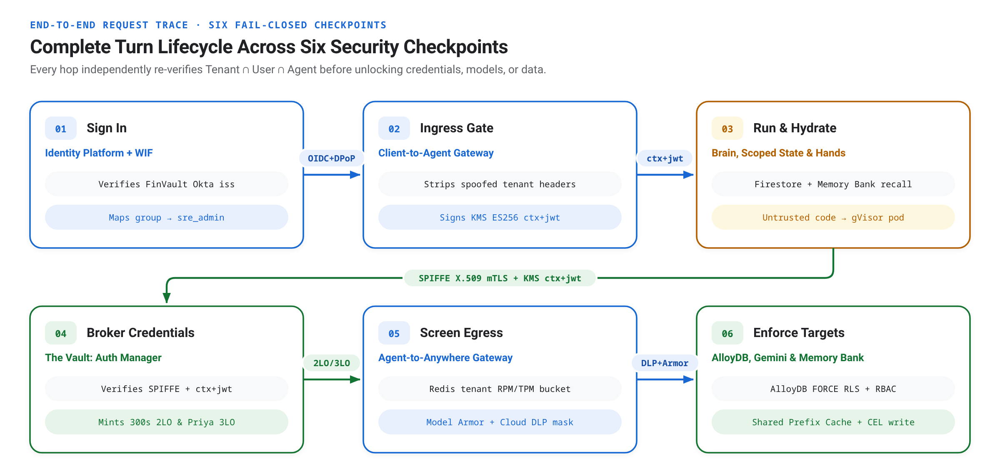

# Pooled Multi-Tenant AI Agents on Google Cloud

A reference implementation of **pooled multi-tenancy (Pattern A)** for SaaS AI
agents on Google Cloud: multiple enterprise tenants share one gateway,
disaggregated per-agent Cloud Run runtimes, and one set of data stores while
staying isolated through verified IdP logins, short-lived signed tokens,
per-tenant Google service accounts, per-tenant Cloud KMS keys, AlloyDB
PostgreSQL row-level security, and Model Armor / Cloud DLP guardrails. Built
with Python (FastAPI, Google Agent Development Kit, MCP) and Terraform.

> **v0.2.4 · sandbox only · synthetic tenants.** Status as of **2026-11-19**. It
> was built and verified in one Google Cloud sandbox project
> (`cymbal-multitenancy-example` here is a placeholder ID) with two synthetic
> tenants, **FinVault Bank** and **RetailStream Corp**. No customer data. Not a
> product. Cost figures in this repository are **modeled**, not measured. See
> the full
> [**Implementation Status, Security Model & Known Gaps**](docs/implementation_status.md)
> (19-row live/simulated/modeled status audit, component-compromise matrix,
> verification evidence, and the
> [production-data gate](docs/implementation_status.md#gate-no-customer-data-until-these-are-true)).
>
> **Disclaimer:** This is not an officially supported Google product.

## Architecture



_Reference architecture across Hops 0–5. The runnable deployment uses Cloud Run
behind IAP (`cymbal-pooled-gateway`), Cloud KMS asymmetric `ctx+jwt` signing,
disaggregated per-agent Cloud Run services (`cymbal-agent-shared`,
`cymbal-agent-finvault-alpha`) with Cloud Run Agent Identity (`SPIFFE`),
`cymbal-credential-broker`, AlloyDB PostgreSQL 18 `FORCE RLS`, Memorystore
Redis, Memory Bank in Gemini (IAM CEL), Agent Sandbox in Gemini (`gVisor`),
Model Armor, and Cloud DLP. **Optional enterprise upgrade:** Apigee X/Hybrid at
ingress and Managed Agent Gateway / Cloud Load Balancing `ext_proc` Service
Extensions at egress layer on without changing token contracts
([details](docs/solution_architecture_end_to_end.md#gateway-perimeter-options-cloud-run-and-iap-reference-vs-apigee-and-managed-agent-gateway)).
For exact live vs. planned component status, see
[`docs/implementation_status.md`](docs/implementation_status.md#at-a-glance)._

## Security guarantees (`Hop 0 → Hop 5` · `Tenant ∩ User ∩ Agent`)

Every request crosses six independent enforcement boundaries; no hop trusts
caller-supplied tenant headers or request-body identity fields:

| Boundary                            | Enforcement control                                                                                                                                                                                                                                                                        | Key implementation                                                                                                                                             |
| :---------------------------------- | :----------------------------------------------------------------------------------------------------------------------------------------------------------------------------------------------------------------------------------------------------------------------------------------- | :------------------------------------------------------------------------------------------------------------------------------------------------------------- |
| **Hop 0 · Login**                   | Per-tenant OIDC federation (pinned asymmetric JWKS, issuer-to-tenant binding, audience, max lifetime, Entra `tid`, strict role mapping).                                                                                                                                                   | [`agents/hop0_idp_federation.py`](agents/hop0_idp_federation.py), [`app/auth.py`](app/auth.py)                                                                 |
| **Hop 1 · Gateway & Context**       | 10-min ES256 DPoP-bound (`cnf.jkt`, RFC 9449) gateway token with single-use proofs + non-exportable Cloud KMS ES256 `ctx+jwt` binding `tenant_id`, `sub`, and `agent_id`.                                                                                                                  | [`app/gateway_tokens.py`](app/gateway_tokens.py), [`agents/context_signing.py`](agents/context_signing.py)                                                     |
| **Hop 2 · Entitlement**             | `Tenant ∩ User ∩ Agent` registry check; catalog hides other tenants' private agents (`403`); unentitled or unconsented 3LO tools are pruned before the model runs.                                                                                                                         | [`agents/registry.py`](agents/registry.py), [`agents/interceptors.py`](agents/interceptors.py)                                                                 |
| **Hop 3 · Limits, Memory & Broker** | Per-tier Redis token/request/turn bulkheads (`429`); per-record KMS envelope-encrypted memory + Memory Bank IAM CEL; 2-tier Gemini 4 routing + gVisor sandboxes; isolated `cymbal-credential-broker` minting 5-min `ct-<hash>` tenant SA tokens only for matching SPIFFE agent principals. | [`broker_service/core.py`](broker_service/core.py), [`agents/memory_crypto.py`](agents/memory_crypto.py), [`agents/model_routing.py`](agents/model_routing.py) |
| **Hop 4 · Guardrails**              | Inbound Model Armor prompt/SQL injection screening (`400`) and outbound compliance + Cloud DLP PII redaction across plain text, JSON, and Base64.                                                                                                                                          | [`agents/interceptors.py`](agents/interceptors.py), [`agents/gcp_live_bridge.py`](agents/gcp_live_bridge.py)                                                   |
| **Hop 5 · Tools & Data**            | MCP tool wire re-verifies the KMS `ctx+jwt` (`-32001` on tamper); AlloyDB PostgreSQL 18 executes per-tenant `ct-*` IAM DB users under `cymbal_mcp_app` (`NOSUPERUSER NOBYPASSRLS`) with transactional `set_config('app.current_tenant_id', $1, true)` and `FORCE ROW LEVEL SECURITY`.      | [`mcp_server/server.py`](mcp_server/server.py), [`mcp_server/db.py`](mcp_server/db.py), [`mcp_server/schema.sql`](mcp_server/schema.sql)                       |

Full isolation invariants (`I1`–`I7`), component-compromise blast radius, and
the 26-attack test proof matrix live in
[`docs/implementation_status.md`](docs/implementation_status.md#security-model)
and [`docs/tenant_isolation_assurance.md`](docs/tenant_isolation_assurance.md).

## Quickstart (local, no GCP)

**Requirements:** Python 3.12+ (3.13 recommended) and
[`uv`](https://docs.astral.sh/uv/). No Google Cloud account is needed.

```bash
uv sync --frozen                                  # install locked dependencies (or: make setup)
make config-check                                 # validate config/ for ENV=sandbox
uv run --frozen pytest -q                         # hermetic test suite (live GCP tests skip)
uv run --frozen python run_breach_simulations.py  # 10/10 cross-tenant breach simulations
make serve                                        # gateway + demo UI on http://127.0.0.1:8080
```

Additional offline verification suites (55-case golden E2E, 45-case adversarial
batch audit, 53-case AI engineering evals, and 5-act interactive walkthrough)
are documented in
[`docs/implementation_status.md`](docs/implementation_status.md#evidence-how-to-run-each-suite).

> **Local sandbox mode is opt-in.** Off Cloud Run / GKE, the synthetic dev
> issuer (`POST /api/v1/sandbox/token`) and demo routes return `404` unless
> `CYMBAL_LOCAL_SANDBOX=1` is set (`make serve` and test scripts set it on
> loopback only).

Every data endpoint requires a DPoP-bound gateway token. Use
[`scripts/sandbox_auth.py`](scripts/sandbox_auth.py) (`SandboxCaller`) to call
the local gateway as a synthetic tenant user:

```python
import httpx
from scripts.sandbox_auth import SandboxCaller

caller = SandboxCaller(
    "http://127.0.0.1:8080",
    tenant_id="tenant-retailstream-beta",
    sub="bob@retailstream.com",
    role="read_only_analyst",
)
url = caller.url("/api/v1/invoke-agent")
resp = httpx.post(
    url, json={"tool_name": "query_telemetry_rls"}, headers=caller.headers("POST", url)
)
# 200 on the shared agent; adding "agent_id": "finvault_regulatory_escalation_agent" returns 403 at Hop 2
```

## Deploy to your own GCP project

> [!WARNING] Review every Terraform plan before applying, and **do not load real
> customer or personal data** until every item in the
> [production-data gate](docs/implementation_status.md#gate-no-customer-data-until-these-are-true)
> is satisfied.

**Prerequisites:** a Google Cloud project you own, authenticated `gcloud`,
`terraform >= 1.6`, and `uv`.

```bash
# 1. Configure your environment and tenants (replace <env> with e.g. dev or acme)
cp config/environments/customer.example.yaml config/environments/<env>.yaml
cp -r config/tenants/customer-example config/tenants/<env>
#    Edit config/environments/<env>.yaml (project_id, region, public_origin,
#    gateway_signing_secret, context_signing_kms_key) and tenant YAML files.

# 2. Configure Terraform inputs (enables platform signing secrets, live mode, AlloyDB, Redis, or agent runtimes)
cp terraform/terraform.tfvars.example terraform/<env>.tfvars

# 3. Bootstrap and deploy through the single entrypoint
./scripts/bootstrap_customer_env.sh <env>
```

`scripts/bootstrap_customer_env.sh` runs prerequisite and config validation,
then invokes [`scripts/deploy.sh`](scripts/deploy.sh) to enable core APIs,
create the remote state bucket, provision Cloud KMS and
`cymbal-gateway-signing-key` (seeding EC P-256 version 1 strictly in-memory on
fresh projects), build/roll container images with `cymbal-build-sa`, apply
Terraform, bootstrap AlloyDB RLS, and execute Tier 3 Cloud Run smoke checks.

See [`docs/customer_deployment.md`](docs/customer_deployment.md) and
[`docs/configuration_reference.md`](docs/configuration_reference.md) for IAM
preflight, IdP onboarding, credential broker rollout, and optional 3P connector
setup.

## Repository map & documentation

### Codebase layout

| Path                                    | Role                                                                                                                                                                                                                                                                 |
| :-------------------------------------- | :------------------------------------------------------------------------------------------------------------------------------------------------------------------------------------------------------------------------------------------------------------------- |
| [`app/`](app/)                          | FastAPI gateway: Hop 0 exchange, DPoP gateway tokens (`gateway_tokens.py`), remote runtime dispatch, demo UI, and `/visualizer`.                                                                                                                                     |
| [`agents/`](agents/)                    | Core isolation engine: Hop 0 federation, KMS context signing & exchange, registry PDP, two-tier `SKILL.md` loader (`skill_loader.py`), bulkheads, KMS memory crypto, model routing, interceptors, gVisor sandboxes, config (`platform_config.py`, `runtime_env.py`). |
| [`broker_service/`](broker_service/)    | Isolated credential broker Cloud Run entrypoint (ADR-0014 B4 / ADR-0016 SPIFFE verification); imports no agent code.                                                                                                                                                 |
| [`runtime_service/`](runtime_service/)  | Disaggregated per-agent Cloud Run entrypoint (ADR-0014 B5); verifies KMS public keys only, holds zero signing/TokenCreator keys.                                                                                                                                     |
| [`mcp_server/`](mcp_server/)            | MCP JSON-RPC tool server, AlloyDB `FORCE RLS` connection pool (`db.py`, `schema.sql`), and standalone external JWKS verifier.                                                                                                                                        |
| [`config/`](config/)                    | Layered YAML configuration: `base.yaml` → `environments/<env>.yaml` → `tenants/<dir>/<tenant>.yaml`.                                                                                                                                                                 |
| [`terraform/`](terraform/)              | Modular Terraform (`platform_core`, `agent_runtime`, `tenant`, `tenant_data_plane`) + silo/hybrid stamping examples ([`terraform/README.md`](terraform/README.md)).                                                                                                  |
| [`scripts/`](scripts/)                  | Turnkey bootstrap/deploy (`deploy.sh`, `bootstrap_customer_env.sh`), config/preflight/smoke checks, AlloyDB RLS bootstrap, suite runners, sanitizer.                                                                                                                 |
| [`evals/`](evals/) & [`tests/`](tests/) | Output contracts, claim verifier, golden datasets, hermetic unit/security/breach suites, and opt-in live GCP integration tests.                                                                                                                                      |

### Deep-dive documentation

| Document                                                                                                                     | Covers                                                                                                                                                                                           |
| :--------------------------------------------------------------------------------------------------------------------------- | :----------------------------------------------------------------------------------------------------------------------------------------------------------------------------------------------- |
| [**Guided Architecture Story Deck**](docs/explainer.html) & [**Interactive Security Lab**](docs/visualizer.html)             | 13-slide visual story (`GET /explainer?slide=1`) + 4-tab packet tracer, concurrency simulator, 10-vector breach matrix, and capacity explorer (`GET /visualizer` or GitHub Pages). |
| [**Implementation Status, Security Model & Known Gaps**](docs/implementation_status.md)                                      | 19-row live/simulated/modeled status matrix, compromise blast-radius table, IAM model, test evidence, 21 known gaps, roadmap, and customer-data gate.                                            |
| [End-to-End Solution Architecture](docs/solution_architecture_end_to_end.md) & [Architecture Overview](docs/architecture.md) | 3-Plane model, 5-Hop flow, gateway perimeter options (Cloud Run + IAP vs. Apigee / Managed Agent Gateway), and Workstream 1–4 alignment.                                                         |
| [Customer Deployment Guide](docs/customer_deployment.md) & [Configuration Reference](docs/configuration_reference.md)        | Turnkey customer deployment, token expiry & call-ceiling profiles, environment variables, and KMS key rotation.                                                                                  |
| [Tenant Isolation Assurance](docs/tenant_isolation_assurance.md) & [Secrets Management](docs/secrets_management.md)          | Shared-surface threat matrix (`I1`–`I7`), definition of done, and out-of-band Secret Manager hygiene.                                                                                            |
| [Architecture Decision Records (ADRs)](docs/adr/README.md) & [Runbooks](docs/runbooks/b5_agent_runtime_rollout.md)           | ADR-0001 through ADR-0016 plus staged rollout/rollback runbooks for B4 broker and B5 agent runtimes.                                                                                             |
| [Terraform Guide](terraform/README.md) & [Pooling Benchmarks (Modeled)](docs/pooling_volume_benchmarks.md)                   | Remote state, module structure, silo/hybrid stamps, and modeled pooled-vs-siloed FinOps economics.                                                                                               |
| [SECURITY.md](SECURITY.md) · [CONTRIBUTING.md](CONTRIBUTING.md) · [CHANGELOG.md](CHANGELOG.md)                               | Vulnerability reporting, known limits, PR verification gates, and release history.                                                                                                               |

## Verification & contributing

Run the local CI gates before opening a pull request (see
[CONTRIBUTING.md](CONTRIBUTING.md) and [SECURITY.md](SECURITY.md) for
security-review rules and honest status labeling):

```bash
uv run --frozen python scripts/verify_repo_sanitized.py
uv run --frozen ruff check . && uv run --frozen ruff format --check .
uv run --frozen pytest -q
make tf-validate
```

**License:** Apache-2.0 ([LICENSE](LICENSE)).
