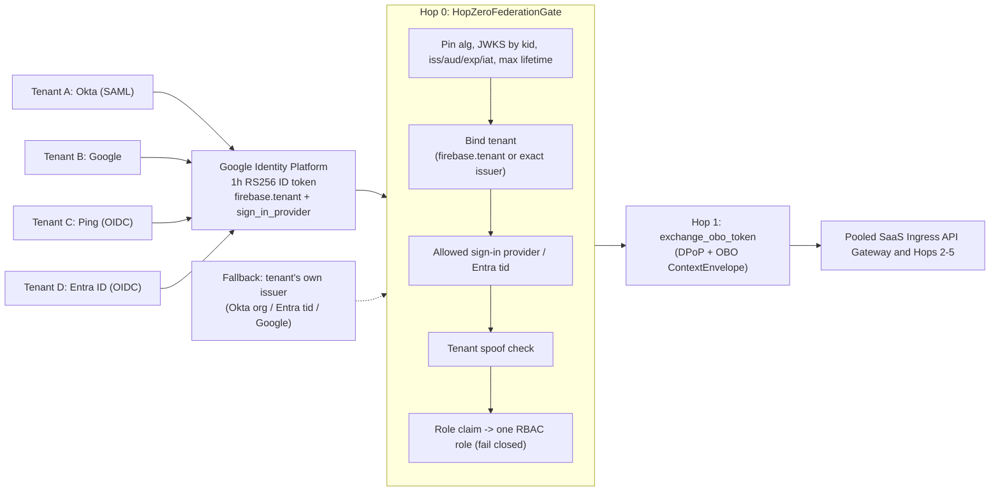

# ADR-0009: Hop 0 Multi-Tenant IdP Federation via Google Identity Platform

- **Status**: Accepted
- **Date**: 2026-10-26
- **Applies To**: Subsystem 1 (Edge Identity), ahead of Hop 1 in
  [ADR-0002](0002-5-hop-cryptographic-context-chain-obo-dpop.md)
- **Code**:
  [`agents/hop0_idp_federation.py`](../../agents/hop0_idp_federation.py),
  `EdgeAuthVerifier.exchange_federated_idp_token` in
  [`agents/context.py`](../../agents/context.py)
- **Tests**:
    - [`tests/security/test_hop0_identity_platform.py`](../../tests/security/test_hop0_identity_platform.py)
      covers the broker (primary mode).
    - [`tests/security/test_hop0_idp_federation.py`](../../tests/security/test_hop0_idp_federation.py)
      covers direct federation (fallback mode).

> Numbered 0009 because `ADR-0008` is already referenced by
> `agents/pooled_resilience_and_standards.py`.

## Context

In the Pattern A (Pool) reference architecture, every tenant brings its own
enterprise IdP: Tenant A uses Okta, Tenant B uses Google, Tenant C uses Ping.
**Google Identity Platform** sits between those IdPs and the pooled SaaS Ingress
API Gateway. It issues **short-lived credentials** carrying a **verified
`tenant_id` and `sub`**, with **zero directory sync**. The team also agreed that
Okta and Microsoft Entra ID are the primary enterprise IdPs.

Before this ADR, Hop 1 had four gaps:

1.  **One key for every issuer.** `AsymmetricDPoPProvider.verify_idp_jwt`
    checked every token against a single locally generated ES256 key.
1.  **Tenant taken from a claim.** `exchange_obo_token` took the tenant from a
    self-describing `tenant_id` claim.
1.  **No role mapping.** The intra-tenant role came from a free-form `user_role`
    claim.
1.  **No broker and no per-tenant audience.** The system had no concept of an
    auth broker, and nothing checked the token was issued for the right app.

## Decision

Add an explicit **Hop 0** (`HopZeroFederationGate`) that runs before Hop 1 and
outputs normalized claims. The existing Hop 1 OBO and DPoP exchange consumes
those claims unchanged. Hop 0 has two modes behind one entry point.

### Primary mode: Google Identity Platform broker

`IdentityPlatformBrokerConfig(project_id)` follows the documented Identity
Platform ID-token contract:

- **Issuer and audience.** `iss = https://securetoken.google.com/{project}` and
  `aud = {project}`.
- **Signature.** `RS256` only, with keys from
  `https://www.googleapis.com/service_accounts/v1/jwk/securetoken@system.gserviceaccount.com`.
- **Required claims.** `sub` must be 1 to 128 characters, `auth_time` must not
  be in the future, and the token lifetime must be at most 3600 s (short-lived
  credential).

Each tenant binds through an `IdentityPlatformTenantConfig`:

1.  **Tenant binding.** `firebase.tenant` (signed by Google) maps to exactly one
    pooled `tenant_id`, and each pooled tenant maps to exactly one Identity
    Platform tenant. Tokens without a tenant (project-level users) are rejected.
1.  **Sign-in provider allowlist.** `firebase.sign_in_provider` must be one of
    the providers onboarded for that tenant, for example `saml.okta-tenant-a`,
    `google.com`, `oidc.ping-tenant-c`, or `oidc.entra-tenant-d`. This blocks
    password or anonymous sign-in, and another tenant's provider.
1.  **Role.** The role comes from a custom claim set by a `beforeSignIn`
    blocking function (default `cymbal_role`, holding one role value because
    custom claims are capped at 1,000 bytes). Alternatively it comes from a SAML
    attribute in `firebase.sign_in_attributes` with a per-tenant mapping (for
    example Okta groups). The request fails closed if nothing maps.
1.  **Zero directory sync.** Identity and role are read from the token on every
    request. No user directory is copied into the platform.
1.  **Adding an IdP is configuration only.** Ping, Okta, Entra, Google, or any
    other SAML/OIDC IdP is configured on the tenant's Identity Platform tenant,
    and the gateway code does not change.

### Fallback mode: direct federation

For tenants that cannot use the broker, `FederatedIdPConfig` trusts the tenant's
own issuer directly:

- **Issuer binding.** Each issuer maps to exactly one tenant. Duplicate issuers
  and Identity Platform issuers are rejected.
- **Signature and audience.** Per-issuer JWKS (with OIDC discovery and an issuer
  check), `RS256`, and the tenant client ID as `aud`.
- **Lifetime.** At most 5,400 s.
- **Entra directory check.** The Entra `tid` must equal the onboarded directory.
  Multi-tenant issuers (`/common`, `/organizations`) are rejected.
- **Roles.**
    - Entra: App Roles (`roles`) only. Raw group GUIDs are ignored and group
      overage is rejected.
    - Okta: `groups`.
    - Google anchor: `user_role`, which is now required instead of defaulting to
      admin.

### Shared rules and compatibility

- `alg: none` and `HS*` can never be configured or accepted, so a public key can
  never be used as an HMAC secret.
- A self-asserted top-level `tenant_id` that disagrees with the verified binding
  is rejected.
- When several role values map, the most privileged role is chosen
  deterministically.
- `SecurityContext` gains `user_role` and `idp_provider` (with defaults). Both
  are exported to ADK `temp:` state.
- Hop 0 is opt-in. Existing callers of `exchange_obo_token` and
  `exchange_asymmetric_jwt_obo` are unchanged.

## Scope of IdP support in this change

| IdP                | Identity Platform broker (primary)              | Direct federation (fallback)                               |
| :----------------- | :---------------------------------------------- | :--------------------------------------------------------- |
| **Okta**           | Supported and tested (Tenant A, `saml.okta-*`)  | Supported and tested (`groups` mapping, full threat table) |
| Google             | Supported and tested (Tenant B, `google.com`)   | Anchor tenant only (FinVault, `user_role` claim)           |
| Ping               | Supported and tested (Tenant C, `oidc.ping-*`)  | **Not in scope.** Ping tenants must use the broker.        |
| Microsoft Entra ID | Supported and tested (Tenant D, `oidc.entra-*`) | Anchor tenant only (RetailStream, App Roles)               |

Okta is the only IdP with dedicated defaults and tests in both modes. Other IdPs
reach the gateway through Identity Platform, which needs no IdP-specific gateway
code.

## Alignment with the Pattern A reference diagram

| Diagram element                                                | Implementation                                                                                                                                                                                      |
| :------------------------------------------------------------- | :-------------------------------------------------------------------------------------------------------------------------------------------------------------------------------------------------- |
| Tenant A: Okta, Tenant B: Google, Tenant C: Ping               | Identity Platform tenants with `saml.*` / `google.com` / `oidc.*` providers; `FederatedIdP` includes `OKTA_ENTERPRISE_OIDC`, `GOOGLE_WORKSPACE_OIDC`, `PING_IDENTITY` (plus `MICROSOFT_ENTRA_OIDC`) |
| Google Identity Platform                                       | `IdentityPlatformBrokerConfig`, primary Hop 0 mode                                                                                                                                                  |
| Short-lived credentials                                        | 1 h Identity Platform ID tokens; `max_token_lifetime_seconds` enforced; Hop 1 then mints a DPoP-bound OBO envelope                                                                                  |
| Verified `tenant_id` & `sub`                                   | `tenant_id` from signed `firebase.tenant` binding; `sub` validated                                                                                                                                  |
| Zero directory sync                                            | Role and identity taken from the token per request                                                                                                                                                  |
| Tenant & user context, token → Pooled SaaS Ingress API Gateway | Normalized claims → `exchange_federated_idp_token` → `ContextEnvelope`. Gateway endpoint wiring is follow-up 1.                                                                                     |

## Threat to Control Map

| Threat                                                       | Control                          | Error                                                                                                                         | Mode   |
| :----------------------------------------------------------- | :------------------------------- | :---------------------------------------------------------------------------------------------------------------------------- | :----- |
| Forged token                                                 | JWKS signature by `kid`          | `E_HOP0_INVALID_SIGNATURE`                                                                                                    | Both   |
| `alg: none` / HS256 key confusion                            | Asymmetric allowlist             | `E_HOP0_DISALLOWED_ALG`                                                                                                       | Both   |
| Token from another Identity Platform project or app          | `aud`                            | `E_HOP0_AUDIENCE_MISMATCH`                                                                                                    | Both   |
| Long-lived or replayable credential                          | Max lifetime, `exp`, `auth_time` | `E_HOP0_TOKEN_LIFETIME_TOO_LONG`, `E_HOP0_TOKEN_EXPIRED`, `E_HOP0_INVALID_AUTH_TIME`                                          | Both   |
| Project-level user (no tenant)                               | `firebase.tenant` required       | `E_HOP0_GCIP_MISSING_TENANT`                                                                                                  | Broker |
| Unknown Identity Platform tenant                             | Tenant binding lookup            | `E_HOP0_GCIP_UNKNOWN_TENANT`                                                                                                  | Broker |
| Password, anonymous, or another tenant's IdP used to sign in | Per-tenant provider allowlist    | `E_HOP0_GCIP_PROVIDER_NOT_ALLOWED`                                                                                            | Broker |
| Malformed subject                                            | `sub` 1 to 128 characters        | `E_HOP0_INVALID_SUBJECT`                                                                                                      | Broker |
| Unfederated issuer                                           | Exact issuer lookup              | `E_HOP0_UNKNOWN_ISSUER`                                                                                                       | Direct |
| Entra token from another directory                           | `tid == directory_id`            | `E_HOP0_ENTRA_DIRECTORY_MISMATCH`                                                                                             | Direct |
| Entra group overage hides memberships                        | Reject overage without roles     | `E_HOP0_ENTRA_GROUP_OVERAGE`                                                                                                  | Direct |
| Self-asserted `tenant_id` spoof                              | Verified binding wins            | `E_HOP0_TENANT_CLAIM_SPOOF`                                                                                                   | Both   |
| No or unknown role                                           | Fail-closed mapping              | `E_HOP0_NO_RBAC_ROLE`                                                                                                         | Both   |
| Unknown or rotated key                                       | `kid` lookup, refetch on miss    | `E_HOP0_UNKNOWN_KID`                                                                                                          | Both   |
| Ambiguous control-plane config                               | Registration uniqueness          | `E_HOP0_DUPLICATE_ISSUER`, `E_HOP0_DUPLICATE_GCIP_TENANT`, `E_HOP0_DUPLICATE_TENANT_BINDING`, `E_HOP0_BROKER_ISSUER_RESERVED` | Both   |

Every row has at least one test in the two test files listed above.

## Consequences

- **Positive**:
    - Matches the Pattern A diagram: one broker and one token contract for every
      tenant IdP.
    - Adding Ping, Okta, Entra, or another SAML/OIDC IdP is Identity Platform
      configuration with no code change.
    - The tenant and role cannot be asserted by the caller.
    - DPoP, OBO signing, and Hops 2 to 5 are reused unchanged.
- **Negative**:
    - Requires an Identity Platform project with multi-tenancy enabled.
    - Roles depend on a `beforeSignIn` blocking function or SAML attribute
      mapping. The blocking function has a 7 s budget and custom claims are
      capped at 1,000 bytes.
    - Direct-federation tenants must register an exact issuer and client ID.

## Addendum (2026-10-30): gateway token exchange (RFC 9449)

**Problem.** IdP ID tokens (Okta, Entra, Google, Identity Platform) cannot carry
a key binding, so a stolen ID token would work with any attacker-made DPoP key.
Checking a DPoP proof next to an unbound token only stops proof replay, not
token theft.

**Decision.** The gateway exchanges a Hop 0-verified ID token once for its
**own** short-lived access token bound to the client's key:

1.  `POST /api/v1/auth/token` with `{"subject_token": <ID token>}` and a DPoP
    proof for that URL. Hop 0 verifies the ID token; the proof is consumed only
    after that succeeds (unauthenticated callers cannot fill the replay cache).
    Re-exchanging an ID token must use the same key.
1.  The gateway returns an ES256 token (`aud = .../gateway-api`, distinct from
    IdP audiences) with `cnf.jkt` = the client key thumbprint, never outliving
    the ID token (at most 10 minutes).
1.  Each request sends `Authorization: DPoP <token>` and a proof that is signed
    by the bound key, matches the method and URL (origin fixed by
    `identity.public_origin`, `X-Forwarded-Host` ignored), carries `ath`, is
    recent, and has an unused `jti`.
1.  The `ContextEnvelope` is built only from that token (`require_caller`);
    request bodies carry no identity.

**Key.** `identity.gateway_signing_secret` names a pinned Secret Manager version
(EC P-256), loaded at startup; required for customer data. Synthetic sandboxes
may use an ephemeral per-process key (one instance).

**Limits.** The replay cache and ID-token binding are per instance (shared cache
or `DPoP-Nonce` before multi-instance customer use); no `kid` overlap on
rotation; per-user rate limiting is a follow-up. Implemented in PRs #14, #15,
and #17 (`app/auth.py`, `app/gateway_tokens.py`).

## Follow-ups

1.  _(Completed in PRs #14, #15 & #17)_ Route the gateway through Hop 0 with
    `Authorization: DPoP` + `DPoP` headers (see the addendum above), replacing
    tenant and role values asserted in the request body.
1.  Terraform for the Identity Platform project, its tenants, SAML/OIDC
    providers, and the `beforeSignIn` blocking function that sets `cymbal_role`.
1.  _(Completed in PR #7 & PR #6)_ `user_role`, `idp_provider`, and
    `delegation_chain` are bound into the canonical JSON OBO HMAC, and
    `verify_signed_adk_state` enforces signature and delegation-depth checks
    across ADK interceptors and the MCP JSON-RPC wire.
1.  Optional live tests against a real Identity Platform tenant (skipped by
    default), mirroring the Entra live tests.
1.  Direct-federation support for Ping (and other IdPs beyond Okta) only if a
    customer cannot use the Identity Platform broker.
