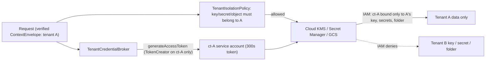

# ADR-0010: Tenant Blast-Radius Containment with Per-Tenant Runtime Identities

- **Status**: Accepted. _Update 2026-11-04:_ the legacy shared gateway identity
  `cymbal-ingress-pep-sa` is being retired. It runs nothing, its TokenCreator on
  the tenant SAs was removed during the ADR-0014 B4 rollout, and it is no longer
  defined in Terraform; its leftover project roles were removed and the account
  disabled on 2026-11-04 (deletion pending). Since ADR-0014 B4 only
  `cymbal-broker-sa` may mint tenant SA tokens.
- **Date**: 2026-10-26
- **Applies To**: Hop 3 (CMEK), Hop 5 (3LO secrets, runbook vault); inventory
  rows #7 and #8 in
  [Tenant Isolation Assurance](../tenant_isolation_assurance.md)
- **Code**:
  [`agents/tenant_credentials.py`](../../agents/tenant_credentials.py),
  [`agents/gcp_live_bridge.py`](../../agents/gcp_live_bridge.py)
- **Infrastructure**:
  [`terraform/modules/tenant/main.tf`](../../terraform/modules/tenant/main.tf),
  [`terraform/modules/platform_core/iap_gateway.tf`](../../terraform/modules/platform_core/iap_gateway.tf),
  [`terraform/modules/platform_core/alloydb.tf`](../../terraform/modules/platform_core/alloydb.tf)
- **Tests**:
  [`tests/security/test_tenant_blast_radius.py`](../../tests/security/test_tenant_blast_radius.py)

## Context

Per-tenant CMEK keys existed, but the shared gateway identity
(`cymbal-ingress-pep-sa`) held **project-wide**
`roles/cloudkms.cryptoKeyEncrypterDecrypter`,
`roles/secretmanager.secretAccessor`, and `roles/storage.objectAdmin`. The
pooled runbook bucket's default key was FinVault's.

Consequences:

- **Compromising one request leaked every tenant.** A hijacked request, a
  container escape, a leaked token, or a code-execution bug could decrypt every
  tenant's key, read every tenant's Jira/ServiceNow/Entra secret, and read every
  runbook object.
- **Separation relied entirely on application code.** Per-tenant keys gave
  cryptographic separation only as long as the code chose the right key.
- **One tenant's key covered another tenant's data.** RetailStream objects
  uploaded without an explicit key were encrypted with FinVault's key.

## Decision

1.  **One service account per tenant.** The ID is `ct-<sha256(tenant_id)[:24]>`:
    a deterministic formula that Python and Terraform share, keeps tenant names
    out of IAM, and fits the 6-30 character limit.
1.  **Resource-level grants only.** Each tenant service account receives:
    - `cryptoKeyEncrypterDecrypter` on **its** KMS key;
    - `secretAccessor` on **its** secrets;
    - `objectViewer` on **its** runbook managed folder (`<tenant_id>/`) and
      skills bucket.
1.  **The shared identity loses all project-wide data roles.** It keeps only
    `roles/iam.serviceAccountTokenCreator` on each tenant service account, so it
    can mint short-lived tokens but cannot read tenant data as itself.
1.  **Credentials are minted from the verified envelope only.**
    `TenantCredentialBroker.credential_for(envelope)` derives the principal from
    `envelope.tenant.tenant_id`; there is no API that accepts a free-form
    tenant. Tokens last 300 s, are cached per tenant, and are refreshed 60 s
    before expiry.
1.  **Two independent controls on every live call.** `TenantIsolationPolicy`
    rejects a foreign key, secret, or object (including `..` traversal) **before
    any network call**. The tenant credential is then rejected by IAM at the
    Google API if the code check were ever bypassed.
1.  **No single-tenant default key on pooled storage.** Objects carry their
    tenant's `kmsKeyName`, and the vault rejects mismatches.
1.  **Fail-closed in live mode.** In PR #7, `validate_runtime_environment()`
    rejects `CYMBAL_TENANT_SCOPED_CREDENTIALS=0` whenever `CYMBAL_LIVE_GCP=1`,
    ensuring live deployments always execute tenant KMS, Secret Manager, and GCS
    calls through per-tenant service accounts (`cymbal-pooled-runtime-sa` is the
    single Cloud Run serving identity and holds only
    `roles/iam.serviceAccountTokenCreator` on each tenant SA).

## Blast-radius results

| Compromised                                        | Before                                                               | After                                                                                |
| :------------------------------------------------- | :------------------------------------------------------------------- | :----------------------------------------------------------------------------------- |
| Shared gateway identity (as itself)                | Every tenant's keys, secrets, runbooks                               | **No tenant data.** It can only mint tenant tokens, and each mint is audited by IAM. |
| One tenant's credential or service account         | n/a                                                                  | **That tenant only** (proven for every onboarded tenant by `describe_blast_radius`)  |
| One tenant's KMS key                               | That tenant, plus RetailStream runbooks under FinVault's default key | **That tenant only**                                                                 |
| Code bug choosing the wrong key, secret, or object | Leak                                                                 | Blocked by the policy check, **and** by IAM                                          |

### Residual (tracked in the assurance doc)

- **Gateway compromise _with_ impersonation:** an attacker controlling the
  gateway can still mint tokens for any tenant, one tenant at a time.
  Mitigations: each mint is an IAM audit event, with anomaly alerts in the
  Detection PR. Optional for regulated tenants: per-tenant runtimes (Pattern B)
  or IAM conditions tied to request attributes.
- **Firestore and BigQuery still use the shared identity.** Firestore becomes
  ciphertext-only once memory records use KMS-wrapped data keys (Data-plane PR).
  BigQuery is narrowed in phase 2.

## Consequences

- **Positive:**
    - A single tenant credential, key, or code-level mistake reaches at most one
      tenant.
    - Secrets and keys are IAM-isolated, not just code-isolated.
    - Every tenant data access is attributable to a per-tenant principal in
      audit logs.
- **Negative:**
    - One service account per tenant (default quota is ~100 per project, which
      can be raised). At much larger scale, use Credential Access Boundaries
      (downscoped tokens) for Storage plus per-key IAM conditions.
    - Live paths add one token mint per tenant every 4-5 minutes.
    - Objects in the pooled bucket must be uploaded with an explicit per-tenant
      key.

## Rollout

1.  Run `terraform apply`. This creates tenant service accounts, resource-level
    bindings, and TokenCreator grants, and removes the shared identity's
    project-wide data roles.
1.  Deploy the gateway. Tenant-scoped credentials are on by default in live
    mode.
1.  Verify with `CYMBAL_ENV=sandbox RUN_LIVE_GCP_TESTS=1 uv run pytest` on
    `test_live_tenant_blast_radius.py` and `test_live_gcp_integration.py`.
    Cross-tenant KMS and secret access must be denied by IAM, and
    `CYMBAL_TENANT_SCOPED_CREDENTIALS=0` is rejected at startup in live mode.
