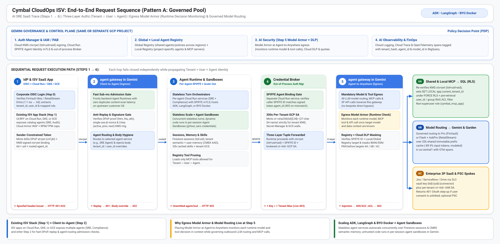
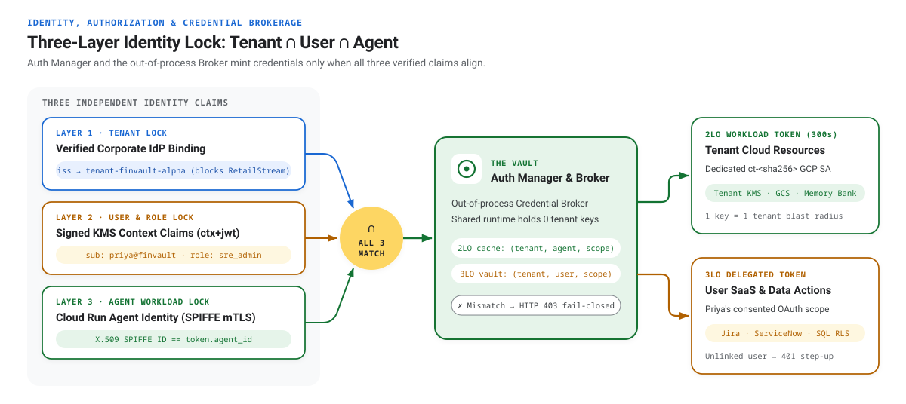

# Solution Architecture: High-Density Pooled Multi-Tenancy (Pattern A)

This document defines the end-to-end architecture for **Workstream 2: Pattern A
(High-Density Pooled Architecture)** on the **Gemini** and **Google Agent
Development Kit (ADK 2.0)** for the **Cymbal SaaS** scenario, and demonstrates
how **80% of this core codebase is reused unchanged** in **Workstream 3 (Pattern
B: Dedicated Single-Tenant Silos)** and **Workstream 4 (Pattern C: Dynamic
Hybrid PSC)**.

---

## 1. End-to-End 3-Plane & 7-Subsystem Pooled Topology

This diagram shows how **Tenant Alpha (`FinVault Bank` — Enterprise Tier)** and
**Tenant Beta (`RetailStream Corp` — Standard Tier)** share a single
high-density compute and storage fleet in `cymbal-multitenancy-example`
(`us-central1`) while maintaining cryptographic, identity, and FinOps isolation
across all 7 subsystems.



_Target enterprise topology vs. primary reference runtime. In this repository,
Cloud Run (`cymbal-pooled-gateway`) behind IAP + Cloud KMS `ctx+jwt` signing
(ingress) and ADK runtime interceptors in
[`agents/interceptors.py`](../agents/interceptors.py) (egress) form the primary
runnable perimeter (avoiding ~45-min Apigee X org provisioning during rapid
sandbox iteration), alongside Phase B5 per-agent Cloud Run services, Cloud Run
Agent Identity (`SPIFFE`), `cymbal-credential-broker`, live Gemini `gVisor`
`sandboxEnvironments`, live Zonal AlloyDB PostgreSQL 18 `FORCE RLS`
(`cymbal_mcp_app`), and `REDIS_URL` `SharedReplayStore` + `RedisBulkheadStore`
wiring. Apigee X/Hybrid and agent gateway in Gemini / Cloud Load Balancing
`AuthzExtension` (`ext_proc`) Service Extensions layer on as optional enterprise
perimeter upgrades without changing `ctx+jwt` or SPIFFE contracts
([details](solution_architecture_end_to_end.md#gateway-perimeter-options-cloud-run-and-iap-reference-vs-apigee-and-managed-agent-gateway)).
Hosted demo requests remain simulated when `CYMBAL_LIVE_GCP` is unset; see
[README](../README.md)._

**How Hop 0 is implemented.** Each tenant's own company IdP (Okta, Microsoft
Entra ID, Google or Ping) signs its users in over direct OIDC federation, or
Google Identity Platform acts as a broker (for example Okta via SAML) and the
tenant comes from the signed `firebase.tenant` claim, with an allow-list of
sign-in providers. `HopZeroFederationGate` in
[`agents/hop0_idp_federation.py`](../agents/hop0_idp_federation.py) verifies the
ID token at `POST /api/v1/auth/token`: the issuer must be onboarded and is bound
to exactly one tenant; the signature is checked against that issuer's JWKS with
only asymmetric algorithms, pinned per issuer (`alg: none` and `HS*` are
rejected); the audience must equal the tenant's app client ID; expiry is
checked; Entra tokens must come from the configured directory (`tid`); and the
role is mapped from the IdP claim (Okta `groups`, Entra app `roles`, Google
`user_role`) to one of 3 platform roles (`sre_admin`, `compliance_officer`,
`read_only_analyst`). A missing or unknown role is rejected and never defaults
to admin. The gateway then issues a 10-minute ES256 gateway token bound to the
client's DPoP key (RFC 9449) and keeps only a hash of the ID token, bound to
that key. Onboarding a customer's Okta is config only: `issuer`, `provider`,
`audience`, `role_claim` and `role_map` in
[`config/tenants/customer-example/tenant-acme-corp.yaml`](../config/tenants/customer-example/tenant-acme-corp.yaml).
In this sandbox Hop 0 is synthetic: a sandbox-only dev issuer
([`app/auth.py`](../app/auth.py), pinned to the sandbox project and refused in
any other environment or project) mints Google- and Entra-format tokens that go
through the same gate, and Okta and Ping are verified with Okta/Ping-format test
tokens (151 tests in `tests/test_hop0_*.py`, `test_gateway_hop0_*.py` and
`test_gateway_token_exchange.py`). No real Okta org is connected. See
[ADR-0009](adr/0009-hop-0-multi-idp-federation.md).

---

## 2. End-to-End 5-Hop Cryptographic Execution Sequence & 10-Vector Interception Map

```mermaid
sequenceDiagram
    autonumber
    actor Caller as "Tenant Caller (FinVault / RetailStream)"
    participant H1 as "Hop 1: Edge Auth & OBO/DPoP"
    participant H2 as "Hop 2: Registry PDP & Callback"
    participant H3 as "Hop 3: Quota, Cache & KMS Memory"
    participant H4 as "Hop 4: Model Armor, NLC & DLP"
    participant H5 as "Hop 5: Postgres RLS & 3LO Vault"

    Caller->>H1: POST /api/v1/auth/token (IdP ID token + DPoP proof), once
    H1-->>Caller: 10-min gateway token bound to the client key (cnf.jkt)
    Caller->>H1: HTTPS Request + Authorization: DPoP token + fresh DPoP proof (+ Optional Spoofed X-Tenant-ID)
    Note over H1: [Vector 1] Verifies token, key binding, method/URL, ath, single use; Ignores tenancy headers; rejects identity in the body (422); Mints immutable ContextEnvelope (temp:tenant_id) from the token only
    H1->>H2: ContextEnvelope (tenant_id, tier, dpop_jkt, scopes)
    Note over H2: [Vector 2] Blocks RetailStream -> Agent Alpha (HTTP 403); [Vector 3] Prunes unentitled Jira/Gmail/Calendar tools from ctx.active_tools
    H2->>H3: Authorized Agent + Pruned Tools
    Note over H3: [Vector 6] In-process bulkhead clamps Standard tier 16k -> 4k tokens & blocks 250 RPM flood (HTTP 429); [Vector 9] Binds 32k READ_ONLY_IMMUTABLE_PREFIX (-84.7% COGS modeled, blocks write-back); [Vector 7A/7B] Locks Firestore Memory (KMS-wrapped data keys, AAD=tenant/user/scope/key) & GCS Skills Bucket
    H3->>H4: Prompt + Tool Call Candidate
    Note over H4: [Vector 4] Model Armor blocks prompt injection & SQLi OR 1=1 (HTTP 400); [Vector 5] Semantic NLC blocks OCC escalation suppression (HTTP 422)
    H4->>H5: Validated Tool Execution Request
    Note over H5: [Vector 7C] Runs SELECT set_config('app.current_tenant_id', $1, true) inside Postgres FORCE RLS tx; [Vector 10] Returns HTTP 401 Entra OAuth challenge if 3LO token missing; Queries live Jira (FINVAULT-1..3) or ServiceNow (INC0010001)
    H5->>H4: Raw Tool Output
    Note over H4: [Vector 8] Cloud DLP masks IBAN, SWIFT, SSN, ABA & Card PAN (0 raw PII egress)
    H4-->>Caller: Sanitized Response + Zero-PII BigQuery OTel Audit Span
```

---

## 2a. Token Flow: Who Passes What



_Target enterprise topology vs. primary reference runtime. The three-credential
chain (KMS-signed `ctx+jwt` for tenant + user + routed agent, Cloud Run Agent
Identity `SPIFFE X.509 mTLS`, and brokered `ct-<hash>` per-tenant service
account for Google Cloud IAM) matches the deployed sandbox (`ADR-0014` B2 to B5
and `ADR-0016`), and AlloyDB PostgreSQL 18 `FORCE RLS` is verified live under
`cymbal_mcp_app` (simulated on the hosted demo when `CYMBAL_LIVE_GCP` is unset).
agent gateway in Gemini egress is an optional enterprise perimeter upgrade
alongside ADK runtime interceptors. The Mermaid sequence in
[`docs/architecture.md`](../docs/architecture.md#2a-token-flow-who-passes-what)
is the source of truth for the baseline deployed steps._

The same flow is on the demo site (tab 2 "Token & Permission Flow", and tab 5).
The Mermaid version below is the editable source of truth for the steps.

How credentials move between systems, and what is never stored or passed along.
Status (2026-11-17,
[ADR-0014](adr/0014-credential-broker-and-asymmetric-context-signing.md) &
[ADR-0016](adr/0016-three-layer-authz-tenant-user-agent.md)): B2 (the KMS-signed
context token), B3 (JWKS + per-audience exchange), B4 (the separate credential
broker `cymbal-credential-broker`), and B5 (gateway/runtime split across
`cymbal-agent-shared` and `cymbal-agent-finvault-alpha` with Cloud Run Agent
Identity SPIFFE verification) are deployed live in the sandbox. The Mermaid
sequence below shows the deployed steps.

```mermaid
sequenceDiagram
    autonumber
    actor U as User browser (holds its own DPoP key)
    participant IdP as Company IdP (Okta / Entra / Google / Ping; synthetic in sandbox)
    participant GW as Gateway (Cloud Run)
    participant RT as Agent runtime
    participant CB as Credential broker (separate service since B4)
    participant G as Google APIs (KMS, Secret Manager, GCS, BigQuery)
    participant SAAS as Jira / ServiceNow (3P SaaS)
    participant MCP as MCP tool server
    participant DB as Postgres (FORCE RLS)

    U->>IdP: Sign in
    IdP-->>U: ID token (JWT, signed by the IdP)
    U->>GW: POST /api/v1/auth/token with ID token + DPoP proof
    Note over GW: Verify the ID token with the IdP's keys. Store only a HASH of it, bound to the device key. The proof is single-use.
    GW-->>U: Gateway token, 10 min, ES256, bound to the device key (cnf.jkt)
    Note over U,IdP: The IdP JWT never goes past the gateway

    U->>GW: Request with Authorization DPoP gateway-token + fresh proof (method, URL, token hash)
    Note over GW: Check the signature (key ring), proof and replay. Identity comes ONLY from the token. Body identity = 422
    GW->>RT: Signed context envelope (tenant, user, role, scopes, key)
    Note over GW,RT: ES256 context token (ctx+jwt) signed by a non-exportable Cloud KMS key; verifiers hold public keys only (ADR-0014 B2)
    RT->>RT: Re-verify the signature, prune tools by tenant and role, apply limits
    RT->>CB: Need cloud access for this tenant
    CB->>G: Mint a 5-min token for this tenant's own service account
    Note over CB,G: Only the broker SA can mint, after verifying SPIFFE Agent Identity + single-use broker ctx+jwt (B4 + B5 + ADR-0016)
    G-->>RT: 5-min tenant SA token
    RT->>G: Read or decrypt as that tenant only
    G-->>RT: Allowed for own tenant. Another tenant's data returns 403 from IAM/KMS

    RT->>G: Read this tenant's connector secret (Secret Manager) as the tenant SA, policy check first
    Note over RT: Per-user 3LO token must match tenant + user + scope (in-process vault today, target Agent Identity Auth Manager)
    RT->>SAAS: Jira / ServiceNow API call with the tenant's credential
    SAAS-->>RT: This tenant's tickets only. User never linked their account = 401 consent challenge

    RT->>MCP: Tool call with signed state (JSON-RPC)
    MCP->>MCP: Verify the signature, else error -32001
    MCP->>DB: Query inside a transaction, tenant set via set_config
    DB-->>MCP: Only this tenant's rows
    MCP-->>RT: Tool result
    RT-->>U: Answer (DLP-redacted)
```

**Never stored:** the IdP JWT (only its hash, until expiry), gateway tokens
(stateless, verified by signature), and any token in logs. **Never propagated
past the gateway:** the IdP JWT.

## 3. Mapping the 7 Subsystems to Code Modules, Terraform & Live Resources

| Subsystem                                                       | Architectural Responsibility                                                                                                                                                                                                                                                                                                                                                                                                  | Reference Implementation Module                                                                                                                                                                                                                                                                                                                                                         | Terraform (written; not all applied in the sandbox) & Resource in `cymbal-multitenancy-example`                                                                                                                                                                                                                                      |
| :-------------------------------------------------------------- | :---------------------------------------------------------------------------------------------------------------------------------------------------------------------------------------------------------------------------------------------------------------------------------------------------------------------------------------------------------------------------------------------------------------------------- | :-------------------------------------------------------------------------------------------------------------------------------------------------------------------------------------------------------------------------------------------------------------------------------------------------------------------------------------------------------------------------------------- | :----------------------------------------------------------------------------------------------------------------------------------------------------------------------------------------------------------------------------------------------------------------------------------------------------------------------------------- |
| **0. Enterprise IdP Federation (Hop 0)**                        | Verify each tenant's IdP ID token at Hop 0 (JWKS signature, `aud`, max lifetime) and map the role claim to one RBAC role (fail closed). The sandbox uses direct Google OIDC / Entra ID federation. Identity Platform broker mode (bind `firebase.tenant` to one pooled `tenant_id`, allow only the tenant's onboarded `sign_in_provider`) is built and tested but not live                                                    | [`agents/hop0_idp_federation.py`](../agents/hop0_idp_federation.py) (`HopZeroFederationGate`, `IdPFederationRegistry`, `IdentityPlatformBrokerConfig`), [`agents/context.py`](../agents/context.py) (`EdgeAuthVerifier.exchange_federated_idp_token`)                                                                                                                                   | [ADR-0009](adr/0009-hop-0-multi-idp-federation.md)                                                                                                                                                                                                                                                                                   |
| **1. Inbound Identity & Delegation (Hop 1)**                    | Exchange the Hop 0-verified ID token for a DPoP-bound gateway token; verify token, key binding and single-use proof on every request; build the `ContextEnvelope` only from the token, carrying an ES256 context token signed with a Cloud KMS key (ADR-0014 B2) (body identity rejected, tenancy headers ignored)                                                                                                            | [`app/gateway_tokens.py`](../app/gateway_tokens.py) (`require_caller`, `GatewayTokenService`), [`app/auth.py`](../app/auth.py), [`agents/context.py`](../agents/context.py) (`EdgeAuthVerifier`)                                                                                                                                                                                        | [`terraform/modules/platform_core/iap_gateway.tf`](../terraform/modules/platform_core/iap_gateway.tf) (`cymbal-multitenant-edge-waf`, planned: not applied, Entra Tenant `00000000-0000-4000-8000-000000000001`)                                                                                                                     |
| **2. Ingress Agent Gateway & Registry PDP (Hop 2)**             | Serve `/.well-known/ai-catalog.json` & `/.well-known/agent.json`, enforce `Agent Alpha` ACL (`HTTP 403`), prune unentitled 3LO tools via `before_agent_callback` (Cloud Run + IAP primary reference; Apigee X/Hybrid optional enterprise ingress upgrade)                                                                                                                                                                     | [`agents/registry.py`](../agents/registry.py) (`AgentRegistryPDP`), [`agents/interceptors.py`](../agents/interceptors.py) (`enforce_tenant_isolation_interceptor`)                                                                                                                                                                                                                      | [`terraform/modules/platform_core/iap_gateway.tf`](../terraform/modules/platform_core/iap_gateway.tf) (`cymbal-pooled-gateway` on Cloud Run v2 behind IAP)                                                                                                                                                                           |
| **3. Agent Runtime & Multi-Model Orchestration (Hop 3)**        | ADK 2.0 pooled `InMemoryRunner`, KMS-signed ES256 context token + public-key `verify_signed_adk_state` sub-agent propagation, declarative `gemini-4-hydrogen` default routing + bounded live `AskPro` (`gemini-4-carbon`, with `gemini-4-argon` & `gemini-3.8-flash` allowlisted)                                                                                                                                             | [`agents/shared_diagnostic_agent.py`](../agents/shared_diagnostic_agent.py), [`agents/agent_alpha.py`](../agents/agent_alpha.py), [`agents/model_routing.py`](../agents/model_routing.py), [`agents/gcp_live_bridge.py`](../agents/gcp_live_bridge.py) (`LiveADKVertexRunner`)                                                                                                          | Vertex AI `gemini-4-hydrogen`, `gemini-4-carbon`, `gemini-4-argon` & `gemini-3.8-flash` (`global`)                                                                                                                                                                                                                                   |
| **4. State & 5-Level CMEK Memory Bank (Hop 3)**                 | Tenant-qualified ADK sessions (`{tenant_id}:{sub}`), strict memory keys with a hashed user partition, per-record data keys wrapped by the tenant's KMS key as the tenant SA (`AAD = tenant, user, scope, key`), Memory Bank in Gemini SDK adapter, write rules, injection screen + quarantine on every read, operator-only GLOBAL                                                                                             | [`agents/memory_crypto.py`](../agents/memory_crypto.py), [`agents/memory_bank.py`](../agents/memory_bank.py) (`MemoryBankPartitioner`, `VertexMemoryBankSDKAdapter`), [`agents/tenant_credentials.py`](../agents/tenant_credentials.py) (`TenantCredentialBroker`), [`agents/gcp_live_bridge.py`](../agents/gcp_live_bridge.py) (`LiveFirestoreMemoryBank`, `LiveCloudKMSCMEKVerifier`) | [`terraform/modules/platform_core/memorystore_firestore.tf`](../terraform/modules/platform_core/memorystore_firestore.tf), [`tenant_isolation.tf`](../terraform/modules/tenant/main.tf) & [`alloydb.tf`](../terraform/modules/platform_core/alloydb.tf) (`cymbal-memory-bank-prod`, `finvault-alpha-cmek`, `retailstream-beta-cmek`) |
| **5. Foundation Models, Prefix Cache & Bulkheads (Hop 3)**      | Shared 32k `READ_ONLY_IMMUTABLE_PREFIX` + per-model `ContextCacheConfig` (`min_cacheable_tokens = 4,096`; `-84.7%` net input COGS is modeled, not measured), tier thinking clamps (`8,000` vs. `4,000`), `HTTP 429` `TokenBucketBulkhead` (`120` vs. `30` RPM; `12` vs. `5` turns per session; in-process by default, atomic Lua `RedisBulkheadStore` when `REDIS_URL` is set, failing closed with `HTTP 503` if unreachable) | [`agents/auth/vault_and_bulkhead.py`](../agents/auth/vault_and_bulkhead.py) (`TokenBucketBulkhead`, `RedisBulkheadStore`), [`agents/platform_config.py`](../agents/platform_config.py), [`run_breach_simulations.py`](../run_breach_simulations.py) (`ImmutablePrefixCacheEngine`)                                                                                                      | [`terraform/modules/platform_core/memorystore_firestore.tf`](../terraform/modules/platform_core/memorystore_firestore.tf) & [`iap_gateway.tf`](../terraform/modules/platform_core/iap_gateway.tf) (`cymbal-token-bulkhead-prod` wired via `REDIS_URL` when `enable_live_mode && enable_memorystore_redis`)                           |
| **6. Guardrail PEP, Semantic NLCs & FinOps OTel (Hop 4)**       | Model Armor prompt/SQLi gate (`HTTP 400`), OCC Semantic NLC (`HTTP 422`), Cloud DLP PII masking, BigQuery OTel + native Row Access Policies (ADK runtime interceptors primary; Managed Agent Gateway / CLB `ext_proc` optional enterprise egress upgrade)                                                                                                                                                                     | [`agents/interceptors.py`](../agents/interceptors.py) (`ingress_model_armor_screen`, `egress_dlp_and_nlc_guardrail`), [`agents/gcp_live_bridge.py`](../agents/gcp_live_bridge.py) (`LiveModelArmorGuardrail`, `LiveCloudDLPGuardrail`, `LiveBigQueryOTelSink`)                                                                                                                          | [`terraform/modules/platform_core/model_armor_dlp.tf`](../terraform/modules/platform_core/model_armor_dlp.tf) & [`bigquery_otel.tf`](../terraform/modules/platform_core/bigquery_otel.tf) (`cymbal-pooled-inbound-pep`, DLP `1000000000000000001`, `cymbal_agent_analytics`)                                                         |
| **7. Governed Data, RLS, Blast-Radius SAs & 3LO Vault (Hop 5)** | Stateless MCP JSON-RPC 2.0 server (`verify_signed_adk_state`, `-32001`), AlloyDB PostgreSQL 18 `FORCE RLS` (transaction-local `SELECT set_config('app.current_tenant_id', $1, true)`; IAM DB auth + `cymbal_mcp_app` posture verified live), per-tenant `ct-<sha256[:24]>` SAs (`TenantIsolationPolicy`), per-use Secret Manager 3P reads + `broker_service` 3LO Vault, Pooled GCS CMEK Runbooks, live Jira & ServiceNow      | [`mcp_server/db.py`](../mcp_server/db.py) (`RLSDatabasePool`), [`mcp_server/server.py`](../mcp_server/server.py), [`agents/tenant_credentials.py`](../agents/tenant_credentials.py), [`agents/gcp_live_bridge.py`](../agents/gcp_live_bridge.py)                                                                                                                                        | [`terraform/modules/tenant/main.tf`](../terraform/modules/tenant/main.tf) & [`alloydb.tf`](../terraform/modules/platform_core/alloydb.tf) (`cymbal-pooled-rls-primary-prod`, `cymbal-multitenancy-example-runbooks`, `cymbal-finvault-jira-credentials`, `cymbal-retailstream-servicenow-credentials`)                               |

---

## 4. Current Sandbox Deployment Notes (`freeze-f1`) & Proposed `ADR-0012` Extensions

### 4.1 Current Sandbox vs. Codebase Capabilities (`freeze-f1`)

- **Hop 0 Federation**: Identity Platform broker mode is implemented and tested
  in [`agents/hop0_idp_federation.py`](../agents/hop0_idp_federation.py)
  ([`ADR-0009`](adr/0009-hop-0-multi-idp-federation.md)); the live sandbox
  tenants currently authenticate via direct Google OIDC and Microsoft Entra ID
  federation.
- **Edge Header Stripping & WAF**:
  [`EdgeAuthVerifier.strip_untrusted_headers`](../agents/context.py) and
  `InvokeAgentRequest` (`extra="forbid"`, `HTTP 422` on body identity fields)
  enforce tenancy header/body rejection in-process; the Cloud Armor WAF
  attachment (`cymbal-multitenant-edge-waf`) lands with the Step-4 Terraform
  import series.
- **Single-Instance Hosted Demo (`max_instance_count = 1`) vs. `REDIS_URL`
  Multi-Replica Wiring**: The hosted demo gateway runs with
  `enable_live_mode = false` (`max_instance_count = 1`); when
  `enable_live_mode && enable_memorystore_redis` is enabled in Terraform,
  `REDIS_URL` wires `SharedReplayStore` (`app/gateway_tokens.py`) and atomic Lua
  `RedisBulkheadStore` (`agents/auth/vault_and_bulkhead.py`) across replicas.

### 4.2 Compute Scaling, Sandbox & Workstream 1 Extensions (`ADR-0012` — Status by Item)

The items below track `ADR-0012` follow-up extensions (status indicated per
item):

1.  **Step-3 Credential Broker & B5 Runtime Split (`ADR-0014`, Live)**: Moves
    `ct-<sha256[:24]>` token minting out of the serving container into dedicated
    `cymbal-credential-broker` (`B4`) and splits KMS signing on
    `cymbal-pooled-gateway` from per-agent Cloud Run runtimes (`B5`, `ADR-0016`
    SPIFFE verification, deployed live `2026-11-09`).
1.  **Cloud Run Multi-Instance Scaling (`PR-S3`, `REDIS_URL` Wired — Cutover
    Pending)**: `SharedReplayStore` (`app/gateway_tokens.py`), atomic Lua
    `RedisBulkheadStore` (`agents/auth/vault_and_bulkhead.py`), and
    `FirestoreRevocationStore` (`agents/control_plane/revocation_store.py`) are
    implemented and wired via `REDIS_URL` and `FIRESTORE_REVOCATION_STORE`;
    raising `max_instance_count > 1` awaits provisioning a shared Secret Manager
    gateway signing key and Redis AUTH/TLS.
1.  **Workstream 1 Model Router Bridge (`PR-S4`, Proposed)**: Connects Hop 3 to
    Workstream 1 (`modelrouter`) _after_ the Step-3 Credential Broker lands and
    _after_ three multi-tenant `modelrouter` preconditions are met: (a)
    `tenant_id`-scoped semantic cache keys (`SEMANTIC_CACHE_ENABLED=false` until
    keyed by `tenant_id`), (b) explicit per-SA `identities` registration with
    domain/project auto-provisioning disabled on `verify_google_jwt`, and (c)
    fail-closed Redis rate limiting alongside Hop 3 `TokenBucketBulkhead`.
1.  **agent sandboxes in Gemini & GKE `gVisor` Warm Pools (`PR-S2`, Live in
    `us-central1` + Hermetic CI)**:
    [`agents/sandbox_execution.py`](../agents/sandbox_execution.py)
    (`GeminiAgentSandboxManager`),
    [`agents/gcp_live_bridge.py`](../agents/gcp_live_bridge.py)
    (`LiveGeminiAgentSandboxClient`),
    [`docs/compute_and_sandbox_scaling.md`](compute_and_sandbox_scaling.md), and
    [`terraform/examples/gke_sandbox_warm_pool.yaml`](../terraform/examples/gke_sandbox_warm_pool.yaml)
    enforce one-way `Claim-and-Taint` per-session sandboxes
    (`STATE_UNCLAIMED -> STATE_RUNNING -> STATE_PAUSED -> STATE_DESTROYED`) with
    zero mounted `ct-*` credentials, `169.254.169.254` lockdown, per-tenant
    concurrency bulkheads, and fail-closed `HTTP 503` handling when
    `AGENT_SANDBOX_REASONING_ENGINE_NAME` is unset in live mode.

### 4.3 Data-at-Rest Residency vs. In-Flight Model Processing

We separate **Data-at-Rest Residency** (where customer state, sessions,
runbooks, and encryption keys are stored) from **In-Flight Model Processing**
(where model inference executes):

| Plane / Surface                                                                   | Capability in Pattern A                                                                                                                                                                                                                                                                                            | Technical Control in This Repository                                                                                                                                                                                        | Scope Boundary                                                                                   |
| :-------------------------------------------------------------------------------- | :----------------------------------------------------------------------------------------------------------------------------------------------------------------------------------------------------------------------------------------------------------------------------------------------------------------- | :-------------------------------------------------------------------------------------------------------------------------------------------------------------------------------------------------------------------------- | :----------------------------------------------------------------------------------------------- |
| **Data-at-Rest Residency** (`Firestore`, `AlloyDB`, `Cloud Storage`, `Cloud KMS`) | Regional storage in `us-central1` today; `europe-west3` planned (Memory Bank routing rule in [`agents/memory_bank_iam_and_residency.py:61`](../agents/memory_bank_iam_and_residency.py)) with per-tenant Cloud KMS CMEK (`finvault-alpha-cmek`, `retailstream-beta-cmek`) and `AAD = v2\|tenant\|user\|scope\|key` | [`agents/memory_bank_iam_and_residency.py`](../agents/memory_bank_iam_and_residency.py), [`agents/memory_crypto.py`](../agents/memory_crypto.py), [`terraform/modules/tenant/main.tf`](../terraform/modules/tenant/main.tf) | Enforced in Workstream 2                                                                         |
| **In-Flight Model Processing** (Gemini / agent runtime / managed sessions)        | Gemini endpoint routing (`global` for `gemini-4-hydrogen`, `gemini-4-carbon`, `gemini-4-argon`, and `gemini-3.8-flash`)                                                                                                                                                                                            | [`agents/gcp_live_bridge.py`](../agents/gcp_live_bridge.py), [`agents/model_routing.py`](../agents/model_routing.py), [`agents/platform_config.py`](../agents/platform_config.py)                                           | Vertex AI endpoints only; does **not** claim sovereign or air-gapped model processing            |
| **Dedicated Single-Tenant Model Hosting**                                         | Dedicated single-tenant Gemma 3 on GKE + dedicated GCP project + VPC-SC perimeter                                                                                                                                                                                                                                  | `topology.pattern: silo` + [`agents/topology_router.py`](../agents/topology_router.py) (routing only; not deployed)                                                                                                         | Out of scope for Pattern A; route to **Pattern B: Dedicated Single-Tenant Silos** (Workstream 3) |
