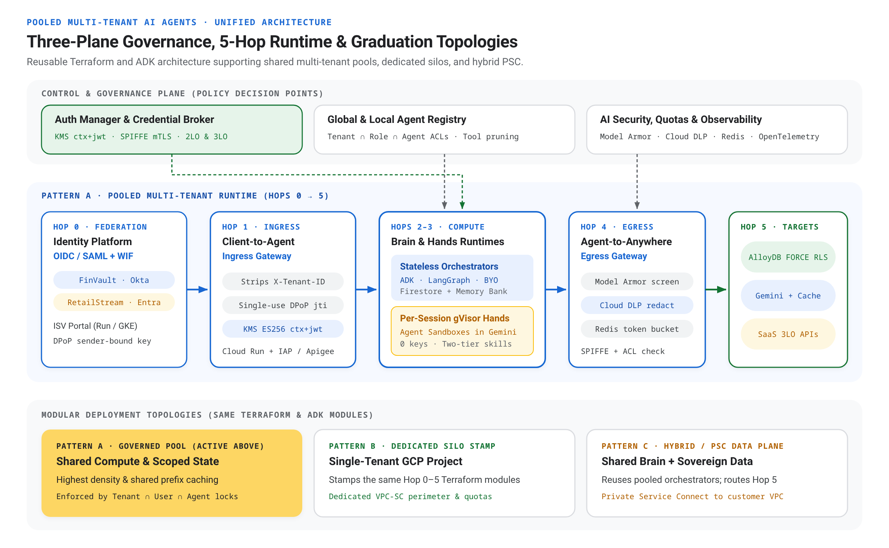

# Implementation Status, Security Model & Known Gaps

> **v0.2.4 · sandbox only · synthetic tenants.** Status as of **2026-11-19**. It
> was built and verified in one Google Cloud sandbox project
> (`cymbal-multitenancy-example` here is a placeholder ID) with two synthetic
> tenants, **FinVault Bank** and **RetailStream Corp**. No customer data. Not a
> product. Cost figures in this repository are **modeled**, not measured.

This document holds the full implementation-status audit, security compromise
matrix, IAM model, verification evidence, known gaps, and production-data gate
referenced from the [project README](../README.md) and
[`SECURITY.md`](../SECURITY.md).

## At a glance

Labels used throughout this repository: **Live** = running in the sandbox and
exercised for real · **Simulated** = code path runs, but external calls are
replaced by local stand-ins · **Modeled** = a calculation or simulation, not a
measurement · **Built, not live** = code and tests exist, not deployed · **Not
built** = design or roadmap only.

| Area                                                                                                             | Status                                                                                                                                         | Notes                                                                                                                                                                                                                                                                                                                                                                                                                                                                                                                               |
| :--------------------------------------------------------------------------------------------------------------- | :--------------------------------------------------------------------------------------------------------------------------------------------- | :---------------------------------------------------------------------------------------------------------------------------------------------------------------------------------------------------------------------------------------------------------------------------------------------------------------------------------------------------------------------------------------------------------------------------------------------------------------------------------------------------------------------------------- |
| Gateway on Cloud Run (`cymbal-pooled-gateway`) behind IAP                                                        | **Live**                                                                                                                                       | Single instance. Access through IAP is limited to named accounts.                                                                                                                                                                                                                                                                                                                                                                                                                                                                   |
| Hop 0 login → DPoP-bound gateway token → per-request proof                                                       | **Live**                                                                                                                                       | Logins are synthetic: a sandbox-only issuer mints Google- and Entra-format ID tokens that go through the real Hop 0 checks.                                                                                                                                                                                                                                                                                                                                                                                                         |
| KMS-signed ES256 context token (ADR-0014 B2)                                                                     | **Live**                                                                                                                                       | Key `cymbal-platform-kr/ws2-context-signing`, non-exportable. Verifiers hold public keys only.                                                                                                                                                                                                                                                                                                                                                                                                                                      |
| JWKS + per-audience token exchange + reference external verifier (B3)                                            | **Live**                                                                                                                                       | The JWKS endpoint sits behind IAP for now, so external MCP servers can't fetch it yet.                                                                                                                                                                                                                                                                                                                                                                                                                                              |
| Credential broker `cymbal-credential-broker` (B4)                                                                | **Live**                                                                                                                                       | Only `cymbal-broker-sa` can mint tenant service-account tokens, and only per-agent Cloud Run Agent Identity principals can invoke the broker (`broker_keep_runtime_caller = false`). Live tests 13/13.                                                                                                                                                                                                                                                                                                                              |
| Gateway / runtime split (B5)                                                                                     | **Live**                                                                                                                                       | Gateway (`cymbal-pooled-gateway`) is the sole holder of `cloudkms.signerVerifier`; Hop 3–5 turns execute on dedicated per-agent Cloud Run services (`cymbal-agent-shared`, `cymbal-agent-finvault-alpha`) that verify context tokens with KMS public keys over workload mTLS and hold zero signing or `TokenCreator` grants.                                                                                                                                                                                                        |
| Three-layer authorization: Tenant ∩ User ∩ Agent ([ADR-0016](adr/0016-three-layer-authz-tenant-user-agent.md))   | **Live** (gateway, agent runtimes, broker) · **Built, not live** (separate MCP service)                                                        | Context and broker tokens carry the signed `agent_id` (`CONTEXT_TOKEN_BIND_AGENT_ID=1`, `CONTEXT_TOKEN_REQUIRE_AGENT_ID=1`); the broker verifies caller SPIFFE Agent Identity principal + purpose (`BROKER_REQUIRE_AGENT_BINDING=1`).                                                                                                                                                                                                                                                                                               |
| Agent Sandbox in Gemini Claim-and-Taint ([ADR-0012](adr/0012-compute-sandbox-scale-and-workstream-alignment.md)) | **Live**                                                                                                                                       | Out-of-process gVisor `sandboxEnvironments` (`4.19.0-gvisor`, `uid=999`, zero mounted credentials, stateful `pause`/`resume`) verified live in `us-central1` and enforced hermetically in CI.                                                                                                                                                                                                                                                                                                                                       |
| Request-time calls to Google APIs and 3P SaaS on the hosted gateway & agent runtimes                             | **Live**                                                                                                                                       | `enable_live_mode = true` (`CYMBAL_LIVE_GCP=1`) across `cymbal-pooled-gateway`, `cymbal-agent-shared`, `cymbal-agent-finvault-alpha`, and `cymbal-credential-broker`; verified by 27/27 live GCP integration tests and Tier 3 Cloud Run smoke checks.                                                                                                                                                                                                                                                                               |
| Per-tenant service accounts, KMS keys, Secret Manager secrets, runbook bucket, Memory Bank in Gemini IAM CEL     | **Live**                                                                                                                                       | Cross-tenant access denied by Google IAM (including `roles/aiplatform.memoryUser` scoped via IAM CEL on `aiplatform.googleapis.com/memoryScope['tenant_id']`), tested live.                                                                                                                                                                                                                                                                                                                                                         |
| Postgres row-level security                                                                                      | **Live**                                                                                                                                       | Zonal 2-vCPU AlloyDB PostgreSQL 18 primary instance (`cymbal-pooled-rls-primary-prod`) over Direct VPC Egress with zero-password IAM authentication (`cymbal-pooled-runtime-sa` on gateway; per-tenant `ct-*` IAM DB users via `ALLOYDB_TENANT_IAM_AUTH=1` on disaggregated agent runtimes) under `cymbal_mcp_app` (`NOSUPERUSER NOBYPASSRLS`).                                                                                                                                                                                     |
| Redis (shared replay store, shared rate limits)                                                                  | **Live (`REDIS_URL` wired to Memorystore Redis; AUTH + Server TLS built & clean-room E2E verified)**                                           | Memorystore for Redis backs `SharedReplayStore` + atomic Lua `RedisBulkheadStore` over Direct VPC Egress (`enable_live_mode = true`). `enable_redis_auth_and_tls` (`SERVER_AUTHENTICATION` TLS + Secret Manager `REDIS_TLS_SECRET_VERSION`) is built in Terraform and verified in clean-room E2E (`v0.2.2`); `sandbox.tfvars` stays single-instance until `gateway_signing_secret` and `enable_redis_auth_and_tls = true` are flipped on for multi-replica scale-out.                                                               |
| Cloud Armor, VPC Service Controls                                                                                | **Not applied**                                                                                                                                | Cloud Armor is in Terraform behind `enable_edge_waf` (off; no load balancer). VPC Service Controls is not written yet.                                                                                                                                                                                                                                                                                                                                                                                                              |
| Terraform                                                                                                        | **Live**                                                                                                                                       | Converged in GCS remote state as of 2026-11-17 (`terraform plan -var-file=sandbox.tfvars` shows zero drift across gateway, B5 agent runtimes, credential broker, AlloyDB primary + IAM DB users, Memorystore Redis, WIF pools/OIDC providers, and Memory Bank IAM CEL bindings). Modules for stamping silo and hybrid tenants: [`terraform/README.md`](../terraform/README.md).                                                                                                                                                     |
| Per-tenant Workload Identity Pool + OIDC Provider & Google Identity Platform broker for Hop 0                    | **Live** (Terraform WIF pool/OIDC provider + direct OIDC) · **Built, not live** (Identity Platform broker)                                     | Issuer-bound `google_iam_workload_identity_pool_provider` resources are live in `sandbox.tfvars`; Identity Platform multi-tenant OIDC broker is tested hermetically.                                                                                                                                                                                                                                                                                                                                                                |
| Okta and Ping                                                                                                    | **Format tests only**                                                                                                                          | No real Okta or Ping tenant is connected.                                                                                                                                                                                                                                                                                                                                                                                                                                                                                           |
| Perimeter gateways (Cloud Run and IAP vs. optional Apigee or Managed Agent Gateway)                              | **Live** (Cloud Run + IAP + KMS signing + ADK interceptors) · **Optional enterprise upgrade** (Apigee, Managed Agent Gateway / CLB `ext_proc`) | The reference repo runs `cymbal-pooled-gateway` behind IAP, [`agents/registry.py`](../agents/registry.py), and [`agents/interceptors.py`](../agents/interceptors.py) so sandbox deployments iterate without ~45-min Apigee X org provisioning; Apigee (for heterogeneous or non-ADK sinks) and Managed Agent Gateway / CLB Service Extensions layer on without changing token contracts ([details](solution_architecture_end_to_end.md#gateway-perimeter-options-cloud-run-and-iap-reference-vs-apigee-and-managed-agent-gateway)). |
| Embedded-app (workload identity) callers, session renewal, per-user budgets                                      | **Not built**                                                                                                                                  | See [Missing components and known gaps](#missing-components-and-known-gaps).                                                                                                                                                                                                                                                                                                                                                                                                                                                        |
| Cost and pooling economics                                                                                       | **Modeled**                                                                                                                                    | [`scripts/benchmark_pooling_at_scale.py`](../scripts/benchmark_pooling_at_scale.py), [`docs/pooling_volume_benchmarks.md`](pooling_volume_benchmarks.md).                                                                                                                                                                                                                                                                                                                                                                           |

---

## User journeys

**The product.** Cymbal (the ISV) sells one product: an AI agent for incident
and compliance operations, used by SRE, IT operations and compliance teams at
enterprise customers. FinVault Bank (regulated, Enterprise tier) and
RetailStream Corp (retail, Standard tier) are two customers of that product, so
both journeys follow the same kind of user.

These are illustrative personas. They describe what each hop does for a real
user.

### Priya, SRE at FinVault Bank (Cymbal web app, long investigation)

**Where it stands:** the hops below run live in the sandbox. Priya is a
synthetic user: her login is minted by the sandbox issuer in Google format, and
Hops 0–5 execute live against Cloud KMS, Firestore, Memory Bank in Gemini,
AlloyDB PostgreSQL 18 RLS, Model Armor, and Cloud DLP.

**What Priya sees:** a payments API starts timing out. She signs in to Cymbal
with her FinVault account and asks the agent to investigate. She gets answers
drawn only from FinVault's tickets, runbooks and memory. FinVault's private
regulatory agent is available to her only if her IdP role allows it (in the
batch audit a `compliance_officer` gets 200 and a `read_only_analyst` gets 403).
Card numbers and bank details in answers are masked. A long investigation hits
two configurable defaults today: the gateway token lasts 10 minutes
(`gateway_token_ttl_seconds`, tunable up to `3,600` s), and the Enterprise tier
allows 12 agent turns per gateway token (`enterprise_max_turns_per_session`; the
counter resets when a new gateway token is issued). Programmatic callers
(`scripts/sandbox_auth.py` `SandboxCaller`) can re-exchange a still-valid IdP
token with the same DPoP key, while automatic background renewal in the web UI
and per-user rolling budgets are not built yet (see
[Missing components and known gaps](#missing-components-and-known-gaps)).

| Hop | What happens for Priya                                                                                                                                                                                                                                         |
| :-- | :------------------------------------------------------------------------------------------------------------------------------------------------------------------------------------------------------------------------------------------------------------- |
| 0   | FinVault's IdP (Google in the sandbox) issues her ID token. The gateway checks issuer, signature, audience and expiry, and maps her IdP role to one platform role.                                                                                             |
| 1   | Her browser exchanges that ID token once for a 10-minute gateway token bound to a key only her browser holds (DPoP). Each request carries a fresh one-time proof. The gateway builds her tenant context from the token only and signs it with Cloud KMS.       |
| 2   | The registry checks FinVault may use the agent she called. Tools she isn't entitled to (by tenant, role and consent) are removed before the model runs.                                                                                                        |
| 3   | Enterprise limits apply (8,000 thinking tokens, 120 requests/min, 12 turns per token). Her memory is encrypted with FinVault's KMS key and bound to her user. If a cloud call is needed, the broker mints a 5-minute token for FinVault's own service account. |
| 4   | Her prompt is screened for injection. The answer is checked against compliance rules and PII is redacted.                                                                                                                                                      |
| 5   | Tool calls verify the signed context again. Database queries run with FinVault's tenant set inside the transaction, so row-level security returns only FinVault rows.                                                                                          |

### Sam, SRE at RetailStream (Cymbal embedded in RetailStream's ops console)

**Where it stands:** mostly planned. The same product, integrated differently.

Sam is already signed in to RetailStream's internal ops console with his Entra
ID account. During a checkout-latency spike he opens the Cymbal panel inside the
console and asks for a diagnosis. The agent uses RetailStream's telemetry and
runbooks and opens a ServiceNow incident. He never signs in to Cymbal
separately, and nothing from FinVault is ever visible to him.

| Step                | What happens for Sam (target)                                                                                                                                                                                                                                         | Built today?                                                                    |
| :------------------ | :-------------------------------------------------------------------------------------------------------------------------------------------------------------------------------------------------------------------------------------------------------------------- | :------------------------------------------------------------------------------ |
| Identity            | RetailStream's console backend calls Cymbal's token exchange with its own workload identity plus Sam's Entra ID token as the subject, producing a token with `sub = Sam` and `act = RetailStream console`. The tenant comes from who vouched, never from the request. | Planned (today Sam can sign in to Cymbal directly with Entra ID)                |
| Token               | Same DPoP-bound gateway token and KMS-signed context.                                                                                                                                                                                                                 | Built                                                                           |
| Entitlement         | Only agents and tools RetailStream is entitled to are visible; FinVault's private agent returns `403`.                                                                                                                                                                | Built                                                                           |
| Models and limits   | Standard tier: `gemini-4-hydrogen` by default (with bounded mid-turn `AskPro` escalation to `gemini-4-carbon`) and lower limits than Enterprise, so a RetailStream spike can't slow FinVault down.                                                                    | Live (`REDIS_URL`-backed `SharedReplayStore` + atomic Lua `RedisBulkheadStore`) |
| Guardrails and data | Same guardrails and data isolation as for Priya.                                                                                                                                                                                                                      | Built                                                                           |

---

## Architecture details

### How Workstream 1 (W1) and Workstream 2 (W2) come together

- **W1 defines the macro blueprint; W2 builds the production engine:** **W1
  (Part 1)** establishes the **3-Plane Operational Model** (_Control Plane_,
  _Stateless Compute Plane_, and _Stateful Data Plane_), the **7
  Agent-as-a-Service (AaaS) subsystems**, and the **3 Packaging Topologies**
  (_Pattern A: Pool_, _Pattern B: Dedicated Single-Tenant Silo_, and _Pattern C:
  Dynamic Hybrid Private Service Connect_), while **W2 (Part 2: this
  repository)** is the concrete end-to-end reference implementation of the
  **Pattern A (High-Density Pooled) runtime** for an ISV SaaS platform (**Cymbal
  CloudOps**, serving banking and retail enterprise tenants from a Cloud Run /
  GKE / GCE client application stack).
- **W1’s control-plane design maps onto W2’s 5-Hop runtime execution chain:** W1
  defines the **Control Plane** design (`Auth Manager`,
  `Global + Local Agent Registry`, and `AI Security`) as the **Policy Decision
  Point (PDP)**. In W2 today there is no separate W1 service: the decision point
  is implemented by `cymbal-pooled-gateway` (Hop 0 to 1: IdP federation,
  **DPoP-bound (`cnf.jkt`) gateway token**, **Cloud KMS-signed ES256 context
  token** binding `tenant_id + sub + agent_id`), by independently deployed
  per-agent Cloud Run runtimes (`cymbal-agent-shared`,
  `cymbal-agent-finvault-alpha` with **Cloud Run Agent Identity SPIFFE mTLS**
  and [`agents/registry.py`](../agents/registry.py) `AgentRegistryPDP`), and by
  `cymbal-credential-broker` (`Tenant ∩ User ∩ Agent` SPIFFE verification,
  [ADR-0016](adr/0016-three-layer-authz-tenant-user-agent.md)). **2-tier model
  routing** (`gemini-4-hydrogen` default across Standard, Enterprise,
  `FastSearch`, and eval judge, with bounded mid-turn `AskPro` escalation to
  `gemini-4-carbon` and `gemini-4-argon` / `gemini-3.8-flash` allowlisted in
  [`config/base.yaml`](../config/base.yaml)) is enforced in
  [`agents/model_routing.py`](../agents/model_routing.py) and wired into
  `LiveADKVertexRunner` alongside clamped `ThinkingConfig` (`LOW` / `MEDIUM` /
  `HIGH` / `XHIGH`) and 4,096-token durable implicit prefix caching; in the
  target architecture, outbound model, MCP, and API calls traverse
  **Agent-to-Anywhere** (rather than `Client-to-Agent` ingress) so **Model
  Armor** monitors each runtime model and tool decision alongside governed model
  routing (`agents/interceptors.py` invokes live Model Armor and Cloud DLP in
  the v0.2.x sandbox), paired with **AlloyDB PostgreSQL 18 `FORCE RLS` +
  zero-password IAM auth + per-tenant Cloud KMS + Memory Bank in Gemini IAM
  CEL**. Optional enterprise **Client-to-Agent** (Apigee) and
  **Agent-to-Anywhere** (Managed Agent Gateway) perimeters and the Global/Local
  Registry service layer on without changing token contracts, while **Agent
  Sandbox in Gemini Claim-and-Taint** (`ADR-0012`) is live-verified on
  `us-central1` `4.19.0-gvisor`.
- **Zero-rewrite tier graduation
  (`Pool -> Hybrid -> Dedicated Single-Tenant Silo`) (design):** Because W2
  enforces tenant isolation via a cryptographically signed **Context Token**
  (`tenant_id`, `sub`, `agent_id`, `tier`, `scopes`) rather than hardcoded
  infrastructure, the design goal is that W2's runtime and enforcement core
  transfers across W1’s topologies (supporting **Google ADK**, **LangGraph**,
  and **BYO Docker** harnesses): starting in **W2’s Shared Pool**, upgrading to
  **Pattern C (Hybrid, PSC)** by routing W2’s **Hop 4 to 5 data calls** over
  **Private Service Connect (PSC)** to a tenant's dedicated DB/CMEK, or stamping
  a dedicated copy of **W2’s 5-Hop blueprint** inside a **Pattern B (Dedicated
  Single-Tenant Silo)** GCP project (`VPC-SC` + `Principal Access Boundary`).
  Silo and hybrid routing is config-driven
  ([`agents/topology_router.py`](../agents/topology_router.py)) and returns
  decisions only: no silo or PSC endpoint is deployed. Before any silo goes
  live, extend the forwarded token (or re-derive the role) so the silo enforces
  in-tenant roles. '~80% reuse' and '1,000+ tenants on 1 runbook' are design
  targets, not measured.



_Target architecture (W1 + W2). Editable Draw.io vector sources in
[`docs/assets/`](assets/):
[`w1_w2_unified_multitenant_agent_architecture.drawio`](assets/w1_w2_unified_multitenant_agent_architecture.drawio)
([PNG](assets/w1_w2_unified_multitenant_agent_architecture.png)) and
[`w2_pooled_multitenant_agent_gateway_architecture.drawio`](assets/w2_pooled_multitenant_agent_gateway_architecture.drawio)
([PNG](assets/w2_pooled_multitenant_agent_gateway_architecture.png))._

#### Where Workstream 1 (W1) samples plug into this repository

| W1 Subsystem / Sample Type                                                                | Extension Point in Repository                                                                                                                                                            | Contract & Verification Test                                                                                                  |
| :---------------------------------------------------------------------------------------- | :--------------------------------------------------------------------------------------------------------------------------------------------------------------------------------------- | :---------------------------------------------------------------------------------------------------------------------------- |
| **1. Onboarding a Tenant & IdP (`Okta` / `Entra ID` / `Google` / `Ping`)**                | Add a YAML file under [`config/tenants/customer-example/`](../config/tenants/customer-example/tenant-acme-corp.yaml)                                                                     | `make config-check` & [`tests/security/test_hop0_idp_federation.py`](../tests/security/test_hop0_idp_federation.py)           |
| **2. Registering an Agent & Tier Entitlements (`Control Plane PDP`)**                     | Register agent ACLs and tool manifests in [`agents/registry.py`](../agents/registry.py) (`AgentRegistryPDP`)                                                                             | [`tests/security/test_catalog_visibility_isolation.py`](../tests/security/test_catalog_visibility_isolation.py)               |
| **3. Hop 3 Semantic Model Routing (`FastSearch` Flash vs. `AskPro` Pro)**                 | Extend `SharedModelRoutingPDP` / `FastSearchHarnessTrimmer` in [`agents/model_routing.py`](../agents/model_routing.py) ([ADR-0015](adr/0015-model-routing-shared-map-and-first-move.md)) | [`tests/unit/test_model_routing_shared_map.py`](../tests/unit/test_model_routing_shared_map.py)                               |
| **4. Adding MCP Tools & Tenant-Scoped 3LO Connectors (`Hop 5`)**                          | Register tools in [`mcp_server/server.py`](../mcp_server/server.py) and 3LO scopes in [`agents/workspace_plugins.py`](../agents/workspace_plugins.py)                                    | [`tests/security/test_rls_fail_closed_isolation.py`](../tests/security/test_rls_fail_closed_isolation.py)                     |
| **5. Topology Graduation (`Pattern A Pool` → `Pattern B Silo` / `Pattern C Hybrid PSC`)** | Per-tenant `topology:` config + [`agents/topology_router.py`](../agents/topology_router.py) ([ADR-0001](adr/0001-3-plane-decomposition-and-80-percent-reusable-core.md))                 | [`tests/security/test_ws3_silo_and_ws4_hybrid_reusability.py`](../tests/security/test_ws3_silo_and_ws4_hybrid_reusability.py) |

### Hops 0–5

| Hop                                               | What it checks                                                                                                                                                                                                                                                                                                                                                                                                                                                                                                                                                                                                                                                                                                                                                                                                                                                                                                                                               | What it blocks (status)                                                                                                                                                                                                         | Where in code                                                                                                                                                                                                                                                                                                                                                                                                                                                                                                        |
| :------------------------------------------------ | :----------------------------------------------------------------------------------------------------------------------------------------------------------------------------------------------------------------------------------------------------------------------------------------------------------------------------------------------------------------------------------------------------------------------------------------------------------------------------------------------------------------------------------------------------------------------------------------------------------------------------------------------------------------------------------------------------------------------------------------------------------------------------------------------------------------------------------------------------------------------------------------------------------------------------------------------------------- | :------------------------------------------------------------------------------------------------------------------------------------------------------------------------------------------------------------------------------ | :------------------------------------------------------------------------------------------------------------------------------------------------------------------------------------------------------------------------------------------------------------------------------------------------------------------------------------------------------------------------------------------------------------------------------------------------------------------------------------------------------------------- |
| **0. Login (IdP federation)**                     | ID token from the tenant's IdP: issuer onboarded and bound to exactly one tenant; signature against that issuer's JWKS with pinned asymmetric algorithms; audience; expiry and max lifetime; Entra directory (`tid`); role claim maps to one of `sre_admin`, `compliance_officer`, `read_only_analyst`, else fail.                                                                                                                                                                                                                                                                                                                                                                                                                                                                                                                                                                                                                                           | Unknown issuer, forged or `alg: none`/HS256 tokens, wrong audience, expired or long-lived tokens, wrong Entra directory, no role (401).                                                                                         | [`agents/hop0_idp_federation.py`](../agents/hop0_idp_federation.py) (`HopZeroFederationGate`), [`app/auth.py`](../app/auth.py), `POST /api/v1/auth/token` in [`app/main.py`](../app/main.py)                                                                                                                                                                                                                                                                                                                         |
| **1. Gateway token and context**                  | Exchanges the verified ID token for a 10-minute ES256 gateway token bound to the client's key (`cnf.jkt`, RFC 9449 DPoP). Every request: token signature, a fresh proof for this method and URL with the token hash, single use. Builds the tenant context **only** from the token and has it signed as an ES256 context token by Cloud KMS.                                                                                                                                                                                                                                                                                                                                                                                                                                                                                                                                                                                                                 | No token or wrong scheme (401), stolen token without the client key (401), replayed or stale proof (401), identity fields in the body (422). `X-Tenant-ID` and similar headers are ignored.                                     | [`app/gateway_tokens.py`](../app/gateway_tokens.py) (`GatewayTokenService`, `make_require_caller`), [`agents/context_signing.py`](../agents/context_signing.py) (`KmsContextSigner`), [`agents/context_token.py`](../agents/context_token.py), [`agents/context.py`](../agents/context.py) (`EdgeAuthVerifier`)                                                                                                                                                                                                      |
| **2. Agent and tool entitlement**                 | The tenant is entitled to the target agent; the catalog shows only entitled agents; tools are pruned to tenant ∩ role ∩ 3LO consent before the model runs. Re-verifies the signed context.                                                                                                                                                                                                                                                                                                                                                                                                                                                                                                                                                                                                                                                                                                                                                                   | Calls to another tenant's private agent (403), unentitled tools (removed), forged or spliced context (refused).                                                                                                                 | [`agents/registry.py`](../agents/registry.py) (`AgentRegistryPDP`), [`agents/interceptors.py`](../agents/interceptors.py) (`enforce_tenant_isolation_interceptor`)                                                                                                                                                                                                                                                                                                                                                   |
| **3. Limits, memory, credentials, model routing** | Tier limits on thinking tokens, requests/min, tokens/min and turns per gateway token (token estimates computed server-side, backed by `RedisBulkheadStore` via `REDIS_URL`). 2-tier model routing (`gemini-4-hydrogen` default across all tiers vs. bounded mid-turn `AskPro` advisor consultation on `gemini-4-carbon` via `escalate_to_advisor()`, capped at 1/turn with 4,096-token durable implicit prefix caching; savings are modeled, [ADR-0015](adr/0015-model-routing-shared-map-and-first-move.md)). Session/user memory records in Firestore are encrypted per record with a data key wrapped by the tenant's KMS key (AAD binds tenant, user, scope and key), paired with scope-locked Memory Bank in Gemini long-term retrieval (`LiveVertexMemoryBankAdapter` + `roles/aiplatform.memoryUser` IAM CEL condition). Every memory read is screened for injected instructions. Cloud credentials come from the broker for the token's tenant only. | Noisy-neighbour bursts and runaway loops (429), cross-tenant and cross-user memory reads, poisoned shared memory, minting for another tenant.                                                                                   | [`agents/context.py`](../agents/context.py) (`TokenBucketBulkhead`), [`agents/memory_bank.py`](../agents/memory_bank.py) (`MemoryBankPartitioner`), [`agents/memory_crypto.py`](../agents/memory_crypto.py), [`agents/adapters/storage_and_telemetry.py`](../agents/adapters/storage_and_telemetry.py) (`LiveVertexMemoryBankAdapter`), [`agents/tenant_credentials.py`](../agents/tenant_credentials.py) (`TenantCredentialBroker`, `RemoteBrokerBackend`), [`agents/model_routing.py`](../agents/model_routing.py) |
| **4. Guardrails**                                 | Inbound: Model Armor screen for prompt and SQL injection. Outbound: compliance constraint gate and Cloud DLP redaction (IBAN, SWIFT, SSN, ABA, card numbers; plain text, JSON and Base64).                                                                                                                                                                                                                                                                                                                                                                                                                                                                                                                                                                                                                                                                                                                                                                   | Injection and jailbreak prompts (400), regulatory-suppression answers (422), raw PII in output (redacted). Live on the hosted sandbox (`CYMBAL_LIVE_GCP=1`).                                                                    | [`agents/interceptors.py`](../agents/interceptors.py) (`ingress_model_armor_screen`, `egress_dlp_and_nlc_guardrail`), [`agents/gcp_live_bridge.py`](../agents/gcp_live_bridge.py)                                                                                                                                                                                                                                                                                                                                    |
| **5. Tools and data**                             | MCP tool calls re-verify the signed context (JSON-RPC error `-32001` on tamper). AlloyDB PostgreSQL 18 queries run over Direct VPC Egress with zero-password IAM authentication (`ct-*` per-tenant IAM DB users on agent runtimes, `cymbal-pooled-runtime-sa` on gateway) assuming `cymbal_mcp_app` (`NOSUPERUSER NOBYPASSRLS`) in a transaction with `SELECT set_config('app.current_tenant_id', $1, true)` under `FORCE ROW LEVEL SECURITY`. 3P connector secrets are read per use as the tenant's service account. Missing per-user 3LO consent returns a 401 consent challenge.                                                                                                                                                                                                                                                                                                                                                                          | Forged tool state, cross-tenant rows, SQL that tries to reset the tenant, another tenant's connector secret, confused-deputy use of another user's 3LO token. Live on AlloyDB PostgreSQL 18 (`cymbal-pooled-rls-primary-prod`). | [`mcp_server/server.py`](../mcp_server/server.py), [`mcp_server/db.py`](../mcp_server/db.py) (`RLSDatabasePool`, `make_tenant_iam_pool_factory`), [`mcp_server/schema.sql`](../mcp_server/schema.sql), [`agents/workspace_plugins.py`](../agents/workspace_plugins.py), [`mcp_server/external_verifier.py`](../mcp_server/external_verifier.py)                                                                                                                                                                      |

### Token and permission flow

The Mermaid diagram below reflects the baseline gateway-to-broker flow (B2 to
B4; with Phase B5 per-agent runtimes and
[ADR-0016](adr/0016-three-layer-authz-tenant-user-agent.md) live in the
sandbox). The illustrated version in
[`docs/assets/ws2_token_permission_flow.svg`](assets/ws2_token_permission_flow.svg)
shows the target-architecture view.

```mermaid
sequenceDiagram
    autonumber
    actor U as User browser (holds its own DPoP key)
    participant IdP as Company IdP (synthetic in sandbox)
    participant GW as Gateway + agent runtime (split in B5)
    participant KMS as Cloud KMS (context-signing key)
    participant CB as Credential broker (separate Cloud Run service)
    participant G as Google APIs (KMS, Secret Manager, GCS)
    participant MCP as MCP tool server
    participant DB as Postgres (FORCE RLS)

    U->>IdP: Sign in
    IdP-->>U: ID token (JWT)
    U->>GW: POST /api/v1/auth/token with ID token + DPoP proof
    Note over GW: Hop 0: verify ID token; keep only its hash, bound to the client key
    GW-->>U: Gateway token (10 min, ES256, bound to client key)
    U->>GW: Request: Authorization DPoP token + fresh one-time proof
    Note over GW: Hop 1: verify token + proof; identity only from the token
    GW->>KMS: Sign context token once per gateway token
    KMS-->>GW: ES256 signature (verifiers use public keys only)
    Note over GW: Hops 2-4 run in the runtime and re-verify the context token
    GW->>GW: Exchange context token for a broker-audience token (5 min max)
    GW->>CB: Broker token + Cloud Run Agent Identity token
    Note over CB: Tenant taken from the token; onboarding re-checked; one mint per token/kind/audience
    CB->>G: generateAccessToken for ct-(tenant hash) only
    G-->>CB: 5-min tenant SA token
    CB-->>GW: 5-min tenant SA token
    GW->>G: Use tenant key / secret / runbook as that tenant
    G-->>GW: Own tenant allowed; other tenant denied by IAM (403)
    GW->>MCP: Tool call with signed context (JSON-RPC)
    MCP->>DB: Transaction with set_config(tenant) under FORCE RLS
    DB-->>MCP: This tenant's rows only
    MCP-->>GW: Tool result
    GW-->>U: Answer (DLP-redacted)
```

**Never stored:** the IdP ID token (only its hash, until it expires), gateway
tokens (stateless), any token value in logs. **Never passed past the gateway:**
the IdP ID token.

### Tokens

| Token                         | Issued by                                         | Signed with                                                                                                         | Lifetime                                                                    | Audience / binding                                             | Who verifies it                                                       |
| :---------------------------- | :------------------------------------------------ | :------------------------------------------------------------------------------------------------------------------ | :-------------------------------------------------------------------------- | :------------------------------------------------------------- | :-------------------------------------------------------------------- |
| **Login (IdP ID token)**      | Tenant's IdP (sandbox: project-pinned dev issuer) | IdP's key (RS256 for direct federation and Identity Platform)                                                       | Max 5,400 s (direct) / 3,600 s (Identity Platform)                          | Tenant's app client ID                                         | Gateway (Hop 0), once per exchange                                    |
| **Gateway token** (`at+jwt`)  | Gateway                                           | ES256 key ring (active / previous / next). Sandbox: per-process key; customer config: pinned Secret Manager version | 600 s, never longer than the ID token                                       | `.../gateway-api`; bound to the client's key (`cnf.jkt`, DPoP) | Gateway on every request, with a one-time DPoP proof                  |
| **Context token** (`ctx+jwt`) | Gateway                                           | ES256, Cloud KMS key `ws2-context-signing` (non-exportable)                                                         | ≤ 600 s, never longer than the gateway token; signed once per gateway token | `runtime`, `mcp`                                               | Interceptor, sub-agent hops, in-process MCP handler (public key only) |
| **Derived token** (exchange)  | Gateway, from a valid context token               | Same KMS key                                                                                                        | ≤ 300 s and ≤ the context token's remaining life                            | Exactly one: `broker` or a registered external MCP URL         | Broker; external MCP servers via the JWKS                             |
| **Tenant SA token**           | Credential broker via IAM Credentials             | Google                                                                                                              | 300 s (broker caps `access_token` at 300 s)                                 | `ct-<sha256(tenant_id)[:24]>` service account                  | Google APIs (IAM decides)                                             |

Details: [ADR-0009](adr/0009-hop-0-multi-idp-federation.md) (Hop 0 and gateway
token), [ADR-0014](adr/0014-credential-broker-and-asymmetric-context-signing.md)
(context token, exchange, broker).

### Identity assumptions

- **Employees sign in with their company's SSO.** Each tenant brings its own IdP
  (Okta, Entra ID, Google or Ping). The gateway trusts that IdP directly over
  OIDC (direct federation), or through Google Identity Platform as a broker. The
  sandbox uses direct federation with synthetic Google- and Entra-format tokens.
  The Identity Platform broker is built and tested, not live.
- **Embedded apps should authenticate as workloads.** When a tenant's own
  backend calls the agent on behalf of its users (Sam's embedded console), the
  caller should be a workload identity, with the end user carried as a
  reference. **Not built.**
- **How Workload Identity Federation (WIF), Direct OIDC / Identity Platform, and
  the Credential Broker fit together (and why Workforce Identity Federation is
  not used).** In Terraform
  ([`terraform/modules/tenant/main.tf`](../terraform/modules/tenant/main.tf),
  live in `sandbox.tfvars`), each onboarded tenant has an issuer-bound
  **Workload Identity Federation (WIF)** pool and OIDC provider
  (`google_iam_workload_identity_pool_provider.tenant_oidc_provider`) codifying
  `google.subject = assertion.sub`, `attribute.tenant_id = '<tenant_id>'`, and
  `attribute.user_role = assertion.groups` under
  `assertion.iss == '<tenant_oidc_issuer_uri>'`. At request time, the gateway
  verifies the corporate OIDC token directly or through Google Identity Platform
  ([`agents/hop0_idp_federation.py`](../agents/hop0_idp_federation.py)), binds
  `(tenant_id, sub, user_role)` to the client's DPoP key and Cloud KMS
  `ctx+jwt`, pairs per-agent Cloud Run Agent Identity (`SPIFFE`) workload checks
  ([ADR-0016](adr/0016-three-layer-authz-tenant-user-agent.md)), and exchanges
  via `cymbal-credential-broker` for `300 s` per-tenant service accounts
  (`ct-<sha256(tenant_id)[:24]>`) for Google Cloud resource access. By contrast,
  **Workforce Identity Federation** (mapping external customer employees into
  human Google Cloud Console / IAM principals) and per-human GCP Service
  Accounts are intentionally avoided, because SaaS end users invoke application
  APIs rather than Google Cloud APIs directly and per-user service accounts
  create standing IAM sprawl and exceed GCP project quotas.

### Where requests get blocked, and the proof

All tests are in [`tests/`](../tests/). "Live" tests need `RUN_LIVE_GCP_TESTS=1`
and real GCP access; everything else runs offline.

| Attack or mistake                                                                     | Blocked at    | Result                                    | Test (file :: name)                                                                                           |
| :------------------------------------------------------------------------------------ | :------------ | :---------------------------------------- | :------------------------------------------------------------------------------------------------------------ |
| No token / wrong auth scheme                                                          | Hop 1         | 401                                       | `test_gateway_token_exchange.py::test_missing_or_wrong_scheme_is_401_with_dpop_challenge`                     |
| Stolen gateway token used from another device                                         | Hop 1         | 401                                       | `test_gateway_token_exchange.py::test_stolen_gateway_token_fails_with_the_thiefs_key`                         |
| Replayed DPoP proof                                                                   | Hop 1         | 401                                       | `test_gateway_token_exchange.py::test_proofs_are_single_use`                                                  |
| Login token edited to another tenant's issuer                                         | Hop 0         | 401                                       | `test_gateway_token_exchange.py::test_login_token_edited_to_another_tenants_issuer_is_a_plain_401`            |
| Tenant or user in the request body                                                    | Hop 1         | 422                                       | `test_gateway_hop0_enforcement.py::test_identity_fields_in_the_body_are_rejected`                             |
| Spoofed `X-Tenant-ID` header                                                          | Hop 1         | Ignored, reported                         | `test_gateway_hop0_enforcement.py::test_spoofed_tenancy_headers_are_ignored_and_reported`                     |
| Forged or wrongly-keyed context token                                                 | Hops 2–5      | Refused                                   | `test_adr_0014_context_token.py::test_forged_context_token_is_rejected_by_every_verifier`                     |
| Gateway token presented as a context token                                            | Hops 2–5      | Refused                                   | `test_adr_0014_context_token.py::test_gateway_access_token_is_rejected_as_a_context_token`                    |
| KMS signing outage                                                                    | Hop 1         | 503, no local fallback                    | `test_adr_0014_context_token.py::test_kms_failure_returns_503_with_no_local_fallback`                         |
| RetailStream calls FinVault's private agent                                           | Hop 2         | 403                                       | `test_catalog_visibility_isolation.py::test_retailstream_direct_call_to_agent_alpha_returns_403`              |
| Unentitled 3LO tools offered to the model                                             | Hop 2         | Removed                                   | `test_catalog_visibility_isolation.py::test_before_agent_callback_prunes_unentitled_3lo_tools`                |
| Standard-tier burst starving Enterprise                                               | Hop 3         | 429                                       | `test_token_bulkhead_noisy_neighbor.py::test_noisy_neighbor_tpm_bulkhead_isolates_retailstream_from_finvault` |
| Turn loop across many requests on one token                                           | Hop 3         | 429                                       | `test_shared_dpop_and_bulkhead_state.py::test_http_invoke_agent_enforces_session_turn_cap_across_requests`    |
| Another user reads Alice's private memory                                             | Hop 3         | Denied                                    | `test_memory_encryption.py::test_charlie_cannot_read_alices_user_memory`                                      |
| Cross-tenant memory unwrap, even with the code check bypassed                         | Hop 3         | Denied by KMS IAM                         | `test_memory_encryption.py::test_cross_tenant_unwrap_denied_by_kms_iam_even_with_acl_bypassed`                |
| Injected instructions in stored memory or RAG chunks                                  | Hop 3         | Quarantined / dropped                     | `test_memory_write_rules.py::test_rag_drops_injected_chunks`                                                  |
| Prompt injection / jailbreak                                                          | Hop 4         | 400                                       | `test_prompt_injection_and_dlp.py::test_ingress_model_armor_blocks_jailbreak_and_cross_tenant_prompt`         |
| Raw PII in the answer                                                                 | Hop 4         | Redacted                                  | `test_prompt_injection_and_dlp.py::test_egress_dlp_redacts_banking_and_payment_pii`                           |
| Forged scopes or tenant on the MCP wire                                               | Hop 5         | `-32001`                                  | `test_identity_hardening.py::test_mcp_wire_refuses_forged_scopes_or_tenant`                                   |
| SQL that resets the tenant or adds `OR 1=1`                                           | Hop 5         | Blocked (**live** AlloyDB RLS + hermetic) | `test_live_alloydb_rls.py::test_live_alloydb_rls_enforces_tenant_isolation_and_blocks_guc_and_write_rbac`     |
| Broker asked to mint for a tenant other than the token's                              | Broker        | Refused                                   | `test_adr_0014_b4_credential_broker.py::test_the_request_cannot_name_a_tenant`                                |
| Cross-agent context token presented to an agent runtime (`B5` / `ADR-0016`)           | Agent runtime | 403 (**live**)                            | `test_disaggregated_runtime_service.py::test_runtime_refuses_wrong_or_missing_agent_id`                       |
| Caller workload principal does not match signed `agent_id` on the broker (`ADR-0016`) | Broker        | 403 (**live**)                            | `test_agent_identity_authz.py::test_broker_refuses_when_caller_principal_does_not_match_bound_agent`          |
| Runtime SA tries to mint a tenant token directly                                      | Google IAM    | 403 (**live**)                            | `test_live_credential_broker.py::test_runtime_sa_can_no_longer_mint_tenant_tokens`                            |
| Tenant credential used on another tenant's key, secret or runbook                     | Google IAM    | 403 (**live**)                            | `test_live_tenant_blast_radius.py::test_iam_denies_cross_tenant_key_secret_and_runbook`                       |
| Errors that name another tenant                                                       | All           | Generic error                             | `test_no_foreign_identifiers.py::test_http_and_mcp_denials_do_not_name_the_other_tenant`                      |

---

## Security model

### Isolation invariants

From [`docs/tenant_isolation_assurance.md`](tenant_isolation_assurance.md),
which tracks each shared surface, its controls and its remaining gap:

| ID  | Invariant                                                               |
| :-- | :---------------------------------------------------------------------- |
| I1  | No cross-tenant read on any path.                                       |
| I2  | No cross-tenant write or poisoning (memory, RAG, shared prompt prefix). |
| I3  | No cross-user read of user- or session-scoped data inside a tenant.     |
| I4  | No leakage through side channels (errors, logs, caches, traces).        |
| I5  | Tenant identity is unforgeable end to end.                              |
| I6  | Blast radius ≤ 1 tenant per compromised key, identity or component.     |
| I7  | Detectable and reversible (audit trail, crypto-shred).                  |

**I6 holds across tenant SAs, the credential broker and per-agent runtimes (B5
deployed 2026-11-09)**; the gateway itself remains the signing trust root (see
table below), and **I7 is partial** (no alerting, no automated crypto-shred).
The assurance document says external material should use "defense-in-depth
tenant isolation with an isolation verification harness in progress", not "zero
leakage guaranteed". This repository follows that rule.

### What if a component is compromised?

"Before B5" was the deployed state at B2–B4. "Today (B5 + ADR-0016, live since
2026-11-09)" is the live gateway/runtime split with per-agent Cloud Run Agent
Identity
([ADR-0014 D4](adr/0014-credential-broker-and-asymmetric-context-signing.md),
[ADR-0016](adr/0016-three-layer-authz-tenant-user-agent.md)).

| Compromised component                                                                                 | Before B5 (B2–B4)                                                                                                                                                    | Today (B5 + ADR-0016, live since 2026-11-09)                                                                                                                                                                                                                                                                                                             |
| :---------------------------------------------------------------------------------------------------- | :------------------------------------------------------------------------------------------------------------------------------------------------------------------- | :------------------------------------------------------------------------------------------------------------------------------------------------------------------------------------------------------------------------------------------------------------------------------------------------------------------------------------------------------- |
| Source code / repository leak                                                                         | Nothing: no signing key in code.                                                                                                                                     | Same.                                                                                                                                                                                                                                                                                                                                                    |
| A code or prompt bug in the runtime                                                                   | Can't cross tenants: tenant comes from the signed token; IAM and KMS AAD refuse other tenants.                                                                       | Same, plus cross-agent calls are refused (`E_RUNTIME_AGENT_MISMATCH`, `E_AGENT_PRINCIPAL_MISMATCH`).                                                                                                                                                                                                                                                     |
| **Agent runtime container (`cymbal-agent-shared` / `cymbal-agent-finvault-alpha`) fully compromised** | Ran inside the gateway identity and could get KMS signatures for any onboarded tenant.                                                                               | **Holds no `signerVerifier` and no `TokenCreator`.** Can use only context/broker tokens that reach that specific agent while compromised, each for ≤ 10 min (context token) + ≤ 300 s (minted credential). Cannot forge tokens, cannot act as another agent (`E_AGENT_PRINCIPAL_MISMATCH`), and cannot reach tenants without live traffic to that agent. |
| Gateway (`cymbal-pooled-gateway`, front door)                                                         | Same as the runtime (one service).                                                                                                                                   | Can sign context tokens for any tenant (it is the trust root), but holds no `TokenCreator` on `ct-*` and cannot invoke `cymbal-credential-broker` (`broker_keep_runtime_caller = false`, 403 at Cloud Run IAM). Mitigations: minimal Hop 0–2 code, KMS audit logs, alerting on signing volume (alerting not built).                                      |
| Credential broker (`cymbal-credential-broker`)                                                        | Can mint for any onboarded tenant. Mitigations: tiny surface, no user ingress, invoker = runtime SA only, audited mints, needs a gateway-signed token.               | Same, hardened: invoker = per-agent Cloud Run Agent Identity principals only (`broker_keep_runtime_caller = false`); enforces `BROKER_REQUIRE_AGENT_BINDING=1` and `CONTEXT_TOKEN_REQUIRE_AGENT_ID=1`.                                                                                                                                                   |
| MCP server (separately deployed)                                                                      | Sees only requests sent to it; can't forge tokens; can't replay to the broker (wrong audience). Today's MCP handler runs in-process with the runtime.                | Same (`MCP_REQUIRE_AGENT_BINDING` built and hermetically tested; awaits separate MCP service deployment).                                                                                                                                                                                                                                                |
| One tenant's service account or key                                                                   | That tenant only.                                                                                                                                                    | Same.                                                                                                                                                                                                                                                                                                                                                    |
| A stolen client gateway token                                                                         | Useless without the client's DPoP key.                                                                                                                               | Same.                                                                                                                                                                                                                                                                                                                                                    |
| A stolen IdP ID token                                                                                 | Whoever exchanges it first binds it to their key; later exchanges must use that same key. Usable until the ID token expires. Mitigated by short IdP token lifetimes. | Same.                                                                                                                                                                                                                                                                                                                                                    |

### IAM model today (who can mint what)

Live state in the sandbox, verified 2026-11-09 and converged in Terraform
(`terraform plan -var-file=sandbox.tfvars` reports no changes; see
`docs/terraform_drift_2026-11-04.md` and
[`docs/runbooks/b5_agent_runtime_rollout.md`](runbooks/b5_agent_runtime_rollout.md)).

| Principal                                                                                                                                   | Holds                                                                                                                                                                                                    | Can mint tenant SA tokens?                                                                                                          |
| :------------------------------------------------------------------------------------------------------------------------------------------ | :------------------------------------------------------------------------------------------------------------------------------------------------------------------------------------------------------- | :---------------------------------------------------------------------------------------------------------------------------------- |
| `cymbal-pooled-runtime-sa` (gateway, Hop 0–2)                                                                                               | `cloudkms.signerVerifier` on `ws2-context-signing`; `run.invoker` on `cymbal-agent-shared` and `cymbal-agent-finvault-alpha`; decrypt-only (`cryptoKeyDecrypter`) on `cymbal-platform-global`            | **No** (no `TokenCreator`, and `run.invoker` on the broker removed in B5 Stage 6)                                                   |
| `principal://agents.global.org-100000000001.../services/cymbal-agent-{shared,finvault-alpha}` (per-agent Cloud Run Agent Identity, Hop 3–5) | `cloudkms.publicKeyViewer` on `ws2-context-signing` (workload mTLS); `run.invoker` on `cymbal-credential-broker`; `logging.logWriter`, `cloudtrace.agent`, `monitoring.metricWriter`                     | **Only for the tenant & agent named in a gateway-signed broker token, via the broker** (zero `TokenCreator`, zero `signerVerifier`) |
| `cymbal-broker-sa` (credential broker)                                                                                                      | `iam.serviceAccountTokenCreator` on each `ct-*`; `cloudkms.publicKeyViewer` on `ws2-context-signing`; log writer                                                                                         | **Yes, the only service account that can**                                                                                          |
| `ct-<hash>` (one per tenant)                                                                                                                | `cryptoKeyEncrypterDecrypter` on its own CMEK key; `secretAccessor` on its own secrets; read on its own runbook folder and skills bucket                                                                 | n/a                                                                                                                                 |
| `cymbal-build-sa` (dedicated Cloud Build SA, drift S4)                                                                                      | `logging.logWriter`, `artifactregistry.writer`, `storage.objectViewer`, `storage.objectCreator`                                                                                                          | No                                                                                                                                  |
| Human operator                                                                                                                              | Project owner (bootstrap). TokenCreator on the runtime, broker and tenant SAs only through a time-boxed conditional grant during live verification, removed immediately after. No standing TokenCreator. | Only via a temporary test grant                                                                                                     |
| `cymbal-ingress-pep-sa` (legacy)                                                                                                            | Disabled; all roles removed.                                                                                                                                                                             | No                                                                                                                                  |

### Architecture decision records

| ADR                                                                            | Decision                                                                                                                                | Status                                                                                  |
| :----------------------------------------------------------------------------- | :-------------------------------------------------------------------------------------------------------------------------------------- | :-------------------------------------------------------------------------------------- |
| [0001](adr/0001-3-plane-decomposition-and-80-percent-reusable-core.md)         | Split into control, compute and data planes; share one core across pooled, siloed and hybrid patterns.                                  | Accepted                                                                                |
| [0002](adr/0002-5-hop-cryptographic-context-chain-obo-dpop.md)                 | Five-hop context chain with on-behalf-of tokens, DPoP and ADK context variables.                                                        | Accepted (signing later replaced by ADR-0014)                                           |
| [0003](adr/0003-ard-catalog-filtering-and-adk-callback-tool-pruning.md)        | Per-tenant agent catalog and tool pruning before each model turn.                                                                       | Accepted                                                                                |
| [0004](adr/0004-fail-closed-alloydb-rls-and-5-level-cmek-memory-bank.md)       | Fail-closed Postgres/AlloyDB RLS and five memory scopes.                                                                                | Accepted, live on AlloyDB PostgreSQL 18 (`2026-11-17`)                                  |
| [0005](adr/0005-multi-tenant-tokenomics-prefix-caching-and-redis-bulkheads.md) | Shared prompt-prefix caching, per-tenant rate bulkheads, BigQuery cost attribution.                                                     | Accepted, live (`REDIS_URL` replay + atomic Lua bulkhead wired; prefix savings modeled) |
| [0006](adr/0006-ciso-defense-in-depth-and-10-edge-case-mitigations.md)         | Ten multi-tenant agent edge cases and their controls.                                                                                   | Accepted                                                                                |
| [0007](adr/0007-modular-workspace-plugins-and-canonical-ports.md)              | Pluggable per-tenant IdP, workspace and ticketing integrations.                                                                         | Accepted                                                                                |
| [0009](adr/0009-hop-0-multi-idp-federation.md)                                 | Hop 0 IdP federation (Identity Platform broker or direct OIDC) and the DPoP gateway token.                                              | Accepted (broker built, not live)                                                       |
| [0010](adr/0010-tenant-blast-radius-containment.md)                            | One service account per tenant, resource-level IAM only.                                                                                | Accepted, live                                                                          |
| [0011](adr/0011-memory-envelope-encryption-and-user-qualified-memory.md)       | Per-record KMS envelope encryption; tenant- and user-qualified memory; write rules.                                                     | Proposed (implemented)                                                                  |
| [0012](adr/0012-compute-sandbox-scale-and-workstream-alignment.md)             | Gates for scaling out, Agent Sandbox in Gemini (`sandboxEnvironments` + GKE `gVisor` `SandboxWarmPool`), and the model-router boundary. | Accepted, live (`us-central1` `4.19.0-gvisor` verified 2026-11-16)                      |
| [0013](adr/0013-runtime-failure-modes-and-hardening-plan.md)                   | Twelve runtime failure modes and the hardening plan.                                                                                    | Proposed (fixes merged)                                                                 |
| [0014](adr/0014-credential-broker-and-asymmetric-context-signing.md)           | KMS-signed context token (B2), JWKS + exchange (B3), credential broker (B4), gateway/runtime split (B5).                                | Accepted; B2–B4 deployed (2026-11-04), B5 deployed (2026-11-09)                         |
| [0015](adr/0015-model-routing-shared-map-and-first-move.md)                    | Task-aware model routing and tool trimming at Hop 3.                                                                                    | Accepted                                                                                |
| [0016](adr/0016-three-layer-authz-tenant-user-agent.md)                        | Three-layer authorization (`Tenant ∩ User ∩ Agent`) with Cloud Run Agent Identity / SPIFFE.                                             | Accepted; A1–A3 deployed live (2026-11-09)                                              |

There is no ADR-0008 file (the number is referenced from code; see the note in
ADR-0009). Index: [`docs/adr/README.md`](adr/README.md).

---

## Evidence: how to run each suite

There is no hosted demo. Run it locally with `make serve` (gateway and demo UI,
synthetic tenants, no GCP account needed).

Offline suites need no GCP access.

| Suite                                          | Command                                                                                                                                                                                                                                                                                          | Current result                                                                            | What it proves                                                                                                                                                                                                                                                                                                                               |
| :--------------------------------------------- | :----------------------------------------------------------------------------------------------------------------------------------------------------------------------------------------------------------------------------------------------------------------------------------------------- | :---------------------------------------------------------------------------------------- | :------------------------------------------------------------------------------------------------------------------------------------------------------------------------------------------------------------------------------------------------------------------------------------------------------------------------------------------- |
| Hermetic pytest                                | `uv run pytest -q` (or `make test`)                                                                                                                                                                                                                                                              | **all pass** (the skipped tests are the opt-in live GCP/AlloyDB/broker/ADK/gateway tests) | Every hop's checks, token and key handling, broker logic, per-tenant AlloyDB IAM pool factory, agent sandbox in Gemini Claim-and-Taint isolation, Memory Bank in Gemini IAM CEL, config and Terraform contracts, docs link integrity.                                                                                                        |
| Breach simulations                             | `uv run python run_breach_simulations.py`                                                                                                                                                                                                                                                        | **10/10** blocked                                                                         | Ten cross-tenant attack scenarios end to end, offline.                                                                                                                                                                                                                                                                                       |
| Golden end-to-end                              | `uv run python scripts/run_extended_golden_e2e.py`                                                                                                                                                                                                                                               | **55/55**                                                                                 | Security, RBAC, GDPR and cost scenarios against expected outcomes.                                                                                                                                                                                                                                                                           |
| Batch audit                                    | `uv run python scripts/run_verifiable_batch_audit.py`                                                                                                                                                                                                                                            | **45/45**                                                                                 | JSONL batch of adversarial prompts (including sandbox payloads), plus MCP JSON-RPC wire checks.                                                                                                                                                                                                                                              |
| Evaluation harness                             | `uv run python scripts/run_ai_engineering_evals.py`                                                                                                                                                                                                                                              | **53/53** hermetic (`--live` opt-in); cost figures are **modeled**                        | Behavioral golden + sandbox evals, output contracts, claim verifier, judge calibration, sampling.                                                                                                                                                                                                                                            |
| 5-act demo                                     | `uv run python scripts/run_5act_demo.py`                                                                                                                                                                                                                                                         | **12/12** checks, `ALL_5_ACTS_VERIFIED`                                                   | A scripted tour of Hops 0–5 with pass/fail per check.                                                                                                                                                                                                                                                                                        |
| Live GCP integration + AlloyDB RLS + ADK evals | `CYMBAL_ENV=sandbox RUN_LIVE_GCP_TESTS=1 CYMBAL_LIVE_GCP=1 CYMBAL_DIRECT_IMPERSONATION=1 uv run pytest -v tests/integration/test_live_gcp_integration.py tests/integration/test_live_tenant_blast_radius.py tests/integration/test_live_alloydb_rls.py tests/integration/test_live_adk_evals.py` | **19/19** (12 + 5 + 1 + 1)                                                                | Real calls: Model Armor, KMS, DLP, Firestore, Memory Bank in Gemini (`memoryScope` IAM CEL), BigQuery row policies, GCS, Jira, ServiceNow, Entra discovery, Gemini (`gemini-4-hydrogen` / `gemini-4-carbon`), Agent Sandbox in Gemini (`4.19.0-gvisor`), and AlloyDB PostgreSQL 18 `FORCE RLS` (`cymbal_mcp_app`); cross-tenant IAM denials. |
| Live broker (B4)                               | `RUN_LIVE_GCP_TESTS=1 B4_STAGE4_DONE=1 CREDENTIAL_BROKER_URL=<broker URL> uv run pytest -v tests/integration/test_live_credential_broker.py tests/integration/test_live_tenant_blast_radius.py`                                                                                                  | **13/13** (8 + 5)                                                                         | Runtime SA gets 403 minting directly; broker SA succeeds; broker-minted tokens still can't cross tenants; broker refuses unauthenticated and non-runtime callers.                                                                                                                                                                            |

Notes:

- The 5-act demo and the other offline scripts sign context tokens with a
  per-process local key. The scripts set `CYMBAL_LOCAL_CONTEXT_SIGNER=1` and
  `CYMBAL_LOCAL_SANDBOX=1` themselves; `make serve` sets both on the command
  line. The local signer is refused outside the synthetic sandbox config and on
  any managed runtime (Cloud Run, GKE); without `CYMBAL_LOCAL_SANDBOX=1` a local
  process exposes no dev issuer and no sandbox-only endpoint.
- The live suites share the 5 blast-radius tests, so **27 unique opt-in live
  tests** (`12 + 5 + 8 + 1 + 1`) exist across live GCP, credential broker,
  AlloyDB RLS, and Gemini ADK evals.
- **Live-test access is time-boxed.** The live tests impersonate the runtime and
  broker service accounts. The operator needs
  `roles/iam.serviceAccountTokenCreator` on those two SAs, granted with an
  expiring IAM condition, never as a standing grant. See Stage 5 of the
  [broker runbook](runbooks/credential_broker_b4.md).
- CI (`.github/workflows/ci.yml`) runs the sanitization gate, `ruff` and the
  hermetic pytest suite on every pull request.

---

## Missing components and known gaps

Items below track remaining gaps (plus completed milestones 1 and 21 for audit
continuity). Each open item has a planned fix; none blocks running the offline
suites.

| #   | What's missing                                                                                     | Why it matters                                                                                                                                                                                                                                                                                                                                                                                                                                                                                                                                                                              | Planned fix                                                                                                                                                                                                                                                                                                                                                                                                                                                                                                                                                                                                                                                                                                                                                                                                                         | Status                                                                                                                                       |
| :-- | :------------------------------------------------------------------------------------------------- | :------------------------------------------------------------------------------------------------------------------------------------------------------------------------------------------------------------------------------------------------------------------------------------------------------------------------------------------------------------------------------------------------------------------------------------------------------------------------------------------------------------------------------------------------------------------------------------------ | :---------------------------------------------------------------------------------------------------------------------------------------------------------------------------------------------------------------------------------------------------------------------------------------------------------------------------------------------------------------------------------------------------------------------------------------------------------------------------------------------------------------------------------------------------------------------------------------------------------------------------------------------------------------------------------------------------------------------------------------------------------------------------------------------------------------------------------- | :------------------------------------------------------------------------------------------------------------------------------------------- |
| 1   | **Gateway/runtime split (ADR-0014 B5)**                                                            | Previously, gateway and agent runtime shared one Cloud Run service and identity, allowing a compromised runtime to request KMS context-token signatures for any tenant.                                                                                                                                                                                                                                                                                                                                                                                                                     | Split into `cymbal-pooled-gateway` (signing, admission; zero `run.invoker` on the broker) and per-agent Cloud Run services `cymbal-agent-shared` and `cymbal-agent-finvault-alpha` (public keys + broker invoker only, Cloud Run Agent Identity). [ADR-0014 D4](adr/0014-credential-broker-and-asymmetric-context-signing.md), [B5 runbook](runbooks/b5_agent_runtime_rollout.md)                                                                                                                                                                                                                                                                                                                                                                                                                                                   | **Done (live 2026-11-09)**                                                                                                                   |
| 2   | **Redis wiring and scale-out**                                                                     | Previously, DPoP replay protection and `TokenBucketBulkhead` rate limits were in-process only, even when Memorystore Redis was provisioned. The sandbox gateway token key is still per process until `gateway_signing_secret` is set.                                                                                                                                                                                                                                                                                                                                                       | `REDIS_URL` is wired live in Terraform (`enable_live_mode = true` in `sandbox.tfvars`) across `cymbal-pooled-gateway`, `cymbal-agent-shared`, and `cymbal-agent-finvault-alpha` to `SharedReplayStore` (`app/gateway_tokens.py`) and atomic Lua `RedisBulkheadStore` (`agents/auth/vault_and_bulkhead.py`), returning `HTTP 503` (`Retry-After: 10`) if Redis is unreachable. `enable_redis_auth_and_tls` (`SERVER_AUTHENTICATION` TLS + `REDIS_TLS_SECRET_VERSION`) is built and verified in clean-room E2E (`v0.2.2`); set `identity.gateway_signing_secret`, enable `enable_redis_auth_and_tls = true` on `sandbox.tfvars`, and raise `max_instance_count` for multi-replica scale-out. [ADR-0012](adr/0012-compute-sandbox-scale-and-workstream-alignment.md), [ADR-0013](adr/0013-runtime-failure-modes-and-hardening-plan.md) | **`REDIS_URL` replay + atomic Lua bulkhead live; AUTH + TLS verified clean-room (`v0.2.2`); single-instance until `gateway_signing_secret`** |
| 3   | **3P connector secrets & out-of-process 3LO vault**                                                | Previously, 3P Jira/ServiceNow/Entra secrets stayed cached on connector instances after first read, and per-user 3LO tokens lived only in an in-process vault.                                                                                                                                                                                                                                                                                                                                                                                                                              | 3P connector secrets are now read per use (zero cached secrets on connector instances), and `broker_service` + `RemoteBroker3LOVault` provide an out-of-process 3LO consent vault (`POST /internal/v1/3lo-credential/{store,checkout,evict}`) gated on SPIFFE caller identity + `aud=broker` `ctx+jwt`. Live multi-instance Redis/Secret-Manager backing for 3LO storage remains next.                                                                                                                                                                                                                                                                                                                                                                                                                                              | **Per-use 3P reads + broker 3LO vault built & tested**                                                                                       |
| 4   | **Terraform: remaining hardening**                                                                 | Done: the sandbox is adopted and applied (2026-11-06, adoption record), with least-privilege IAM, IAP, broker grants, the decrypt-only platform key, bucket public access prevention, per-agent runtime services (`modules/agent_runtime`), dedicated least-privilege build SA (`cymbal-build-sa`, closing drift finding S4), and opt-in Memorystore Redis AUTH + Server TLS (`enable_redis_auth_and_tls`, verified clean-room in `v0.2.2`). Still open: Cloud Armor (behind `enable_edge_waf`, off), VPC Service Controls, Artifact Registry scanning, Firestore delete protection / PITR. | Add VPC Service Controls and Cloud Armor (with a load balancer); enable `enable_redis_auth_and_tls = true` on `sandbox.tfvars` when ready for scale-out; AR scanning and Firestore protection. Drift report (finding S8 open; S4 closed)                                                                                                                                                                                                                                                                                                                                                                                                                                                                                                                                                                                            | Partly done: applied                                                                                                                         |
| 5   | **Alerting and monitoring**                                                                        | KMS signing failures are only an `ALERT` log line plus 503. No log-based alerts on signing volume, broker mints, cross-tenant denials or IAM changes. No Data Access audit logs on KMS, Secret Manager, Storage. Public-invoker check on the broker is a manual command.                                                                                                                                                                                                                                                                                                                    | Detection PR: audit logs, alert policies, recurring broker-invoker check. [Assurance doc](tenant_isolation_assurance.md)                                                                                                                                                                                                                                                                                                                                                                                                                                                                                                                                                                                                                                                                                                            | Not built                                                                                                                                    |
| 6   | **Postgres RLS on a real database**                                                                | Previously, AlloyDB had only a cluster shell with no primary instance, IAM DB user, or Cloud Run VPC egress.                                                                                                                                                                                                                                                                                                                                                                                                                                                                                | Zonal 2-vCPU AlloyDB PostgreSQL 18 primary instance (`cymbal-pooled-rls-primary-prod`) provisioned via Terraform with `alloydb.iam_authentication = on` (zero static passwords), per-tenant `ct-*` `ALLOYDB_IAM_USER` principals (`ALLOYDB_TENANT_IAM_AUTH=1` executing `SET ROLE "cymbal_mcp_app";`), Cloud Run Direct VPC Egress (`PRIVATE_RANGES_ONLY`), `scripts/bootstrap_alloydb_rls.py`, and live RLS/RBAC verification (`tests/integration/test_live_alloydb_rls.py`) under `cymbal_mcp_app` (`NOSUPERUSER NOBYPASSRLS`). [ADR-0004](adr/0004-fail-closed-alloydb-rls-and-5-level-cmek-memory-bank.md)                                                                                                                                                                                                                      | **Live on AlloyDB PostgreSQL 18 (`2026-11-17`)**                                                                                             |
| 7   | **Hosted sandbox live-mode cutover**                                                               | Previously, the hosted gateway and agent runtimes ran with `enable_live_mode = false`, so live GCP/3P calls were exercised only by integration test suites.                                                                                                                                                                                                                                                                                                                                                                                                                                 | Cut over `terraform/sandbox.tfvars` to `enable_live_mode = true`, `enable_tenant_wif_provider = true`, and `enable_memory_bank_iam_cel = true` across `cymbal-pooled-gateway`, `cymbal-agent-shared`, `cymbal-agent-finvault-alpha`, and `cymbal-credential-broker` (live KMS, broker, Model Armor, DLP, Firestore, Memory Bank in Gemini IAM CEL, Gemini `gVisor` sandboxes, Memorystore Redis, and AlloyDB RLS). Interactive browser chat UI remains optional.                                                                                                                                                                                                                                                                                                                                                                    | **Done: live on hosted sandbox (`2026-11-17`)**                                                                                              |
| 8   | **Session renewal and per-user budgets**                                                           | Gateway tokens last 10 minutes and allow 5 (Standard) or 12 (Enterprise) turns. Long sessions must re-exchange a login token. Limits are per tenant and per token, not per user, so one user can use a tenant's whole quota.                                                                                                                                                                                                                                                                                                                                                                | Proposed: renewal bound to the same DPoP key, per-user budgets in the shared store.                                                                                                                                                                                                                                                                                                                                                                                                                                                                                                                                                                                                                                                                                                                                                 | Proposed, not built                                                                                                                          |
| 9   | **Embedded-app / workload-identity callers and machine callers**                                   | Only human logins via an IdP are supported. A tenant's backend (Sam's embedded ops console) or a scheduled job has no supported way in.                                                                                                                                                                                                                                                                                                                                                                                                                                                     | Workload-identity exchange mapped to one tenant, with the end user carried as a reference.                                                                                                                                                                                                                                                                                                                                                                                                                                                                                                                                                                                                                                                                                                                                          | Not built                                                                                                                                    |
| 10  | **Identity Platform broker not live**                                                              | The Hop 0 broker mode (Okta via SAML, Ping) is tested hermetically only. No Identity Platform project, tenants or blocking function exist.                                                                                                                                                                                                                                                                                                                                                                                                                                                  | Terraform for Identity Platform; optional live tests. [ADR-0009](adr/0009-hop-0-multi-idp-federation.md) follow-ups 2 and 4                                                                                                                                                                                                                                                                                                                                                                                                                                                                                                                                                                                                                                                                                                         | Built, not live                                                                                                                              |
| 11  | **Real Okta / Ping tenants not tested**                                                            | Okta and Ping support is proven with format-correct test tokens, not a real org.                                                                                                                                                                                                                                                                                                                                                                                                                                                                                                            | Connect a developer Okta org; Ping through the broker.                                                                                                                                                                                                                                                                                                                                                                                                                                                                                                                                                                                                                                                                                                                                                                              | Not done                                                                                                                                     |
| 12  | **Public JWKS location**                                                                           | The context-token JWKS is behind IAP, so customer-hosted MCP servers can't fetch it.                                                                                                                                                                                                                                                                                                                                                                                                                                                                                                        | Publish the JWKS at a public location (public Cloud Storage object updated on rotation, or a JWKS-only service) before onboarding the first external MCP server. [ADR-0014 B3](adr/0014-credential-broker-and-asymmetric-context-signing.md)                                                                                                                                                                                                                                                                                                                                                                                                                                                                                                                                                                                        | Not done                                                                                                                                     |
| 13  | **Optional enterprise perimeter gateways (Apigee, Managed Agent Registry, Managed Agent Gateway)** | The reference repo runs Cloud Run (`cymbal-pooled-gateway`) behind IAP + [`agents/registry.py`](../agents/registry.py) + ADK runtime interceptors ([`agents/interceptors.py`](../agents/interceptors.py)) so clones deploy in minutes without provisioning an Apigee X organization.                                                                                                                                                                                                                                                                                                        | Keep Cloud Run + IAP + runtime interceptors as the default runnable path; layer Apigee X/Hybrid at ingress (when fronting heterogeneous or non-ADK sinks) and Managed Agent Gateway / Cloud Load Balancing `AuthzExtension` (`ext_proc`) Service Extensions at egress as optional enterprise perimeter upgrades without altering `ctx+jwt` or SPIFFE contracts ([architecture guide](solution_architecture_end_to_end.md#gateway-perimeter-options-cloud-run-and-iap-reference-vs-apigee-and-managed-agent-gateway)).                                                                                                                                                                                                                                                                                                               | **Optional enterprise upgrade (Cloud Run + IAP primary)**                                                                                    |
| 14  | **3LO CSRF key**                                                                                   | Offline/single-instance mode uses a per-process 32-byte key; multi-instance OAuth callbacks require a shared pinned secret.                                                                                                                                                                                                                                                                                                                                                                                                                                                                 | `resolve_oauth_state_signing_key()` loads a pinned numeric Secret Manager version (`OAUTH_3LO_CSRF_SECRET_VERSION`, rejecting `latest`), failing closed when `OAUTH_REQUIRE_SHARED_CSRF_KEY=1`.                                                                                                                                                                                                                                                                                                                                                                                                                                                                                                                                                                                                                                     | **Built & tested (provision secret before multi-instance callback)**                                                                         |
| 15  | **Broker offboarding & agent suspension**                                                          | Previously, dynamic agent suspension and tenant revocation were single-instance in-memory only.                                                                                                                                                                                                                                                                                                                                                                                                                                                                                             | `FirestoreRevocationStore` (`FIRESTORE_REVOCATION_STORE=1`) backs `suspend_agent` and `mark_tenant_revoked` in Firestore (`cymbal_control_plane_revocations_v1`) so gateway, agent runtimes, and `broker_service` share control-plane revocations across replicas without redeploying containers.                                                                                                                                                                                                                                                                                                                                                                                                                                                                                                                                   | **Built & tested (Firestore multi-replica store wired)**                                                                                     |
| 16  | **Independent security review**                                                                    | All tests and reviews so far are by the team.                                                                                                                                                                                                                                                                                                                                                                                                                                                                                                                                               | External review of the harness, status docs and the assurance doc; optional red-team pass.                                                                                                                                                                                                                                                                                                                                                                                                                                                                                                                                                                                                                                                                                                                                          | Not done                                                                                                                                     |
| 17  | **Cost figures are modeled**                                                                       | Prefix-cache savings, pooled-vs-siloed infrastructure cost, judge-sampling cost and onboarding latency come from calculations and simulations, not billing data.                                                                                                                                                                                                                                                                                                                                                                                                                            | Measure on real traffic once live mode and BigQuery cost export run.                                                                                                                                                                                                                                                                                                                                                                                                                                                                                                                                                                                                                                                                                                                                                                | Modeled                                                                                                                                      |
| 18  | **Modular agents, tools and per-tenant versions**                                                  | The agent catalog is a Python dict in `agents/registry.py`, the per-tenant model list is set by tier in `SharedModelRoutingPDP`, and the live agent runner picks tools with hard-coded tenant branches (tenant IDs appear in about 15 modules, mostly demo paths). Adding an agent or fixing a tool for one tenant means changing and redeploying shared code for every tenant. Tenant-specific tools can already live in a separate MCP server (`external_mcp_audiences`).                                                                                                                 | Agent manifests loaded from config; shared tools in Cymbal's MCP server and tenant-specific tools in their own servers; per-tenant agent version pinning (roll a fix to one tenant first); a tenant config store (allowed models, agent versions, tool servers) looked up by the verified `tenant_id`; remove hard-coded tenant branches.                                                                                                                                                                                                                                                                                                                                                                                                                                                                                           | Not done                                                                                                                                     |
| 19  | **Mid-turn `AskPro` live advisor consultation**                                                    | `SharedModelRoutingPDP` defaults all turns to `gemini-4-hydrogen` (`global`) with tier-clamped `ThinkingConfig` + per-model prefix cache isolation (`4,096`-token durable implicit caching), allowlists `gemini-4-carbon`, `gemini-4-argon`, and `gemini-3.8-flash` via [`config/base.yaml`](../config/base.yaml), and invokes `gemini-4-carbon` on `"global"` inside `escalate_to_advisor()` when `is_live_mode()` is enabled (capped at 1 consultation per turn).                                                                                                                         | Done; measure real token savings once live billing export runs (item 17).                                                                                                                                                                                                                                                                                                                                                                                                                                                                                                                                                                                                                                                                                                                                                           | **Done**                                                                                                                                     |
| 20  | **Per-tenant token policy exceptions**                                                             | PR #62 (merged) makes token lifetimes and call ceilings configurable and enforces ADR-0014 Amendment A1's hard caps (context token ≤ 600 s, broker tokens ≤ 300 s). A per-tenant IdP lifetime override can still exceed the platform cap (up to 8 h) without an explicit exception, and per-tenant quota overrides have no upper bound.                                                                                                                                                                                                                                                     | Per [ADR-0014 Amendment A1](adr/0014-credential-broker-and-asymmetric-context-signing.md#amendment-a1-proposed-2026-11-05-customer-driven-session-length-vs-credential-lifetime): per-tenant loosening only through an explicit `exception:` entry (reason, approver, startup log, alert on use); cap quota overrides at the tier value.                                                                                                                                                                                                                                                                                                                                                                                                                                                                                            | Partly done                                                                                                                                  |
| 21  | **Agent-level authorization (Agent Identity / SPIFFE)**                                            | Previously, authorization checked tenant and user, but not which agent was calling (`agent_id` was an unbound string and all agents shared one Cloud Run service).                                                                                                                                                                                                                                                                                                                                                                                                                          | ADR-0016: the gateway signs the routed `agent_id` into the context token (`CONTEXT_TOKEN_BIND_AGENT_ID=1`); the agent runtimes and credential broker verify that the calling SPIFFE workload identity (`principal://agents.global.org-...`) matches `token.agent_id` and is entitled to the purpose (`BROKER_REQUIRE_AGENT_BINDING=1`, `CONTEXT_TOKEN_REQUIRE_AGENT_ID=1`). MCP wire enforcement (`MCP_REQUIRE_AGENT_BINDING`) is built and hermetically tested in `mcp_server/server.py` (awaiting a separate MCP Cloud Run service deployment). [ADR-0016](adr/0016-three-layer-authz-tenant-user-agent.md)                                                                                                                                                                                                                       | **Live on gateway, agent runtimes & broker (2026-11-09); MCP wire enforcement built & tested (in-process today)**                            |

---

## Roadmap

In order:

1.  ~~**Agent-level authorization (Agent Identity / SPIFFE)** (gap 21)~~ — **Done
   on gateway, agent runtimes, and credential broker (live 2026-11-09;
   [ADR-0016](adr/0016-three-layer-authz-tenant-user-agent.md))**. Separate MCP
   Cloud Run service deployment remains when MCP moves out-of-process.
1.  ~~**B5: split the gateway from the agent runtime** (gap 1)~~ — **Done (live
   2026-11-09;
   [ADR-0014](adr/0014-credential-broker-and-asymmetric-context-signing.md),
   [B5 runbook](runbooks/b5_agent_runtime_rollout.md))**.
1.  **Public JWKS location** (gap 12), needed before any external MCP server.
1.  **Terraform hardening** (gap 4): adopted and applied in the sandbox; modules
   for stamping silo / hybrid tenants; dedicated least-privilege build SA
   (`cymbal-build-sa`) live; Memorystore Redis AUTH + Server TLS
   (`enable_redis_auth_and_tls`) verified clean-room in `v0.2.2`. Remaining: VPC
   Service Controls, Cloud Armor, AR scanning, Firestore protection.
1.  **Alerting and audit logs** (gap 5).
1.  **Scale-out cutover (`max_instance_count > 1`)** with a shared Secret Manager
   gateway signing key and `enable_redis_auth_and_tls = true` on
   `sandbox.tfvars` (gap 2; `REDIS_URL` `SharedReplayStore` +
   `RedisBulkheadStore` and Firestore multi-replica revocation store in gap 15
   are now wired).
1.  ~~**Postgres RLS on AlloyDB** (gap 6)~~ — **Done (live Zonal 2-vCPU AlloyDB
   PostgreSQL 18 primary instance, IAM auth, Direct VPC Egress, and live
   `cymbal_mcp_app` RLS/RBAC suite verified 2026-11-17)**.
1.  ~~**3P secrets read per use; 3LO tokens out of process** (gaps 3, 14)~~ —
   **Built & hermetically verified (`LiveAtlassianJiraConnector` /
   `LiveServiceNowITOMConnector` / `LiveMicrosoftEntraOIDCConnector` per-use
   reads, `broker_service` `/internal/v1/3lo-credential/*` +
   `RemoteBroker3LOVault`, and pinned `OAUTH_3LO_CSRF_SECRET_VERSION`)**; wire
   shared backing store when scaling beyond `max-instances=1`.
1.  **Session renewal and per-user budgets** (gap 8).
1.  **Identity:** Identity Platform broker live, a real Okta org,
    workload-identity callers (gaps 9–11).
1.  ~~**Wire routing and thinking budget into the live agent** (gap 19)~~ —
    **Done (`gemini-4-hydrogen` universal default + `gemini-4-carbon` `AskPro`
    advisor + `gemini-4-argon` / `gemini-3.8-flash` allowlisted +
    `ThinkingConfig` + 4,096-token durable implicit prefix caching wired)**.
1.  **Modular agents and tools:** manifest-driven registry and runner,
    tenant-specific MCP servers, per-tenant agent versions, tenant config store
    (gap 18).
1.  **Independent security review** (gap 16).

### Gate: no customer data until these are true

No real customer data enters this platform until **all** of these are true:

- [x] B5 is deployed, and a full runtime compromise is shown to reach only
      tenants with live traffic.
- [ ] Terraform is applied with least-privilege IAM, and the drift report shows
      no open high or medium findings.
- [ ] Shared replay store, rate limits and offboarding are in place (or the
      deployment is provably single-instance), and the gateway signing key is a
      shared Secret Manager version.
- [ ] Alerting covers KMS signing volume, broker mints, cross-tenant denials and
      IAM changes.
- [x] RLS is verified on the real database the deployment uses.
- [x] Connector secrets are not held in process memory.
- [ ] The definition of done in
      [`docs/tenant_isolation_assurance.md`](tenant_isolation_assurance.md#definition-of-done-when-we-may-say-no-data-leakage)
      is met, including an independent review.
