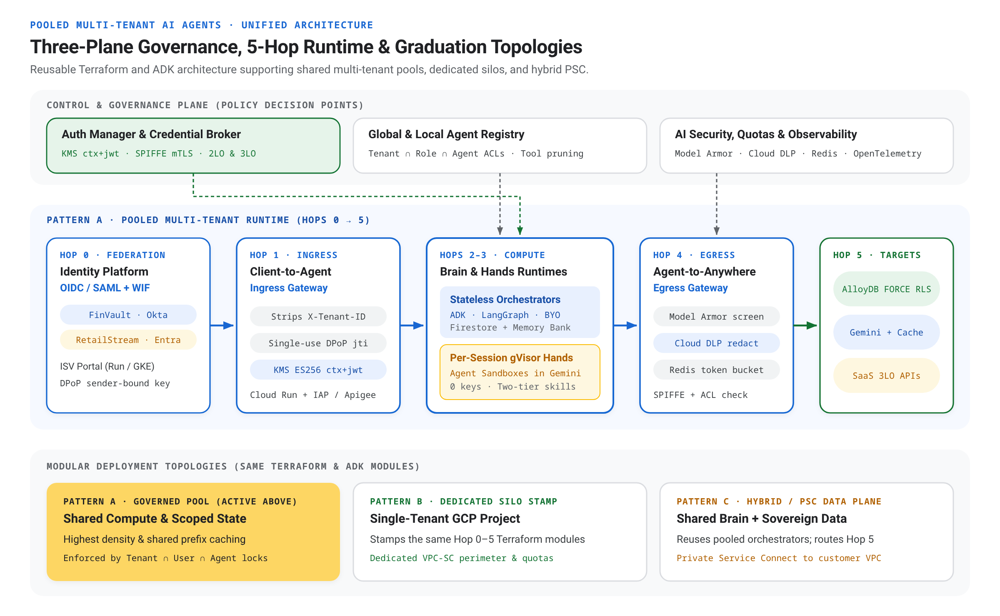

# Pooled Multi-Tenant AI Agents on Google Cloud

A reference implementation of **Pattern A (The Governed Pool)** for B2B SaaS
providers running multi-tenant AI agents on shared Google Cloud infrastructure
with **Gemini** and **Agent Development Kit (ADK)**.

Unlike traditional SaaS backends that isolate database rows alone, enterprise AI
agents reason over live operational telemetry, execute untrusted diagnostic
scripts, hold delegated API credentials, and recall past incidents across weeks.
This blueprint enforces the **`Tenant ∩ User ∩ Agent`** isolation invariant
outside the model at every hop so:

- **Tenant A's users** cannot read **Tenant B's** rows, runbooks, secrets, or
  memories.
- **User B** cannot retrieve **Coworker A's** private sessions or delegated
  `3LO` OAuth tokens inside the same company.
- **Agent A** cannot invoke **Agent B's** restricted tools or impersonate
  another workload identity.

## Interactive Story Deck & Security Lab

Walk through the architecture step-by-step in the guided visual story deck, or
probe the 6-checkpoint request flow, two-Enterprise concurrency, 10-vector
adversarial breach simulations, and modeled prefix-caching capacity directly in
your browser with zero backend setup:

- **[Launch the Guided Architecture Story Deck (`explainer.html`, deep-linkable via `?slide=1..13`)](explainer.html)**
- **[Launch the Interactive Security Lab (`visualizer.html`, deep-linkable via `?tab=breach&vector=2`)](visualizer.html)**

## Disaggregated Runtime Subsystems

1.  **Ingress & Egress Policy Gateways:** Corporate OIDC/SAML federation via
   **Google Cloud Identity Platform** and **Workload Identity Federation
   (WIF)**, RFC 9449 **DPoP** sender-bound gateway tokens, asymmetric **Cloud
   KMS** (`ES256`) `ctx+jwt` context tokens, **Model Armor** prompt/output
   screening, **Cloud DLP** PII redaction, and **Memorystore for Redis** atomic
   rate-limit bulkheads.
1.  **The Brain (Stateless Turn Orchestrator):** Shared Cloud Run orchestrators
   (portable to GKE or managed **agent runtime in Gemini**) verifying context
   tokens with Cloud KMS public keys only, loading shared baseline skills in the
   cached prompt prefix alongside per-tenant Cloud KMS-encrypted custom skills
   in the uncached turn suffix.
1.  **The Hands (Per-Session gVisor Sandboxes):** Ephemeral per-session **agent
   sandboxes in Gemini** (plus a portable GKE `gVisor` warm-pool manifest)
   executing untrusted diagnostic code as an unprivileged user (`uid=999`) with
   zero mounted credentials and no direct metadata or internet egress.
1.  **The Vault (Auth Manager & Out-of-Process Credential Broker):** Dedicated
   `cymbal-credential-broker` verifying **Cloud Run Agent Identity** (`SPIFFE`
   X.509 mTLS) before minting short-lived per-tenant `ct-<sha256[:24]>` `2LO`
   tokens or checking out per-user `(tenant_id, user_id, scope)` `3LO` OAuth
   grants.
1.  **Session, Scoped Memory & Relational Data Layer:** Cloud KMS AEAD-encrypted
   **Cloud Firestore** session checkpoints, exact-scope **Memory Bank in
   Gemini** guarded by Cloud IAM `memoryScope` CEL conditions (`tenant_id` and
   `agent_id`), and **AlloyDB for PostgreSQL** `FORCE ROW LEVEL SECURITY` under
   a `NOSUPERUSER NOBYPASSRLS` role (`cymbal_mcp_app`).

## Documentation Map

- **[Guided Architecture Story Deck](explainer.html):** 13-slide
  interactive executive & architectural walkthrough with `?slide=N` deep links
  and filmstrip navigation.
- **[Interactive Security Lab](visualizer.html):** Client-side 6-checkpoint
  packet tracer, concurrent enterprise turn simulator, and 10-vector red-team
  breach explorer.
- **[End-to-End Solution Architecture](solution_architecture_end_to_end.md):**
  Request flow, trust boundaries, gateway perimeter options (Cloud Run + IAP vs.
  optional Apigee / managed agent gateway in Gemini), and storage portability.
- **[Architecture & Residency Boundaries](architecture.md):** Data-at-rest
  residency vs. in-flight model processing and multi-tenant routing
  preconditions.
- **[Compute & Sandbox Scaling](compute_and_sandbox_scaling.md):** Horizontal
  Cloud Run sizing, `Claim-and-Taint` gVisor sandboxes, and GKE warm pools.
- **[Tenant Isolation Assurance](tenant_isolation_assurance.md):** Threat
  matrix, residual trust-root analysis, and verification suite mapping.
- **[Configuration Reference](configuration_reference.md):** Environment
  variables, token TTL profiles, and declarative tenant YAML schemas.
- **[Customer Deployment Guide](customer_deployment.md)** &
  **[3P Connectors Setup](customer_deployment_and_3p_setup.md):** Terraform
  deployment and Secret Manager onboarding.
- **[Pooling Volume Benchmarks (Modeled)](pooling_volume_benchmarks.md):**
  Modeled cost and tokenomics sensitivity analysis across pooled vs. siloed
  topologies.
- **[Architecture Decision Records (ADRs)](adr/README.md):** Engineering
  trade-offs from `ADR-0001` through `ADR-0016`.
- **[Source Code on GitHub](https://github.com/GoogleCloudPlatform/cloud-solutions/tree/main/projects/pooled-multi-tenant-agents):**
  Full Python, FastAPI, ADK, MCP server, SQL RLS schema, Terraform modules, and
  security test suites.
