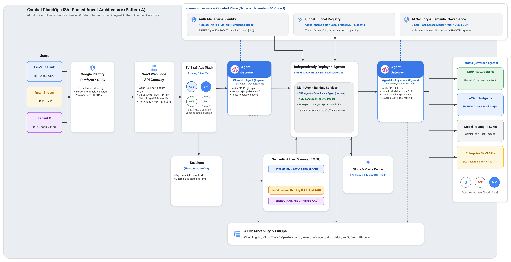
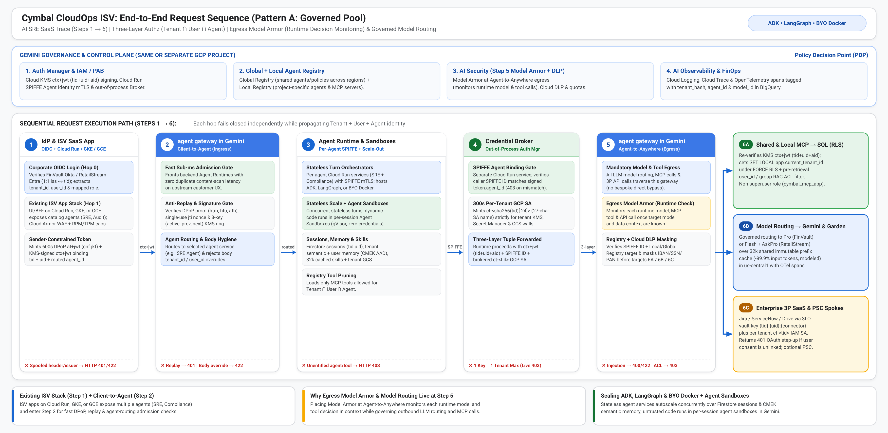
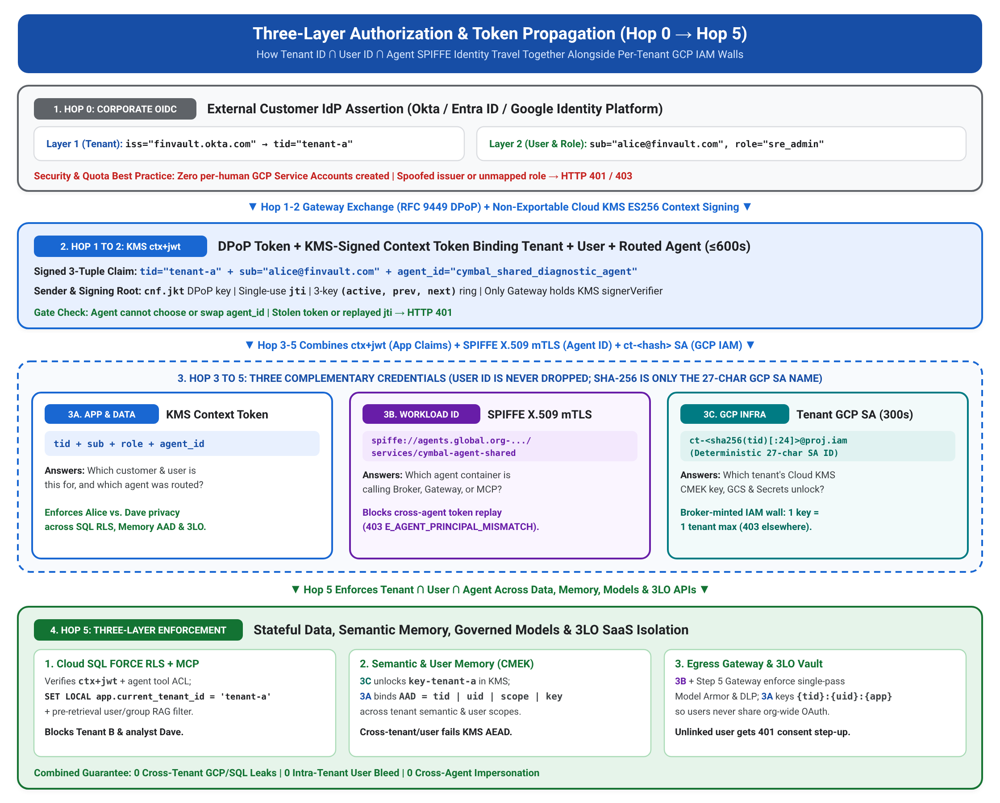

# Cymbal B2B SaaS: Pooled Multi-Tenant Agent Architecture

**Status:** v0.2.0 Sandbox Reference Design (2026-11-17, Live Mode + AlloyDB
RLS + Agent Sandbox in Gemini + Memory Bank in Gemini IAM CEL) | **Region &
Sandbox:** `us-central1` (`cymbal-multitenancy-example`) | **Reference Repo:**
[multi-tenant-experiment-workstream2](https://github.com/cloud-ai-fde/multi-tenant-experiment-workstream2)
([PR #62: Token & Session Policy](https://github.com/cloud-ai-fde/multi-tenant-experiment-workstream2/pull/62))

## 1. Context and Scope

**Cymbal CloudOps** is a B2B SaaS Independent Software Vendor (ISV) selling an
**AI SRE and Compliance Operations Agent-as-a-Service platform** to enterprise
engineering and risk teams across banking and retail verticals. Consider a
Tuesday incident peak on Cymbal's shared platform hosting AI operations agents
for multiple corporate customers in `us-central1`. At regulated banking customer
**FinVault Bank** (`tenant-finvault-alpha`, Enterprise tier), senior SRE
**Alice** (`sre_admin`) runs a 30-minute root-cause investigation across
telemetry, runbooks, and Jira while junior FinVault analyst **Dave**
(`read_only_analyst`) searches the same workspace. On the same deployment,
Standard-tier retail customer **RetailStream Corp** (`tenant-retailstream-beta`,
operator **Bob** on Microsoft Entra ID) launches an automated job that spikes
traffic to `5,000 RPM`.

Giving each customer a dedicated database cluster, VPC, and deployment pipeline
multiplies fixed, mostly idle compute, database, and networking overhead per
tenant across `250` customers, pricing out Standard-tier subscriptions. Naive
multi-tenant pooling cuts that idle floor but exposes shared system prompts,
memory stores, vector indexes, and tool credentials to cross-tenant leakage,
prompt injection, and noisy-neighbor starvation.

### Goals and Isolation Invariants

This design specifies **Pattern A (High-Density Pooled Multi-Tenancy)** with
defense-in-depth tenant isolation across a shared control, compute, and data
plane, measured against seven falsifiable invariants
([`docs/tenant_isolation_assurance.md`](tenant_isolation_assurance.md)):

- **Cross-tenant read isolation (`I1`)**: FinVault callers read zero
  RetailStream rows, runbooks, secrets, or memory records across SQL, Cloud
  Storage, Secret Manager, and Firestore.
- **Cross-tenant write and cache safety (`I2`)**: Prompt injection or tool
  outputs from RetailStream cannot mutate FinVault state or write tenant data
  into the shared `32,000`-token immutable system prefix.
- **Intra-tenant user privacy (`I3`)**: Inside FinVault, Dave
  (`read_only_analyst`) receives `HTTP 403` on FinVault's compliance-only agent
  and cannot decrypt Alice's user-scoped memories or use Alice's Jira OAuth
  grant.
- **Side-channel and tail-latency containment (`I4`)**: Denial responses expose
  generic error codes with zero foreign tenant names, and a `5,000 RPM` flood
  from RetailStream returns `HTTP 429` without starving FinVault's quota bucket.
- **Cryptographic three-layer context binding (`I5`)**: Downstream actions
  enforce `Tenant ∩ User ∩ Agent`
  ([`ADR-0016`](adr/0016-three-layer-authz-tenant-user-agent.md)). Tenant, user,
  and routed `agent_id` derive solely from verified tokens (`at+jwt` bound via
  RFC 9449 DPoP and `ctx+jwt` signed by non-exportable Cloud KMS ECDSA P-256)
  matched against the calling workload's Cloud Run Agent Identity
  (`SPIFFE X.509 mTLS`), rejecting caller headers and JSON identity fields
  (`HTTP 422`).
- **Bounded credential and runtime blast radius (`I6`)**: A leaked per-tenant
  Google IAM token reaches only that single tenant's Cloud KMS key, Secret
  Manager entries, and Cloud Storage folder (`HTTP 403` elsewhere, verified
  live). Under Phase B5 (deployed live `2026-11-09`), per-agent Cloud Run
  runtimes (`cymbal-agent-shared`, `cymbal-agent-finvault-alpha`) hold public
  keys only and zero `TokenCreator` grants, bounding runtime-container
  compromise to active traffic on that single agent while
  `cymbal-pooled-gateway` remains the narrow Hop 0 to 2 signing trust root
  (Section 6).
- **Auditability and tenant revocation (`I7`)**: Structured audit logs record
  pseudonymous user references (`u-<hmac>`), and `offboard_tenant()` purges
  active single-instance caches in under `1 ms` alongside Cloud KMS key
  disablement.

### Non-Goals

- **Arbitrary untrusted code execution in shared containers**: Conversational
  and tool-orchestration turns share stateless Python processes; untrusted user
  code requires ephemeral `gVisor` microVMs or graduation to a dedicated
  project.
- **Customer IdP replacement or MFA administration**: Authentication strength,
  password rotation, and corporate SSO session policies remain owned by each
  customer's Okta, Entra ID, Ping, or Google Identity tenant.
- **Multi-region active-active database replication in v0.1**: The v0.1
  reference stack runs in `us-central1`; regional data-residency routing
  (`europe-west3`) and customer-storefront workload federation remain roadmap
  items (Section 8).

## 2. System Architecture

Workstream 1 defines the three-plane enterprise model (Control Plane, Stateless
Compute Plane, and Stateful Data Plane) and three packaging topologies (Pattern
A Pool, Pattern B Dedicated Single-Tenant Silo, and Pattern C Hybrid Private
Service Connect). Workstream 2 implements the Pattern A pooled runtime and
aligns its six verification hops (Hop 0 to Hop 5) with the **Gemini** governance
surfaces
([Agent Gateway overview](https://docs.cloud.google.com/gemini-enterprise-agent-platform/govern/gateways/agent-gateway-overview);
[Editable Workstream 2 draw.io source](assets/w2_pooled_multitenant_agent_gateway_architecture.drawio)):

- **Governance and Control Plane**: **Auth Manager & Identity** enforces IAM
  default-deny, Principal Access Boundaries, Cloud Run Agent Identity
  (`SPIFFE X.509 mTLS`), deterministic 27-character per-tenant Google Service
  Accounts (`ct-<sha256(tenant_id)[:24]>`), and per-tenant Cloud KMS keys
  (`finvault-alpha-cmek`, `retailstream-beta-cmek`). For multi-project and
  multi-region ISVs spanning pooled and siloed tenants, a **Global Agent
  Registry** holds baseline agent definitions, shared skills, and cross-region
  policies, paired with a **Local Agent Registry** (`AgentRegistryPDP` in the
  single-project v0.1 sandbox) inside each runtime project that controls tenant
  agent visibility, role-pruned MCP tool schemas, and local MCP endpoints
  without cross-project lookup latency; and **AI Security** runs Model Armor
  prompt screening, Sensitive Data Protection (Cloud DLP) egress redaction, and
  tier token budgets at the **Agent-to-Anywhere** egress boundary.
- **Dual-Mode Agent Gateways and Pooled Runtime**: External tenant users
  (FinVault, RetailStream) sign in through Corporate OIDC or Google Identity
  Platform, traverse the **SaaS Web Edge API Gateway** and **ISV SaaS App
  Stack**, and enter through the **Client-to-Agent Agent Gateway** (ingress)
  into **Independently Deployed Agents** (`SPIFFE X.509 mTLS` across per-agent
  Cloud Run services `cymbal-agent-shared` and `cymbal-agent-finvault-alpha`),
  backed by partitioned Firestore **Sessions** and per-tenant **Semantic & User
  Memory**, before calling the **Agent-to-Anywhere Agent Gateway** (egress) to
  reach **MCP Servers**, governed **Model Routing** (`Vertex AI`), **A2A
  Sub-Agents**, and **Enterprise SaaS APIs** with end-to-end **AI
  Observability**.
- **Existing ISV Application Stack and Agent Gateways**: Most B2B ISVs run their
  existing SaaS web and application stack on **Cloud Run**, **Google Kubernetes
  Engine (GKE)**, or **Compute Engine**, acting as upstream clients accessing
  the backend agent runtime. First, the **SaaS Web Edge API Gateway** fronts
  that stateless ISV application tier (Cloud Armor WAF, OIDC-to-DPoP token
  exchange, per-tenant RPM/TPM limits, and task-based agent catalog selection
  between Cymbal's **SRE Diagnostic Agent** and **Regulatory Compliance Agent**;
  zero agents execute in the client tier). Second, the **Client-to-Agent Agent
  Gateway** checks ingress into the target agent runtime (`ctx+jwt` signature,
  routed `agent_id`, `jti` replay) without invoking **Model Armor** at ingress;
  instead, **Model Armor** runs behind the **Agent-to-Anywhere** egress Agent
  Gateway to monitor each outbound runtime model, MCP tool, and third-party API
  decision after the agent issues the call, avoiding duplicate upstream latency.
- **Zero-Trust Concurrent Execution, Phase B5 Split, and Harness Portability**:
  Under
  [`ADR-0014`](adr/0014-credential-broker-and-asymmetric-context-signing.md)
  Phase B5 and [`ADR-0016`](adr/0016-three-layer-authz-tenant-user-agent.md)
  (deployed live `2026-11-09`), `cymbal-pooled-gateway` is the sole holder of
  `roles/cloudkms.signerVerifier` on `ws2-context-signing`, while Hop 3 to 5
  turns execute on independently deployed per-agent Cloud Run services
  (`cymbal-agent-shared` and `cymbal-agent-finvault-alpha`) with Cloud Run Agent
  Identity (`SPIFFE X.509 mTLS`), holding public keys only
  (`roles/cloudkms.publicKeyViewer`) and zero
  `roles/iam.serviceAccountTokenCreator` grants. Within each stateless
  container, interleaved multi-tenant turns isolate state in Python `ContextVar`
  request scope (`_ACTIVE_TENANT_ENVELOPE`) with zero mutable tenant globals,
  zero local disk writes, and `RESET ALL` on pooled database connections,
  calling `cymbal-credential-broker` to mint `300 s` `ct-<hash>` tokens. Because
  the gateway, `ctx+jwt`, broker, and MCP contracts use standard HTTP/JSON-RPC
  and workload mTLS, ISVs can host **(1) bring-your-own custom agent harnesses
  packaged in Docker containers** and **(2) LangGraph agents** side-by-side with
  **Google ADK** services. Concurrent turns inside a stateless container share
  one Python `asyncio` process heap (`ContextVar` and `RESET ALL` prevent
  accidental async cross-talk across normal execution, not malicious heap
  scraping via `gc.get_objects()` or `/proc/self/mem` under an interpreter or
  library RCE bug): the `v0.1.1` repo exposes only a fixed `8`-tool MCP catalog
  ([`agents/registry.py`](../agents/registry.py),
  [`agents/turn_engine.py`](../agents/turn_engine.py)) with zero `eval()`,
  `exec()`, shell, or browser execution inside `Agent Runtime` and bounds
  container RCE via Phase B5 to active turns on that single agent (`<= 600 s`
  `ctx+jwt` / `<= 300 s` SA), whereas the target Gemini architecture
  ([`ADR-0012`](adr/0012-compute-sandbox-scale-and-workstream-alignment.md))
  runs any LLM-generated Python, bash, browser/computer use, or dynamic skill
  scripts out-of-process in **Agent Sandbox in Gemini** (`gVisor`-isolated per
  session, zero parent credentials mounted, `169.254.169.254` and raw internet
  blocked) paired with runtime VPC egress lockdown (`0.0.0.0/0` denied), and
  regulated customers requiring `100%` orchestrator compute and memory
  separation deploy on **Pattern B (Dedicated Single-Tenant Silo)**. Setting
  `--workers 1` (or `--workers 1` plus `concurrency = 1`) on a shared runtime
  does not create per-session containers: `--workers 1` still interleaves async
  turns when `concurrency > 1` (and managed agent runtime in Gemini spawns `9`
  worker processes per container by default), while `concurrency = 1` reuses the
  same warm Python process milliseconds later for the next tenant with unzeroed
  CPython `pymalloc` heap arenas in RAM; only an ephemeral `Claim-and-Taint`
  sandbox (`UNCLAIMED -> TAINTED(tenant_id, session_id) -> DESTROYED`) destroyed
  on session close guarantees `1` fresh container per session.
- **Scaling Partitioned Sessions, Semantic Memory, and Skills Without Leakage**:
  Stateless agent containers scale horizontally by externalizing **Sessions**
  (`MemoryScope.SESSION`) into **Cloud Firestore** keyed by `{tenant_id}:{sub}`,
  so any replica resumes multi-turn state without sticky routing. Load-balancer
  session affinity also provides zero tenant isolation because best-effort
  cookies are one-way (nudging User A back to Container 1 without preventing
  User B's incoming session from landing on Container 1 between turns). Stateful
  **agent sandboxes in Gemini** (target architecture) instead pin by storing
  `sandbox_id` inside the tenant-scoped session record and addressing
  `sandboxEnvironments/{SANDBOX_ID}` directly (verified against `ctx+jwt`).
  **Memory** splits into **per-tenant semantic memory** (shared tenant
  operational runbooks and resolved incident patterns) and **per-user memory**
  (`{tenant_id}:{sub}`), each encrypted with per-record AES-256-GCM keys wrapped
  under that tenant's Cloud KMS CMEK (`finvault-alpha-cmek` or
  `retailstream-beta-cmek`) and bound to canonical JSON AAD
  `["v2", tenant_id, user, scope, key]` from the verified `ctx+jwt`. **Skills**
  pair one shared read-only `32,000`-token baseline SRE prefix
  (`READ_ONLY_IMMUTABLE_PREFIX`, zero tenant strings) with per-tenant custom
  playbooks fetched post-prefix from each tenant's IAM-isolated Cloud Storage
  folder.

_Target enterprise topology vs. primary deployed `v0.2.0` runtime. Phase B5
per-agent Cloud Run services (`cymbal-agent-shared`,
`cymbal-agent-finvault-alpha`), Cloud Run Agent Identity (`SPIFFE X.509 mTLS`),
Cloud KMS `ctx+jwt` signing, `cymbal-credential-broker`, Memorystore Redis
(`SharedReplayStore` + `RedisBulkheadStore`), Gemini `gVisor`
`sandboxEnvironments` (`4.19.0-gvisor`), Memory Bank in Gemini (`memoryScope`
IAM CEL), and AlloyDB PostgreSQL 18 `FORCE RLS` (`ALLOYDB_TENANT_IAM_AUTH=1`)
run live in `cymbal-multitenancy-example` (`enable_live_mode = true`); managed
agent gateway in Gemini (ingress and egress), Global Registry service, Cloud
Armor, and live Identity Platform brokering remain optional enterprise upgrades
or roadmap items. See Section 8 and [README.md](../README.md)._

Because tenant boundaries ride inside the signed `ctx+jwt` token rather than
hardcoded hostnames, tenants can graduate across Workstream 1 packaging
topologies as compliance mandates tighten
([`agents/topology_router.py`](../agents/topology_router.py), config-driven
decision router today):

| Topology Pattern                                           | Target Customer Profile                                          | Compute & Gateway Plane                                                                                               | Stateful Data & Key Plane                                                                                                                           | Sandbox Status                                                                                                                                                                           |
| :--------------------------------------------------------- | :--------------------------------------------------------------- | :-------------------------------------------------------------------------------------------------------------------- | :-------------------------------------------------------------------------------------------------------------------------------------------------- | :--------------------------------------------------------------------------------------------------------------------------------------------------------------------------------------- |
| **Pattern A: Pool (Workstream 2)**                         | Standard & multi-tenant Enterprise SaaS (RetailStream, FinVault) | Shared gateway, per-agent Cloud Run runtimes (`B5` SPIFFE), Gemini `gVisor` sandboxes, and `cymbal-credential-broker` | Shared AlloyDB Postgres (`FORCE RLS`) + partitioned Firestore Sessions, Memory Bank in Gemini (`memoryScope` IAM CEL) & GCS (`ct-<hash>` SA & CMEK) | **Core reference repo (`v0.2.0` Live across Hops 0–5: KMS B2–B3, Broker B4, B5 Split, `ADR-0016`, Redis, Agent Sandbox in Gemini, Memory Bank IAM CEL, DLP, Model Armor & AlloyDB RLS)** |
| **Pattern C: Hybrid PSC (Workstream 4)**                   | Regulated enterprises requiring customer-hosted data residency   | Shared Pattern A control and stateless per-agent runtime plane                                                        | Hop 5 routes over **Private Service Connect (PSC)** to tenant-owned DB, MCP servers, and CMEK                                                       | **Router built** ([`agents/topology_router.py`](../agents/topology_router.py)); external MCP JWKS verifier **Live**                                                                      |
| **Pattern B: Dedicated Single-Tenant Silo (Workstream 3)** | Strict kernel, VPC-SC, or regulatory physical-isolation mandates | Dedicated single-tenant GCP project stamped from the same Hop 0 to 5 Terraform blueprint                              | Dedicated AlloyDB/Cloud SQL, VPC Service Controls perimeter, and customer-owned KMS project                                                         | **Router built** ([`agents/topology_router.py`](../agents/topology_router.py)); ~80% code reuse is a design target                                                                       |

## 3. Request Sequence

Tracing Alice's incident-triage turn (`alice@finvault.com`, `sre_admin`)
alongside Bob's concurrent RetailStream burst illustrates how a request moves
across one sequential six-step path (`Steps 1 to 6` in the diagram below)
without hidden side branches:

1.  **Step 1 (IdP Login & ISV SaaS App Stack)**: Alice signs in once at
    FinVault's corporate IdP through Cymbal's SaaS web application tier (hosted
    on Cloud Run, GKE, or Compute Engine) and exchanges that ID token at
    `POST /api/v1/auth/token` with an ECDSA P-256 DPoP proof (`htm`, `htu`,
    `iat`, `jti`) to receive a `600 s` DPoP-bound gateway token (`at+jwt`).
    Subsequent calls carry `Authorization: DPoP <at+jwt>` plus a fresh
    single-use proof; the gateway mints one non-exportable Cloud KMS `ctx+jwt`
    (`ws2-context-signing`) binding `tenant_id`, `sub`, and the target
    `agent_id`.
1.  **Step 2 (Client-to-Agent Ingress)**: Verifies the caller's DPoP binding and
    routed `agent_id`, rejects any request body attempting to pass `tenant_id`
    or `user_id` (`HTTP 422`), and defers **Model Armor** inbound
    prompt-injection screening (`HTTP 400` on jailbreak payloads) to **Step 5**
    rather than calling **Model Armor** at `Client-to-Agent` ingress, avoiding
    duplicate upstream latency and inspecting each request after the agent
    chooses its runtime model and target tool or API.
1.  **Step 3 (Agent Runtime & Sandboxes)**: Cymbal's SaaS web edge exposes
    multiple independently deployed task agents so users pick by need (such as
    `cymbal-agent-shared` for SRE root-cause diagnostics and
    `cymbal-agent-finvault-alpha` for regulatory compliance escalation; this
    trace follows the SRE agent, and ISVs can deploy **bring-your-own custom
    Dockerized agent harnesses** or **LangGraph** agents alongside **Google
    ADK** on the same contract). Inside `cymbal-agent-shared`, the Local
    Registry (`AgentRegistryPDP`) verifies FinVault's `Tenant ∩ User ∩ Agent`
    entitlement (`HTTP 403` if RetailStream calls FinVault's private regulatory
    agent) and prunes unentitled tools before model execution, while
    `TokenBucketBulkhead` enforces FinVault's `120 RPM / 250,000 TPM / 12`-call
    quota independently of Bob's `429`-throttled flood. Deterministic tier
    policy ([`agents/model_routing.py`](../agents/model_routing.py)) selects the
    model profile inside Step 3, while outbound model calls traverse the **Step
    5 Agent-to-Anywhere** gateway rather than making bespoke direct calls.
1.  **Step 4 (Out-of-Process Credential Broker)**: When Alice's turn reads
    FinVault's encrypted semantic or user memory or Jira secret,
    `cymbal-agent-shared` presents its Cloud Run Agent Identity (`SPIFFE X.509`
    workload ID token `principal://agents.global.org-<ORG_ID>...`) plus a
    single-use `broker`-audience `ctx+jwt` to `cymbal-credential-broker`, which
    verifies `Tenant ∩ User ∩ Agent` (`BROKER_REQUIRE_AGENT_BINDING=1`) before
    minting a `300 s` IAM token scoped strictly to FinVault's `ct-<hash>`
    service account.
1.  **Step 5 (Agent-to-Anywhere Egress) & Step 6 (Parallel Targets)**: Because
    an agent decides dynamically at runtime whether to chain multiple models
    within a task (such as `gemini-4-hydrogen` invoking mid-turn `AskPro` on
    `gemini-4-carbon`) and which MCP tools or APIs to call step-by-step,
    outbound model, MCP, and API requests traverse the **Agent-to-Anywhere**
    egress boundary so **Model Armor** monitors each issued runtime decision
    (`HTTP 400` on prompt/SQL injection), alongside regulatory compliance checks
    (`HTTP 422`) and **Cloud DLP** masking (`IBAN`, `SWIFT`, `SSN`, payment card
    numbers), before fanning out in parallel to **6A** Shared MCP + PostgreSQL
    `FORCE RLS`, **6B** the governed Model Routing Layer calling Vertex AI
    (`gemini-4-hydrogen`, `gemini-4-carbon`, `gemini-4-argon`, and
    `gemini-3.8-flash` on `global`), and **6C** tenant-consented enterprise SaaS
    APIs (Jira, ServiceNow). _(In this reference implementation, egress
    guardrails run via ADK runtime interceptors in
    [`agents/interceptors.py`](../agents/interceptors.py); agent gateway in
    Gemini and Cloud Load Balancing Service Extensions are optional enterprise
    perimeter upgrades, see Section 4.)_ Postgres does not chain out to external
    cloud STS endpoints.

\_Target enterprise topology vs. primary reference runtime. In the repository,
`cymbal-pooled-gateway` on Cloud Run behind IAP + Cloud KMS `ctx+jwt` signing
(ingress) and ADK runtime interceptors in
[`agents/interceptors.py`](../agents/interceptors.py) (egress) form the primary
runnable perimeter, paired with Phase B5 per-agent Cloud Run services, Cloud Run
Agent Identity (`SPIFFE`), `cymbal-credential-broker`, live Gemini `gVisor`
`sandboxEnvironments`, live Memory Bank in Gemini (`memoryScope` IAM CEL), live
AlloyDB PostgreSQL 18 `FORCE RLS` (`cymbal_mcp_app` + per-tenant `ct-*` IAM DB
logins), and live `REDIS_URL` (`SharedReplayStore` and `RedisBulkheadStore`,
`enable_live_mode = true`); Apigee X/Hybrid and agent gateway in Gemini / CLB
Service Extensions are optional enterprise perimeter upgrades.\*

### Per-Hop Enforcement and Anchor Tenant Configuration

Each hop fails closed independently before handing control downstream:

| Hop                                     | Verification Check                                                                                                                                                                                                                  | Denial Code                        | Primary Module                                                                                                                                                                                                        |
| :-------------------------------------- | :---------------------------------------------------------------------------------------------------------------------------------------------------------------------------------------------------------------------------------- | :--------------------------------- | :-------------------------------------------------------------------------------------------------------------------------------------------------------------------------------------------------------------------- |
| **Hop 0: IdP Federation**               | Pinned OIDC/SAML issuer (`1:1` with `tenant_id`), asymmetric JWKS (`RS256`/`ES256`), `aud`, `exp`, max token lifetime, Entra `tid`, explicit role mapping                                                                           | `HTTP 401`                         | [`agents/hop0_idp_federation.py`](../agents/hop0_idp_federation.py), [`app/auth.py`](../app/auth.py)                                                                                                                  |
| **Hop 1: DPoP & KMS Context**           | `at+jwt` signature, `cnf.jkt` key match, `ath` hash, fresh single-use DPoP `jti`, Cloud KMS `ws2-context-signing` `ctx+jwt` mint binding `tenant_id + sub + agent_id`; strips `X-Tenant-*`                                          | `HTTP 401 / 422 / 503`             | [`app/gateway_tokens.py`](../app/gateway_tokens.py), [`agents/context_signing.py`](../agents/context_signing.py)                                                                                                      |
| **Hop 2: Global/Local Registry & PDP**  | Re-verifies `ctx+jwt` public key over workload mTLS; checks `RUNTIME_AGENT_ID`, tenant agent ACL, and `tenant_scopes ∩ role_scopes ∩ user_3lo_consent` prior to prompt assembly                                                     | `HTTP 403` / tool pruned           | [`runtime_service/main.py`](../runtime_service/main.py), [`agents/registry.py`](../agents/registry.py), [`agents/interceptors.py`](../agents/interceptors.py)                                                         |
| **Hop 3: Quotas, Memory & Broker**      | Server-side token estimate against tier RPM/TPM, thinking budget, and calls-per-token cap; CMEK AEAD memory unwrap; SPIFFE-verified (`Tenant ∩ User ∩ Agent`) brokered `ct-<hash>` SA mint                                          | `HTTP 429 / 403 / 503`             | [`agents/context.py`](../agents/context.py), [`agents/memory_crypto.py`](../agents/memory_crypto.py), [`agents/workload_identity.py`](../agents/workload_identity.py), [`broker_service/`](../broker_service/main.py) |
| **Hop 4: Agent-to-Anywhere Guardrails** | Egress **Model Armor** screen monitoring each runtime model, MCP tool, and API decision (in-process via `agents/interceptors.py` in v0.1 sandbox); regulatory non-suppression check; Cloud DLP structured/text/Base64 PII redaction | `HTTP 400 / 422` / redacted        | [`agents/interceptors.py`](../agents/interceptors.py), [`agents/gcp_live_bridge.py`](../agents/gcp_live_bridge.py)                                                                                                    |
| **Hop 5: MCP, SQL RLS & 3LO**           | MCP wire re-verifies `ctx+jwt` (`-32001`) & `agent_id` binding; transaction `set_config('app.current_tenant_id', $1, true)` under `FORCE RLS`; `{tid}:{uid}:{app}` 3LO lookup                                                       | `JSON-RPC -32001 / HTTP 401 / 403` | [`mcp_server/server.py`](../mcp_server/server.py), [`mcp_server/db.py`](../mcp_server/db.py), [`agents/workspace_plugins.py`](../agents/workspace_plugins.py)                                                         |

The sandbox ([`config/base.yaml`](../config/base.yaml) +
`config/tenants/sandbox/`) instantiates two synthetic anchor tenants that
exercise both subscription tiers throughout our scenario:

| Tenant (`tenant_id`)                               | Tier & Hop 0 IdP                                             | Personas & Roles                                                                                   | Default Quota & Call Policy                                                             | Model & Isolation Bindings                                                                                                                                                                                                                                                 |
| :------------------------------------------------- | :----------------------------------------------------------- | :------------------------------------------------------------------------------------------------- | :-------------------------------------------------------------------------------------- | :------------------------------------------------------------------------------------------------------------------------------------------------------------------------------------------------------------------------------------------------------------------------- |
| **FinVault Bank** (`tenant-finvault-alpha`)        | **Enterprise** (Google OIDC in sandbox; Okta/GCIP supported) | **Alice** (`sre_admin`), **Dave** (`read_only_analyst`), compliance officer (`compliance_officer`) | `8,000` thinking tokens, `120 RPM`, `250,000 TPM`, `12` calls per `600 s` gateway token | Default `gemini-4-hydrogen` (`global`, `HIGH` thinking, `4,096`-token durable implicit caching) + bounded `AskPro` (`gemini-4-carbon`), semantic cache off, CMEK `finvault-alpha-cmek`, Jira 3LO + private regulatory agent + BYO MCP (`https://mcp.finvault.example/mcp`) |
| **RetailStream Corp** (`tenant-retailstream-beta`) | **Standard** (Microsoft Entra ID v2.0, `tid` pinned)         | **Bob** (`sre_admin`), operations analysts (`read_only_analyst`)                                   | `4,000` thinking tokens, `30 RPM`, `40,000 TPM`, `5` calls per `600 s` gateway token    | `FastSearch` (`gemini-4-hydrogen`, `LOW` thinking, `2,200 -> 800` schema tokens) + bounded live `AskPro` (`gemini-4-carbon`), CMEK `retailstream-beta-cmek`, ServiceNow & SharePoint 3LO                                                                                   |

## 4. Identity, Token Lifetimes, and Session Continuity

### Direct OIDC, Identity Platform, and Per-Tenant Workload Identity Federation vs. Workforce Identity Federation

Enterprise employees sign in through their corporate IdP (Okta, Microsoft Entra
ID, Ping Identity, or Google Workspace). At Hop 0
([`agents/hop0_idp_federation.py`](../agents/hop0_idp_federation.py)), the
gateway verifies that login either directly against the tenant's pinned OIDC
JWKS or through **Google Identity Platform** (`identity.broker_project_id` with
per-tenant `gcip_tenant_id` SAML/OIDC federation). In Terraform
([`terraform/modules/tenant/main.tf`](../terraform/modules/tenant/main.tf)),
each tenant module also provisions an isolated **Workload Identity Federation
(WIF)** OIDC provider (`google_iam_workload_identity_pool_provider.tenant_idp`,
`enable_tenant_wif_provider = true`) inside the platform Workload Identity Pool
(`cymbal-tenant-wif-pool-prod`) pinned `1:1` to that tenant's issuer and client
audience, while downstream `300 s` `ct-<hash>` GCP access tokens are minted
out-of-process by `cymbal-credential-broker` after `Tenant ∩ User ∩ Agent`
verification.

By contrast, the runtime deliberately avoids **Google Cloud Workforce Identity
Federation** and per-human GCP Service Accounts. Workforce Identity Federation
turns external human employees into first-party Google Cloud IAM workforce
principals so they can call Google Cloud console/APIs directly, whereas SaaS end
users like Alice and Dave invoke Cymbal's application endpoints rather than
Google Cloud APIs, and granting standing Cloud IAM bindings per external
customer employee violates least-privilege security design. Verifying the
corporate OIDC token at Hop 0 yields a clean application principal (`tenant_id`,
`sub`, `user_role`), restricts token signature algorithms to `RS256`/`ES256`,
and rejects unmapped role claims fail-closed.

### Three-Layer Authorization (Tenant, User, Agent) and Per-Tenant IAM Walls

A recurring multi-tenant failure mode is dropping `user_id` or `agent_id` once a
request enters backend tool routing, letting Dave read Alice's session notes or
letting a general diagnostic agent invoke a compliance-only tool inside
FinVault. Conversely, creating individual Google Cloud IAM Service Accounts for
human end users is a cloud security anti-pattern that expands standing IAM
surface and credential sprawl, and allocating a dedicated Google Cloud IAM
Service Account per user across `250` tenants and `2,000` employees (`500,000`
service accounts) exceeds GCP per-project service-account quotas, while Cloud
KMS CMEK keys (`finvault-alpha-cmek`) are provisioned per tenant rather than per
employee.

Cymbal resolves these orthogonal boundaries by combining **Three-Layer
Authorization (`Tenant ∩ User ∩ Agent`,
[`ADR-0016`](adr/0016-three-layer-authz-tenant-user-agent.md))** with
**per-tenant Google Cloud IAM walls
([`ADR-0014`](adr/0014-credential-broker-and-asymmetric-context-signing.md))**
across Hops 3 to 5:

1.  **Composite Application & Data Principal (`ctx+jwt`)**: Carries `tenant_id`
    (`tenant-finvault-alpha`), `sub` (`alice@finvault.com`), the gateway-routed
    `agent_id` (`cymbal_shared_diagnostic_agent`), `user_role`, `cnf.jkt`,
    `scopes`, and `session_id`, signed by non-exportable Cloud KMS key
    `ws2-context-signing`. Internal agent hops, MCP server calls, pre-retrieval
    SQL RAG filters, 5-element KMS memory AAD checks, and
    `{tenant_id}:{sub}:{provider}` 3LO vault lookups verify this composite
    identity so Alice and Dave stay isolated inside FinVault.
1.  **Cryptographic Workload Agent Identity
    (`Cloud Run Agent Identity / SPIFFE X.509 mTLS`)**: Each independently
    deployed agent service (`cymbal-agent-shared` and
    `cymbal-agent-finvault-alpha`) runs with
    `--identity-type=agent-identity --functional-type=agent --identity-certificate`,
    receiving a workload X.509 SVID for mTLS Google API channels
    (`cloudkms.mtls.googleapis.com`) and an `RS256` SPIFFE ID token
    (`spiffe://agents.global.org-<ORG_ID>.system.id.goog/resources/run/...`).
    `cymbal-credential-broker` and downstream MCP gates verify that the calling
    workload's SPIFFE principal matches the registered principal for
    `ctx+jwt.agent_id` (`E_AGENT_PRINCIPAL_MISMATCH` on mismatch) and holds
    purpose/tool entitlement.
1.  **Coarse GCP Infrastructure Principal (`ct-<sha256(tenant_id)[:24]>`)**:
    Minted exclusively by `cymbal-credential-broker` after verifying a
    single-audience broker token derived from `ctx+jwt` alongside the caller's
    SPIFFE Agent Identity. Note that `ct-<sha256(tenant_id)[:24]>` is not a
    custom authentication protocol: workload SPIFFE identifies _which agent
    container_ is calling, whereas a pooled agent (`cymbal-agent-shared`) serves
    many tenants, so [`agents/tenant_identity.py`](../agents/tenant_identity.py)
    deterministically maps arbitrary tenant slugs into GCP's `6..30`
    lowercase-alphanumeric Service Account ID limit (`^ct-[0-9a-f]{24}$`, 27
    chars). This `300 s` Google IAM access token enforces project-level GCP
    resource walls (Cloud KMS decrypt on `finvault-alpha-cmek`, Secret Manager
    secret `cymbal-finvault-jira-credentials`, and FinVault's Cloud Storage
    runbook prefix) without replacing `sub` or `agent_id` at the data layer.

**Fine-Grained Entitlement Tuple and PEP Placement (Custom Python in v0.1.1 vs.
Managed Agent Gateway Service Extensions):** Keying entitlements on
`(user, agent_id)` alone fails when role names (`sre_admin`,
`read_only_analyst`) collide across tenants or when a pooled agent calls
tenant-specific tools, so every gate evaluates the 3-tuple `Tenant(tenant_id)` ∩
`User(sub, user_role, 3LO consent)` ∩
`Agent(signed agent_id == SPIFFE principal)`
([`agents/registry.py`](../agents/registry.py)). In the `v0.1.1` repo, four
Python PEPs enforce this tuple against `AgentRegistryPDP`: (a) gateway admission
([`app/main.py`](../app/main.py)), (b) runtime entry plus ADK
`before_agent_callback` tool pruning
([`runtime_service/main.py`](../runtime_service/main.py),
[`agents/interceptors.py`](../agents/interceptors.py)), (c)
`cymbal-credential-broker`
([`broker_service/core.py`](../broker_service/core.py)), and (d) MCP JSON-RPC
wire verification plus PostgreSQL `FORCE RLS`
([`mcp_server/server.py`](../mcp_server/server.py),
[`mcp_server/db.py`](../mcp_server/db.py)). In the target managed Gemini
architecture, **Agent-to-Anywhere** egress (`<= 4` authorization policies) maps
Layer 3 (`Agent -> MCP tool`) natively to **IAP `REQUEST_AUTHZ` Unified Access
Policies** (`iap.googleapis.com` verifying SPIFFE `Agent Identity` + CEL on
`request.mcp.toolName`), while Layers 1 and 2 (SaaS `tenant_id` and `user_role`
inside `ctx+jwt`, which native IAP does not parse) run in a custom **Service
Extension** (`google_network_services_authz_extension` over Envoy `ext_proc`)
alongside `Model Armor` (`CONTENT_AUTHZ`); managed **Client-to-Agent** ingress
supports at most `1` `CONTENT_AUTHZ` policy and no `REQUEST_AUTHZ` policy, so
`Tenant ∩ User -> Agent` admission runs at the ISV's SaaS gateway (or a custom
`CONTENT_AUTHZ` `ext_proc` callout), and downstream MCP/PostgreSQL `FORCE RLS`
plus CMEK AAD remain mandatory.

### Gateway Perimeter Options: Cloud Run and IAP Reference vs. Apigee and Managed Agent Gateway

To keep iterative sandbox development fast (`< 5` minutes to clone, test, and
deploy on Cloud Run without provisioning a ~45-minute paid Apigee X
organization), this repository implements all ingress and egress security
invariants directly on **Cloud Run + Identity-Aware Proxy (IAP) + Cloud KMS +
ADK Runtime Interceptors** as the primary reference architecture. Enterprise
deployments that already operate **Apigee** or **agent gateway in Gemini / Cloud
Load Balancing Service Extensions** layer them around the same `ctx+jwt` and
SPIFFE workload-identity contracts without modifying agent or data-plane code:

| Perimeter Plane                         | Reference Implementation in This Repository (**Primary / Deployed**)                                                                                                                                                                                                                                                                                                                                                                                                                                                                       | Optional Enterprise Perimeter Upgrade (**Drop-In Compatibility**)                                                                                                                                                                                                                                                                                                                               |
| :-------------------------------------- | :----------------------------------------------------------------------------------------------------------------------------------------------------------------------------------------------------------------------------------------------------------------------------------------------------------------------------------------------------------------------------------------------------------------------------------------------------------------------------------------------------------------------------------------- | :---------------------------------------------------------------------------------------------------------------------------------------------------------------------------------------------------------------------------------------------------------------------------------------------------------------------------------------------------------------------------------------------- |
| **Client-to-Agent Ingress (Hops 0–2)**  | `cymbal-pooled-gateway` on **Cloud Run** behind **Identity-Aware Proxy (IAP)** and optional **Cloud Armor** ([`iap_gateway.tf`](../terraform/modules/platform_core/iap_gateway.tf)): verifies corporate OIDC/WIF issuers ([`hop0_idp_federation.py`](../agents/hop0_idp_federation.py)), strips untrusted `X-Tenant-*` headers, validates RFC 9449 DPoP proofs via `SharedReplayStore`, checks `AgentRegistryPDP`, and signs non-exportable **Cloud KMS `ES256` `ctx+jwt`** tokens ([`context_signing.py`](../agents/context_signing.py)). | **Apigee X / Hybrid** in front of `cymbal-pooled-gateway` when fronting heterogeneous or non-ADK agent sinks alongside ADK runtimes, exposing external API developer portals, or applying API-product monetization. Apigee enforces edge traffic policies and header hygiene while `cymbal-pooled-gateway` remains the sole holder of `roles/cloudkms.signerVerifier` on `ws2-context-signing`. |
| **Agent-to-Anywhere Egress (Hops 4–5)** | In-process **ADK Runtime Interceptors** ([`interceptors.py`](../agents/interceptors.py) calling live **Model Armor** and **Cloud DLP**), **Redis / In-Process `TokenBucketBulkhead`** ([`vault_and_bulkhead.py`](../agents/auth/vault_and_bulkhead.py)), and **MCP JSON-RPC `ctx+jwt` + SPIFFE verification** ([`mcp_server/server.py`](../mcp_server/server.py)) over **AlloyDB PostgreSQL 18 `FORCE ROW LEVEL SECURITY`**.                                                                                                               | **agent gateway in Gemini** (`IAP REQUEST_AUTHZ` Unified Access Policies for SPIFFE `Agent -> MCP tool` ACLs) paired with a **Cloud Load Balancing `AuthzExtension` (`ext_proc`) Service Extension** validating signed `tenant_id` and `user_role` claims on the network path for polyglot or non-ADK agent containers.                                                                         |

_Target architecture vs. deployed `v0.2.0` stack. The three-credential chain
(`ctx+jwt` for tenant + user + routed agent, Cloud Run Agent Identity
`SPIFFE X.509 mTLS` for workload caller identity, and brokered `ct-<hash>`
per-tenant service account for Google Cloud IAM, Memory Bank in Gemini
`memoryScope` IAM CEL, and AlloyDB IAM login) runs live in
`cymbal-multitenancy-example` (`ADR-0014` B2 to B5 and `ADR-0016`), alongside
live Hop 5 AlloyDB PostgreSQL 18 `FORCE RLS` under `cymbal_mcp_app`; managed
Agent Gateway egress remains an optional enterprise upgrade. The Mermaid
sequence in
[`docs/architecture.md`](architecture.md#2a-token-flow-who-passes-what)
documents the exact deployed steps._

| Token or Workload Credential               | Issuer & Signing Key                                                                           | Default TTL (Configurable Range)                                                    | Audience & Key Binding                                                           | Principal Carried                                                                    | Verifier                                                                                                |
| :----------------------------------------- | :--------------------------------------------------------------------------------------------- | :---------------------------------------------------------------------------------- | :------------------------------------------------------------------------------- | :----------------------------------------------------------------------------------- | :------------------------------------------------------------------------------------------------------ |
| **1. Corporate IdP Token**                 | Customer IdP (Okta, Entra, Ping, or Identity Platform) `RS256`/`ES256`                         | Max `3,600 s` broker / `5,400 s` direct (`300 to 28,800 s`, or per-tenant override) | Tenant OIDC client ID; hashed & bound on first use to client `cnf.jkt`           | `iss` (`-> tenant_id`), `sub`, IdP groups/roles                                      | `HopZeroFederationGate` at `POST /api/v1/auth/token` (not forwarded past Hop 1)                         |
| **2. Gateway Access Token (`at+jwt`)**     | `GatewayTokenService` ECDSA P-256 (`active`, `previous`, `next`) Secret Manager ring           | `600 s` (`60 to 3,600 s`), capped at IdP `exp`                                      | `.../gateway-api` + RFC 9449 DPoP `cnf.jkt` + per-call `120 s` proof `jti`/`ath` | `tenant_id + sub + user_role`                                                        | Gateway on each HTTP request; stateless apart from replay store                                         |
| **3. Internal Context Token (`ctx+jwt`)**  | Gateway via Cloud KMS `ws2-context-signing` (`EC_SIGN_P256_SHA256`, non-exportable)            | `<= 600 s` (`min(gateway_ttl, 600 s)`), transparently re-signed on expiry           | Per-agent runtime URL or `["runtime", "mcp"]`                                    | **3-layer claim:** `tenant_id + sub + agent_id + user_role + scopes + cmek_key_name` | Per-agent runtime service (KMS public key over workload mTLS) and MCP server                            |
| **4. Derived Audience Token (`ctx+jwt`)**  | Gateway / `ContextTokenExchange` via same Cloud KMS key                                        | `<= 300 s` and `<=` remaining `ctx+jwt` life                                        | Single audience: `"broker"` or tenant `external_mcp_audiences` HTTPS URL         | `tenant_id + sub + agent_id + src_jti` (audit-linked)                                | `cymbal-credential-broker` or customer-hosted MCP server via `/.well-known/cymbal-context-jwks.json`    |
| **5. Cloud Run Agent Identity (`SPIFFE`)** | Org Agent STS Pool (`agents.global.org-<ORG_ID>.system.id.goog`) `RS256` + workload X.509 cert | Managed Cloud Run rotation (short-lived SVID + ID token per call)                   | `cymbal-credential-broker` URL + `*.mtls.googleapis.com`                         | `spiffe://.../services/cymbal-agent-{shared,finvault-alpha}` (`-> principal://...`)  | Cloud Run IAM edge, `cymbal-credential-broker` (`ADR-0016` match with `agent_id`), and Google mTLS APIs |
| **6. Tenant GCP SA Token**                 | `cymbal-credential-broker` (`cymbal-broker-sa`) via IAM Credentials API                        | `300 s` hard cap (tunable `60 to 300 s`), refreshed `60 s` prior to expiry          | Deterministic 27-char SA ID `ct-<sha256(tenant_id)[:24]>@<project>.iam...`       | `tenant_id` GCP IAM wall (paired beside `ctx+jwt`, without replacing `sub`)          | Google Cloud IAM on KMS, Secret Manager, and Cloud Storage                                              |

### Session Continuity Without User Re-Authentication

Short token lifetimes (`600 s` gateway token, `300 s` tenant SA token) and
bounded call ceilings (`12` Enterprise and `5` Standard calls per gateway token)
prevent stolen-token replay and runaway agent billing loops. Four runtime
mechanisms keep Alice's 30-minute incident triage uninterrupted without
prompting her to log in again:

1.  **Silent DPoP re-exchange at Hop 1 (`0` login prompts while SSO stays
    valid)**: `TokenBucketBulkhead` keys the autonomous call ceiling
    (`max_turns_per_session`) to `sess-{gateway_token_jti}`, ignoring
    caller-supplied `X-Session-ID` headers so a client cannot reset a runaway
    loop by changing a header string. When Alice reaches `10` minutes or call
    `12`, FinVault's corporate IdP token remains valid (`3,600 s` via Identity
    Platform or `5,400 s` direct OIDC, refreshed quietly by FinVault's standard
    OIDC/SAML browser or BFF session). The client SDK (`SandboxCaller` in
    [`scripts/sandbox_auth.py`](../scripts/sandbox_auth.py)) posts that valid
    IdP token to `POST /api/v1/auth/token` with a DPoP proof signed by Alice's
    **same** ECDSA P-256 key (`cnf.jkt`). `GatewayTokenService` verifies the
    stored `(subject_token_hash -> jkt)` binding, rejects any copied IdP token
    presented with a different key (`HTTP 401 E_SUBJECT_TOKEN_INVALID`), and
    issues a fresh `at+jwt` with a clean per-token call counter. Conversational
    context persists across gateway tokens in Firestore (`MemoryScope.SESSION`)
    keyed by `{tenant_id}:{sub}`. _(Note: automatic background renewal inside
    the standalone sandbox demo UI and rolling per-user daily budgets remain
    roadmap items; see Section 8.)_
1.  **Proactive tenant SA refresh (`60 s` lead margin)**:
    `TenantCredentialBroker` caches FinVault's `ct-<hash>` access token in
    memory and mints a replacement through `cymbal-credential-broker` once
    `expires_at - now <= tenant_sa_refresh_margin_seconds` (`60 s` default on a
    `300 s` TTL), avoiding mid-turn Google API `401` failures during multi-step
    tool chains.
1.  **Three-stage rolling key rotation (`0` dropped turns during Cloud Run
    rollouts)**: Rotating a signing key with only `(active, previous)` causes
    `HTTP 401` errors during multi-replica deployments whenever a new replica
    signs with key `B` before older replicas load `B`'s public key.
    `GatewayTokenService` implements a three-key
    `(active_kid, previous_kid, next_kid)` ring: **Stage 1** deploys `B` as
    verify-only `gateway_next_signing_secret` across all replicas while signing
    with `A`; **Stage 2** promotes `B` to `active_kid` with `A` as
    `previous_kid` (pseudonymous `u-<hmac>` log references rotate at this
    boundary); **Stage 3** retires `A` after waiting
    `gateway_token_ttl_seconds + 30 s` skew. Cloud KMS `ws2-context-signing`
    follows the same discipline via a version window
    (`configured - 1 .. configured + 2`) on
    `/.well-known/cymbal-context-jwks.json`, waiting `300 s` (JWKS `max-age`)
    prior to switchover and `930 s` (`300 s` + `600 s` fixed `ctx+jwt` cap +
    `30 s` skew) before disabling version `n`.
1.  **Immediate offboarding eviction**: `offboard_tenant()` removes the tenant
    from `TENANT_DIRECTORY`, evicts cached DEKs, `ct-<hash>` SA tokens, `60 s`
    KMS verification entries, 3LO grants, active/paused agent sandbox in
    Geminies, and quota buckets (including `RedisBulkheadStore` keys when
    `REDIS_URL` is configured), and writes to `FirestoreRevocationStore`
    (`FIRESTORE_REVOCATION_STORE=1`) for cross-replica revocation alongside
    Cloud KMS CMEK key disablement.

### Configurable Token and Call-Ceiling Policy (Terraform + YAML)

Different enterprises weigh blast-radius containment against autonomous
investigation length differently. Rather than hardcoding expiry constants in
Python, Cymbal exposes a single schema-validated policy surface
([PR #62](https://github.com/cloud-ai-fde/multi-tenant-experiment-workstream2/pull/62),
[`docs/configuration_reference.md`](configuration_reference.md)) across three
layers, resolved in strict precedence: **Terraform / Cloud Run env vars
(`var.token_and_session_policy` in
[`terraform/variables.tf`](../terraform/variables.tf)) > environment YAML
(`config/environments/<env>.yaml`) > base defaults
([`config/base.yaml`](../config/base.yaml))**, plus optional per-tenant
overrides (`identity.max_token_lifetime_seconds`, `max_turns_per_session`,
`rpm_limit`, `tpm_limit`, `thinking_budget`) in
`config/tenants/<dir>/<tenant_id>.yaml`.

Startup validation (`validate_runtime_environment()` and five HCL validation
blocks) fails closed on out-of-range settings or unsafe cross-token
combinations: `dpop_proof_max_age_seconds <= gateway_token_ttl_seconds`,
`tenant_sa_token_ttl_seconds - tenant_sa_refresh_margin_seconds >= 30`,
`gateway_token_ttl_seconds <= idp_*_max_token_lifetime_seconds`, and
`max_turns_per_session` within `1..500`.
[`terraform/terraform.tfvars.example`](../terraform/terraform.tfvars.example)
ships three pre-validated enterprise calibration profiles:

| Policy Parameter (Terraform / `base.yaml`)                 | Cloud Run Env Override                  | Balanced B2B SaaS _(Default)_ | Regulated Banking | Long-Horizon Autonomous Triage |
| :--------------------------------------------------------- | :-------------------------------------- | :---------------------------- | :---------------- | :----------------------------- |
| `gateway_token_ttl_seconds` (`at+jwt`; `ctx+jwt <= 600 s`) | `GATEWAY_TOKEN_TTL_SECONDS`             | `600 s` (`10 min`)            | `300 s` (`5 min`) | `1,800 s` (`30 min`)           |
| `dpop_proof_max_age_seconds` (per-request proof)           | `DPOP_PROOF_MAX_AGE_SECONDS`            | `120 s` (`2 min`)             | `60 s` (`1 min`)  | `120 s` (`2 min`)              |
| `tenant_sa_token_ttl_seconds` (`ct-<hash>` IAM)            | `TENANT_SA_TOKEN_TTL_SECONDS`           | `300 s` (`5 min`)             | `180 s` (`3 min`) | `300 s` (`5 min` cap)          |
| `tenant_sa_refresh_margin_seconds`                         | `TENANT_SA_REFRESH_MARGIN_SECONDS`      | `60 s` (`1 min`)              | `45 s`            | `60 s` (`1 min`)               |
| `idp_broker_max_token_lifetime_seconds`                    | `IDP_BROKER_MAX_TOKEN_LIFETIME_SECONDS` | `3,600 s` (`1 h`)             | `3,600 s` (`1 h`) | `3,600 s` (`1 h`)              |
| `idp_direct_max_token_lifetime_seconds`                    | `IDP_DIRECT_MAX_TOKEN_LIFETIME_SECONDS` | `5,400 s` (`90 min`)          | `3,600 s` (`1 h`) | `7,200 s` (`2 h`)              |
| `standard_max_turns_per_session`                           | `STANDARD_MAX_TURNS_PER_SESSION`        | `5` calls / token             | `4` calls / token | `15` calls / token             |
| `enterprise_max_turns_per_session`                         | `ENTERPRISE_MAX_TURNS_PER_SESSION`      | `12` calls / token            | `8` calls / token | `40` calls / token             |
| **Stage 3 Secret Manager / KMS drain wait**                | _(Operational runbook)_                 | `630 s / 930 s`               | `330 s / 630 s`   | `1,830 s / 930 s`              |

## 5. Quotas, Prefix Caching, and Model Selection

### Fair-Share Token-Bucket Bulkheads and Immutable Prefix Caching

Before invoking a model at Hop 3, `TokenBucketBulkhead`
([`agents/auth/vault_and_bulkhead.py`](../agents/auth/vault_and_bulkhead.py))
enforces per-tenant RPM (`30` Standard, `120` Enterprise), TPM (`40,000`
Standard, `250,000` Enterprise), thinking-token clamps (`4,000` vs. `8,000`),
and per-token call ceilings using server-computed token estimates rather than
caller-supplied fields. When Bob's RetailStream script floods the gateway,
RetailStream trips `HTTP 429` (`E_TPM_QUOTA_EXHAUSTED` or
`E_SESSION_LOOP_CIRCUIT_BREAKER`) while Alice's FinVault bucket continues
unaffected. In live mode (`enable_live_mode = true` in `sandbox.tfvars`),
`REDIS_URL` is wired across `cymbal-pooled-gateway` and the per-agent runtimes
so `build_bulkhead_from_env()` activates `RedisBulkheadStore` to enforce atomic
Lua token-bucket and `session_turns` quotas across replicas using Redis server
time (failing closed with `HTTP 503` and `Retry-After: 10` if Redis is
unreachable; offline local `make serve` runs in-process).

Pooled tenants share one read-only `32,000`-token system instruction prefix
(`READ_ONLY_IMMUTABLE_PREFIX`), keeping dynamic tenant state and tool outputs in
post-prefix message segments. Across
[`run_breach_simulations.py`](../run_breach_simulations.py) and
[`scripts/benchmark_pooling_at_scale.py`](../scripts/benchmark_pooling_at_scale.py),
applying the `90%` cached prefix discount across a `32,000`-token prefix and
`2,000`-token suffix produces a modeled `84.7%` net input-token cost reduction
(`89.96%` across cached multi-turn simulations) with zero tenant strings inside
cached prefix blocks.

### Governed Model Routing via Agent-to-Anywhere (`ADR-0015`)

Pre-request small-model classifiers misroute multi-step enterprise
investigations before seeing tool outputs, and regulated banking audits reject
non-deterministic bandit routing. At enterprise scale, agent containers do not
make bespoke direct calls to model endpoints or external proxies, which would
bypass **Model Armor** screening and centralized audit governance. Instead,
outbound LLM calls traverse the **Agent-to-Anywhere** Agent Gateway into the
governed model routing layer targeting Vertex AI (`us-central1`). In the v0.1
sandbox (where managed agent gateway in Gemini and a standalone router service
are not yet wired), [`agents/model_routing.py`](../agents/model_routing.py)
encodes those deterministic tier routing rules
([`ADR-0015`](adr/0015-model-routing-shared-map-and-first-move.md)):

| Mechanism                                     | Runtime Behavior                                                                                                                                                                                                                                                         | Tenant Policy & Status                                                                                                                                                                                                                                                                 |
| :-------------------------------------------- | :----------------------------------------------------------------------------------------------------------------------------------------------------------------------------------------------------------------------------------------------------------------------- | :------------------------------------------------------------------------------------------------------------------------------------------------------------------------------------------------------------------------------------------------------------------------------------- |
| **1. Deterministic Tenant Pinning**           | Selects model by verified `(tenant_id, user_role, agent_id)` without a pre-request classifier.                                                                                                                                                                           | **FinVault (Enterprise)**: Default `gemini-4-hydrogen` (`global`, `HIGH` thinking) with `4,096`-token durable implicit caching (`gemini-4-carbon`, `gemini-4-argon`, `gemini-3.8-flash` allowlisted in `config/base.yaml`); semantic cache disabled. Routing policy **live & tested**. |
| **2. `FastSearchHarnessTrimmer`**             | On read-only lookup turns, trims active MCP schemas from `2,200` to `800` tokens (read-only lookup allowlist), disables sub-agent delegation, and clamps thinking budget to `2,048` (`LOW`) on `gemini-4-hydrogen`.                                                      | **RetailStream (Standard)**: Saves ~`1,400` schema tokens per lookup turn (**modeled** across `76.5%` lookup traffic share). Trimmer **built & tested**.                                                                                                                               |
| **3. Bounded `AskPro` Escalation**            | Keeps `gemini-4-hydrogen` as turn executor and exposes a mid-turn `gemini-4-carbon` advisor call on `escalation_reason` triggers (`tool_error_retry`, `ambiguous_evidence`, `complex_synthesis`), capped at `1` call per `(tenant_id, trace_id)` (`HTTP 429` on repeat). | **RetailStream (Standard) & Enterprise**: **Modeled** model-spend reduction vs. routing all turns to frontier Carbon/Argon. Routing gate & live `gemini-4-carbon` advisor consultation **wired & tested**.                                                                             |
| **4. `CrossFamilySessionSanitizer` & Ledger** | Strips `<thought>` / `<thinking>` blocks across model families while re-verifying `ctx+jwt` `tenant_id`, and records per-tenant token attribution.                                                                                                                       | Prevents multi-model transcript errors and feeds FinOps chargeback models (`EVEN_SPLIT`, `PROPORTIONAL_USAGE`, `TIERED_COMMIT_PLUS_OVERAGE`).                                                                                                                                          |

## 6. Data Plane, Memory, and Blast-Radius Boundaries

### PostgreSQL `FORCE ROW LEVEL SECURITY` and Pre-Retrieval ACLs

At Hop 5, [`mcp_server/server.py`](../mcp_server/server.py) re-verifies the
Cloud KMS `ctx+jwt` signature (returning JSON-RPC `-32001` on tamper) and
overrides any LLM-supplied `tenant_id` tool argument with the verified claim.
`RLSDatabasePool` ([`mcp_server/db.py`](../mcp_server/db.py)) keeps
event-loop-scoped and per-tenant connection pools via
`weakref.WeakKeyDictionary` (authenticating each tenant pool to AlloyDB via
`ALLOYDB_TENANT_IAM_AUTH=1` with that tenant's `300 s` brokered `ct-<hash>` IAM
token and immediately executing `SET ROLE "cymbal_mcp_app";`,
`NOSUPERUSER NOBYPASSRLS`), strips SQL comments and blocks
`SET`/`set_config`/`RESET` tampering (`E_RLS_TAMPERING_DETECTED`), and runs each
query inside a transaction setting
`SELECT set_config('app.current_tenant_id', $1, true)` against tables configured
with `ENABLE` and `FORCE ROW LEVEL SECURITY` (`tenant_incidents`,
`tenant_runbooks` in [`mcp_server/schema.sql`](../mcp_server/schema.sql)),
executing `RESET ALL` before releasing connections. To enforce intra-tenant
privacy (`I3`), vector and document retrieval intersects the caller's verified
role and group claims prior to scoring so Dave cannot retrieve Alice's
restricted FinVault memos. _(Zonal 2-vCPU AlloyDB PostgreSQL 18 primary instance
`cymbal-pooled-rls-primary-prod` runs live in `cymbal-multitenancy-example` with
`alloydb.iam_authentication = on` and Cloud Run Direct VPC Egress; offline
`make serve` uses an in-memory hermetic stand-in when `CYMBAL_LIVE_GCP` is
unset.)_

### Envelope-Encrypted Memory and Per-User 3LO Consent

`MemoryBankPartitioner` ([`agents/memory_bank.py`](../agents/memory_bank.py))
and `MemoryCrypto` ([`agents/memory_crypto.py`](../agents/memory_crypto.py))
encrypt each session, tenant semantic, and user memory record with a fresh
per-record AES-256-GCM data encryption key wrapped by that tenant's Cloud KMS
CMEK (`finvault-alpha-cmek` or `retailstream-beta-cmek`). Both wrapping and
AES-GCM encryption bind canonical JSON authenticated additional data
`["v2", tenant_id, user, scope, key]` derived from the **caller's** verified
`ContextEnvelope`, not from stored fields: swapping ciphertext across tenants or
across Alice and Dave fails AEAD authentication
(`E_CMEK_AEAD_DECRYPTION_FAILED`), and cross-tenant KMS unwraps are
independently denied by Google Cloud IAM (`403`, verified live). Memory reads
also run prompt-injection screening and quarantine poisoned entries. Third-party
OAuth tokens in `AuthManager3LOVault`
([`agents/workspace_plugins.py`](../agents/workspace_plugins.py)) are keyed by
`{tenant_id}:{sub}:{provider}` and backed by tenant-SA-scoped Secret Manager
secrets, returning an `HTTP 401` inline OAuth consent challenge when Dave lacks
a personal Jira grant rather than reusing Alice's token.

### Compromised-Component Blast Radius (Deployed Phase B5 + `ADR-0016`)

| Compromised Artifact or Component                                                                      | Reach Today (Live Phase B5 + `ADR-0016`)                                     | Enforced Cryptographic & IAM Boundary                                                                                                                                                                                                                                                                                                             |
| :----------------------------------------------------------------------------------------------------- | :--------------------------------------------------------------------------- | :------------------------------------------------------------------------------------------------------------------------------------------------------------------------------------------------------------------------------------------------------------------------------------------------------------------------------------------------ |
| **Copied IdP token or `at+jwt` gateway token**                                                         | **0 requests**                                                               | Without the client's private ECDSA P-256 DPoP key matching `cnf.jkt`, both `/api/v1/auth/token` re-exchange and data calls return `HTTP 401`.                                                                                                                                                                                                     |
| **Single tenant's `ct-<hash>` Google IAM token**                                                       | **1 tenant (`<= 300 s` default)**                                            | Google IAM restricts `ct-<hash>` to that tenant's CMEK key, Secret Manager IDs, and GCS folder (`13/13` & `15/15` live IAM tests deny cross-tenant access with `403`).                                                                                                                                                                            |
| **Tampered MCP wire call or SQL injection payload**                                                    | **0 cross-tenant rows**                                                      | MCP verifies Cloud KMS `ctx+jwt` public key (`-32001`), checks `agent_id`, blocks `app.current_tenant_id` overrides, and enforces `FORCE RLS` under non-superuser `cymbal_mcp_app`.                                                                                                                                                               |
| **Full RCE inside an agent runtime container (`cymbal-agent-shared` / `cymbal-agent-finvault-alpha`)** | **Active turns on that single agent (`<= 600 s` `ctx+jwt` / `<= 300 s` SA)** | Deployed live `2026-11-09` (`B5` + `ADR-0016`): agent runtimes hold `roles/cloudkms.publicKeyViewer` only (zero `signerVerifier`, zero `TokenCreator`). A compromised agent cannot forge `ctx+jwt`, cannot impersonate another agent (`E_AGENT_PRINCIPAL_MISMATCH` on SPIFFE check), and cannot reach tenants without live traffic to that agent. |
| **Front-door gateway (`cymbal-pooled-gateway`)**                                                       | **Signing trust root (no direct broker mint)**                               | Holds `roles/cloudkms.signerVerifier` on `ws2-context-signing` across minimal Hop 0 to 2 admission code, while holding zero `TokenCreator` and zero `run.invoker` on `cymbal-credential-broker` (`broker_keep_runtime_caller = false`, `403` at Cloud Run IAM).                                                                                   |

## 7. Alternatives Considered

| Alternative                                                                                       | Why Not Chosen for Default SaaS Tiers                                                                                                                                                                                                                                                                                                                                                                                                              | When to Revisit                                                                                                                                                         |
| :------------------------------------------------------------------------------------------------ | :------------------------------------------------------------------------------------------------------------------------------------------------------------------------------------------------------------------------------------------------------------------------------------------------------------------------------------------------------------------------------------------------------------------------------------------------- | :---------------------------------------------------------------------------------------------------------------------------------------------------------------------- |
| **Dedicated GCP project per tenant for all customers (Pattern B everywhere)**                     | Carries a steep **modeled** `O(N)` idle per-tenant infrastructure floor across `250` dedicated silos and slows self-serve onboarding with per-tenant Terraform pipelines and VPC quotas.                                                                                                                                                                                                                                                           | Customers with contractual physical-isolation, customer-owned GCP project, or untrusted native-binary requirements graduate to Pattern B using the same token contract. |
| **Workforce Identity Federation (WIF) + per-user GCP Service Accounts**                           | Creating per-human Google Cloud IAM service accounts is a cloud security anti-pattern (standing IAM surface and credential sprawl), SaaS end users do not invoke Google Cloud APIs directly, and GCP quotas cannot allocate `250 x 2,000 = 500,000` user SAs. Direct OIDC / Identity Platform + `ctx+jwt` (`tenant_id + sub + agent_id`) paired with Cloud Run Agent Identity (`SPIFFE`) and per-tenant `ct-<hash>` SAs preserves least privilege. | Internal employee-only enterprise deployments where workforce users already hold first-party Cloud IAM principals calling GCP APIs directly.                            |
| **Single shared runtime SA with project-wide KMS, Secret Manager, and TokenCreator IAM**          | Any single SSRF, deserialization bug, or leaked runtime token exposes multiple customers' encryption keys and third-party secrets simultaneously (violating `I6`). Phase B4 + B5 isolate `TokenCreator` inside `cymbal-credential-broker` gated by `Tenant ∩ User ∩ Agent` SPIFFE verification.                                                                                                                                                    | Local single-developer synthetic sandboxes only (`CYMBAL_LOCAL_CONTEXT_SIGNER=1`, blocked on Cloud Run by `validate_runtime_environment()`).                            |
| **Long-lived `8 h` bearer session cookies instead of short DPoP `at+jwt` + silent re-exchange**   | A bearer cookie stolen via XSS, browser extension, or proxy log grants 8 hours of unconstrained cross-network replay and unbounded model spend. `600 s` DPoP tokens + per-token call caps bound worst-case exposure while silent same-key `/api/v1/auth/token` re-exchange avoids user re-login.                                                                                                                                                   | Legacy non-DPoP webhook callers, handled through short-lived mTLS workload identity once machine-caller support lands.                                                  |
| **Bespoke direct LLM calls or pre-request small-model classifiers bypassing `Agent-to-Anywhere`** | Direct agent-to-model calls bypass **Model Armor** and lose governance at scale, while pre-request small-model classifiers misroute multi-step incident prompts before seeing tool outputs. Deterministic tier policy routed through **Agent-to-Anywhere** into the model routing layer keeps Model Armor and financial audit rules intact.                                                                                                        | When adopting managed agent gateway in Gemini routing policies with native mid-turn tool-output escalation in production.                                               |

## 8. Failure Modes, Status, and Calibration

### Failure Modes and Dependency Degradation

Backend verification outages return `HTTP 503` with `Retry-After: 10` (rather
than `HTTP 401`, which would trick healthy clients into discarding valid tokens
and hammering corporate IdPs, and without fail-open local fallbacks):

| Fault or Adversarial Condition                                                           | Detection Point                                                     | Deterministic System Response                                                                                                                                                                                                                                                                           |
| :--------------------------------------------------------------------------------------- | :------------------------------------------------------------------ | :------------------------------------------------------------------------------------------------------------------------------------------------------------------------------------------------------------------------------------------------------------------------------------------------------ |
| **Cloud KMS `ws2-context-signing` latency (`> 5 s`) or outage**                          | Hop 1 (`KmsContextSigner` / `JwksCache`)                            | Serves cached public keys across transient blips (`5 min` TTL + `10 min` stale window); new gateway token signing returns **HTTP 503** (`E_CONTEXT_SIGNING_UNAVAILABLE`, `Retry-After: 10`) with zero local-key fallback.                                                                               |
| **DPoP replay store / Redis unavailability or `100k` cache saturation**                  | Hop 1 (`SharedReplayStore` / `_ReplayCache`)                        | Catches `(RedisError, OSError, TimeoutError)` and cache-full conditions fail-closed, returning **HTTP 503** (`E_DPOP_REPLAY_STORE_UNAVAILABLE` / `E_DPOP_REPLAY_CACHE_FULL`, `Retry-After: 10`).                                                                                                        |
| **`cymbal-credential-broker` timeout or IAM outage**                                     | Hop 3 (`RemoteBrokerBackend`)                                       | Serves existing cached `ct-<hash>` token until expiry; uncached mint failures raise `TenantCredentialUnavailable` -> **HTTP 503** (`Retry-After: 10`).                                                                                                                                                  |
| **RetailStream `5,000 RPM` flood, runaway `N + 1` agent loop, or Redis bulkhead outage** | Hop 3 (`TokenBucketBulkhead` / `RedisBulkheadStore`)                | Throttles only RetailStream with **HTTP 429** (`E_TPM_QUOTA_EXHAUSTED` or `E_SESSION_LOOP_CIRCUIT_BREAKER`) while FinVault turns proceed in isolated buckets; if `REDIS_URL` is unreachable, fails closed with **HTTP 503** (`E_BULKHEAD_BACKEND_UNAVAILABLE`, `Retry-After: 10`).                      |
| **Prompt jailbreak, OCR indirect injection, or SQL GUC tamper**                          | Hop 4 (`Agent-to-Anywhere` Model Armor) & Hop 5 (`RLSDatabasePool`) | Untrusted documents stay fenced; **Model Armor** behind `Agent-to-Anywhere` egress monitors each runtime model and tool call to reject prompt/tool injection (**HTTP 400**), compliance gate blocks suppression (**HTTP 422**), and SQL AST/regex checks block `set_config`/`RESET ALL` (**HTTP 403**). |
| **Multi-replica signing-key rotation or emergency tenant offboard**                      | Hop 1 (`GatewayTokenService`) & Hop 3 (`offboard_tenant`)           | Three-key (`active`, `previous`, `next`) ring yields **0 dropped requests** during deploys; `offboard_tenant()` evicts caches + `RedisBulkheadStore` keys + `FirestoreRevocationStore` revocations alongside Cloud KMS key disablement (**HTTP 401/403**).                                              |

### Implementation Status (`cymbal-multitenancy-example` as of 2026-11-17)

| Subsystem                                                                                                                                                                                                                   | Current Status                                                        | Verification Evidence                                                                                                                                                                                                                                                                                                                 |
| :-------------------------------------------------------------------------------------------------------------------------------------------------------------------------------------------------------------------------- | :-------------------------------------------------------------------- | :------------------------------------------------------------------------------------------------------------------------------------------------------------------------------------------------------------------------------------------------------------------------------------------------------------------------------------ |
| **Cloud Run gateway (`cymbal-pooled-gateway`) behind IAP, Hop 0 to 1 DPoP `at+jwt`, configurable policy (`PR #62`) & Agent Sandbox in Gemini (`PR-S2`)**                                                                    | **Live (Primary Reference Perimeter & Sandbox)**                      | IAP-protected Cloud Run gateway + ADK runtime interceptors (`interceptors.py`), live Gemini `gVisor` `sandboxEnvironments` (`4.19.0-gvisor`, `uid=999`, stateful `pause`/`resume`), and hermetic suites (`test_token_and_session_policy_config.py`, `test_gemini_agent_sandbox_isolation.py`).                                        |
| **Cloud KMS `ws2-context-signing` (B2), JWKS + derived exchange (B3), `cymbal-credential-broker` (B4), B5 per-agent split & `ADR-0016` SPIFFE**                                                                             | **Live**                                                              | `cymbal-agent-shared` & `cymbal-agent-finvault-alpha` run with Cloud Run Agent Identity (`SPIFFE X.509 mTLS`, public keys only); `broker_keep_runtime_caller = false`; live suites `13/13` and `15/15` pass.                                                                                                                          |
| **Terraform stack (`terraform/`), `cymbal-build-sa`, per-tenant `ct-<hash>` SAs, WIF providers, CMEK keys, Secrets, GCS folders, Memory Bank in Gemini IAM CEL & AlloyDB PostgreSQL 18 `FORCE RLS`**                        | **Live**                                                              | Converged in GCS state (`zero` plan drift on `sandbox.tfvars` with `enable_live_mode = true`); per-tenant `roles/aiplatform.memoryUser` IAM CEL (`memoryScope['tenant_id']`) + Zonal 2-vCPU AlloyDB primary (`cymbal-pooled-rls-primary-prod`, `ALLOYDB_TENANT_IAM_AUTH=1`) verified live (`27/27` live tests pass).                  |
| **Redis shared replay & atomic Lua bulkhead (`REDIS_URL`) and Firestore multi-replica revocation (`FIRESTORE_REVOCATION_STORE`)**                                                                                           | **Live (`enable_live_mode = true` on `cymbal-multitenancy-example`)** | `SharedReplayStore` + `RedisBulkheadStore` wired live via `REDIS_URL` across gateway and agent runtimes, and `FirestoreRevocationStore` wired across gateway, agent runtimes, and `cymbal-credential-broker`; Google Identity Platform broker and separate MCP Cloud Run deployment remain optional/roadmap.                          |
| **Pattern B & C graduation routers**                                                                                                                                                                                        | **Built, Not Live**                                                   | Topology routing verified hermetically (`agents/topology_router.py`); external MCP JWKS verifier (`mcp_server/external_verifier.py`) verified live.                                                                                                                                                                                   |
| **Pooling unit economics (`98.9%` modeled base-infra reduction at `250` tenants, `84.7%` prefix token savings, `54.0%` `AskPro` savings)**                                                                                  | **Modeled**                                                           | Arithmetic simulations in [`run_breach_simulations.py`](../run_breach_simulations.py), [`scripts/run_5act_demo.py`](../scripts/run_5act_demo.py), [`agents/model_routing.py`](../agents/model_routing.py), and [`scripts/benchmark_pooling_at_scale.py`](../scripts/benchmark_pooling_at_scale.py), not production billing telemetry. |
| **Optional enterprise perimeter gateways (Apigee X/Hybrid, agent gateway in Gemini `IAP REQUEST_AUTHZ` + CLB `AuthzExtension` `ext_proc`), Global Registry service, public JWKS, browser silent renewal, per-user budgets** | **Optional Enterprise Upgrade / Roadmap**                             | Cloud Run + IAP + ADK interceptors remain the default runnable reference path; Apigee and Managed Agent Gateway layer on without changing `ctx+jwt` or SPIFFE contracts (tracked in [README.md](../README.md) Known gaps).                                                                                                            |

### Enterprise Calibration Checklist

When onboarding an enterprise deployment via `var.token_and_session_policy`
([`terraform/terraform.tfvars.example`](../terraform/terraform.tfvars.example)),
platform and customer security teams calibrate four settings:

1.  **Match Hop 0 caps to corporate SSO lifetimes**: Set
    `idp_broker_max_token_lifetime_seconds` or per-tenant
    `identity.max_token_lifetime_seconds` at or above the customer's Okta/Entra
    ID token expiry (`3,600 s` typical) so silent Hop 1 DPoP re-exchanges
    succeed throughout normal business sessions without interactive login
    prompts. _(Note: gating per-tenant IdP lifetime overrides above the platform
    cap behind an explicit `exception:` approval block with startup logging and
    alerting remains open as `README` gap 20 under `ADR-0014` Amendment A1 rule
    3.)_
1.  **Size `max_turns_per_session` from `p99` workflow depth**: Measure real
    tool-step counts per user prompt (`5` Standard / `12` Enterprise for
    interactive Q&A; raise to `15` / `40` under the Long-Horizon Autonomous
    Triage preset or per-tenant YAML for deep incident remediation) so normal
    workflows finish inside a single gateway token while infinite loops still
    trip `HTTP 429`.
1.  **Couple key-rotation drain timers to `gateway_token_ttl_seconds`**: Update
    deployment runbooks so Stage 3 waits at least
    `gateway_token_ttl_seconds + 30 s` before retiring a Secret Manager gateway
    signing secret (fixed `930 s` for Cloud KMS `ws2-context-signing` versions:
    `300 s` JWKS `max-age` + `600 s` `ctx+jwt` cap + `30 s` skew).
1.  **Close customer-data cutover gates**: Enable `enable_live_mode = true` so
    `REDIS_URL` activates `SharedReplayStore` + `RedisBulkheadStore` (with Redis
    AUTH/TLS and a shared Secret Manager gateway signing key), verify AlloyDB
    `DATABASE_URL` under `cymbal_mcp_app`, publish JWKS outside IAP, configure
    KMS/broker audit alerts, and validate
    `scripts/config_check.py --env <prod> --for-deploy` (`problems: []`) before
    switching `data_classification` from `synthetic` to `customer`.
