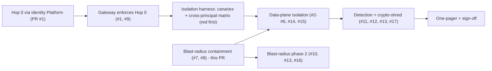

# Tenant Isolation Assurance ("Job Zero")

**Status**: Living document. Owners: Platform Security & Architecture
Maintainers. Updated with every isolation PR.

Absolute tenant isolation is the most critical requirement of the pooled
(Pattern A) architecture:

> No tenant can read, infer, modify, or poison another tenant's data, and no
> user can read another user's private data inside the same tenant. This holds
> on every path (request, memory, retrieval, tools, database, caches, logs,
> errors, and operator access), and it keeps holding when a single component is
> compromised.

This document turns that requirement into testable invariants, inventories every
surface tenants share, tracks the control and remaining gap for each, and
defines when we may claim "no data leakage".

## What "absolute" means here

| Pillar          | Meaning                                                                                                                      |
| :-------------- | :--------------------------------------------------------------------------------------------------------------------------- |
| **Prevention**  | Every known cross-tenant path is blocked by **at least two independent controls**, and both fail closed.                     |
| **Containment** | Any single compromised component, identity, or key exposes **at most one tenant** (target blast radius: zero other tenants). |
| **Detection**   | Every cross-tenant attempt is logged and alerted on.                                                                         |
| **Proof**       | An automated harness tries every read and write path as every other principal on every change, and fails CI on any leak.     |

Residual trust in Google-managed services (Cloud KMS, Identity Platform, Gemini)
is stated explicitly in [Residual trust](#residual-trust).

## Isolation invariants

| ID     | Invariant                                                               | Example violation                                                              |
| :----- | :---------------------------------------------------------------------- | :----------------------------------------------------------------------------- |
| **I1** | No cross-tenant **read** on any path                                    | RetailStream's agent retrieves FinVault's memory, runbook, ticket, or row      |
| **I2** | No cross-tenant **write or poisoning**                                  | Tenant B's content lands in Tenant A's memory, RAG index, or the shared prefix |
| **I3** | No intra-tenant cross-user read of **user- or session-scoped** data     | Charlie reads Alice's private memory or uses Alice's 3LO token                 |
| **I4** | No leakage via **side channels**                                        | A foreign tenant's IDs appear in errors, telemetry, caches, or traces          |
| **I5** | **Tenant identity is unforgeable end to end**                           | Tenant or role taken from the request body, a header, or a stale context       |
| **I6** | **Blast radius ≤ 1 tenant** per compromised key, identity, or component | One runtime identity can decrypt every tenant                                  |
| **I7** | **Detectable and reversible**                                           | No audit trail of key use; no way to crypto-shred a tenant                     |

## Design principles

1.  **Two independent controls per path.** Pair a logical control (key prefix,
    RLS, filter) with a cryptographic or IAM control (tenant-bound AAD,
    per-tenant key, per-tenant identity).
1.  **Tenant-qualify every identifier.** Session IDs, memory keys, cache keys,
    and IdP subjects are always `(tenant_id, sub)`, never `sub` alone.
1.  **Fail closed.** A missing tenant, role, AAD, or database GUC means deny,
    never a default.
1.  **Least privilege per tenant at runtime.** After Hop 1, downstream calls use
    tenant-scoped credentials.
1.  **No foreign identifiers in responses.** Errors say _that_ access was
    denied, not _whose_ resource it was.
1.  **Prove with canaries.** Unique per-tenant markers are planted everywhere. A
    foreign marker in any output, log, or span fails the build.

## Shared-surface inventory

Legend: ✅ adequate · ⚠️ partial · ❌ gap. Severity: **P0** (must close before
claiming isolation), P1, P2.

| #   | Shared surface                                               | Current control                                                                                                                                                                                                                                                                                                                                                                                                                                                                                                                                                                                                                                                                                                                                                                                                                                                | Remaining gap                                                                                                                                                                                                                                                                     | Inv.       | Sev   | Closed by                                                                        |
| :-- | :----------------------------------------------------------- | :------------------------------------------------------------------------------------------------------------------------------------------------------------------------------------------------------------------------------------------------------------------------------------------------------------------------------------------------------------------------------------------------------------------------------------------------------------------------------------------------------------------------------------------------------------------------------------------------------------------------------------------------------------------------------------------------------------------------------------------------------------------------------------------------------------------------------------------------------------- | :-------------------------------------------------------------------------------------------------------------------------------------------------------------------------------------------------------------------------------------------------------------------------------- | :--------- | :---- | :------------------------------------------------------------------------------- |
| 1   | Gateway identity                                             | ✅ **Identity only from a DPoP-bound gateway token issued after Hop 0 (RFC 9449); body/query identity rejected; `REDIS_URL` wires `SharedReplayStore` (`app/gateway_tokens.py`) and atomic Lua `RedisBulkheadStore` (`agents/auth/vault_and_bulkhead.py`, fail-closed `HTTP 503` on Redis outage)**                                                                                                                                                                                                                                                                                                                                                                                                                                                                                                                                                            | Hosted sandbox runs live (`enable_live_mode = true`, single-instance until shared signing key + Redis AUTH/TLS); per-user daily budget open                                                                                                                                       | I5, I1     | ✅    | PR #14, #15, #17, Gap 2                                                          |
| 2   | ADK sessions                                                 | ✅ **Tenant-qualified `user_id = "{tenant_id}:{sub}"` (`tenant_qualified_user_id` rejects `:` in `tenant_id`)**                                                                                                                                                                                                                                                                                                                                                                                                                                                                                                                                                                                                                                                                                                                                                | —                                                                                                                                                                                                                                                                                 | I1, I3     | ✅    | PR #7                                                                            |
| 3   | Memory Bank (tenant scope)                                   | ✅ **Per-record data key wrapped by the tenant's KMS key as the tenant SA; AAD = `v2\|tenant\|user\|scope\|key`**                                                                                                                                                                                                                                                                                                                                                                                                                                                                                                                                                                                                                                                                                                                                              | —                                                                                                                                                                                                                                                                                 | I1, I6     | ✅    | This PR                                                                          |
| 4   | Memory Bank (user scope)                                     | ✅ **User-partitioned keys; caller's user in AAD**                                                                                                                                                                                                                                                                                                                                                                                                                                                                                                                                                                                                                                                                                                                                                                                                             | —                                                                                                                                                                                                                                                                                 | I3         | ✅    | This PR                                                                          |
| 5   | Memory writes                                                | ✅ **GLOBAL needs an operator + different approver and the reviewed content hash; serving identity is decrypt-only on the platform key (Terraform); TENANT/STRATEGY need `memory:tenant.write` (granted only to `sre_admin`)**                                                                                                                                                                                                                                                                                                                                                                                                                                                                                                                                                                                                                                 | The enforcing IAM control (runtime decrypt-only on the platform key) is live since 2026-11-04 and codified in Terraform since 2026-11-06. Tenant-name filter is best effort                                                                                                       | I2         | ⚠️ P1 | This PR / Terraform apply (#73)                                                  |
| 6   | RAG / context packing                                        | ✅ **Tenant + user candidate filter; every read path screens each string leaf; flagged records quarantined in the store**                                                                                                                                                                                                                                                                                                                                                                                                                                                                                                                                                                                                                                                                                                                                      | Pattern screen only; semantic (Model Armor) screening of chunks in live mode                                                                                                                                                                                                      | I2, I3     | P2    | This PR / Detection PR                                                           |
| 7   | Shared runtime identity                                      | ✅ **Per-tenant service accounts (`ct-*`) with zero project-wide KMS/Secret/Storage roles ([ADR-0010](adr/0010-tenant-blast-radius-containment.md)); credential broker `cymbal-credential-broker` is the sole holder of `TokenCreator` on `ct-*` (B4, 2026-11-04); gateway `cymbal-pooled-gateway` is split from per-agent Cloud Run runtimes (`cymbal-agent-shared`, `cymbal-agent-finvault-alpha` with Cloud Run Agent Identity SPIFFE principals, B5 + [ADR-0016](adr/0016-three-layer-authz-tenant-user-agent.md), 2026-11-09): only the gateway holds `roles/cloudkms.signerVerifier` on `ws2-context-signing` (and has zero `run.invoker` on the broker), while agent runtimes hold only `publicKeyViewer` and `run.invoker` on the broker (`Tenant ∩ User ∩ Agent` enforced via `BROKER_REQUIRE_AGENT_BINDING=1`, `CONTEXT_TOKEN_REQUIRE_AGENT_ID=1`)** | A compromised agent runtime cannot sign context tokens and can only mint credentials for active turns addressed to its bound `agent_id`. Firestore and BigQuery still use the shared identity for writes when live mode is enabled (see #13, #14)                                 | I6         | P1    | PR #2, PR #3, PR #7, B4 (#49, #53, #56), B5 & ADR-0016 (#72, #75, #76, #77, #78) |
| 8   | Pooled runbook bucket                                        | ✅ **No single-tenant default key; per-tenant managed-folder IAM**                                                                                                                                                                                                                                                                                                                                                                                                                                                                                                                                                                                                                                                                                                                                                                                             | Seeding must set per-object `kmsKeyName`                                                                                                                                                                                                                                          | I1, I6     | ✅    | PR #2                                                                            |
| 9   | Request tenant context                                       | ✅ **Context var cleared after every request (`require_caller`)**                                                                                                                                                                                                                                                                                                                                                                                                                                                                                                                                                                                                                                                                                                                                                                                              | —                                                                                                                                                                                                                                                                                 | I5         | ✅    | PR #15                                                                           |
| 9b  | Sub-agent & MCP wire OBO state                               | ✅ **ES256 context token signed by a non-exportable Cloud KMS key (ADR-0014 B2, deployed 2026-11-04); the interceptor, sub-agent hops and MCP JSON-RPC wire (`-32001`) verify with public keys only; `DEFAULT_PEP_SIGNING_SECRET` removed**                                                                                                                                                                                                                                                                                                                                                                                                                                                                                                                                                                                                                    | Delegation depth is bound with a per-process HMAC tag (in-process only); a separately deployed MCP will not check it                                                                                                                                                              | I5, I1     | ✅    | PR #7, PR #6; ADR-0014 B2                                                        |
| 10  | Postgres RLS                                                 | ✅ **`ENABLE` + `FORCE`, transaction-local `SELECT set_config('app.current_tenant_id', $1, true)`, fail-closed predicate; Zonal 2-vCPU AlloyDB PostgreSQL 18 (`cymbal-pooled-rls-primary-prod`) provisioned with `alloydb.iam_authentication = on`, per-tenant `ct-*` `ALLOYDB_IAM_USER` logins (`ALLOYDB_TENANT_IAM_AUTH=1`), and verified live under `cymbal_mcp_app` (`NOSUPERUSER NOBYPASSRLS`, `test_live_alloydb_rls.py`)**                                                                                                                                                                                                                                                                                                                                                                                                                              | Live on hosted sandbox (`enable_live_mode = true`, `2026-11-17`)                                                                                                                                                                                                                  | I1         | ✅    | PR #90 / v0.2.0                                                                  |
| 10b | Connector secrets source                                     | ✅ Secret Manager only in live mode; rotation verified and mandatory ([secrets_management.md](secrets_management.md))                                                                                                                                                                                                                                                                                                                                                                                                                                                                                                                                                                                                                                                                                                                                          | —                                                                                                                                                                                                                                                                                 | I5, I7     | ✅    | PR #3                                                                            |
| 11  | 3LO token vault                                              | ✅ **Per `(tenant, user)` confused-deputy check; denials name no owner**                                                                                                                                                                                                                                                                                                                                                                                                                                                                                                                                                                                                                                                                                                                                                                                       | —                                                                                                                                                                                                                                                                                 | I4         | ✅    | This PR                                                                          |
| 12  | Shared prompt prefix cache                                   | Read-only; writes rejected                                                                                                                                                                                                                                                                                                                                                                                                                                                                                                                                                                                                                                                                                                                                                                                                                                     | No check that the prefix holds zero tenant data                                                                                                                                                                                                                                   | I2, I4     | P1    | Detection PR                                                                     |
| 13  | Telemetry / BigQuery                                         | No prompts in spans; `bigquery.admin` removed from runtime SA; native Terraform `google_bigquery_row_access_policy.tenant` + read-only `verify_row_access_policies()` verified live                                                                                                                                                                                                                                                                                                                                                                                                                                                                                                                                                                                                                                                                            | Shared identity retains dataset-scoped `bigquery.dataEditor` for span writes + operator RAP view; no Data Access audit logs yet                                                                                                                                                   | I6, I7     | P1    | Blast-radius phase 2 / Detection PR                                              |
| 14  | Firestore memory (live)                                      | ✅ **Same v2 crypto; documents hold ciphertext + wrapped key only (closes F1 at the data layer)**                                                                                                                                                                                                                                                                                                                                                                                                                                                                                                                                                                                                                                                                                                                                                              | Shared identity still has `datastore.user` (ciphertext only)                                                                                                                                                                                                                      | I1, I6     | P2    | This PR                                                                          |
| 15  | Memory IAM CEL condition                                     | ✅ **Live in Terraform & runtime:** `google_project_iam_member.tenant_memory_bank_user` (`terraform/modules/tenant/main.tf`) grants `roles/aiplatform.memoryUser` to each tenant's `ct-*` SA conditioned on `api.getAttribute('aiplatform.googleapis.com/memoryScope', {})['tenant_id'] == '${var.tenant_id}'`, paired with `LiveVertexMemoryBankAdapter` (`agents/adapters/storage_and_telemetry.py`) and `MemoryBankIAMCELGuard` (`agents/memory_bank_iam_and_residency.py`)                                                                                                                                                                                                                                                                                                                                                                                 | Cross-tenant `memories.retrieve` denied at GCP IAM (`403 PERMISSION_DENIED`, verified live in `test_live_gcp_integration.py`)                                                                                                                                                     | I1, I6     | ✅    | PR #89 / v0.2.0                                                                  |
| 16  | Dynamic tenants' keys                                        | Key name computed in code                                                                                                                                                                                                                                                                                                                                                                                                                                                                                                                                                                                                                                                                                                                                                                                                                                      | Terraform provisions only the anchor keys                                                                                                                                                                                                                                         | I6         | P1    | Blast-radius phase 2                                                             |
| 17  | Crypto-shred / offboarding                                   | ⚠️ Per-tenant keys exist; `offboard_tenant` (`agents/context.py`) clears the tenant from the directory, evicts every per-tenant cache (DEK, SA token, KMS verify, 3LO, `TokenBucketBulkhead` + `RedisBulkheadStore` keys, model-routing PDP, and active/paused Gemini session sandboxes), and records revocation in `FirestoreRevocationStore` (`FIRESTORE_REVOCATION_STORE=1`)                                                                                                                                                                                                                                                                                                                                                                                                                                                                                | KMS key disable is not automated; offboarding runbook execution pending                                                                                                                                                                                                           | I7         | P1    | PR #90 / Detection PR                                                            |
| 18  | Network perimeter                                            | Cloud Run (`cymbal-pooled-gateway`) behind built-in IAP + Cloud KMS `ctx+jwt` signing (ingress) and ADK runtime interceptors (`agents/interceptors.py`) (egress) form the primary deployed perimeter; Apigee X/Hybrid and agent gateway in Gemini / CLB `ext_proc` Service Extensions are documented as optional enterprise perimeter upgrades                                                                                                                                                                                                                                                                                                                                                                                                                                                                                                                 | Cloud Armor (`enable_edge_waf = false`) and VPC Service Controls around KMS, Storage, BigQuery, Firestore not yet enabled in sandbox                                                                                                                                              | I6         | P2    | Terraform apply (#73) / Later                                                    |
| 19  | Model/runtime                                                | Per-request agent build, tool pruning                                                                                                                                                                                                                                                                                                                                                                                                                                                                                                                                                                                                                                                                                                                                                                                                                          | —                                                                                                                                                                                                                                                                                 | —          | ✅    | —                                                                                |
| 20  | Header spoofing, catalog, tool entitlement, DLP, Model Armor | 10/10 breach vectors                                                                                                                                                                                                                                                                                                                                                                                                                                                                                                                                                                                                                                                                                                                                                                                                                                           | —                                                                                                                                                                                                                                                                                 | —          | ✅    | —                                                                                |
| 21  | Ephemeral agent sandboxes                                    | ✅ **Live in `cymbal-multitenancy-example`** (previously N/A (code execution not in scope at `freeze-f1`) before ADR-0012 / PR-S2): `GeminiAgentSandboxManager` (`agents/sandbox_execution.py`) + `LiveGeminiAgentSandboxClient` (`agents/gcp_live_bridge.py`) + GKE `gVisor` manifest (`terraform/examples/gke_sandbox_warm_pool.yaml`) enforce one-way `Claim-and-Taint` (`STATE_UNCLAIMED -> STATE_RUNNING -> STATE_PAUSED -> STATE_DESTROYED`), synchronous policy checks before lookup, zero `ct-*`/bearer credential or `169.254.169.254` injection, per-tenant bulkheads (`Standard: 5`, `Enterprise: 20`), and immediate `offboard_tenant` destruction                                                                                                                                                                                                 | Live `AGENT_SANDBOX_REASONING_ENGINE_NAME` (`1000000000000000003`, `4.19.0-gvisor`) + `AGENT_SANDBOX_SHELL_TEMPLATE` (`1000000000000000004`) wired on gateway and per-agent runtimes (`2026-11-17`); optional GKE `SandboxWarmPool` blueprint available for self-managed clusters | I1, I5, I6 | ✅    | ADR-0012 / PR-S2 / v0.2.0                                                        |

## Roadmap

1.  **Gateway enforces Hop 0.** `Authorization: Bearer` + `DPoP` on
    caller-facing endpoints; body identity that conflicts with the token is
    rejected; the tenant contextvar is reset per request.
1.  **Blast-radius containment (this PR).** Per-tenant service accounts,
    tenant-scoped credentials, resource-level IAM, and no project-wide data
    roles on the shared identity.
1.  **Isolation harness.** Tenants A/B/C × users (admin, analyst) write canaries
    to every store. Every other principal tries every read path. Foreign
    canaries are scanned in responses, errors, spans, logs, and packed prompts.
    Poisoning, session-collision, and stale-context probes are included. Known
    gaps start as strict `xfail` and flip to green as fixes land.
1.  **Data-plane isolation.**
    - Tenant-qualified session IDs.
    - Per-record random data keys wrapped by the tenant's KMS key (using the
      tenant credential from this PR).
    - User-bound keys and AAD for USER/SESSION memory.
    - A write-poisoning guard.
    - RAG user filtering and quarantine.
    - The CEL typo fix.
1.  **Blast-radius phase 2.**
    - Pin the database login to `cymbal_mcp_app`.
    - Move the all-tenant BigQuery view to a break-glass identity.
    - Narrow BigQuery to dataset-level roles.
    - Provision keys per onboarded tenant.
1.  **Detection and crypto-shred.**
    - Cloud KMS, Secret Manager, and Storage Data Access audit logs, plus
      cross-tenant anomaly alerts.
    - Generic external error messages.
    - A prefix-cache content guard.
    - Key-compromise and tenant-offboarding runbooks.
1.  **One-pager and sign-off.** Built from this table and the harness results.

## Definition of done: when we may say "no data leakage"

- [ ] All **P0** rows closed, each backed by ≥2 independent controls and a
      harness test.
- [ ] The harness finds **0 foreign canaries** across all stores and paths for
      ≥3 tenants × 2 users × 3 IdPs, and runs in CI on every PR.
- [ ] A single compromised runtime identity or key is shown to reach **only one
      tenant**. _Shown for KMS keys, secrets, and runbook objects by this PR;
      B5 + ADR-0016 (live 2026-11-09) removes KMS context-token signing from
      agent runtimes so a compromised agent runtime can only request credentials
      for active turns addressed to its bound `agent_id`._
- [ ] Key, secret, and storage access is audited, with alerts for cross-tenant
      anomalies.
- [ ] The crypto-shred / offboarding runbook has been executed once in the
      sandbox project.
- [ ] The residual-trust statement below has been reviewed.
- [ ] Independent review of the harness and one-pager (independent reviewer),
      plus an optional red-team pass.

> Until the P0 rows are closed, external material should say **"defense-in-depth
> tenant isolation with an isolation verification harness in progress"**, not
> "zero leakage guaranteed".

## Residual trust

- **Google Cloud control plane:** Cloud KMS key material is non-exportable, and
  IAM is enforced by Google. Identity Platform signs `firebase.tenant`
  correctly.
- **Model provider:** Gemini on Google Cloud does not use customer prompts or
  outputs for training, and models hold no cross-request state.
- **Operators:** break-glass access exists by design and must be audited
  (Detection PR).
